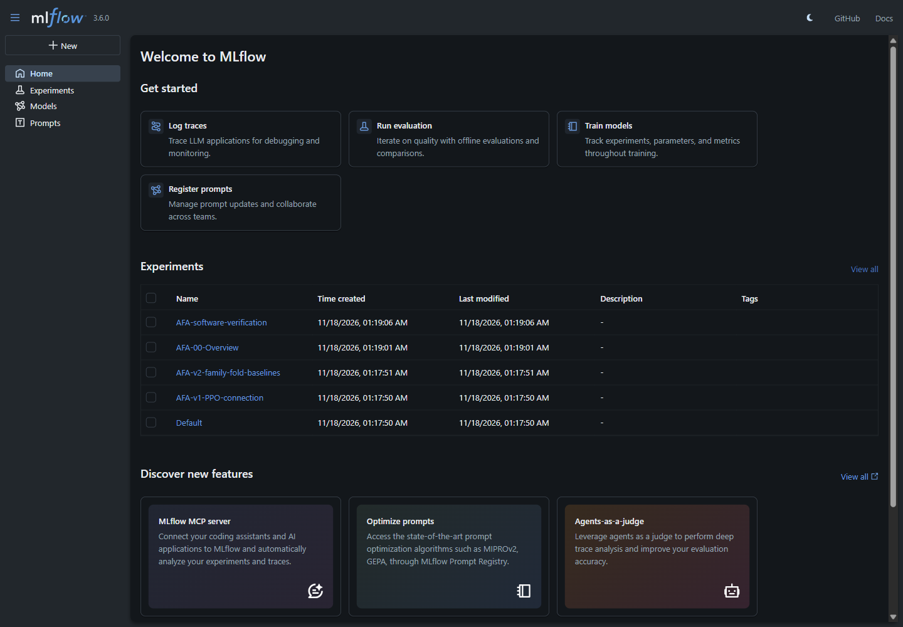
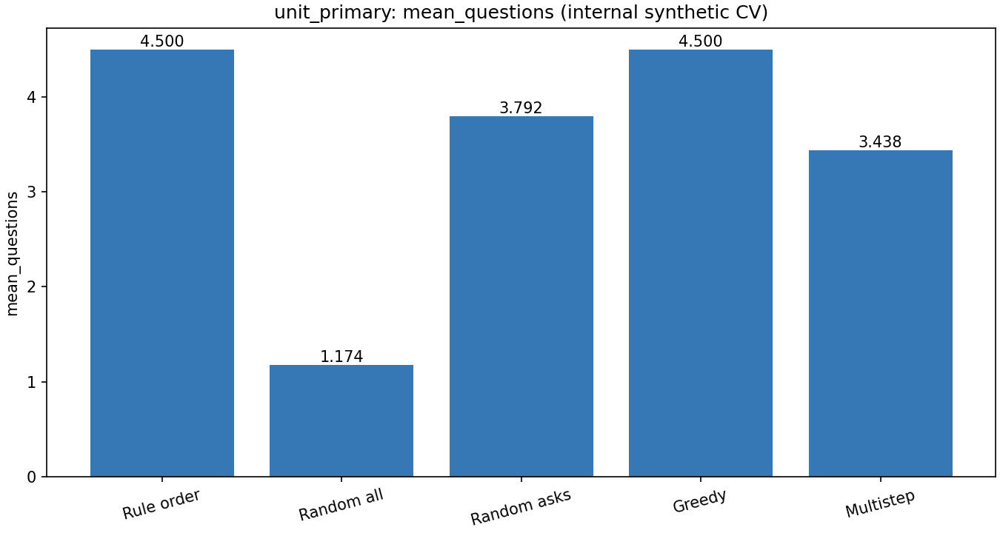
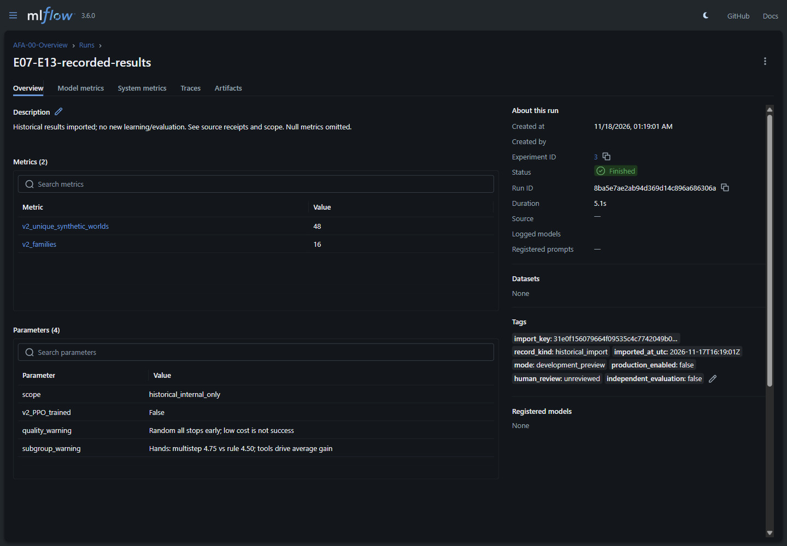

# AFA 실험 대시보드 — 처음 사용하는 사람을 위한 MLflow 안내

이 대시보드는 제한된 AFA 질문 실험을 기록한다. 전체 에이전트의 역할 구분은 [목표 구조](agent-runtime-target.md)를 참고한다.

이 문서는 **화면을 어디서 열고 → 무엇을 클릭하고 → 숫자에서 무엇을 판단하는지**를 순서대로 설명합니다. 처음에는 1~5절만 따라가세요. 설치·검사·기록 코드 설명은 맨 뒤에 있습니다.

## 1. 먼저 이해하기: MLflow에서 모델이 돌아가는가?

현재 프로젝트에서 **학습·테스트는 Python 프로그램이 실행하고, MLflow는 실행 조건과 결과를 기록해서 보여줍니다.** 브라우저를 열었다고 학습이 시작되지는 않습니다.

```text
Python에서 학습·평가 실행 → 설정·점수·파일 기록 → MLflow에서 확인·비교
```

MLflow 자체는 기존 프로그램입니다. 우리가 추가한 것은 AFA 결과를 등록하는 코드와 요약 그래프입니다. E17의 기록은 이미 끝난 실험에서 가져왔습니다. E20에는 새로 수행한 전체 v67 EDA도 `AFA-v67-EDA`에 기록했습니다. [EDA를 배우며 화면을 읽는 보고서](afa-v67-eda.md)를 함께 보세요. 데이터 분석과 정책 성능 실험은 구분합니다. 향후 v2 PPO의 실시간 기록은 학습기 구현 때 연결해야 합니다.

| 화면의 용어 | 쉬운 뜻 | 이 프로젝트의 예 |
| --- | --- | --- |
| Experiment | 같은 목적의 실행을 모아 둔 폴더 | v2 질문 방식 비교 폴더 |
| Run | 조건과 결과를 담은 기록 한 건 | 단위 비용으로 기존 순서를 평가한 기록 |
| Parameters | 실행할 때 정한 조건 | 정책 이름·비용표·seed |
| Metrics | 측정한 숫자 | 평균 질문 수·올바른 종료율 |
| Artifacts | 실행과 연결된 파일 | 그래프·원본 JSON·학습 CSV |
| Tags | 기록을 구분하는 설명표 | `historical_import`=과거 결과 가져오기 |
| Step | 곡선의 가로축에 쓰는 진행 번호 | PPO가 환경에서 행동한 누적 횟수 |

**Run 하나가 사용자 한 명을 뜻하지 않습니다.** v2의 한 기록에는 합성 48개 상황을 seed 3개로 반복한 144개 episode가 집계됩니다. Episode는 상황 하나를 시작해서 종료할 때까지의 실행입니다.

## 2. 처음 접속했을 때: 어디로 들어가나?

1. 이 PC 브라우저에서 [MLflow 열기](http://127.0.0.1:5000/)를 클릭합니다.
2. `Experiments` 목록을 찾습니다. 홈에서 보이지 않으면 왼쪽 메뉴의 `Experiments`를 누릅니다.
3. 처음에는 **`AFA-00-Overview`**를 선택합니다.
4. 실행 이름 **`E07-E13-recorded-results`**를 누릅니다.
5. 실행 상세 화면 위쪽에서 **`Artifacts` → `charts`**를 엽니다.
6. **`unit_primary-mean_questions.png`**를 선택하면 질문 수 그래프를 볼 수 있습니다.



*실제 로컬 MLflow 3.6.0 화면입니다. 실험 이름으로 찾으세요. 시간 표시·정렬·숫자 ID는 다른 PC에서 달라질 수 있습니다.*

화면이 좁으면 브라우저를 최대화하세요. `charts` 옆 작은 삼각형으로 폴더를 펼칩니다. 오른쪽이 `Select a file to preview`라면 오류가 아니라 **아직 파일을 선택하지 않은 상태**입니다. PNG 파일 이름을 클릭하세요.

처음에 보이는 `Models`, `Prompts`, `Traces`는 지금 과제에서 사용할 필요가 없습니다. `Default`도 MLflow의 기본 폴더이므로 AFA 실험 이름을 선택하면 됩니다.

## 3. 첫 그래프 읽기: “질문이 적다”만 보면 안 된다



*위 그림은 MLflow 창 캡처가 아니라, 실제 등록된 그래프 원본입니다. 가로축은 질문 선택 방식, 세로축은 평균 질문 수입니다.*

| 그래프의 이름 | 하는 일 | 평균 질문 수 |
| --- | --- | ---: |
| Rule order | 기존 코드 순서대로 질문 | 4.5000 |
| Random all | 질문과 보류 등을 무작위로 선택 | 1.1736 |
| Random asks | 질문 순서만 무작위, 종료 조건 유지 | 3.7917 |
| Greedy | 다음 질문 하나의 효과를 계산 | 4.5000 |
| Multistep | 이후 질문까지 고려해 기대 비용 계산 | 3.4375 |

`Random all`이 가장 좋아 보일 수 있습니다. 하지만 대부분 너무 일찍 보류합니다. **다음으로 `unit_primary-correct_terminal_rate.png`를 열어야 합니다.**

올바른 종료율은 기존 순서·질문 무작위·Greedy·Multistep에서 1.0(100%)이고, Random all은 약 0.0556(5.56%)입니다. 따라서 Random all의 낮은 질문 수를 개선이라고 말하면 안 됩니다.

이 화면에서 할 수 있는 해석은 **“같은 종료 기준을 충족하는 방식 중 Multistep이 기존 순서보다 전체 평균 질문을 줄였다”**입니다. 이 수치는 PPO의 결과가 아닙니다. 실제 사용자 평가나 임상 정확도도 아닙니다.

### 세 번째로 열 그래프: `unit_primary-subgroups.png`

`hands`는 손세안, `tools`는 도구 사용 상황입니다. 전체 평균만 보고 놓치는 문제를 찾는 화면입니다.

| 상황 | 기존 순서 | Multistep | 해석 |
| --- | ---: | ---: | --- |
| 손세안 12개 | 4.50 | 4.75 | 오히려 질문이 0.25회 증가 |
| 도구 사용 36개 | 4.50 | 3.00 | 질문이 1.50회 감소 |

그래서 **“모든 유형에서 좋아졌다”는 결론은 틀립니다.** 12:36은 합성 조합 수이며 실제 사용자의 구성 비율이 아닙니다.

`unit_primary`는 질문 비용을 모두 1로 둔 실험입니다. `weighted_sensitivity`는 일부 질문 비용을 다르게 둔 실험입니다. 질문 수와 가중 비용은 다른 숫자이므로 같은 비용 조건끼리 비교하세요.

## 4. 실험 설정과 원본까지 확인하기



`Artifacts` 옆 **`Overview`**로 돌아오면 해당 기록의 조건과 숫자를 볼 수 있습니다.

- **Metrics:** 실제 측정값입니다. 요약 실행에는 상황 수 48·가족 수 16이 보입니다. 정책별 성능은 v2 비교 실험 안에 있습니다.
- **Parameters:** 어떤 조건의 결과인지 확인합니다. `v2_PPO_trained=False`는 v2 PPO를 아직 학습하지 않았다는 뜻입니다.
- **Description / Tags:** 기록의 성격을 읽습니다. `historical_import`는 과거 결과를 가져왔다는 뜻입니다.
- **Finished:** 기록 작업이 끝났다는 상태입니다. 성능 합격·전문가 승인이라는 뜻이 아닙니다.

원본을 보려면 `Artifacts`에서 `sources`를 엽니다. `comparison.json`은 정책 비교의 원본, `subgroup-diagnostics.json`은 손세안/도구별 원본입니다. `source-receipts.json`에는 어떤 파일을 가져왔는지 경로와 SHA-256이 있습니다. SHA-256은 **파일 내용이 달라졌는지 확인하는 지문**이며 품질 인증은 아닙니다.

### 정책 두 개를 직접 비교하고 싶다면

1. `Experiments`로 돌아가 `AFA-v2-family-fold-baselines`를 엽니다.
2. Run 이름에서 `unit_primary--existing_rule_order`와 `unit_primary--joint_train_multistep`를 찾습니다.
3. 두 행의 왼쪽 체크박스를 선택합니다. 선택 후 나타나는 `Compare` 또는 비교 화면을 엽니다. 창 크기에 따라 비교 동작이 도구 모음이나 추가 메뉴에 있을 수 있습니다.
4. 먼저 `cost_protocol`이 둘 다 `unit_primary`인지 확인합니다.
5. `correct_terminal_rate`가 둘 다 1인지 본 뒤 `mean_questions` 4.50과 3.4375를 비교합니다.
6. `hands/mean_questions`도 확인합니다. 4.50과 4.75라는 반례를 함께 읽어야 합니다.

비교 버튼을 찾기 어렵다면 각 Run의 Overview → Metrics에서 같은 항목을 차례로 확인해도 됩니다. `Columns`가 있으면 표시할 지표를 선택할 수 있습니다. 기록을 보기 위해 `New run`, 삭제, 상태 변경을 누를 필요는 없습니다.

## 5. PPO가 학습됐는지 확인하는 순서

1. `AFA-v1-PPO-connection`을 엽니다. **v1은 초기 단일 카드 환경**, 현재 v2는 두 카드를 함께 보는 환경입니다.
2. `before-256step-train-only`는 학습 전, `after-256step-train-only`는 256회 행동을 수집하며 학습한 뒤의 기록입니다.
3. 각 Overview에서 `correct_terminal_rate`, `mean_questions`, `mean_return`을 봅니다.

| 지표 | 학습 전 | 학습 후 | 뜻 |
| --- | ---: | ---: | --- |
| 올바른 종료율 | 1/6 | 6/6 | 성급히 끝내던 문제가 줄어듦 |
| 평균 질문 수 | 1.167 | 2.500 | 필요한 질문을 하므로 증가할 수 있음 |
| 평균 return | -5.333 | -2.500 | 잘못 끝내는 손실이 줄어 덜 음수가 됨 |

질문 수가 늘어도 올바른 종료율이 개선됐다면 이 경우에는 좋은 변화입니다. 다만 학습과 확인에 같은 6개 상황을 썼고 기존 강한 기준선도 2.50회였습니다. **PPO가 기존 방식보다 우수하거나 새로운 상황에 일반화한다고 결론내릴 수는 없습니다.**

### 학습 곡선은 어디에서 보나?

after Run을 열고 **`Model metrics`** 탭 또는 Overview의 지표 이름을 선택합니다. `rollout/ep_rew_mean`을 찾아 곡선을 확인하세요. 시간 축 선택이 있으면 Step을 사용합니다. 기록된 가로축은 32, 64, …, 256의 8개 시점입니다.

| 이름 | 무엇을 보는가? | 초보자가 주의할 점 |
| --- | --- | --- |
| `rollout/ep_rew_mean` | 학습 중 모은 대화들의 평균 보상 | 대체로 높은 방향이 좋지만, 별도 평가 성능은 아님 |
| `rollout/ep_len_mean` | 한 실행의 평균 행동 수 | 질문뿐 아니라 종료 행동도 포함하므로 질문 수와 다름 |
| `train/value_loss` | 앞으로의 점수를 예측하는 계산부의 오차 | 임상 오류율·최종 정책 정확도가 아님 |
| `train/approx_kl` | 업데이트 전후 행동 확률이 바뀐 정도 | 작을수록 무조건 좋은 것은 아님. 학습 정체와 함께 해석 |
| `train/entropy_loss` | 행동 선택 확률의 다양성과 관련된 내부 값 | 음수 부호만 보고 성능 악화라고 판단하지 않음 |
| `train/n_updates` | 로그에 기록된 업데이트 카운터 | 최종 optimizer 횟수와 혼동하지 않음 |

처음에는 **보상 곡선 → 학습 전후 종료율 → 질문 비용 → 유형별 결과** 순서로 보세요. 손실 그래프만으로 성공을 판단하지 않습니다. 첫 CSV 행에는 아직 기록되지 않은 학습 내부 지표가 있어 일부 곡선이 64부터 시작할 수 있습니다. 누락값을 0으로 채운 것은 아닙니다.

현재 학습 중인 Run은 없으므로 계속 새로고침해도 곡선이 늘어나지 않습니다. 앞으로 실제 학습 코드에서 지표를 보내면 그 Run에 진행 값이 쌓입니다. 기존 기록이 자동으로 새 학습에 이어 붙는 것은 아닙니다.

## 6. 숫자 사전: 어떤 방향이 좋은가?

| 항목 | 쉬운 뜻 | 해석 |
| --- | --- | --- |
| `mean_questions` | 평균 질문 횟수 | 종료 품질이 같을 때 낮을수록 좋음 |
| `mean_cost` | 질문마다 지정한 비용의 평균 합계 | 같은 비용표끼리 비교. 실제 금액이 아님 |
| `correct_terminal_rate` | 전체 실행 중 판단 의미·종료 조건을 충족한 비율 | 높을수록 좋음. 1=100% |
| `semantic_match_rate` | 전체 실행 중 판단 의미가 참조와 일치한 비율 | 종료 시점도 적절한지는 별도로 확인 |
| `wrong_hold_rate` | 잘못 보류한 수 ÷ 전체 실행 수 | 낮을수록 좋음. 보류 사례만 분모로 삼지 않음 |
| `error_among_drafts` | 잘못된 초안 수 ÷ 초안 종료 수 | 낮을수록 좋음. 초안이 없으면 값 없음 |
| `policy_fallbacks` | 자체 선택 대신 기존 규칙에 맡긴 횟수 | 독립 사용자 수가 아님. 복구 의존성을 확인 |
| `seed` | 무작위 동작의 시작값 | 사용자 번호도 정확도도 아님 |

빈 칸은 측정·정의된 값이 없다는 뜻일 수 있습니다. 0점이나 0%라고 읽지 마세요. 상세 분모와 실제 실험 조건은 [누적 진행 문서](afa-policy-progress.md)를 확인하세요.

## 7. 소프트웨어 검사는 따로 보기

`AFA-software-verification`에는 E16의 `tests_passed=456`, E17의 `tests_passed=463`이 있습니다. 여기서 확인하는 것은 코드의 동작·저장·검증·회귀 문제입니다. 7개 늘어난 것은 MLflow 관련 검사가 추가됐기 때문입니다.

**463개 통과 ≠ 모델 정확도 100% ≠ KB 임상 검증 완료.** 저장소 원본 엄격 검사에는 알려진 5개 불일치가 별도로 남아 있습니다. 이 대시보드의 실험 검사 통과 수로 그 실패가 해결됐다고 읽으면 안 됩니다.

## 8. 자주 막히는 상황

| 증상·질문 | 확인할 것 |
| --- | --- |
| 주소가 열리지 않는다 | 브라우저와 별개로 Python 서버가 켜져 있어야 함. 뒤의 serve 명령 실행. 이미 5000을 사용 중이면 새 서버를 중복 시작하지 말고 기존 화면 확인 |
| 브라우저를 닫으면 결과도 지워지나? | 아님. DB·파일은 디스크에 남음. 브라우저 종료와 서버 종료는 별개 |
| 작업관리자에 MLflow가 없다 | 현재 방식은 `python.exe`로 실행됨. 세부 정보의 명령줄에서 mlflow 확인. PID는 재시작하면 달라짐 |
| `Finished`인데 모델이 실행되지 않는다 | 기록 작업 완료라는 뜻. 현재 기록은 과거 결과를 가져온 것임 |
| 목록이 비어 있다 | 다른 Experiment나 날짜/상태 필터인지 확인. 설치 직후라면 원본을 준비한 뒤 import-history가 필요 |
| 그래프가 잘리거나 파일이 안 보인다 | 창을 최대화하고 charts 폴더를 펼친 뒤 파일 클릭. 이미지 미리보기를 눌러 확대하거나 파일 다운로드 |
| 비교 결과가 이상하다 | 비용표·자료 범위·평가 방식이 같은지 먼저 확인. v1과 v2 return을 직접 우열 비교하지 않음 |
| MLflow를 켜면 EDA·학습도 시작되나? | 아님. 해당 Python 실행 코드가 별도로 필요 |
| 다른 팀원 PC에서 localhost 링크가 안 열린다 | localhost는 각자 자기 PC를 뜻함. 현재는 공용 서버 구성이 아님 |

## 9. 발표·검토할 때의 확인 순서

1. 어떤 환경·자료·비용 조건인지 말합니다.
2. 올바른 종료율과 평균 질문 비용을 함께 제시합니다.
3. 손세안처럼 악화된 부분군도 함께 보여줍니다.
4. 원본 보고서와 해시로 수치를 추적합니다.
5. 합성 내부 점검·같은 train 진단이라는 한계를 명시합니다.

이 문서의 창 캡처는 실제 로컬 화면입니다. 화면 배치는 MLflow 버전·창 크기에 따라 달라질 수 있고, 스크린샷 자체가 새로운 정책 평가나 독립 검증 결과는 아닙니다.

---

## 10. 설치·운영·개발자 참고

여기부터는 직접 서버를 다시 켜거나 기록 코드를 연결할 때 읽습니다. 위 사용 안내만 따라가는 독자는 아래 코드를 실행할 필요가 없습니다.

### 실행·종료 — 실험 폴더에서

작업 위치: `courses/ai-applications/experiments/cos-agent/`.

```powershell
# 기본 프로그램에는 tracking 패키지가 필요 없다.
uv sync --locked --group tracking

# 기존 결과 등록. 같은 원본·설정으로 다시 실행하면 완료 기록을 재사용한다.
uv run --locked --group tracking python -m beauty_agent.afa.tracking import-history

# 브라우저에서 http://127.0.0.1:5000 열기. 종료는 이 터미널에서 Ctrl+C.
uv run --locked --group tracking python -m beauty_agent.afa.tracking serve

# MLflow 선택 검사
uv run --locked --group tracking pytest -q tests/afa/tracking

# 모든 선택 의존성까지 설치한 전체 실험 검사
uv run --locked --group rl-train --group tracking pytest -q -o norecursedirs= tests
```

`import-history`는 로컬 `outputs/` 원본이 있어야 한다. 공유 저장소에는 원본 보고서가 없을 수 있으며, 이때 실패를 숨기거나 가짜 결과를 만들지 않는다. 보고서 또는 설정이 바뀌면 새 가져오기 기록을 만든다. 동시에 여러 가져오기를 실행하지 않는다. 원본 학습 당시의 pyproject/lock 해시는 과거 증빙이며 이번 선택 의존성 추가 후의 파일과 다를 수 있다. 예전 체크포인트 검사 우회나 과거 해시 덮어쓰기는 하지 않는다.

### 다음 PPO·EDA 작업에서 남길 기록

`beauty_agent/afa/tracking.py`의 `LocalTracker`를 사용한다. 실행 단위로 `start` → step별 `log` → `finish`를 호출한다. 오류 시 `finish(..., failed=True)`로 실패를 남긴다. `client.log_artifact`로 EDA 그래프·표·데이터 해시와 보고서를 연결한다. 기존 프로그램에 전역 autolog를 설치하지 않는다.

```python
from beauty_agent.afa.tracking import LocalTracker

tracker = LocalTracker()
run_id = tracker.start("AFA-v2-PPO", "실제-실행-이름", params={
    "seed": 0, "data_version": "실제 사용 버전", "source_commit": "실제 실행 커밋",
})
try:
    # 실제 학습/평가 코드에서 측정한 값만 기록한다.
    # tracker.log(run_id, measured_metrics, step=actual_step)
    pass
except BaseException:
    tracker.finish(run_id, failed=True)
    raise
else:
    tracker.finish(run_id)
```

위 코드는 호출 형태 설명이며 실행 예제가 아니다. **현재 v1 PPO나 미구현 v2 PPO에 실시간 기록이 자동 연결됐다는 뜻은 아니다.** 다음 학습기 구현 시 이 인터페이스를 연결하고 실제 수집을 검증한다. EDA·학습·소프트웨어 검사는 별도 실험 이름과 범위 태그로 구분한다. 학습 설정·데이터 버전·분할·seed·비용·코드 버전과 해시를 반드시 함께 남긴다.

로컬 서버는 `127.0.0.1`에만 바인딩한다. 상시 시작 서비스·외부 팀 공유 서버는 설치하지 않았다. DB만이 아니라 `outputs/afa-mlflow/` 전체를 함께 백업한다. DB를 다른 위치·다른 PC로 옮길 때는 로컬 artifact 절대 경로도 이관해야 한다.

참고: [MLflow Tracking](https://mlflow.org/docs/latest/ml/tracking/), [공식 Python API](https://mlflow.org/docs/latest/api_reference/python_api/mlflow.html). 현재 고정 버전은 3.6.0이며 프로젝트 Python 3.10 환경에서 설치·검증한다.


처음 읽는 독자를 위한 개념 근거: [MLflow 3.6.0 공식 안내](https://mlflow.org/docs/3.6.0/ml/tracking/).
