# AFA Policy — 누적 진행·실험·발표 증빙 기록

**최신 AFA 계약(E29)** — Python 런타임이 전체 요청과 도구를 제어한다. AFA는 허용된 질문을 고르거나 정보 획득을 끝내고 `AFAHandoffResult`를 반환한다. 이 결과는 확보한 값, 질문 순서, 미응답·거절을 담는다. 최종 추천·보류는 런타임이 판단한다. [목표 구조](agent-runtime-target.md) · [AFA 어댑터](../beauty_agent/afa/policy_adapter.py)

최초 정리: 2026-11-17 · 온보딩 설명 보완: E14 · 최신 질문 정책 및 PPO 비교: **E51** · 최신 로컬 검사: **E55 · 기본 503개 통과** · 이 작업 브랜치의 전체 소프트웨어 검사: **E52 · 599개 통과**

**E55 결과:** Myopic의 결정과 후보 점수에 PR #24의 v3 계약을 적용했다. 기존 PPO 변환 메서드를 유지했고, Myopic 반환 객체의 직접 검증과 v3 테스트를 포함해 기본 503개가 통과했다.

**E54 결과:** 기본 Myopic 경로에서 증상 확인도 다른 후속 질문과 함께 점수로 선택한다. 한국어 세안 예시에서 최근 한 번을 고르면 세안 질문을 이어가고 반복을 고르면 필수 보류한다. 기존 구조화 입력 176조건의 결과는 동일했다.

**E53 결과:** v3 AFA 불변식과 정형 버튼의 추적 계약을 점검했다. 동결 176조건에서 네 정책 모두 제품 질문·재질문·필수 보류 누락이 0건이었다. 실행기는 v0.6을 사용하며, v0.6.1 로더와 B-I01 사례 6 실행 연결은 미완료다.

**E52 결과:** 기본 Myopic CLI에서 후속 질문에 번호 선택지를 표시한다. 번호 응답만으로 이어간 합성 176조건에서 구조화 입력과 질문 순서·최종 사용자 응답이 모두 같았고, 총 질문 283회와 전체 입력 기준 사용자 응답 일치 171/176건을 유지했다.

**E51 결과:** 기존 78조건과 추가 합성 98조건에서 현재 Myopic, PPO 라우팅, 과거 Myopic, 고정 순서를 비교했다. 현재 Myopic은 고정 순서보다 질문을 45.9% 줄였고, 전체 입력 기준 사용자 응답 일치는 171/176건이었다. 추가 98조건에서는 현재 Myopic과 고정 순서의 사용자 응답이 모두 같았다.

**E50 결과:** 현재 worktree의 기본 대화형 CLI에 Myopic VOI를 연결했다. 합성 세안 대화에서 질문 3회 후 권고를 반환했고, CLI 기본 정책을 E49의 78개 구조화 조건에 적용하자 질문과 판정이 모두 같았다.

**E49 결과:** 1단계 AFA가 효과가 없는 질문을 제외하고, 여러 답을 함께 보는 확인은 Control Plane이 보류를 확정하기 전에 수행하도록 분리했다. E48의 78조건에서 질문 순서와 판정이 모두 같았고 기본 경로의 전체 입력 판정 일치 74/78건과 총 질문 140회를 유지했다.

**E48 결과:** Myopic 보류 직전에 최대 두 답의 KB 분기를 확인하도록 바꿨다. 동일한 78조건에서 평균 질문은 1.62회에서 1.79회로 늘었고 전체 입력 판정 일치는 67건에서 74건으로 늘었다. 세 답까지 확인한 실험은 평균 1.83회와 75건 일치였다.

**E47 결과:** E46의 동일한 합성 78조건에 기존 B-C02 PPO 라우팅을 추가했다. 전체에서 PPO 라우팅과 고정 순서는 평균 3.59회 및 최종 판정 78/78건 일치였다. PPO가 실제 질문을 선택한 11조건에서는 세 정책 모두 평균 2.00회와 전체 입력 판정 11/11건 일치였다.

**E46 결과:** KB 분기·복합 카드·v67 E22를 포함한 합성 78조건에서 평균 질문은 3.59회에서 1.62회로 줄었고 69건에서 최종 판정이 일치했다. 전체 합성 답을 처음 공개한 판정과의 일치는 고정 순서 76건, Myopic VOI 67건이었다.

**E45 결과:** 활성 세정·보습·자외선차단·영역 간 조정 카드에 적용하는 한 단계 질문 정책을 추가했다. 합성 8건에서 평균 질문은 3.375회에서 1.125회로 줄었고 최종 판정은 7건에서 일치했다. `B-I02`의 두 답변 의존 분기에서 새 정책은 보류했다.

**E44 결과:** 로컬 개발 CLI는 B-C02 세안 질문을 고를 때 PPO를 먼저 시도한다. 모델을 불러오지 못하거나 질문이 지원 범위 밖이면 규칙 기반으로 이어간다.

**E43 결과:** Kiwi 제품명 분할과 오프라인 후보를 정비했다. Jev는 빠진 항목만 묶어서 확인하며, 로컬 CLI는 사용자가 분명히 밝힌 증상 항목의 재질문을 줄인다.

**E42 결과:** 선택형 화면의 번호를 최대 4개로 줄였다. 증상의 대상·발생 여부·양상을 나눠 AFA가 필요한 것만 묻는다.

**E41 결과:** CLI에 입력 NLP, 실제 질문 선택 정책, 조회와 보류·최종 안내를 담당한 모듈을 표시한다.

**E40 결과:** 로컬 세안 CLI는 첫 요청을 자연어로 받고, 후속 질문은 번호로 답한다. 직접 입력을 고르면 그 질문만 해석하고 답을 확인받는다.

**E39 결과:** 기본 한국어 세안 대화에서 강한 마찰의 부정 표현을 바로잡고, 세안 질문에서 관련 없는 합성 선크림 후보가 나오던 문제를 수정했다.

**E38 결과:** 로컬 합성 제품 조회부터 AFA 질문과 답변 재개, 권고와 보류까지 연결해서 검증했다. 제품 버전이나 확인 상태가 바뀌면 다시 조회한다.

**E37 결과:** 규칙을 정한 뒤 작성한 합성 복합 세안 12상황에서 권고·보류 결과가 12/12 일치했고, 질문은 55회에서 41회로 줄었다. 지원 범위의 기본 질문 순위로 적용했다.

**E34 결과:** 복합 세안 요청에서 반복 세안·불편 카드가 빠지던 경로를 수정했다. 질문이 없어도 제품 근거가 남아 있으면 필요한 항목을 반환하고 권고는 보류한다.

**E33 결과:** 도구 우선과 PPO 3개 seed 모두 고정 시험에서 같은 종료 결과를 냈다. PPO는 선행 정보가 없는 16상황과 있는 112조건에서 각각 질문이 한 번씩 더 많았다. E33에서는 B-C02의 기본 정책으로 도구 우선 규칙을 유지했다. [적용 검토](afa-release-review.md)

**E31 한 줄 결과:** 남은 답으로 KB 판단이 달라질 수 있는지 검사해 E30의 공통 오류 두 조건을 해결했다. 두 정책에 각각 질문이 15개 추가돼 적용 후보로 남겼다.

**E28 한 줄 결과:** B-C02에서 PPO를 처음 4,096스텝 학습했다. 검증 16상황에서 PPO와 도구 우선 기준선 모두 16/16으로 올바르게 종료했다. 평균 질문은 PPO 2.3125회, 도구 우선 2.2500회였다. 현재 비교의 기준은 도구 우선으로 유지한다.

**E29 한 줄 결과:** 같은 조건과 seed로 다시 학습해 E28의 기준선과 PPO 결과를 재현했다. 실제 모델 파일로 확인된 세안 도구를 재질문하지 않고 충분·불충분 결과를 반환하는 두 합성 사례를 확인했다.

**E30 한 줄 결과:** 초기 정보가 있는 112조건에서 두 정책 모두 110건을 올바르게 종료했고 재질문은 0건이었다. 도구 우선은 총 87개, PPO는 88개 질문을 했다. 같은 상황에서 두 정책이 함께 틀린 조건 2건은 질문 후보와 종료 허용 규칙의 후속 검증 대상으로 남겼다.

EDA 상세는 [PPO-33 — v67 EDA·라벨 검토·응답 계약](https://linear.app/ppopy/issue/PPO-33)에서 별도로 읽는다. 이 문서는 전체 AFA 진행과 해당 분석의 요약·연결을 유지한다.

공유 위치: [PPOPY PPO-32 — AFA Policy 누적 기록](https://linear.app/ppopy/issue/PPO-32) · 담당: kang kang. 저장소 문서를 기준으로 같은 이슈 본문도 갱신한다(E15). 상세 절차는 이 실험 폴더의 `AGENTS.md`를 따른다.

결과를 그래프로 볼 때는 [MLflow 대시보드 안내](afa-mlflow.md)를 본다(E17). 로컬 주소는 http://127.0.0.1:5000 이다.

파일을 찾을 때는 [AFA Policy 시작 안내](afa-policy-guide.md)를 먼저 본다. 코드·자료·테스트 위치와 최신 검사 명령을 정리했다(E16).

이 문서는 발표자가 **왜 이 작업을 했고, 무엇을 확인했으며, 어디까지 주장할 수 있는지** 이해하도록 쓴 누적 기록이다. 기존 단계 문서와 실행 보고서를 사후 대조해 첫 버전을 작성했다. 최초 정리·E14 설명 보완·E15 공유 연결은 새 모델 실험이 아니다. E16 구조 정리의 소프트웨어 검사는 별도로 기록한다. 이후 AFA 작업마다 아래 양식으로 기록을 추가한다.

### 읽는 순서 — 모든 기술 내용을 처음부터 읽을 필요는 없다

| 독자 | 먼저 읽을 부분 | 이해하면 되는 질문 |
| --- | --- | --- |
| 처음 설명을 듣는 클라이언트 | 1절의 대화·역할 → 3절의 결과 → 7절의 발표 문장 | 무엇을 줄이려는가? 실제로 무엇을 확인했는가? 아직 무엇이 남았는가? |
| 새로 합류한 팀원 | 1절 → [9절의 호출·설정 해설](#technical-guide) → 4절의 작업 기록 | 어떤 정보를 받고 무엇을 선택하는가? 숫자와 코드 이름은 무슨 뜻인가? |
| 실험을 재현할 개발자·검토자 | 9절 → 5~6절 → 해당 E번호의 원본 | 같은 조건인가? 데이터가 섞이지 않았는가? 결과를 어디서 확인하는가? |

표에서 **질문 수는 적을수록 부담이 작고, 종료 기준 충족은 높을수록 좋다. 두 값을 같이 본다.** 현재 자료는 가상 상황이다. 아래의 “안내”는 기존 데모에서 생성하는 가상 제품 표시 사용법 초안이며 실제 사용자에게 적용한 결과가 아니다.

## 1. 먼저 숲 보기 — 우리가 만드는 것과 현재 위치

우리는 사용자에게 **필요한 질문을 적게 하면서, 근거가 부족하면 보류할 수 있는 에이전트**를 만들고 있다. 지금 구현한 범위는 물 온도와 세안 방법에 관한 작은 합성 연습장이다.

**AFA(Active Feature Acquisition)**는 필요한 정보를 골라서 얻는 방식이다. 여기서 feature는 물 온도·세안 도구처럼 판단에 쓰는 정보 항목이다. **Policy(정책)**는 “지금까지 받은 답을 보고 다음 행동을 고르는 방법”이다. 따라서 AFA Policy는 **무엇을 더 물을지, 또는 정해둔 조건에 따라 언제 질문을 끝낼지 고르는 선택기**라고 읽으면 된다.

### 1.1 가상 대화 하나로 이해하기

설명용 예시다. 아래 답들은 기존 합성 변수 범위를 사용하며, 이번 문서 개정에서 새 실험을 실행한 것은 아니다.

| 순서 | 사용자가 보는 흐름 | 프로그램 안에서 하는 일 |
| --- | --- | --- |
| 시작 | 사용자가 세안 방법을 확인하고 싶어 함 | 연습 프로그램은 전체 답변표를 보관하지만 선택기에는 아직 답을 주지 않음 |
| 1 | “어느 부위에 사용하는 방법인가요?” → “얼굴이요.” | 적용 부위를 확인된 정보로 기록. 이제 세부 질문이 가능해짐 |
| 2 | “물 온도는 어떤가요?” → “뜨거운 편이에요.” | 물 온도 규칙을 평가. 도구·마찰 등에 대해서는 아직 모름 |
| 3 | “마찰은 어떤 편인가요?” → “강하게 문질러요.” | 도구 답에 따라 최종 안내 종류가 달라질 수 있어 추가 확인이 필요함 |
| 4 | “세안 도구를 쓰나요?” → “손만 써요.” | 받은 답을 반영해 안내 의미가 더 바뀔 수 있는지 다시 확인 |
| 종료 | 초안을 요청하거나, 정보가 부족하면 보류 | 기존 실행 조건까지 충족해야 가상 제품 초안을 만듦 |

목표는 무조건 모든 항목을 묻는 것이 아니다. 어떤 답으로 결과가 이미 정해졌다면 관련 없는 질문은 생략할 수 있다. 반대로 아직 답하지 않은 항목 때문에 결론이 바뀔 수 있다면 더 확인해야 한다.

**현재 연습의 응답자는 가상 사용자다.** 실제 앱에서 사람에게 묻고 응답받는 기능을 운영한 것이 아니다. 위 질문 문장도 설명을 위한 표현이며 실행 코드의 정확한 문구는 해당 질문 자료를 따른다.

### 1.2 누가 어떤 일을 맡는가?

| 구성요소 | 쉬운 역할 | 현재 구현에서 하는 일 |
| --- | --- | --- |
| KB(knowledge base, 지식베이스) | 조건과 판정 규칙을 담은 자료 | 공개된 정형 답에 현재 개발 스냅샷의 규칙을 적용함. 독립 전문가 정답을 제공하는 것은 아님 |
| AFA Policy | 다음 행동 선택기 | 허용된 질문·초안·보류 중 다음 행동을 선택함 |
| Agent Runtime | 실행 담당자 | 준비한 상태와 행동을 검증하고 한 번 실행한 뒤 기록함 |
| Simulator(가상 사용자) | 연습 상대 | 선택한 질문의 답만 답변표에서 꺼내줌 |
| Evaluator(평가 코드) | 연습 채점 담당자 | 전체 답을 넣은 기계적 참조와 종료 조건으로 결과를 채점함. 전체 답은 선택기에 넘기지 않음 |

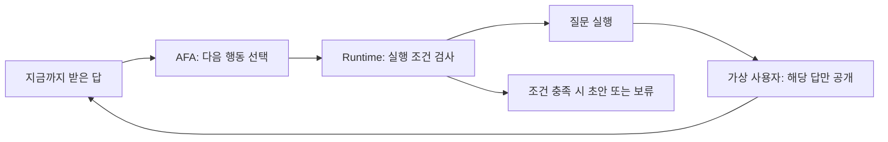

PPO는 이 선택기를 **실행 결과의 점수를 통해 조정하는 강화학습 방법**이다. 현재 시험 학습은 숫자 입력으로 행동 번호를 고르는 작은 신경망을 사용했다. 질문 문구와 가상 제품 초안 생성은 기존 코드가 맡는다. NLP는 자연어를 다루는 별도 역할이며 현재 연습은 미리 정리된 답을 사용한다.

PPO는 선택을 너무 급격히 바꾸는 업데이트를 억제하는 목적함수를 사용한다. 이것이 도메인 안전을 보증하는 것은 아니므로, 실행 전 마스크·규칙 검사도 함께 둔다. 개념 배경은 [PPO 원 논문](https://arxiv.org/abs/1707.06347), 사용 구현은 [Maskable PPO 2.7.1 문서](https://sb3-contrib.readthedocs.io/en/v2.7.1/modules/ppo_mask.html)를 참고한다.

### 1.3 현재 위치

현재까지 확인한 것은 다음과 같다.

- 질문한 항목의 답만 공개하고, 가능한 행동만 실행하는 환경을 만들었다.
- 작은 자료 6개로 PPO 256 step 시험 학습이 실제 동작함을 확인했다.
- 물 온도와 세안 방법을 함께 다루는 48개 상황으로 확장했다.
- 평가에 빠진 손세안 유형을 발견하고, 별도 자료 배치와 16회 순환 점검을 만들었다.
- 순환 비교에서 기존 순서 4.50회, 미리 계산하는 방식 3.44회의 평균 질문 수를 관찰했다.
- train 부모 4개에서 원래 미상·거절 응답 4개와 명시적인 가상 추가 8개를 구분한 작은 응답 자료를 만들었다(E22). 질문 순서 24개·응답 연결 60개를 검사했고 실제 Gym 연결은 다음이다.
- EDA 후속으로 train 1,980턴의 바로 다음 이벤트를 검사하고, 5항목 라벨 검토·919 조건부 수정안·응답 재사용 사전 검증을 작성했다(E21). 실제 Gym 연결과 파생 응답 자료 구현은 아직이다.
- 전체 v67 1,025개 상황·2,453턴의 EDA를 수행했다(E20). 분포 치우침과 응답 경로 공백, 검토할 선택 라벨을 확인했다. [배우며 읽는 EDA 보고서](afa-v67-eda.md)에 절차·그래프·해석을 정리했다.
- 그러나 **손세안만 보면 미리 계산하는 방식이 4.75회로 기존 순서 4.50회보다 불리했다.**

**아직 하지 않은 일:** 64차원 v2 환경에서 PPO 비교 학습, 기존 v67의 PPO 학습 활용, SFT-SLM 성능 비교, 독립 최종 평가, 실제 사용자/앱 적용, 전문가·임상 검증.

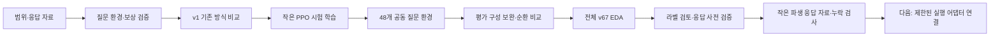

이 기록의 **E00~E13은 누적 기록 ID**다. Linear [PPO-23](https://linear.app/ppopy/issue/PPO-23)의 Stage 번호를 새로 정의하지 않는다. 초기 Stage 0~5A와 이후 v2 보완 작업의 대응은 아래에 표시했다. 현재 Linear 본문을 이번 문서 작성에서 다시 조회한 것은 아니다.

### 용어를 쉬운 말로

| 용어 | 이 프로젝트에서의 뜻 |
| --- | --- |
| 카드 | 관련 질문과 판정 규칙의 묶음. B-C01은 물 온도, B-C02는 도구·마찰·건조 |
| 세계/상황 | 가상 사용자가 각 질문에 어떤 답을 할지 정한 답변표 |
| 마스크 | 지금 실행 가능한 행동 목록 |
| step | 질문·보류·초안 요청 등 행동 한 번 |
| episode | 상황 하나에서 시작해 종료할 때까지의 실행 한 번 |
| 기준선 | PPO가 비교해야 할 기존 방식 |
| 종료 계약 충족 | 기존 엔진의 참조 의미·초안/보류 조건에 맞게 끝남. 전문가 정답·임상 정확도와 다름 |
| 가족 | 도구·마찰·건조 조합이 같은 상황 묶음. 물 온도 변형은 같은 가족에 둠 |
| 합성 자료(synthetic) | 프로그램 연습을 위해 작성한 가상 답과 상황. 실제 사용자 응답이 아님 |
| train / val / test | 준비·학습에 쓰는 자료 / 개발 중 확인 자료 / 테스트 역할의 자료. 현재의 내부 test를 새롭고 독립적인 최종 평가라고 부르지는 않음 |
| 회귀 검사 | 기능을 바꾼 뒤 기존 동작이 깨지지 않았는지 다시 검사하는 것 |
| 복구(fallback) | 계산 방식이 지원하지 못하는 상태에서 기존 규칙으로 선택을 맡기는 것. 복구 횟수도 결과에 표시 |
| 참조/서명(signature) | 전체 답을 엔진에 넣은 판정과, 비교할 상태·행동 종류·문구 등의 묶음. 화면이 아닌 판정 의미를 비교하는 기준 |
| hindsight 하한 | 전체 답을 미리 알 때 가능한 가장 낮은 비용. 답을 모르는 실제 선택기가 달성 가능한 값과 구분 |
| 반사실 응답 | 실제 기록에서 묻지 않았던 질문을 골랐을 때 어떻게 답할지에 대한 정보. 기록에 없으면 임의로 만들어 관찰값으로 쓰지 않음 |

## 2. 전체 진행 기록 한눈에

| ID | 단계 | 목적 | 확인 결과 | 다음 작업을 하게 된 이유 |
| --- | --- | --- | --- | --- |
| E00 | Stage 0 | 성공 기준을 먼저 정함 | 19개 후보 중 10개 지원, 9개 의미 차이로 제외 | 물어볼 답을 완비해야 함 |
| E01 | Stage 1 | 자료 재사용·응답 완결성 확인 | v67 감사, 별도 10개 상황을 6/2/2로 분리 | 실제 한 턴 실행 필요 |
| E02 | Stage 2 | 질문→답→다음 상태 연결 | 58차원 환경, 답 공개·단일 실행·롤백 | 채점과 종료도 검증해야 함 |
| E03 | Stage 3 | 환경·보상 편법 검사 | 유효 전이 203개, 금지 행동 거부 501개 | 학습 전 비교 기준 필요 |
| E04 | Stage 4 | 기존 방식 측정 | train 탐욕 2.50회, val 규칙 2.00회 | 기존 방식이 이미 최선인지 확인 |
| E05 | Stage 4 보완 | 개선 여지 계산 | 공개 정보 최적 비용과 가장 강한 기준선이 같음 | 시험 학습과 성능 주장을 분리 |
| E06 | Stage 5A-1 | PPO 연결 준비 | 초기화·저장·재로드 검사, 학습 step 0 | 실제 업데이트 확인 필요 |
| E07 | Stage 5A-2 | 256 step 시험 학습 | train 종료 충족 1/6→6/6, 질문 2.50회 | 작동 확인 이후 과제 확장 |
| E08 | v2 의미 계약 | 질문 순서에 따른 의미 차이 해결 | 추가 확인으로 제외 9세계의 원본 의미 보존 | 실행 범위·자료 설계 필요 |
| E09 | v2 상황 설계 | 질문·비용·분할 고정 | 48개 상황·9개 별도 점검 예시 | 실제 질문 프로그램에 연결 |
| E10 | v2 실행 환경 | 두 카드를 함께 실행 | 64차원 환경, 전이 4,000개 검사 | 더 넓은 환경의 기준선 필요 |
| E11 | v2 고정 분할 비교 | 기존 방식·개선 여지 점검 | val 4.67→3.00회, 손세안 누락 발견 | 자료 구성이 편중됨 |
| E12 | 구성 보완 | 누락 유형과 분할 제약 해결 | 확인·테스트에 손세안 각 3개, 16회 계획 | 실제 순환 비교 필요 |
| E13 | 순환 기준선 비교 | 모든 가족을 한 번씩 확인 | 전체 4.50→3.44회, 손세안에서는 비용 증가 | 전체·종류별 결과를 함께 보는 PPO 비교 필요 |
| E14 | 온보딩 설명 검토 | 용어·호출·설정·채점 원리를 풀어 설명 | 대화 예시·역할 구분·개발자 해설 추가. 새 실험 없음 | 이후 기록에서도 뜻·분모·한계를 먼저 설명 |
| E15 | Linear 공유 연결 | 팀원이 누적 문서를 Linear에서 함께 확인 | PPO-32 생성·kang kang 배정, 본문 동기화 규칙 추가 | 이후 문서 수정 때 같은 이슈 갱신·확인 |
| E16 | 탐색·테스트 구조 정리 | AFA 파일을 역할별로 쉽게 찾음 | 시작 안내·코드/자료 목차, 테스트 19개 파일 재배치 | 실행·자료 경로를 보존하며 다음 v2 작업 준비 |
| E17 | MLflow 대시보드 | 기존 결과·원본·향후 지표를 한 화면에 모음 | 4개 실험·15개 기록·8개 그래프, 전체 검사 463개 통과 | 다음 EDA와 v2 학습기의 실제 기록 연결 |
| E18 | MLflow 첫 사용자 안내 | 화면과 결과 해석을 혼자 따라가기 | 캡처 2개·그래프 원본·단계별 안내 | 다음 EDA 준비 |
| E19 | 결과 화면 공유 | 로컬 서버 없이 본문에서 확인 | 결과·안내 캡처 5개와 그래프 2개 업로드 | 이후 단계에도 화면·해석 함께 기록 |
| E20 | 전체 v67 EDA | 48개 환경과 기존 전체 데이터의 차이를 이해 | 1,025상황·2,453턴·58카드, 응답 경로·중복·라벨 검토, 7개 그래프 | 원본 보존 후 라벨 선택 기준·이벤트 어댑터 지원 범위 명시 |
| E21 | EDA 후속·응답 계약 | 잘못된 라벨·다른 질문 응답 재사용 방지 | train 1,980턴 집계·5항목 검토·사전 검증, 기본 384개 통과, PPO-33 분리 | 파생 응답 자료·완비 검사 후 환경 연결 |
| E22 | 작은 train 파생 응답 자료 | 순서를 바꿔도 정의된 응답을 받기 | 4상황·12응답·24순서·60연결, 별도 라벨 1행, 전체 486개 통과 | 실제 실행 게이트·초기 공개 상태·종료 계약과 연결 |
| E23 | 질문·보류 검토와 실행 연결 | 자료를 실제 실행 조건으로 검증 | 4상황, 46이력, 42질문 연결, 기본 397개 통과 | 종료 채점과 질문 비용 결정 |
| E24 | 질문 비용과 종료 채점 | 성급한 종료와 효율적인 질문 구분 | 4상황 61경로, 별도 우선순위 반례 | 같은 채점의 정책 비교 |
| E25 | 공개 정보 기준선 비교 | 질문 수와 종료 품질 동시 비교 | 기본 규칙 2.25회, 개발 트리 2.00회, 종료 둘 다 4/4 | 가족 분리 비교 자료 설계 |
| E26 | PPO 학습 전 검증 | 가족 분리와 환경·마스크 검증 | 64상황·940경로, PPO 0스텝 | PPO 첫 학습 |
| E27 | 목표 아키텍처 정정 | 전체 런타임과 질문 정책의 역할 분리 | 목표 구조·구현 상태·다음 설계 순서 명시 | 전체 행동과 상태 전이 계약 정의 |
| E28 | B-C02 첫 PPO 비교 | 올바른 종료를 유지하면서 질문을 줄이는지 확인 | 검증 16/16 동률, PPO 2.3125회 vs 도구 우선 2.2500회 | 부분 관측으로 시작하는 별도 환경과 질문 전용 계약 |
| E29 | PPO 재현과 AFA 결과 반환 계약 | 같은 조건의 재현 여부와 모델 파일 연결을 확인 | E28 비교 재현, 합성 이관 2건, 전체 검사 510개 통과 | 부분 관측이 있는 환경으로 정책 비교 |
| E30 | 선행 정보가 있는 B-C02 비교 | 이미 아는 값을 건너뛰면서 올바르게 멈추는지 확인 | 양쪽 110/112, 재질문 0건, 도구 우선 87개 vs PPO 88개 질문 | 공통 조기 종료 2건 재현과 종료 조건 검토 |
| E31 | B-C02 조기 종료 조건 검증 | 남은 답에 따라 판단이 바뀌는지 검사 | 양쪽 112/112, 정책별 질문 15개 증가 | 최종 권고에 영향을 주는 차이 확인 |
| E32 | 권고 효과와 런타임 안전 경계 | KB 분류 차이가 실제 실행을 바꾸는지 확인 | 112/112 동률, 추가 질문 없이 동일 효과 | 설정 동결 후 시험 분할 평가 |
| E33 | 세 seed 고정 내부 시험 | 미사용 모델 평가 분할에서 비용과 종료 비교 | 전 정책 같은 종료 정확도, PPO는 각 시작 조건 묶음에서 질문 1회 증가 | 기본 정책은 도구 우선 규칙 |
| E34 | 복합 카드와 권고 종료 조건 | 관찰에 관련된 카드·근거 누락 수정 | 복합 권고·필수 보류·근거 부족 보류 회귀 통과 | 미응답 재호출과 질문 순위 검증 |
| E35 | 대기 질문의 재사용 | 답 없는 재호출·동일 요청·공유 질문 확인 | 질문 재실행 없이 다음 답변에서 재개 | 질문 순위 비교 |
| E36 | 실제 결과 우선 순위 | 개발 4상황에서 기존 순서 비교 | 결과 4/4 일치, 질문 25→18 | 규칙·적용 기준 동결 |
| E37 | 새 복합 사례와 기본 런타임 | 동결 뒤 작성한 합성 12상황 | 결과 12/12 일치, 질문 55→41 | 지원 복합 세안에 기본 적용 |
| E38 | 로컬 제품 조회와 AFA 통합 | 사전 정보·질문 후 재개·제품 근거 부족을 확인 | 합성 통합 검사 7/7 통과, 변경 전 제품 표시 사용법 재사용 방지 | 입력과 조회 근거 계약 확장 |
| E39 | 한국어 세안 대화 안정화 | 부정 표현과 기본 제품 자료 범위를 수정 | 한국어 시연 4개·집중 검사 6개 통과 | 같은 사례에서 모델 행동 제안을 비교할 조건 정리 |
| E40 | 세안 CLI 선택형 응답 | 직접 입력과 해석 확인, 증상 확인, 정정 | 집중 검사 39개와 실제 CLI 사례 2개 통과 | 같은 답을 받은 정책별 질문 수 비교 |
| E41 | CLI 모듈 출처 표시 | 규칙 질문·저장된 PPO·증상 확인을 구분 | 집중 검사 39개와 두 실행 설정 통과 | 질문 정책 비교 시 실제 선택 출처 확인 |
| E42 | 증상 질문을 한 항목씩 선택 | 성격이 다른 답을 분리하고 번호 선택지는 화면당 최대 4개 | 집중 검사 46개·전체 583개 통과 | 동일 화면에서 질문 방식 비교 |
| E43 | Kiwi·Jev 입력 처리 정비 | 제품명·증상 후보와 AFA 전달을 검증 | 지정 단위 검사 53개 · 전체 596개 통과 | 원격 연결은 별도 확인 |
| E44 | 로컬 CLI PPO 우선 | 실제 E29 모델, 파일 누락, 규칙 강제, 증상 질문을 확인 | CLI 재현 4건 · 관련 검사 50개 · 전체 600개 통과 | 기존 모델로 실행 경로만 확인 |
| E45 | 여러 영역에서 한 단계 질문 비교 | 활성 카드의 분기 값을 하나씩 대입해 질문 효과와 줄어드는 질문 수를 측정 | 합성 8건 · 평균 3.375 → 1.125회 · 최종 판정 7/8 일치 | 두 답변이 함께 필요한 B-I02에서 차이 |
| E46 | 합성 비교 범위 확대 | KB 분기 62조건, 경계·복합 12조건, v67 train 파생 4건 | 평균 3.59 → 1.62회 · 최종 판정 69/78 일치 | 여러 답을 필요로 하는 9조건에서 Myopic 판정이 달라짐 |
| E47 | 같은 조건에서 기존 PPO까지 비교 | E46의 78조건을 다시 실행해 고정 순서·Myopic VOI·B-C02 PPO 라우팅을 비교 | 평균 3.59 · 1.62 · 3.59회 · 전체 입력 판정 일치 76 · 67 · 76건 | PPO의 직접 질문은 B-C02의 11조건에서만 관찰 |
| E48 | 보류 직전 여러 답이 필요한 KB 분기 확인 | 기존 78조건에 최대 두 답 및 세 답 확인을 추가 | 기본 두 답 확인 평균 1.79회 · 전체 입력 판정 74/78 일치 | 4개 답이 필요한 B-P03 조건은 실험 옵션에서도 미해결 |
| E49 | 1단계 AFA와 보류 전 확인 분리 | E48의 78조건을 같은 설정으로 재실행 | 기존 질문 순서·판정 78/78 일치 · 기본 경로 74/78건, 총 140회 | 신규 독립 평가와 지연 시간 측정은 범위 밖 |
| E50 | 기본 대화형 CLI에 Myopic 연결 | 한국어 합성 세안 실행과 CLI 기본 정책의 회귀 확인 | 질문 3회 후 권고 · E49의 78조건 모두 동일 | 텍스트 입력 CLI 소프트웨어 검사 |
| E51 | 동결 합성 조건에서 정책 4종 비교 | 기존 78조건과 추가 98조건에서 질문·판정·보류·시간 측정 | 현재 Myopic 평균 1.61회 · 사용자 응답 171/176 일치 | 질문 절감의 크기와 PPO 적용 범위가 조건군마다 다름 |
| E52 | 기본 CLI 번호 선택지 연결 | 첫 요청만 NLU, 후속 답은 대기 질문에 결합된 정형 값으로 전달 | 176/176조건에서 질문 순서와 최종 응답 재현 | 합성 소프트웨어 회귀 검사, iOS·사용성 평가는 범위 밖 |
| E53 | v3 계약·불변식·KB 버전 점검 | AFA 결정 trace와 네 정책 회귀, v0.6.1 사례 6 비교 | 492개 통과 · 176조건에서 정책별 제품 질문·재질문·필수 보류 누락 0건 | v0.6.1 실행 연결 및 부모 통합 미완료 |
| E54 | Myopic 증상 확인 선택 | 미확정 증상을 정형 질문 후보로 점수화 | CLI의 최근·반복 분기 확인 · 기본 494개 통과 | 합성 구조화 비교에 자연어 증상 빈도는 포함되지 않음 |
| E55 | PR #24 AFA 계약 호환 | v3 점수 타입 공유 및 v3 결정 검증 상속 | 기본 503개, 초점 검사 48개 통과 | 소프트웨어 계약 검증 |

## 3. 발표에 바로 쓸 수 있는 핵심 결과

**첫 B-C02 학습 비교 E28.** 학습에 사용하지 않은 검증 16상황에서 PPO와 두 우선순위 기준선이 모두 올바르게 끝났다. PPO는 도구 우선보다 두 상황에서 하나씩 덜 물었고 세 상황에서 하나씩 더 물어, 전체 질문이 1회 늘었다. 자세한 분모와 설정은 4절 E28에서 확인한다.

### 3.1 PPO가 실제 학습됐다는 근거 — E07

조건을 풀면 **가상 상황 6개를 준비 자료로 사용하고, 무작위 동작의 시작값을 0으로 고정해, 행동 256회 분량을 수집하며 학습했다**는 뜻이다. 학습과 진단이 같은 작은 train 자료다. 기술 설정은 seed=0, MaskablePPO/MlpPolicy, CPU, total_timesteps=256이며 [9.4절](#training-settings)에서 각각 설명한다.

| 지표 | 초기 정책 | 시험 학습 후 |
| --- | ---: | ---: |
| 종료 계약 충족 | 1/6 | 6/6 |
| 평균 질문 수 | 1.167 | 2.500 |
| 평균 return | -5.333 | -2.500 |
| 성급한 보류 | 5/6 | 0/6 |
| 초안 / 보류 | 0 / 6 | 5 / 1 |

질문 수가 늘었는데 좋아졌다는 이유: 초기 정책은 너무 일찍 보류했다. 학습 후에는 필요한 질문을 하고 정당하게 끝내면서 잘못된 종료 손실을 줄였다.

여기서 **return은 대화 전체의 점수**다. 이 시험에서는 질문마다 1점을 빼고 잘못 끝내면 5점을 더 뺐다. 예를 들어 2번 묻고 성급히 보류하면 −7, 3번 묻고 기준에 맞게 끝내면 −3이다. 음수라도 −3이 더 좋다. 돈이나 임상 위험의 측정값은 아니다. [9.5절](#result-metrics)에 다른 지표의 분모도 설명했다.

학습 실행의 별도 증거는 수집 행동 256개 마스크 준수와, 신경망이 내부 계산에 쓰는 **숫자 묶음(파라미터 텐서) 12개 모두의 변경**이다. 저장·별도 프로세스 재로드 결과도 같았다. 로그의 32 epoch update와 파라미터별 optimizer step 64회는 [9.4절의 계산](#training-settings)으로 연결된다. 단, 기존 탐욕 기준선도 같은 train에서 2.50회였다. **PPO 우위·일반화 입증이 아니다.**

근거: [시험 학습 설명](../data/afa/stage5a-trial-v1/README.md), [원본 audit](../../../../../outputs/afa-stage5a-trial-v1/audit.json), [요약 증빙 E07](afa-policy-evidence.json).

### 3.2 모든 가족을 번갈아 확인한 기준선 — E13

조건: 한 세안 방법의 물 온도별 상황 3개를 확인 대상으로 빼고, 남은 45개에서 답이 얼마나 자주 나오는지 새로 집계했다. 이를 16가지 세안 방법에 한 번씩 반복했다. 따라서 48개 고유 상황을 빠짐없이 확인했다. seed 0/1/2와 두 비용 조건까지 합치면 16 × 3 × 5방식 × 3seed × 2비용 = 1,440 episode다. **1,440명 사용자나 PPO 결과를 뜻하지 않는다.**

선택 방법을 바꿔도 채점 기준은 같다. “물어본 답만 사용하고, 정해둔 안내 의미가 확정됐는지 확인하며, 같은 초안/보류 조건을 충족했는가”를 함께 본다. 표의 계산 방식이 무엇을 미리 계산하는지는 아래와 같다.

| 표의 이름 | 실제로 하는 일 |
| --- | --- |
| 기존 실행 순서 | 현재 가능한 질문 중 기존 코드가 제공하는 순서를 따름 |
| 질문 순서 무작위 | 질문이 남으면 그중 하나를 무작위로 고름. 끝낼 때의 조건은 유지 |
| 한 단계 효과 계산 | 준비 자료에서 그 질문 하나 뒤에 추가 질문이 없어질 가능성을 계산해 비용과 비교 |
| 여러 단계 기대 비용 계산 | 가능한 다음 답마다 그 뒤 질문까지 계산하고, 준비 자료 분포에서 평균 비용이 적은 순서를 선택 |
| 전체 행동 무작위 | 질문뿐 아니라 보류도 무작위로 선택. 너무 일찍 끝내는 편법을 구분하기 위한 비교 |

미리 계산할 때는 **이번 확인 대상의 숨겨진 정답을 읽지 않는다.** 각 차례의 준비 자료 45개에서 현재 답과 맞는 상황들의 분포를 사용한다. 이는 PPO 신경망 학습과 별도의 계산 기준선이다.

| 방식 | 기본 평균 질문 | 종료 계약 충족 | 마찰·건조 2 조건의 평균 비용 |
| --- | ---: | ---: | ---: |
| 기존 실행 순서 | 4.5000 | 100% | 6.0000 |
| 질문 순서 무작위 | 3.7917 | 100% | 4.5833 |
| 한 단계 효과 계산 | 4.5000 | 100% | 3.8750 |
| 여러 단계 기대 비용 계산 | **3.4375** | **100%** | **3.8750** |
| 전체 행동 무작위 | 1.1736 | 5.56% | 1.5833 |

마지막 행은 대부분 성급히 보류해서 비용이 낮다. 품질이 다르므로 효율 개선으로 인정하지 않는다. 비용 2는 실험 가정이며 실제 피로 측정값이 아니다. 위 정상 종료율도 기존 규칙과 실행 게이트의 보호를 포함한다.

### 3.3 전체 평균에 가려졌던 한계 — E13

| 기본 비용의 상황 종류 | 고유 상황 | 기존 순서 | 질문 무작위 | 여러 단계 계산 |
| --- | ---: | ---: | ---: | ---: |
| 손세안 | 12 | 4.50 | 4.50 | **4.75** |
| 도구 사용 | 36 | 4.50 | 3.56 | **3.00** |

전체 평균에서는 4.50−3.4375=**1.0625회 절감**했지만, 손세안에서는 **0.25회 증가**했다. 평균 절감은 주로 도구 사용에서 나왔다. 실제 사용자 분포가 12:36이라는 뜻도 아니다. 이 가상 domain의 조합 수 때문이다.

여러 단계 계산 방식은 기본 비용에서 27회 규칙으로 복구했다. 한 단계 방식은 72회였다. 이는 선택 시점의 복구 횟수이며 사람 수·독립 상황 수가 아니다. 순수한 학습 모델의 일반화 점수로 부르면 안 된다.

근거: [순환 비교 설명](../data/afa/fold-baselines-v1/README.md), [원본 비교](../../../../../outputs/afa-fold-baselines-v1/comparison.json), [종류별 진단](../../../../../outputs/afa-fold-baselines-v1/subgroup-diagnostics.json), [요약 증빙 E13](afa-policy-evidence.json).

## 4. 단계별 누적 기록 — 목적·결과·해석

MLflow 기록이 있는 E07·E13·E16·E17에 결과 화면을, E18에는 사용 안내 화면을 넣었다. E00~E06·E08~E12·E14~E15는 해당 단계의 MLflow 실행 기록이 없으므로 과거 화면을 만들어 넣지 않았다. 각 단계의 원본 보고서·수치 기록으로 확인한다. E07~E18의 캡처는 과거 결과·안내 화면이다. E20에는 이번에 수행한 전체 v67 EDA의 그래프와 새 결과 기록 화면을 넣었다. E20도 새 PPO 학습을 의미하지 않는다.

### E00 — Stage 0: 첫 범위와 성공 기준 / 2026-11-16

- **목적:** 모델이 항상 보류해서 질문 수만 줄이는 편법을 막고, 무엇을 비교할지 먼저 정한다.
- **한 일:** C01/C02를 한 사례당 하나씩 다루는 범위, 고정 행동 8개, 질문 비용 1·예산 4·잘못된 종료 손실 5, gamma=1·shaping=0을 정의했다.
- **결과:** 후보 19세계에서 10개 지원, 9개 제외. 9개는 질문 순서에 따라 action 의미가 달라져 임의의 동등 정답으로 만들지 않았다.
- **해석/다음:** 이때는 명세·기계 검사만 있었다. 응답 자료와 환경은 이후 단계였다. 작성 예시와 참조는 사람 승인 정답이 아니다.
- **근거:** [단계 문서](../data/afa/stage0-v1/README.md), [원본 보고서](../../../../../outputs/afa-stage0/report.json), 증빙 E00.

### E01 — Stage 1: 자료 확인과 응답표 / 2026-11-16

- **목적:** 다른 질문을 골라도 응답이 정의돼 있는지, 자료의 계보와 분할이 유지되는지 확인한다.
- **한 일:** 기존 v67 1,025시나리오·2,453턴을 감사하고, 별도 설계 세계 10개를 train/val/test 6/2/2로 만들었다.
- **결과:** 엄격한 초기 fixture·단일 카드 계약에 **원본 그대로** 들어맞는 v67 사례는 0개였다. 다른 제품/프로필, 여러 턴과 정정 등을 단순 세계로 바꾸지 않았기 때문이다.
- **해석/다음:** v67이 쓸모없다는 결론이 아니다. 여러 턴의 값을 첫 턴에 합치거나 누락 답을 임의 unknown으로 만들지 않았다. 현재까지 v67을 PPO에 학습시키지 않았다.
- **근거:** [단계 문서](../data/afa/stage1-v1/README.md), [v67 감사](../../../../../outputs/afa-stage1/v67-support.json), [응답 자료 manifest](../data/afa/stage1-v1/manifest.json), 증빙 E01.

### E02 — Stage 2: 첫 질문 환경 / 2026-11-16

- **목적:** 질문 하나를 실행하고 그 답만 반영하는 실제 한 턴을 만든다.
- **한 일:** 관찰 준비와 행동 실행을 분리하고, 기존 validator/dispatcher를 재사용했다. 58차원 관찰과 마스크, 중복·오래된 판단·실패 복구를 검사했다.
- **결과:** scripted 예시는 질문 2회 뒤 정당한 보류, dispatch 3회, return −2였다.
- **해석/다음:** 학습한 정책의 점수가 아니라 API 동작 검사다. 예산 소진과 외부 시간 제한을 구분한 뒤 더 넓은 전이·보상 검사를 진행했다.
- **근거:** [단계 문서](../data/afa/stage2-v1/README.md), [scripted smoke](../../../../../outputs/afa-stage2/smoke.json), 증빙 E02.

### E03 — Stage 3: 전이·보상 검사 / 2026-11-16

- **목적:** 모델이 환경·채점의 오류를 이용하지 못하게 한다.
- **결과:** 10세계·88개 질문 순서별 prefix·공개 상태 34개, 유효 전이 203개·금지 행동 거부 501개·종료 경로 125개를 검사했다. 가장 유리한 잘못된 종료도 정상 완료보다 불리했다.
- **해석:** 예산 1회 주입·마지막 답 뒤 무료 종료·범위 밖 B-B01 안전 보류는 별도 경계 검사다. 모든 실사용 안전 상황을 검증한 것은 아니다. 참조도 같은 KB를 공유하므로 도메인 정답의 독립 검증이 아니다.
- **근거:** [단계 문서](../data/afa/stage3-v1/README.md), [원본 전수 검사](../../../../../outputs/afa-stage3/exhaustive.json), 증빙 E03.

### E04 — Stage 4: 첫 기준선 / 2026-11-16

- **목적:** PPO가 단순 무작위만 이긴 것을 개선이라고 부르지 않도록 한다.
- **결과:** train 6개/val 2개에서 방식 5개·seed 3개로 120 episode. 규칙은 train 3.33·val 2.00회, 탐욕은 2.50·2.50회였다. 정상 종료 수준을 함께 확인했다.
- **해석:** val 규칙이 이미 세계별 최선 경로 하한 2.00회에 도달했다. 표 기반 BC는 28개 상태의 규칙 모방이며 신경망/Qwen SFT가 아니다. val에서 규칙 복구 3회가 있어 순수 BC 일반화로 부르지 않았다.
- **근거:** [단계 문서](../data/afa/stage4-v1/README.md), [최초 기준선](../../../../../outputs/afa-stage4/baselines.json), 증빙 E04.

### E05 — 보완: 개선 여지와 실행 비용 / 2026-11-16

- **목적:** 실제 공개 답만으로 달성 가능한 최선과, 전체 답을 미리 보는 하한을 구분한다.
- **결과:** 공개 정보 최적 비용은 train 2.50·val 2.00으로 각각 가장 강한 기존 방식과 같았다. train의 hindsight 2.333은 실제 공통 정책의 달성 가능 값이 아니었다.
- **변경:** 명시적 세계 reset 시 불필요한 난수열 소비를 수정했다. 메모리 전체 복사는 로컬 측정에서 재로드보다 느려 채택하지 않았다.
- **해석/다음:** v1은 학습 연결 점검에 쓰고 비용 우위 주장과 분리했다. 성능 개선을 요구하는 검사 모드의 종료 코드 1은 개선 여지가 없다는 예상 결과다.
- **근거:** [보완 문서](../data/afa/review-v1/README.md), [준비 진단](../../../../../outputs/afa-review-v1/readiness.json), 증빙 E05.

### E06 — Stage 5A-1: PPO 연결 준비 / 2026-11-16

- **목적:** 선택 의존성·학습/평가 코드·마스크·저장 경로를 준비한다.
- **조건:** Windows/Python 3.10.5, Torch 2.9.1+cpu, SB3/sb3-contrib 2.7.1, Gymnasium 1.2.3, NumPy 2.2.6. CPU용 `rl-train` 그룹으로 분리했다.
- **결과:** prepare는 learn을 호출하지 않고 step 0으로 초기 모델을 저장·재로드했다. 마스크 적용과 같은 실행 결과를 확인했다.
- **해석:** 초기화된 가중치가 있다고 학습 완료로 부르지 않는다. 일반 무마스크 평가 helper 대신 mask-aware 경로를 사용했다.
- **근거:** [설정 문서](../data/afa/stage5a-v1/README.md), [prepare 결과](../../../../../outputs/afa-stage5a-setup-v1/report.json), 증빙 E06.

### E07 — Stage 5A-2: 256 step 시험 학습 / 2026-11-16

- **목적:** 실제 수집·optimizer 갱신·로그·재로드를 확인한다.
- **조건/결과:** train 6개·seed 0·rollout 32·batch 16·epoch 4·총 256 step. 결과와 실제 업데이트 근거는 3.1절에 기록했다.
- **해석:** 6/6은 학습에 쓴 작은 자료의 종료 충족이다. 질문 2.50회는 기존 탐욕과 같아 PPO 우위가 아니다. 이 단계에는 PPO 회귀 검사 13개를 다시 실행했으며, 전체 369개 검사를 새로 재실행했다고 기록하지 않았다.
- **근거:** [시험 학습 문서](../data/afa/stage5a-trial-v1/README.md), [audit](../../../../../outputs/afa-stage5a-trial-v1/audit.json), 증빙 E07.

**MLflow 결과 화면 — 초기 PPO 연결 진단**

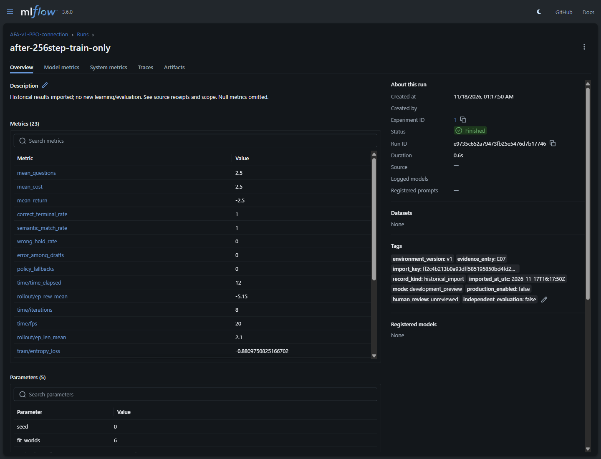

화면에서 `mean_questions=2.5`, `correct_terminal_rate=1`을 확인한다. 같은 train 6개 상황의 종료 계약 6/6 충족이며 독립 평가가 아니다. 당시 실행 결과를 나중에 MLflow로 가져온 화면으로, Created at·Duration은 가져오기 시간이며 원본 학습 시각·학습 소요시간이 아니다.

### E08 — v2 의미 계약 / 2026-11-17

- **목적:** 질문 순서만 달라졌다고 최종 권고 의미가 바뀌지 않게 한다.
- **결정:** 원본 첫 매칭 우선순위를 유지한다. 공개 답에 맞는 모든 합성 완성 상태의 의미가 같고 현재 결과도 같을 때 확정한다. 부족하면 추가 확인한다.
- **결과:** 19세계·99개 우선순위 경로, 기존 제외 9세계의 54개 우선순위에서 원본 전체 정보 의미 보존을 확인했다.
- **해석:** 99개는 독립 사례 수가 아니다. 이때의 tools 추가 질문은 요구사항이며 원본 Context에서 실행 가능해졌다는 뜻은 아니었다. 구현 연결은 E10에서 했다.
- **근거:** [의미 계약](../data/afa/semantic-v2-v1/README.md), [기계 검사](../../../../../outputs/afa-v2-semantics-v1/report.json), 증빙 E08.

### E09 — v2 공동 상황 설계 / 2026-11-17

- **목적:** 두 주제를 함께 다룰 질문·비용·분할을 정의한다.
- **결과:** 물 온도 3 × 도구 4 × 마찰 2 × 건조 2 = 48세계. 부위는 face로 설정하되 자동 공개하지 않고 묻는다. 16가족을 10/3/3으로 배정해 30/9/9를 만들었다.
- **조건:** 기본 비용은 모두 1, 최대 5질문·잘못된 종료 손실 6. 비용 변화 조건은 마찰/건조 2, 최대 비용 7·종료 손실 8. gamma=1·shaping=0.
- **해석:** 비용은 합성 설계값이다. 모름·거절·충돌·정정 등 9개 예시는 별도 소프트웨어 검사이며 core 성능 자료에 섞지 않았다.
- **근거:** [연습장 설계](../data/afa/scenario-plan-v2-v1/README.md), [설계 목록](../../../../../outputs/afa-v2-scenario-plan-v1/design.json), 증빙 E09.

### E10 — v2 실제 질문 환경 / 2026-11-17

- **목적:** 48세계의 질문→답 공개→기록→초안/보류를 연결한다.
- **한 일:** 원본은 보존하고 별도 adapter에서 tools 질문을 검증·추가했다. 초안은 원본 조건 AND 의미 확정 조건이다. 실제 validator/dispatcher를 통과한다.
- **결과:** 64차원 관찰·고정 행동 8개, 실행용 응답 자료 30/9/9. 두 비용의 96개 세계-비용 조합에서 세계별 공개 상태 합계 1,536개·유효 전이 4,000개·금지 행동 거부 8,288개·종료 전이 1,744개를 검사했다.
- **해석:** 실행 검사량을 학습 데이터 크기·정확도로 부르지 않는다. 공유하는 공개 벡터는 322개다. 58차원 v1 모델을 64차원 환경에 그대로 연결하지 않았다.
- **근거:** [실행 환경](../data/afa/joint-v2-v1/README.md), [최종 전수 검사](../../../../../outputs/afa-v2-joint-v1/exhaustive-verified.json), 증빙 E10.

### E11 — v2 고정 분할 기준선과 누락 발견 / 2026-11-17

- **목적:** 더 넓힌 환경에서 강한 비교 기준과 개선 여지를 측정한다.
- **결과:** 30+9세계 × 5방식 × 3seed × 2비용 = 1,170 episode. 기본 val에서 규칙 4.67회, 여러 단계 계산 3.00회, 모두 정상 종료였다.
- **진단:** 해당 고정 분포의 공개 정보 최적 비용과 강한 기준선이 같았다. 그러나 hands 12개가 모두 train에 있고 val/test에는 없었다. 평가 범위가 충분하지 않았다.
- **수정 이력:** 기존 규칙을 문자순으로 모사한 초기 구현이 적합성 검사에서 실패했다. 테스트를 바꾸지 않고 실제 제공 순서로 고쳤다. 최종 증빙은 `baselines-verified.json`이다.
- **해석/다음:** 결과가 좋게 나왔다고 끝내지 않고 구성 문제를 기록했다. 옛 자료·결과는 보존하고 별도 내부 보완 버전을 만들었다.
- **근거:** [고정 분할 비교](../data/afa/joint-baselines-v1/README.md), [최종 결과](../../../../../outputs/afa-v2-baselines-v1/baselines-verified.json), 증빙 E11.

### E12 — 누락 유형 보완과 순환 점검 계획 / 2026-11-17

- **목적:** 손세안이 빠진 문제를 고치되, 같은 가족을 양쪽에 복제하지 않는다.
- **결과:** 같은 48세계의 별도 내부 배치에서 손세안은 train 6·val 3·test 3개가 됐다. 원본 답·참조·ID는 유지하고 원래 소속을 기록했다. 24세계의 새 버전 소속이 변경됐다.
- **제약:** 하나뿐인 일치 손세안 가족은 세 split에 동시에 넣을 수 없다. val/test는 각각 가족 3개라 도구 4종을 모두 담는 조건도 불가능했다.
- **대응:** 16가족을 한 번씩 확인 대상으로 빼는 계획을 만들었다. 매번 45개 준비·3개 확인, 새 모델, 차례 간 체크포인트 이월 금지. 이 단계에서는 아직 점수를 계산하지 않았다.
- **해석:** 새 데이터 수집이나 독립 평가 준비 완료가 아니다. 이미 점검한 48개의 재배치와 내부 점검 계획이다.
- **근거:** [구성 보완](../data/afa/coverage-repair-v1/README.md), [전후 구성](../../../../../outputs/afa-coverage-repair-v1/coverage-verified.json), 증빙 E12.

### E13 — 16가족 순환 기준선 실행 / 2026-11-17

- **목적:** 빠졌던 가족까지 실제로 확인하면서 차례 안의 자료 섞임을 막는다.
- **조건:** 같은 5방식·seed 0/1/2·비용 2조건을 실행 전에 고정했다. 16개 분포 모델을 각각 새로 만들고, 매번 확인 가족을 준비 45개에서 제외했다.
- **결과:** 1,440 episode, 고유 상황 48개. 모든 정책·seed·비용에서 각 root가 정확히 한 번씩 확인됐다. 원본 소속과 이번 역할을 구분하고 선택기에는 64차원 관찰/마스크만 줬다.
- **해석:** 전체 이득과 손세안의 비용 증가는 3.2~3.3절에 함께 기록했다. 확인 결과로 설정을 고르지 않았으며 PPO를 학습하지 않았다. 같은 자료를 차례마다 재사용했으므로 독립 최종 평가가 아니다.
- **근거:** [순환 비교](../data/afa/fold-baselines-v1/README.md), [비교 원본](../../../../../outputs/afa-fold-baselines-v1/comparison.json), 증빙 E13.

**MLflow 결과 화면 — 전체 평균과 손세안 반례**

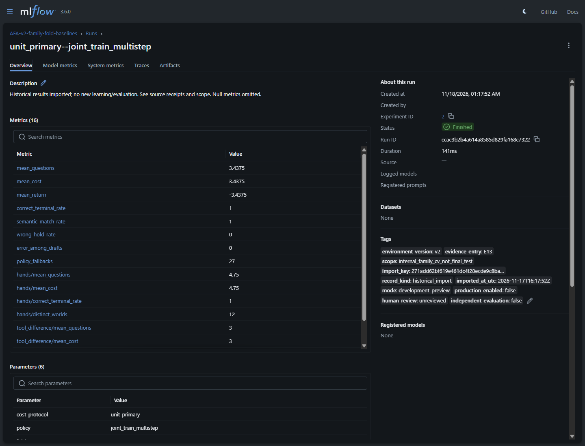

`mean_questions=3.4375`, `correct_terminal_rate=1`, `hands/mean_questions=4.75`를 함께 읽는다. PPO 결과가 아니라 기존 계산 기준선의 합성 48상황 내부 순환 비교다. Created at·Duration은 가져오기 기록의 시간이다.

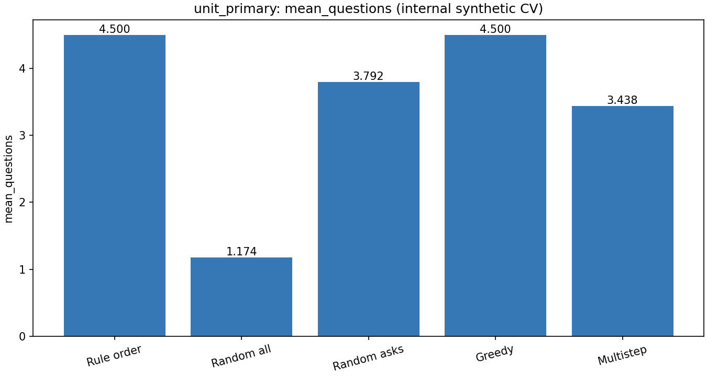

위 그림은 창 캡처가 아니라 MLflow에 등록한 그래프 원본이다. 기존 순서 4.50→Multistep 3.4375회. Random all의 낮은 질문 수는 성급한 보류 때문이며 종료 기준 충족 약 5.56%라 효율 개선으로 인정하지 않는다.

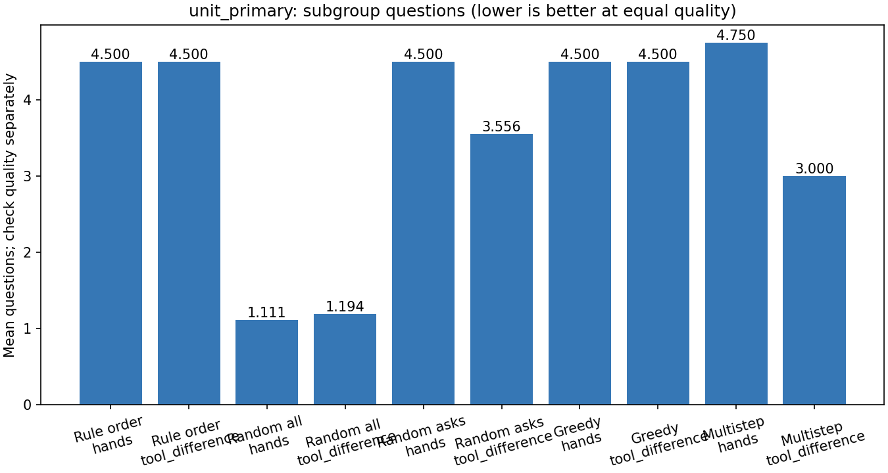

이 그림도 등록된 그래프 원본이다. 손세안은 4.50→4.75회로 악화되고 도구 사용에서 평균 이득이 나온다. 12:36은 실제 사용자 분포가 아니라 합성 조합 수다.

### E14 — 온보딩·발표 설명 검토 / 2026-11-17

- **목적:** 처음 보는 팀원·클라이언트가 코드 이름과 숫자의 배경을 몰라도 진행 과정과 결과를 따라가게 한다.
- **발견:** 용어 사전은 있었지만 AFA/PPO/KB의 역할, 실제 호출 흐름, 입력 필드, 학습 설정과 점수의 뜻이 충분히 이어져 있지 않았다.
- **변경:** 독자별 읽는 순서, 대화·역할 그림, 호출/응답 예시, 숫자 입력과 행동 번호, 학습 설정·지표 설명을 추가했다. E00~E13의 수치·조건·실험 결과는 보존했다.
- **검증:** 저장된 코드·설정·보고서와 설명을 대조하고 링크·핵심 수치를 확인했다. 새 학습·정책 비교·pytest·실제 독자 사용성 시험은 수행하지 않았다.
- **해석/다음:** 편집·기술 검토에 따른 설명 보완이다. 향후 기록에서도 용어의 뜻→이 작업에서의 값→해석과 한계를 함께 쓴다.
- **증빙:** 문서 개정 이전/이후 기록과 검증은 `outputs/afa-policy-onboarding-v1/`, 요약 JSON은 E14. 기술 정의의 외부 근거는 9절의 공식 문서다.

### E15 — Linear 공유 이슈와 갱신 규칙 / 2026-11-17

- **목적:** 저장소를 열지 않아도 진행 과정·실험 결과·한계를 팀원이 함께 읽게 한다.
- **변경:** PPOPY의 [PPO-32](https://linear.app/ppopy/issue/PPO-32)를 만들고 kang kang에게 배정했다. 문서 전체를 공유하며 PPO-23과 관련 이슈로 연결했다. 실험 폴더의 `AGENTS.md`에 원본 갱신 → 같은 이슈 본문 동기화 → 다시 읽기 확인 절차를 추가했다.
- **조건·검사:** 문서와 이슈 연결 작업이다. 새 학습·성능 비교·pytest는 실행하지 않는다. 기존 E00~E14와 실험 수치는 보존한다. 실제 동기화·확인 결과는 `outputs/afa-policy-linear-sync-v1/`에 남긴다.
- **해석:** 앞으로 에이전트가 문서를 수정하는 작업에 동기화를 포함한다. 상시 파일 감시 프로그램을 설치한 것은 아니다. 상대 경로의 원본 증빙이 Linear에 업로드됐다는 뜻도 아니다.
- **다음:** 후속 AFA 단계마다 문서·요약 증빙·PPO-32를 함께 갱신한다. 모델 실험의 다음 후보는 여전히 v2 PPO 비교 조건·실행 연결이다.
- **증빙:** 요약 JSON E15, PPO-32, `AGENTS.md`의 동기화 절차, 로컬 동기화 확인 보고서.

### E16 — AFA 탐색·테스트 구조 정리 / 2026-11-17

- **목적:** 팀원이 전체 설명·현재 코드·학습 코드·증빙을 쉽게 구분하고, 기본 검사와 선택 의존성 검사를 한곳에서 찾게 한다.
- **변경:** `docs/afa-policy-guide.md`, `beauty_agent/afa/README.md`, `data/afa/README.md`, `tests/afa/README.md`를 추가했다. 실험 README의 AFA 단계별 긴 목록은 자료 목차로 모았다. 기본 테스트 9개 파일은 `tests/afa/core/`, Gym 테스트 9개는 `tests/afa/gym/`, PPO 테스트 1개는 `tests/afa/ppo/`로 이동했다. 테스트 파일 내용은 동일하다.
- **호환 조건:** 실행 모듈·CLI·자료·원본 출력 경로를 유지했다. 과거 단계 README·보고서의 옛 명령은 당시 증빙으로 보존하고, 새 길잡이에 경로 대응과 최신 명령을 제공한다. 기본 수집은 선택 패키지를 요구하지 않으며, 전체 검사는 `-o norecursedirs=`로 모든 선택 디렉토리를 연다. 처음 시도한 부모/하위 경로 병기 명령은 369개만 실행해 전체 검사로 인정하지 않았다.
- **검사·증빙:** 테스트 이동 전 456개 수집을 확인했고, 이동 후 전체 검사도 **456개 통과**했다(169.74초, 기존 Starlette 경고 1건). 기본 범위 369개는 통과했고, Gym·Torch 등 선택 패키지를 의도적으로 차단한 기본 수집도 369개로 성공했다. 실행 코드·자료 등 74개 파일 해시와 이동한 테스트 19개 파일 해시는 일치했다. 소스 manifest 27개 일치, 오프라인 잠금 파일 검사 통과. 전체 실행 로그·링크·Linear 확인 결과는 `outputs/afa-layout-v1/`에 기록한다. 실제 전체 검사 명령은 실험 폴더에서 `.venv/Scripts/python.exe -m pytest -q -o norecursedirs= tests`였으며, 위 `uv` 명령은 같은 범위의 잠금 환경 실행 방법이다.
- **해석:** 탐색·유지보수 구조의 변경이며 새 PPO 학습·성능 비교가 아니다. KB 원본 엄격 검사의 알려진 5개 불일치를 해결하거나 숨기지 않았다. 이 작업에서 루트 KB 테스트를 새로 실행하지 않았다.
- **다음:** 기존 계획대로 v2 PPO 비교 조건 확정·연결. 문서 갱신은 같은 PPO-32에 동기화한다.

**MLflow 결과 화면 — 디렉토리 정리 후 회귀 검사**

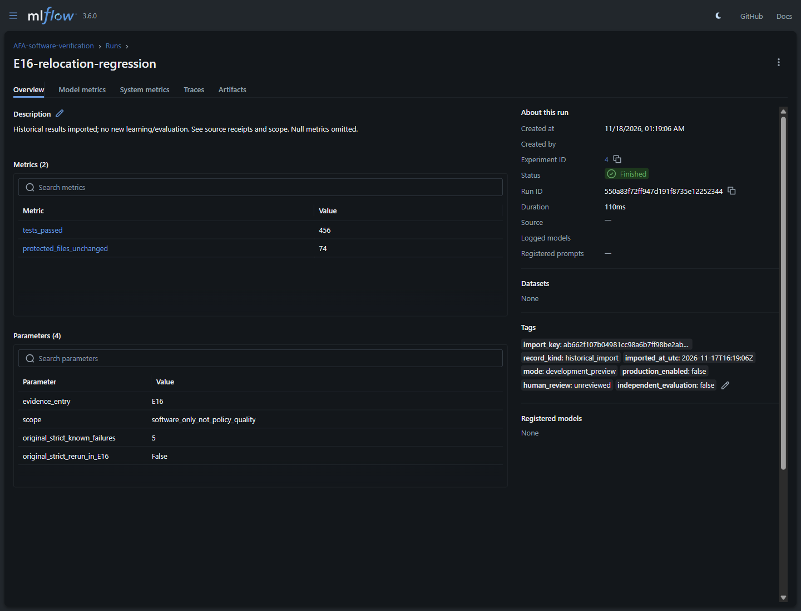

`tests_passed=456`, 보호 파일 74개 유지 결과다. 정책 성능이 아닌 소프트웨어 검사이며 `original_strict_known_failures=5`가 별도로 남아 있다. 화면 시간은 결과 가져오기 시점이다.

### E17 — 로컬 MLflow 실험 대시보드 / 2026-11-18

- **목적:** 문서·JSON·CSV를 따로 열지 않고 실험 비교, 학습 곡선, 종류별 반례, 원본 증빙을 한곳에서 확인한다.
- **변경:** 선택 의존성 `tracking`(MLflow 3.6.0·Matplotlib), `beauty_agent/afa/tracking.py`, 실행·지표 안내를 추가했다. localhost:5000 서버와 로컬 SQLite/artifact 저장소를 구성했다. 기본 프로그램과 학습 코드는 이 모듈을 자동 호출하지 않는다.
- **등록 범위:** 실험 4개 아래 v1 초기/학습후 2개, v2 정책·비용 조합 10개, 그래프 모음 1개, 소프트웨어 검사 2개로 총 15개 완료 기록이다. 과거 결과를 가져온 것이며 새 PPO 학습·성능 비교·EDA를 실행한 것은 아니다. CSV의 8개 시점과 실제 보고서 수치만 사용했다.
- **화면:** 질문 수·비용과 올바른 종료율 그래프를 함께 제공한다. 손세안·도구 사용 그래프도 포함하며 손세안의 4.50→4.75 악화를 숨기지 않는다. 학습 로그의 rollout 보상과 평가 결과, 소프트웨어 통과 수를 구분했다. 각 실행에 원본 보고서와 해시를 연결했다.
- **검사:** 전체 463개 통과(179.08초, 기존 Starlette 경고 1건). 이후 소프트웨어 결과 가져오기 분기 추가 후 선택 검사 7개도 재통과했고 실제 가져오기·HTTP 조회로 검증했다. 같은 원본 재등록의 ID·총수 불변, v1 지표 2기록·v2 10기록·부분군 20개·학습 곡선 8행·그래프 8개를 원본과 대조했다. 보호 대상 실행 코드·자료 74개와 가져오기 입력은 그대로다. 기본 검사 수집 369개, 원본 source manifest 27개, 오프라인 lock 검사를 확인했다. 루트 KB 검사·새 임상/독립 평가는 실행하지 않았다.
- **한계·다음:** 기록 인터페이스는 준비됐지만 미구현 v2 PPO에 실시간 자동 연결한 상태는 아니다. 다음은 EDA를 수행해 그 그래프·보고서를 MLflow에 기록하고, 비교 조건 확정 후 v2 학습기에 step별 기록을 연결한다. 서버는 이 PC 로컬 실행이며 상시 시작·외부 공유 서비스는 설치하지 않았다.
- **증빙:** `outputs/afa-mlflow-v1/`의 테스트 로그·가져오기 검증·화면 확인, `outputs/afa-mlflow/`의 DB와 artifact, 요약 JSON E17, [사용 안내](afa-mlflow.md). 원본 학습 당시 pyproject/lock 해시는 과거 값으로 보존하며 이번 선택 의존성 추가로 생긴 차이를 숨기지 않는다.

**MLflow 결과 화면 — 대시보드 구현 회귀 검사**

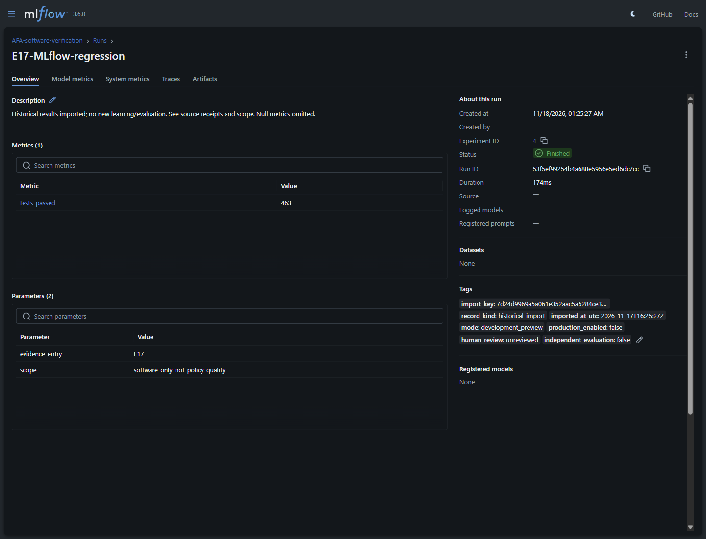

`tests_passed=463`은 당시 소프트웨어 검사 결과다. 임상 정확도·PPO 우위·이번 캡처에서 새 검사 실행을 의미하지 않는다. Created at·Duration은 가져오기 실행 기준이다.

### E18 — MLflow 첫 사용자 안내·화면 예시 / 2026-11-18

- **목적:** 처음 쓰는 팀원이 어디를 클릭하고 어떤 지표부터 해석할지 혼자 따라갈 수 있게 한다.
- **변경:** MLflow 역할·용어, 5분 시작 동선, 그래프와 원본 확인, 정책 비교, PPO 곡선·지표 설명, 문제 해결을 추가했다. 실제 화면 캡처 2개와 등록된 그래프 원본 1개를 문서에 포함했다. 설치·개발자 참고는 뒤에 보존했다.
- **검사:** 실제 로컬 MLflow 3.6.0 화면과 기존 E07/E13 수치를 대조하고 이미지·로컬 링크·Markdown 구성을 확인했다. 새 학습·평가·pytest는 실행하지 않았다. 463개 통과는 E17 기록이며 이번 문서 검토의 신규 시험 수가 아니다.
- **한계·다음:** 독자 이해도 실험은 수행하지 않았다. UI 배치는 버전·창 크기에 따라 다를 수 있으며 버튼을 못 찾으면 지표를 직접 읽는 대안도 적었다. 다음 구현 후보는 기존 계획대로 EDA다.
- **증빙:** `docs/afa-mlflow.md`, `docs/images/mlflow/`, `outputs/afa-mlflow-guide-v1/verification.json`, 요약 JSON E18. PPO-32에도 같은 진행 본문을 동기화한다.

**사용 안내 화면 — 모델 성능 결과가 아닌 화면 예시**

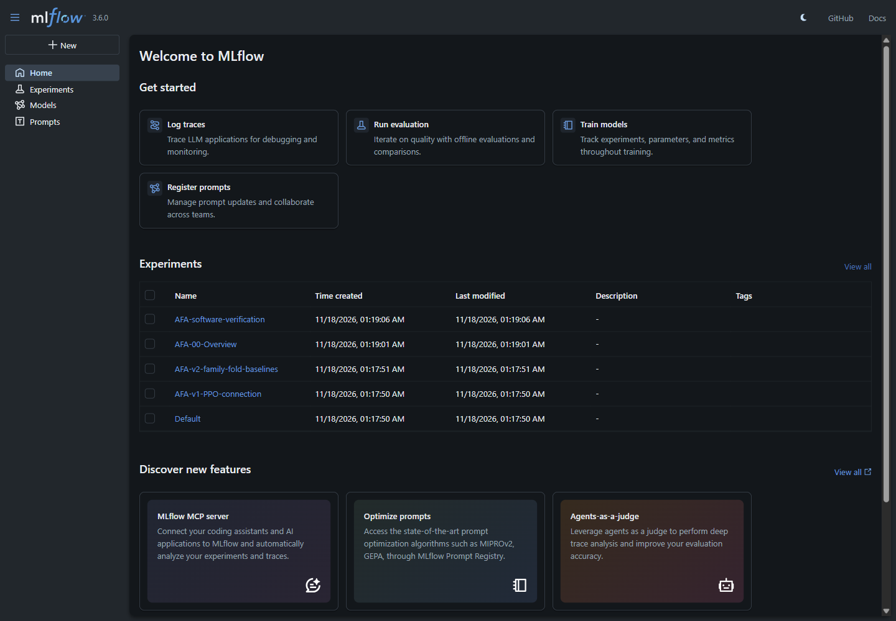

사용 안내를 위한 실제 화면이다. 새 학습이나 평가 결과가 아니다. 팀원은 아래 캡처만으로도 주요 결과를 볼 수 있으며, localhost 주소는 해당 서버 PC에서만 열린다.

### E19 — 단계별 결과 화면의 Linear 본문 공유 / 2026-11-18

- **목적:** 팀원이 로컬 서버 접근 없이 PPO-32에서 주요 결과와 한계를 바로 확인한다.
- **변경:** 실제 결과 화면 4개, 사용 안내 화면 1개, 등록 그래프 원본 2개를 단계에 맞게 배치하고 캡션을 추가했다. Linear에 직접 업로드한 이미지와 로컬 경로·해시의 대응을 `docs/afa-linear-assets.json`에 남겼다.
- **검사:** 실제 화면과 숫자를 확인하고 업로드 HTTP 성공, 이미지 경로·해시, 최종 이슈의 이미지 링크와 본문을 대조한다. 과거 JSON entries/receipts는 보존한다. 새 학습·평가·pytest는 실행하지 않는다.
- **한계·다음:** MLflow 기록이 없는 초기 단계는 원본 보고서로 확인한다. 캡처 시간·가져오기 소요시간과 원본 실험 시간을 구분한다. 앞으로 결과가 있는 단계는 업로드 이미지와 해석을 함께 갱신한다.
- **증빙:** `outputs/afa-linear-snapshots-v1/`, 요약 JSON E19, 단계별 PNG와 Linear asset 대응표.

### E20 — 전체 v67 EDA: 절차를 배우며 데이터 활용 범위 확인 / 2026-11-18

- **목적:** 기존 48개 환경만 보지 않고 전체 합성 데이터의 구성·규칙 검사·학습 활용 한계를 이해한다. EDA는 학습 전 자료를 탐색해 어떤 결정을 해야 할지 찾는 과정이다.
- **방법:** ① 시나리오/턴 구분 → ② 원본 해시·기존 전수 검사 → ③ 행동·카드·대화 길이·분할별 분포 → ④ 활성 질문 후보와 이후 관찰 이벤트 대조 → ⑤ 중복·상이 라벨 집계 + 행동별 train 2턴씩 총 12턴과 해당 12개 시나리오 전체 흐름 검토 → ⑥ MLflow 기록. 표본은 ID 해시 순서로 고정했으며 사람 전문가 승인이 아니다.
- **조건:** v67 전체 1,025상황 / 2,453턴, train 1,980·val 221·test 252턴. 기존 분할·라벨·KB를 바꾸지 않았다. 내부 test 구조를 읽었으므로 독립 미노출 최종 평가라고 부르지 않는다. 정형 전수 검사와 일부 내용 검토를 구분한다.
- **규모·치우침:** 다중 턴 964/1,025(94.05%), 등장 카드 58/60, B-C01(물 온도) 531/1,025(51.80%). 선택된 행동-대상 쌍은 127종, 후보 전체는 177종이다. 평균 성능 외에 카드·행동별 결과를 확인해야 한다.
- **응답 경로:** 활성 소비자 관찰 질문 후보 2,392회 중 이후 이벤트 있음 489회 / 기록 없음 1,903회(79.56%). 후보는 반복될 수 있고 선택되지 않은 질문도 포함하므로 전체 불량률·사용자 결측률이 아니다. 기록된 응답은 unknown/거절일 수도 있다. 다른 질문 순서의 응답을 보장하지 않아 그대로 자유 탐색 RL 환경으로 쓰기는 어렵다. 없는 값을 unknown으로 채우지 않는다.
- **중복·라벨:** 완전히 같은 입력의 중복 초과 행 31개, 분할을 넘는 동일 입력 그룹 0개, 같은 입력/다른 선택 그룹 3개. 모두 오류라고 판정하거나 원본을 삭제하지 않았다. train-919는 사용자가 burning 우선 확인을 요청하지만 제안이 추출 순서상 다른 후보를 가리키는 것으로 보여 후보 연결·우선순위 검토 대상으로 남겼다. train-582의 후속 문구도 검토 대상이다. 자세한 12개 사례와 한계는 [EDA 보고서](afa-v67-eda.md)를 따른다.
- **검사:** 기존 데이터 무결성·명시적 게이트 전수 검사 통과. 새 EDA 단위 검사 5개, 기본 실험 검사 374개 통과(기존 Starlette 경고 1개), source manifest 27/27 일치. 전체 선택 패키지 검사·원본 엄격 검사는 이번에 재실행하지 않았다. 374는 E17의 전체 463과 다른 범위다.
- **해석·다음:** 구조 통과가 의미적 라벨 승인이나 RL 가용성은 아니다. 48개는 v67에서 뽑은 48행이 아닌 별도 완결 격자다. 다음은 3개 상이 라벨 그룹·후보 우선순위 검토와 필요한 이벤트/제품 근거/반사실 응답 계약 정리다. v2 PPO 학습·전체 v67 학습·독립 평가는 이번에 실행하지 않았다.
- **증빙:** `outputs/afa-eda-v1/final/`의 집계·표본·검토·7개 그래프, 검사 stdout·verification.json, 요약 JSON E20, 분석/검사 코드 해시와 사본. [MLflow E20 실행](http://127.0.0.1:5000/#/experiments/5/runs/07f582a9da224c36a428b79fae10848b).

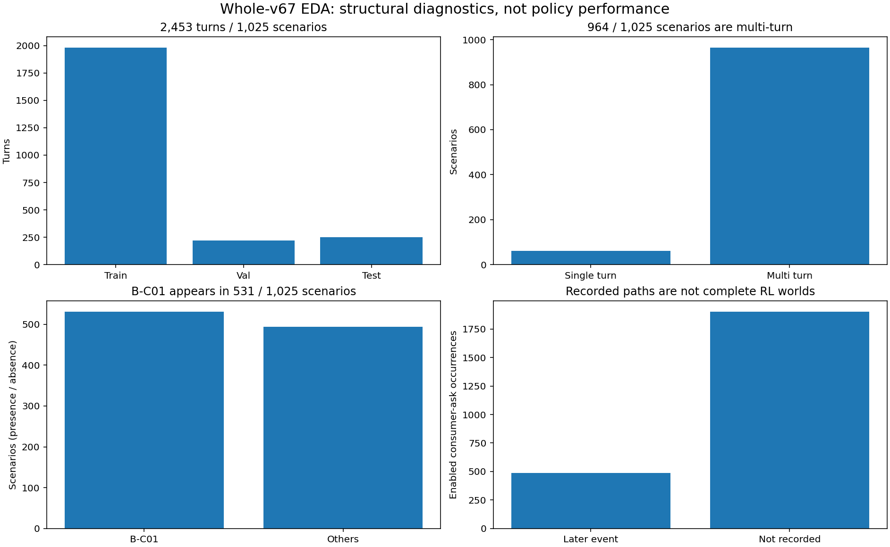

**읽는 법:** 왼쪽 위는 턴 수, 오른쪽 위는 상황 수다. 왼쪽 아래 Others는 B-C01 미등장 상황이다. 오른쪽 아래는 질문 후보 출현 횟수이며 사용자 수가 아니다. 네 그림의 분모를 같다고 보면 안 된다. 이것은 새 EDA 그래프이며 정책 성능 그래프가 아니다.

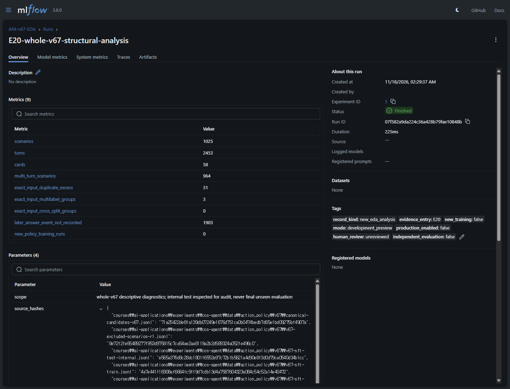

**화면 해석:** scenarios=1,025·turns=2,453·cards=58은 데이터 규모다. 상이 라벨 3그룹은 오류 확정 수가 아니다. `new_policy_training_runs=0`으로 새 학습과 구분했다. Duration은 결과 등록 소요시간이며 전체 분석·내용 검토 시간이나 학습 시간이 아니다.

### E21 — 라벨 후속 검토·응답 연결 사전 검증·EDA 이슈 분리 / 2026-11-18

- **목적:** 원본 기록을 RL 응답으로 옮기기 전에 다른 질문의 답을 재사용하거나 허용 행동을 유일한 최적 정답으로 취급하는 오류를 막는다.
- **변경:** `v67_responses.py`에 바로 다음 이벤트의 대상 검사와 `require_recorded_response` 사전 검증을 추가했다. 다른 행동·대상·후보 확인 초점이면 기록된 응답 재사용을 거부한다. 실제 unknown/거절/충돌은 보존하고 없는 답은 오류로 알린다. 행동 실행·Gym 전이·상태 커밋은 하지 않는다. 계약·리뷰 결정은 `data/afa/v67-review-v1/`에 보관한다.
- **조건:** train 858상황 / 1,980턴. 5항목에 걸친 train 10턴 상세 검토. E20의 12턴 표본과 다른 집계이며 합쳐 오류율을 추정하지 않는다. 원본 v67·KB·분할·기존 48개 환경을 바꾸지 않았다.
- **라벨 결정:** 질문/보류 2그룹은 선호·목적 기준 검토, 도구/건조 1그룹은 허용된 질문 순서 대안이다. train-919 첫 제안은 요청한 burning의 위치 1 대신 0을 가리킨다. 대상·근거 참조를 함께 바꾸는 조건부 수정안을 원래 해시와 기록했으며 원본·학습에는 미적용이다. 둘째 턴의 남은 0 확인은 재질문 오류가 아니다. train-582는 같은 발화 내 의도 변경으로도 읽혀 확정 오류·자동 제외로 분류하지 않았다.
- **다음 이벤트 결과:** 대응 응답 있음 567 / 다음 기록 없음 351 / 다음 기록은 있지만 해당 응답 없음 99 / 프로필·제품 확인 어댑터 필요 153 / 제품 근거 결과 어댑터 필요 99 / 보류·초안 별도 종료 판단 711 = 1,980턴. 567은 RL 가용 턴·에피소드 수가 아니다. E20의 전체 활성 질문 후보/이후 어느 턴 집계와 분모가 달라 개선율로 비교하지 않는다.
- **검사:** 새 회귀 검사 10개, 기본 실험 검사 384개 통과(기존 Starlette 경고 1개). source manifest 27/27 일치. 선택 Gym/PPO/MLflow 전체 검사와 원본 엄격 검사는 이번에 재실행하지 않았다. 기존 전체 463·원본 5개 실패 기록을 덮어쓰지 않는다.
- **공유:** [PPO-33 — EDA 상세](https://linear.app/ppopy/issue/PPO-33)를 PPO-32의 하위 이슈로 생성하고 kang kang에게 배정했다. 전체 EDA 문서와 이번 [후속 검토](afa-v67-response-contract.md), 그래프·실제 화면을 모았다. 원본 E20 기록은 보존하며 이후 상세 문서는 같은 PPO-33에 동기화한다.
- **다음:** 작은 train 파생 범위에 부모 계보·시간 순서·명시 응답을 갖춘 픽스처를 작성하고 지원 행동의 응답 완비를 검사한다. 조회·제품/프로필·후보 확인의 지원 범위를 고정한 뒤 환경에 연결한다. 새 PPO 학습·전체 v67 rollout은 이번에 실행하지 않았다.
- **증빙:** `outputs/afa-v67-review-v1/`의 원본 집계·검사 stdout·코드/자료 해시·verification.json, 요약 JSON E21. [MLflow E21](http://127.0.0.1:5000/#/experiments/5/runs/a20f4496fd2847e08e27ccb3aea1cebb).

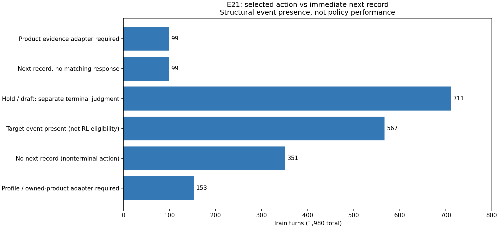

**해석:** 합계는 train 1,980턴이며 대응 이벤트 존재만 확인했다. 오류율·정책 성공률·RL 가용 에피소드 수가 아니다. 그래프 원본이다.

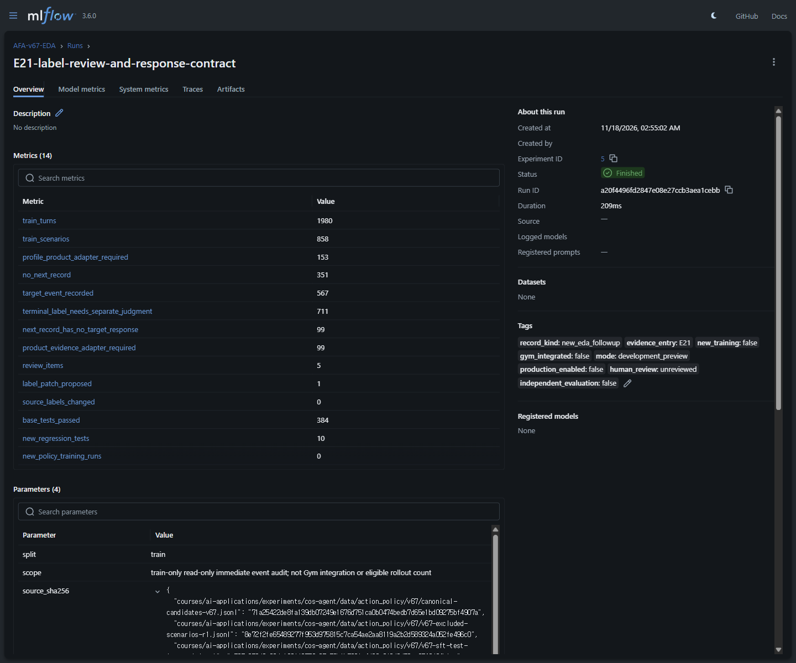

**화면 읽기:** 수정안 1개, 원본 라벨 변경 0개, 기본 검사 384개를 구분한다. 새 정책 학습은 0회다. Duration은 결과 등록 소요시간으로 전체 검토·학습 시간이 아니다.

### E22 — 작은 train 파생 응답 자료·누락 검사 / 2026-11-18

- **목적:** 질문 순서를 바꾼 실험에서 답을 임의로 채우지 않도록, 지원 범위의 응답과 출처를 사전에 정의한다.
- **변경·조건:** train-847/848/849/851의 B-C02 정적 상황 4개에서 도구·마찰·건조 응답표를 만들었다. 처음에는 부위만 공개한다. 실제 SFT train 소속·부모 계보·해시를 보존하고 정정/충돌/제품/후보 확인이 있는 부모는 거부한다. 원래 후속 문장을 다른 질문 분기에 재생하지 않는다.
- **자료 결과:** 응답표 12개 중 원래 값 보존·정적 순서 변경 가정 4개(unknown 3·declined 1), 명시적인 신규 가상 응답 8개다. 자료 수준 질문 순서 24개, 공개 이력 64개, 응답 연결 60개를 검증했다. 응답이 있더라도 KB가 실제 허용하는 질문인지는 별도 검사다. 24는 독립 상황 수·성공률이 아니다.
- **라벨 파생:** 919 첫 턴만 원래 입력·제안 해시가 맞을 때 별도 파생 1행으로 수정했다. 대상·근거 참조와 설명문을 함께 1/burning에 맞췄다. E21 제안만 적용하면 설명문에 0이 남는 점을 E22에서 보완했다. 원본·현재 학습 입력·둘째 턴 제안은 바꾸지 않았다. 파생본도 사람 미검토·training_ready=false다.
- **검사:** 새 회귀 8개, 선택 Gym/PPO/MLflow까지 전체 실험 486개 통과(기존 Starlette 경고 1개), source manifest 27/27 일치. 미등록 경로·누락 응답·초기 미래 답 노출·재질문·조건부 패치 해시 불일치 등을 거부했다. 원본 엄격 검사는 이번에 재실행하지 않았고 알려진 5개 실패를 유지한다.
- **한계·다음:** 자료 수준 검사이며 실제 Gym 전이·실행·보상·종료 정답·PPO 학습은 아니다. 기존 64차원 v2 환경에 파일만 교체할 수 없다. 다음은 이 제한된 자료의 초기 공개 상태·unknown/거절·실행 게이트·종료·롤백을 다루는 어댑터 연결과 검증이다.
- **증빙:** [자료 안내](../data/afa/v67-fixtures-v1/README.md), [쉽게 읽는 E22 상세](afa-v67-response-contract.md#e22-fixtures), `outputs/afa-v67-fixtures-v1/`의 보고서·검사 로그·해시·검증, 요약 JSON E22. [MLflow E22](http://127.0.0.1:5000/#/experiments/6/runs/2f193f1b366e45c18b6c2e7776a64f8a). [PPO-33](https://linear.app/ppopy/issue/PPO-33)에도 상세와 결과 이미지를 동기화한다.

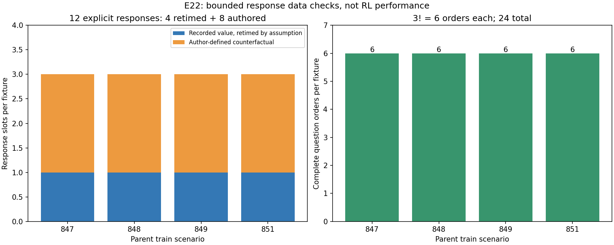

**읽는 법:** 왼쪽은 상황당 응답 3개의 출처, 오른쪽은 질문 순서 6개다. 단위가 다르며 데이터 검사다. 원래 값을 순서를 바꿔 쓰는 것도 별도 가정으로 표시했다.

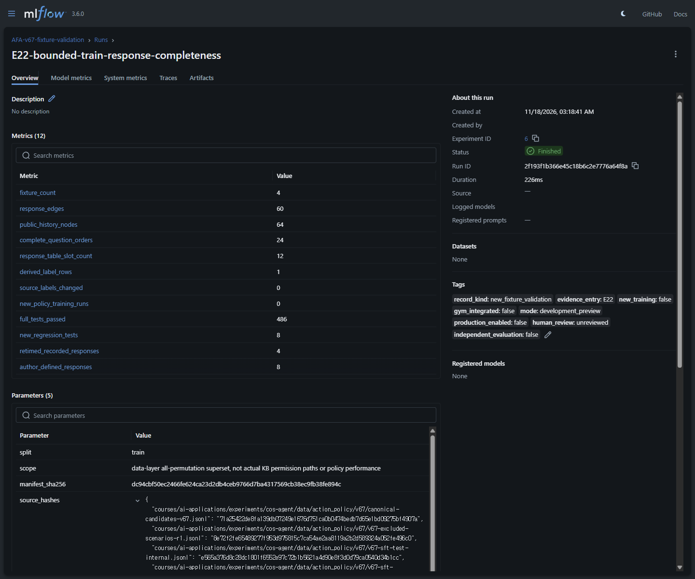

**화면 해석:** 상황 4·질문 순서 24·응답 연결 60을 구분한다. 파생 라벨 1행은 완성 RL 상황 1개가 아니다. 원본 변경·새 정책 학습은 0이며 Duration은 등록 소요시간이다.

### E23 — 질문·보류 기준과 제한된 실행 어댑터 / 2026-11-18

- 022/224와 306/327의 두 행동은 모두 실행 가능했다. 필수 부위를 물을 수 있고 보류 신호가 없으면 AFA 정보 획득 과제에서는 질문을 우선한다. 두 그룹은 과제 목적에 따른 차이가 있어 단일 정답 학습 보류로 기록했다.
- B-C02 train 파생 상황 4개에서 기존 KB와 실행 게이트를 사용했다. 46개 공개 이력에서 질문 42개·보류 46개·초안 요청 15개를 실행했다. 자료 수준 60개 연결 중 실제 규칙이 열어 준 질문은 42개였다. 849는 도구를 먼저 확인했을 때 이후 질문이 닫혔다.
- 회귀 5개와 기본 397개 통과. 실행 전 응답 누락, 거절 뒤 재질문, 이른 초안, 오래된 입력, 실행 실패 시 상태 복구를 확인했다. 전체 선택 검사 최신 기록은 E22의 486개다.
- Stage 0 합성 프로필·제품을 고정한 어댑터 범위다. 비교 실험의 종료 정답·질문 비용과 보상은 다음 단계에서 결정한다. 원본 경로별 보고서와 증빙은 `outputs/afa-v67-runtime-v1/`에 있다. [상세 검토](afa-v67-response-contract.md#e23-runtime) · [MLflow E23](http://127.0.0.1:5000/#/experiments/6/runs/ed46d58114104bbcba2d24e1f272de70)

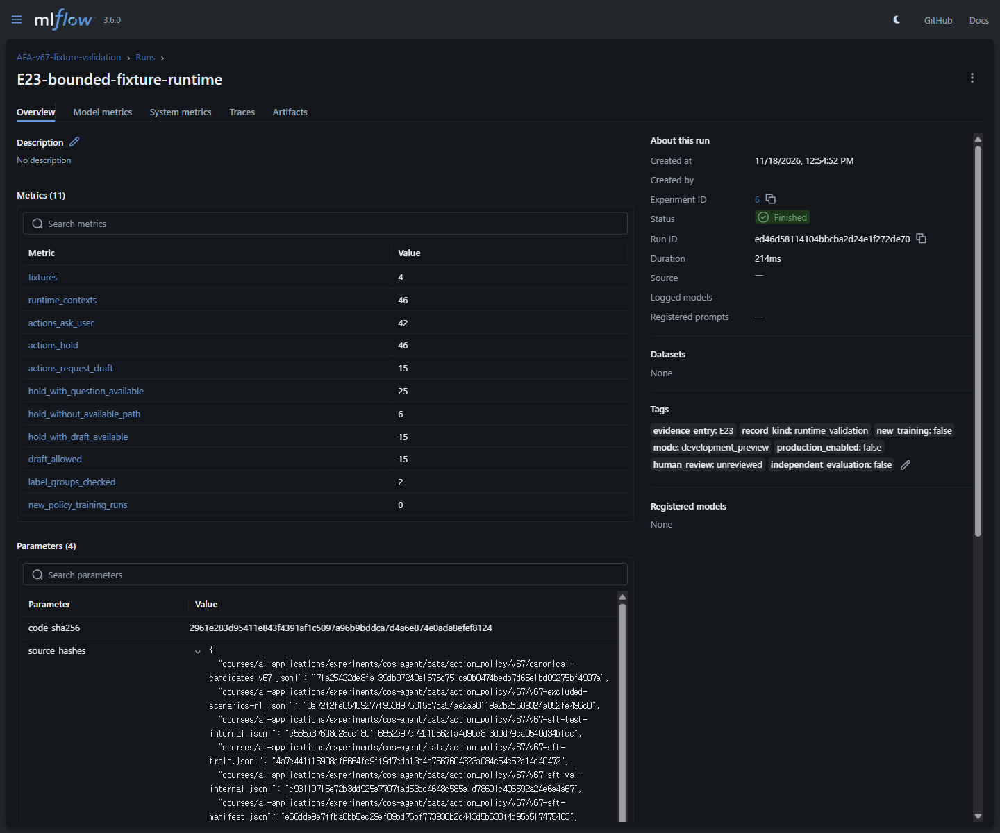

화면에는 네 상황에서 도달한 공개 이력과 실제 실행 선택 수가 표시된다. Duration은 결과 등록 시간이다.

### E24 — 질문 비용과 종료 채점 / 2026-11-18

- 질문 비용 1, 종료 오류 손실 4, 최대 질문 3으로 첫 개발용 채점을 정했다. KB가 허용한 종료도 전체 응답으로 계산한 기준 판정과 대조한다.
- 4상황의 종료 경로 61개 중 기준 일치 초안 15개, 적절한 보류 6개, 성급한 보류 25개, 초안 누락 15개를 확인했다. 별도 도구·마찰 동시 사례에서 같은 카드 상태라도 권고 행동이 다른 초안은 −5점, 기준에 맞는 초안은 −1점이었다.
- 기본 실험 검사 399개 통과. 종료 채점의 상세 기준과 재현 명령을 기록했다. [응답 계약 E24](afa-v67-response-contract.md#e24-reward)

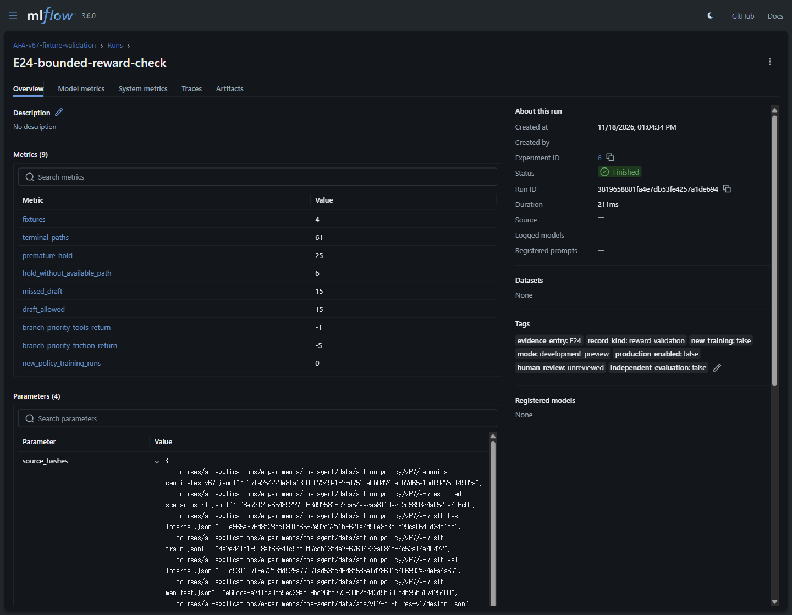

화면은 기본 네 상황과 별도 반례의 채점 결과를 표시한다. [MLflow E24](http://127.0.0.1:5000/#/experiments/6/runs/3819658801fa4e7db53fe4257a1de694)

### E25 — 공개 정보 기준선 비교 / 2026-11-18

- 같은 B-C02 train 파생 상황 4개와 E24 채점표로 6개 방식을 비교했다. 무작위 반복을 포함한 실행은 272회다.
- 기존 규칙·도구 우선·마찰 우선·질문 무작위의 평균은 2.25회, 올바른 종료율은 모두 100%였다. 보류까지 무작위로 고르면 평균 1.25회였지만 올바른 종료는 31/128에 그쳤다.
- 공개 정보 결정 트리를 같은 네 상황에 맞춰 계산한 결과 평균 2.00회, 올바른 종료 4/4였다. 가족을 분리한 평가에서 개선이 재현되는지 확인할 필요가 있다.
- 기본 검사 400개 통과. 정책별 조건과 상황별 결과는 [응답 계약 E25](afa-v67-response-contract.md#e25-baselines)에 있다.

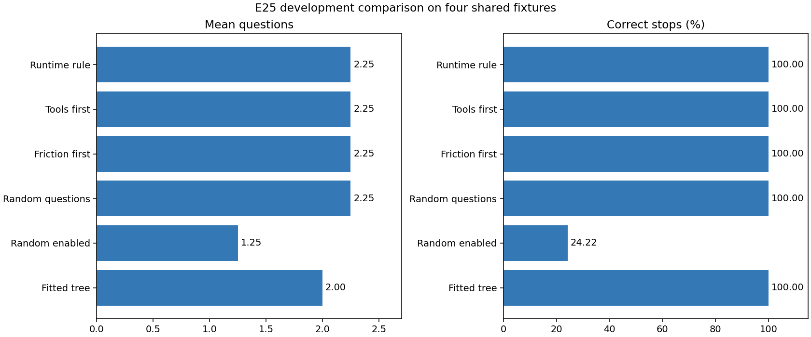

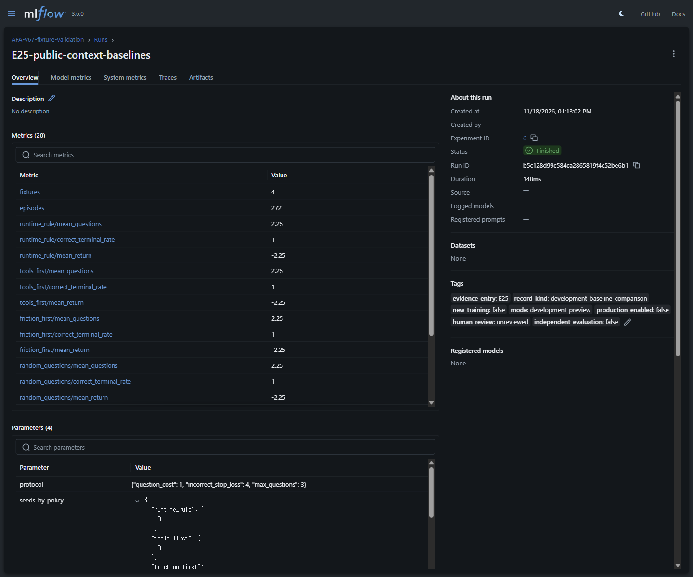

정책별 질문 수·종료율 원본과 실행 조건은 MLflow에 있다. [MLflow E25](http://127.0.0.1:5000/#/experiments/6/runs/b5c128d99c584ca2865819f4c52be6b1)

### E26 — B-C02 PPO 학습 전 검증 / 2026-11-18

- 도구·마찰 조합을 가족으로 묶어 64개 상황을 학습 32·검증 16·시험 16으로 고정했다. 이전 개발 상황과 반례가 속한 5가족은 학습에만 포함했다.
- 종료 경로 940개를 확인했고 모든 상황에 유효한 종료가 있었다. 도구 우선 기준선은 검증·시험 각각 올바른 종료 16/16, 평균 질문 2.25회였다.
- 고정 행동 6개와 공개 관찰 15차원을 Gym 마스크와 연결했다. MaskablePPO 초기화와 행동 예측을 확인했고 학습 스텝은 0이다. 전체 실험 테스트 496개 통과. [학습 전 검증 안내](../data/afa/ppo-preflight-v1/README.md)

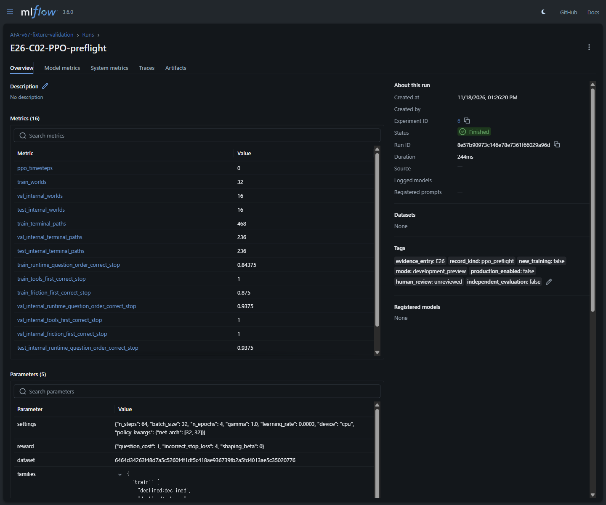

[MLflow E26](http://127.0.0.1:5000/#/experiments/6/runs/8e57b90973c146e78e7361f66029a96d)에서 분할·기준선·종료 경로와 학습 스텝을 확인할 수 있다.

### E27 — 목표 구조와 AFA 책임 정정

- Python 런타임이 날씨·제품 조회, 상태 반영, 질문 대기·재개, 추천·보류 종료를 맡는다. AFA는 질문이 필요할 때 허용된 질문 중 다음 질문을 고른다.
- 추천 결과는 확인된 상황과 근거를 바탕으로 생활습관 조정, 보유품 활용, 사용 제외·보류, 대체품 추천을 담는다.
- E26은 세안 질문 전략을 위한 별도 합성 환경이며 초기화 검증까지 0스텝이다. 목표 구조도·이슈·문서를 정정했다. 기존 측정값은 해당 실험의 기록이다.
- 관련 Markdown 45개를 정리하고 새 링크·문서 해시를 검증했다. Linear 이슈 8건을 개정했으며 PPO-32·PPO-33의 기존 MLflow 이미지 29장을 유지했다.
- 다음 설계는 전체 행동 목록, 선택 주체, 허용 조건, 도구 결과, 대기·재판단·종료 계약이다. [목표 구조](agent-runtime-target.md)

### E28 — B-C02 첫 PPO 학습과 기준선 비교 / 2026-11-18

**질문.** 같은 세안 상황에서 기존 고정 순서보다 덜 묻고, 같은 품질로 끝낼 수 있는가? 여기서 올바른 종료는 합성 환경의 KB 기준과 종료 조건을 충족하는 것을 뜻한다. 실제 사용자 만족도나 임상 결과와는 별개의 지표다.

**조건.** B-C02(세안 도구·마찰·건조), 합성 64상황을 유사 응답 구조인 가족 단위로 학습 32상황(8가족), 검증 16상황(4가족), 시험 16상황(4가족)으로 나눴다. CPU에서 Maskable PPO를 4,096스텝, seed 0으로 한 번 학습했다. 스텝은 정책이 환경에서 행동을 한 번 실행하는 단위다. 모델 평가는 학습·검증에서만 실행했다. 시험 분할의 고정 기준선과 경로 점검은 기존 사전검사의 일부이며, 시험 분할에서 학습 모델을 평가하거나 설정을 고르지 않았다.

| 분할 | 방식 | 올바른 종료 ↑ | 평균 질문 ↓ | 평균 return ↑ |
| --- | --- | ---: | ---: | ---: |
| 학습 | 기존 런타임 질문 정렬 순서 | 27/32 | 2.3125 | −2.9375 |
| 학습 | 세안 도구 우선 | 32/32 | 2.3750 | −2.3750 |
| 학습 | 마찰 우선 | 28/32 | 2.3750 | −2.8750 |
| 학습 | PPO seed 0 | 32/32 | 2.3125 | −2.3125 |
| 검증 | 기존 런타임 질문 정렬 순서 | 15/16 | 2.3125 | −2.5625 |
| 검증 | 세안 도구 우선 | 16/16 | 2.2500 | −2.2500 |
| 검증 | 마찰 우선 | 16/16 | 2.2500 | −2.2500 |
| 검증 | PPO seed 0 | 16/16 | 2.3125 | −2.3125 |

**해석.** 검증에서 PPO는 초안 10건과 더 진행할 수 없어 보류한 6건을 올바르게 구분했다. 도구 우선의 총 질문 36회보다 1회 많았다. `hands:strong`(손세안·강한 마찰) 가족의 4상황 중 3상황에서 각각 질문이 한 번 늘었고, 두 다른 가족의 한 상황씩에서는 각각 한 번 줄었다. 학습에서 줄어든 질문은 검증에서 재현되지 않았다. `return`은 질문당 −1, 잘못된 종료 시 추가 −4를 반영하므로 높을수록 이 실험의 목적에 가깝다. 단일 seed와 4개 검증 가족의 개발 비교이며 규칙 기준선을 유지한다.

**이미 아는 값 확인.** 합성 확정 관찰을 Context에 넣은 5개 사례에서 이미 아는 질문 후보가 모두 비활성화됐다. 저장된 모델은 여전히 후보가 열린 4개 사례에서 남은 질문을 고르고, 세안 도구만으로 판정이 끝난 사례에서는 실험용 초안을 선택했다. 현재 환경의 초기화 계약은 얼굴 부위만 사전 입력하도록 고정되어 있다. 이번 진단은 Context와 마스크를 직접 검사했으며, 사전 입력을 반영한 전체 에피소드와 실제 DB·날씨 연결은 후속 범위다.

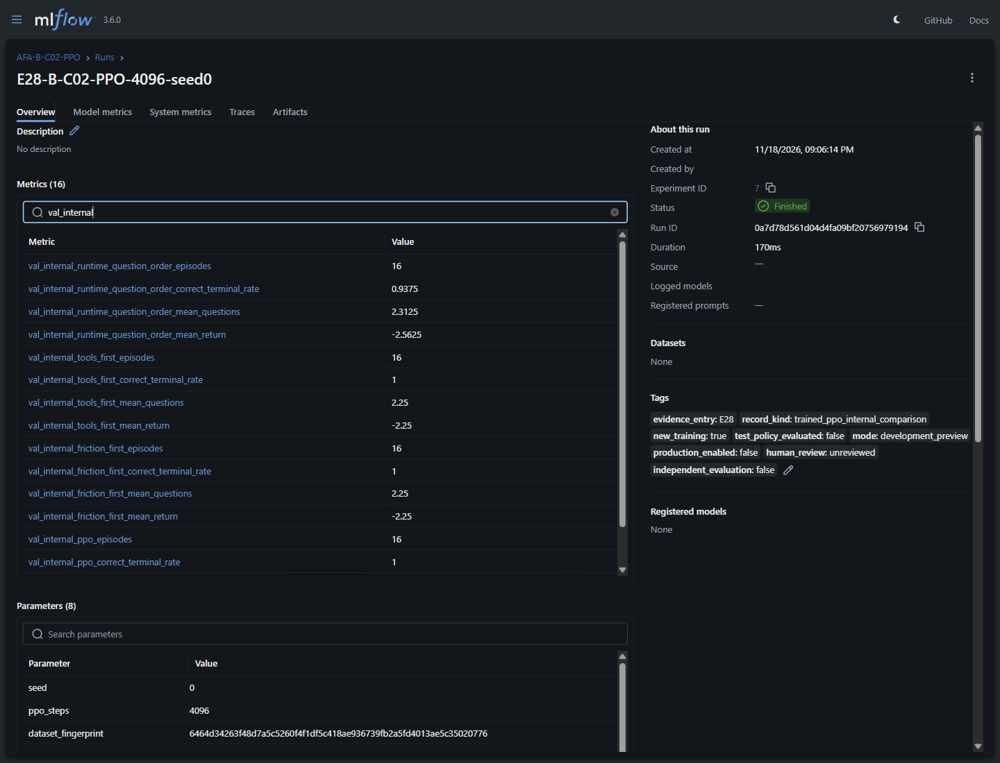

[MLflow E28](http://127.0.0.1:5000/#/experiments/7/runs/0a7d78d561d04d4fa09bf20756979194)에서 지표와 `charts/validation-comparison.png`를 확인한다. MLflow 기록은 학습 후 등록했으므로 화면의 Duration은 등록 시간이다. 원본 보고서, 상황별 CSV, 설정·해시, Context 진단과 모델은 저장소 루트 `outputs/afa-e28/`에 기록했다. 모델은 로컬 파일로 보관한다.

### E29 — B-C02 PPO 재현과 AFA 결과 반환 / 2026-11-18

E28의 seed 0과 가족 분할을 유지해 CPU에서 MaskablePPO 4,096스텝을 별도로 실행했다. 32개 학습·16개 내부 검증 상황에서 학습 전 정의한 세 규칙과 비교했다. 데이터 지문과 기준선·PPO의 상황별 평가 결과는 E28과 일치했다. 고정 환경의 사전 점검에는 시험 분할이 포함되며 학습한 정책은 그 분할에서 평가하지 않았다.

| 분할 | 정책 | 올바른 종료 | 평균 질문 ↓ | 평균 보상 ↑ |
| --- | --- | ---: | ---: | ---: |
| 학습 | 기존 순서 | 27/32 | 2.3125 | −2.9375 |
| 학습 | 도구 우선 | 32/32 | 2.3750 | −2.3750 |
| 학습 | 마찰 우선 | 28/32 | 2.3750 | −2.8750 |
| 학습 | PPO | 32/32 | 2.3125 | −2.3125 |
| 내부 검증 | 기존 순서 | 15/16 | 2.3125 | −2.5625 |
| 내부 검증 | 도구 우선 | 16/16 | 2.2500 | −2.2500 |
| 내부 검증 | 마찰 우선 | 16/16 | 2.2500 | −2.2500 |
| 내부 검증 | PPO | 16/16 | 2.3125 | −2.3125 |

검증에서 PPO는 도구 우선과 종료 품질이 같았고 질문은 합계 1개 더 했다. 도구 우선을 비교 기준으로 유지한다. 동일 seed 재실행의 일치 여부를 확인한 결과이며 seed에 따른 변동과 실제 사용자 효과는 미측정이다.

`PPOAFAPolicy`는 로컬 저장 모델을 불러와 `acquire` 또는 `stop`을 반환한다. `run_acquisition`은 호출자가 제공한 응답과 허용 조건을 사용해 `AFAHandoffResult`를 조립한다. 기존 6개 행동의 변환을 검사했으며 별도의 안전 보류 인덱스는 새 입력 계약에 해당 조건이 없어 마스킹한다. 런타임은 안전 조건과 실제 질문 전송·대기·재개·최종 권고를 담당한다.

실제 체크포인트를 사용한 합성 시험 두 건에서 이미 확인한 도구를 건너뛰었다. 한 건은 마찰·건조 답을 확보해 `sufficient`로, 다른 한 건은 응답 거절을 기록해 `insufficient`로 반환했다. 이 두 건은 계약 검증이다. 선행 정보로 시작하는 새 분할에서의 정책 성능과 앱 연동은 별도 검증 항목이다.

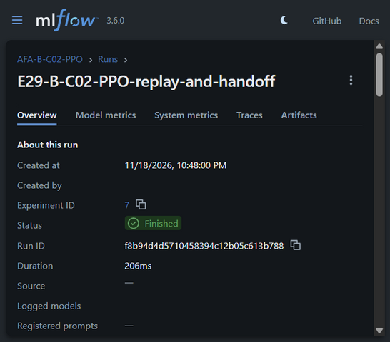

[MLflow E29](http://127.0.0.1:5000/#/experiments/7/runs/f8b94d4d5710458394c12b05c613b788)에서 비교 지표와 그래프를 확인할 수 있다. 기록은 학습 후 등록했다. 명령·원본 보고서·CSV·모델·로그·파일 해시는 저장소 루트 `outputs/afa-e29/`에 보관한다.

### E30 — B-C02 선행 정보와 종료 정확도 / 2026-11-18

E29의 PPO 모델 파일을 고정했다. 같은 검증 16상황·4가족에서 세안 도구·마찰·건조의 여덟 가지 시작 조합을 만들었다. 아무 값도 제공하지 않는 조합은 기존 비교와 상황별로 일치했다. 나머지 일곱 가지 조합이 정책별 112조건이다. 이 수는 원래 16상황의 변형이며 독립 표본 수는 16상황이다. 선택된 초기 관찰만 정책에 공개하고 명시적으로 기록된 모름·거절은 그대로 유지했다. 최초에 주어진 값은 새 질문 수에서 제외했다.

두 정책에 같은 KB·후보·중단 허용 조건을 적용했다. 올바른 종료는 질문·판정 규칙과 전체 답변을 공개했을 때의 KB 결과를 바탕으로 채점했다. 아래는 내부 검증 지표다.

| 시작 관찰 수 | 조건 수 | 도구 우선 올바른 종료 | PPO 올바른 종료 | 도구 우선 질문 합계 | PPO 질문 합계 |
| --- | ---: | ---: | ---: | ---: | ---: |
| 0 | 16 | 16 | 16 | 36 | 37 |
| 1 | 48 | 47 | 47 | 61 | 62 |
| 2 | 48 | 47 | 47 | 26 | 26 |
| 3 | 16 | 16 | 16 | 0 | 0 |
| **선행 정보 있음** | **112** | **110** | **110** | **87** | **88** |

112조건에서 PPO는 두 조건에서 질문을 덜 했고, 세 조건에서 더 했으며 107조건은 같았다. 이미 충분하고 전체 관찰 결과와 일치한 42조건에서 두 정책 모두 질문 없이 정확히 이관했다. 명시적 모름·거절이 시작 상태에 포함된 74조건에서는 두 정책 모두 73건을 올바르게 종료했다. 이 집단의 질문 합계는 도구 우선 66개, PPO 64개였다. 새 학습, 시험 분할 평가, 실제 사용자·Aurora 검증은 미실행이다. 오래된 값이나 상충 상태는 런타임의 확인·정정 계약을 갖춘 뒤 별도로 평가한다.

두 정책이 함께 틀린 2조건은 같은 합성 상황이었다. 강한 건조 마찰이 먼저 확인되면 공통 게이트가 도구 질문을 닫고 충분 종료를 허용했다. 모든 관찰을 공개하면 세안 도구 분기가 우선했다. 표시 문구는 같았지만, KB의 행동 분류가 `suggest_behavior_change`에서 `inform_general_practice`로 바뀌어 이 실험의 채점 기준에서 불일치였다. 공통 종료 조건을 검토할 반례로 보관한다. 이미 본 사례는 후속 최종 평가와 분리한다.

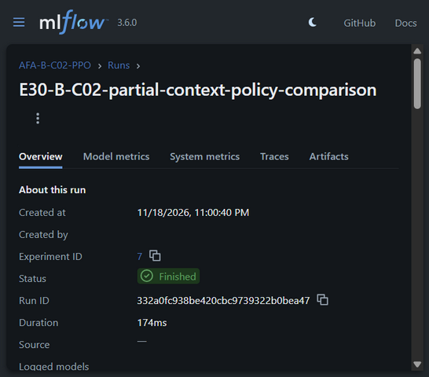

[MLflow E30](http://127.0.0.1:5000/#/experiments/7/runs/332a0fc938be420cbc9739322b0bea47)에서 시작 관찰 수별 지표와 비교 그래프를 확인할 수 있다. 원본은 `outputs/afa-e30/`의 보고서·상황별 CSV·쌍별 비교·종료 실패 분석에 남겼다.

### E31 — B-C02에서 질문을 멈춰도 되는 조건 / 2026-11-19

두 오류 조건을 재현했다. 강한 건조 마찰만 공개한 경우와 마찰이 미상이라는 답도 공개한 경우다. 둘 다 공통 규칙이 세안 도구 질문을 닫고 초안을 허용했다. 도구가 확인되면 표시 문구는 같아도 KB의 행동 분류가 달라졌다.

검증 후보는 기존 규칙이 초안을 허용할 때, 실제 숨은 답을 보지 않고 사전 정의한 응답 조합으로 KB 판단이 바뀌는지 검사한다. 바뀔 수 있으면 충분 종료를 막고 영향이 있는 질문만 다시 연다. 이미 확인했거나 모름·거절한 값은 다시 묻지 않는다. 검증 범위는 B-C02 합성 실험이다.

| E30과 같은 선행 정보 112조건 | 도구 우선 | E29 PPO |
| --- | ---: | ---: |
| 기존 규칙의 올바른 종료 | 110 | 110 |
| 검증 후보의 올바른 종료 | 112 | 112 |
| 기존 규칙의 새 질문 합계 | 87 | 88 |
| 검증 후보의 새 질문 합계 | 102 | 103 |
| 기존 무질문 성공 42조건 중 무질문 유지 | 29 | 29 |

오류 두 조건에서 세안 도구를 한 번씩 물어 문제를 해결했다. 이전에 맞게 끝난 13조건에서도 질문이 하나씩 추가됐다. 강한 건조 마찰만 확인된 반례와 이전에 맞게 끝난 다른 세 상황은 공개 입력이 같았다. 초기 값만으로 실제 세안 도구를 구분할 수 없었다.

E30에 사용하지 않은 기존 train 32상황에서도 도구 우선 회귀를 별도로 확인했다. 선행 정보가 있는 224조건 모두 올바르게 종료했다. 이 자료는 PPO 학습과 겹치며, 본 비교의 112조건도 같은 16상황의 반복이다. 새 학습·시험 분할 평가·실제 사용자 검증은 미실행이다.

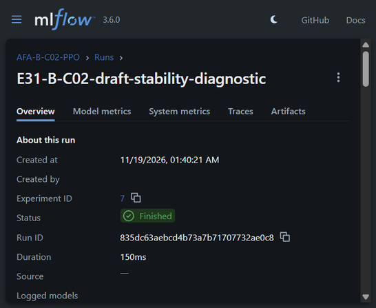

[MLflow E31](http://127.0.0.1:5000/#/experiments/7/runs/835dc63aebcd4b73a7b71707732ae0c8)과 `outputs/afa-e31/`에서 결과·재현 명령·동일 입력 분석을 확인할 수 있다.

### E32 — B-C02의 종료를 실제 권고 효과로 검토 / 2026-11-19

E31의 두 오류는 B-C02의 내부 행동 분류만 달랐다. 실제 권고 문구, 근거 출처, 다음 조회·보류와 후속 효과는 같았다. 이 두 분류만 동일하게 해석하고, 나머지 권고·근거·조회·보류·제품 조치·추가 검토의 차이는 유지했다. 이전 분류 그대로 비교한 E31 결과도 보존한다.

같은 검증 16상황의 선행 정보 변형 112조건에서는 기존 규칙과 새 효과 비교 규칙 모두 두 정책에서 **112/112**였다. 도구 우선 87개, PPO 88개 질문이었다. 엄격한 내부 분류 비교를 적용해도 효과 기준 정확도는 같았고 질문만 정책별로 15개씩 늘었다.

실제 E29 체크포인트를 넣은 로컬 런타임도 확인했다. 요청이 질문을 반환하고 다음 호출에서 답변을 반영했다. 세안 도구를 확인한 사례는 권고로 종료했고, 세 질문을 모두 거절한 사례는 최종 보류로 종료했다. 허용되지 않은 질문이나 종료 제안은 규칙 경로로 복구한다.

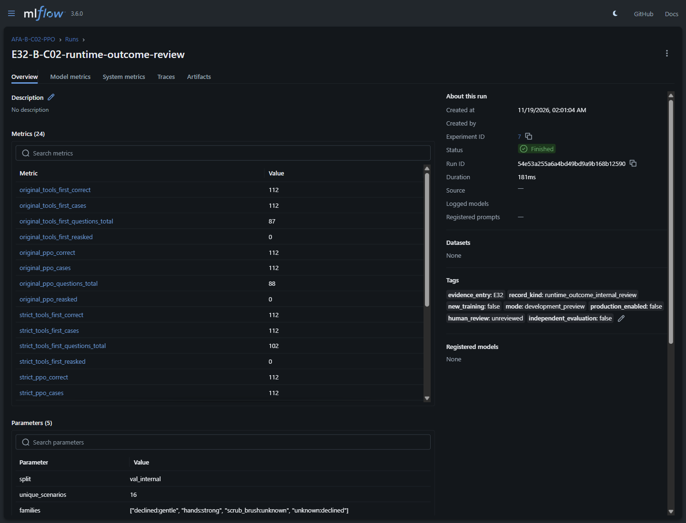

[MLflow E32](http://127.0.0.1:5000/#/experiments/7/runs/54e53a255a6a4bd49bd9a9b168b12590) · 원본 `outputs/afa-e32/`

### E33 — B-C02 세 seed 재현성과 고정 내부 시험 / 2026-11-19

기존 seed 0과 같은 환경에서 seed 1·2를 각각 4,096스텝 학습했다. 세 체크포인트 모두 내부 검증 16/16, 평균 질문 2.3125회였다. 시험 평가 전에 모델·설정·코드 해시와 적용 기준을 기록했다. 도구 우선이 맞힌 조건에서 새 오류가 없고, 모든 seed가 시작 정보 유무 양쪽에서 질문을 줄이며 재질문이 없어야 한다는 개발 적용 기준이다.

| 고정 시험 | 비교 조건 수 | 모든 방식의 올바른 종료 | 도구 우선 질문 합계 | PPO 질문 합계 (각 seed) |
| --- | ---: | ---: | ---: | ---: |
| 시작 정보 없음 | 16 | 16/16 | 36 | 37 |
| 시작 정보 있음 | 112 | 112/112 | 87 | 88 |

시작 정보가 있는 112조건은 같은 시험 16상황·4가족에서 만든 변형이다. 모든 방식의 재질문은 0건이었다. PPO 적용 기준은 질문 절감에서 충족되지 않았다. 평가한 모델은 명시적인 로컬 실험 옵션으로 두며 기본 루프는 도구 우선 규칙을 사용한다.

고정 시험 이후, 같은 사례를 실제 오프라인 Python 런타임의 별도 요청으로 다시 실행했다. 도구 우선과 실제 seed 0 체크포인트는 검증·시험 각각 128조건에서 전체 답을 준 경우와 같은 권고 또는 보류를 반환했다. 각 분할에서 도구 우선은 123개, PPO는 125개 질문을 했다. 이 재실행은 질문 대기·재개·정책 이관을 확인하는 통합 검사다.

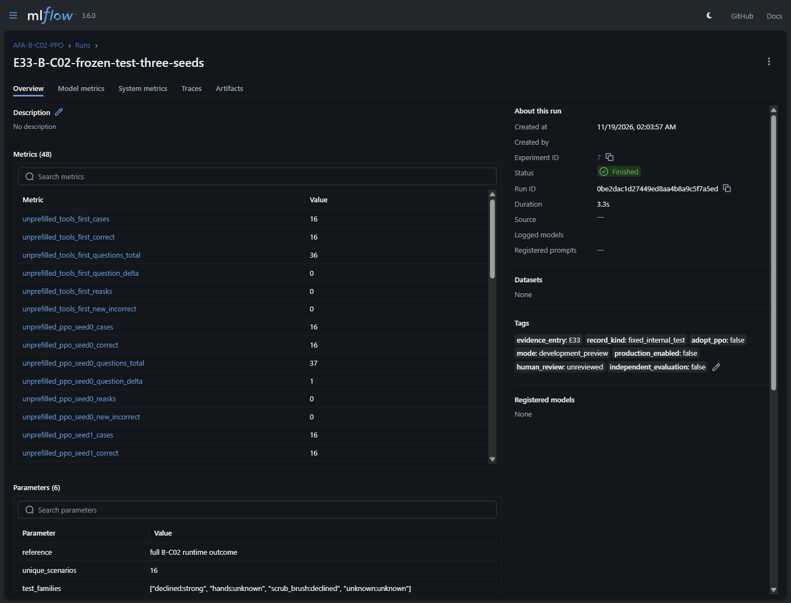

[MLflow E33](http://127.0.0.1:5000/#/experiments/7/runs/0be2dac1d27449ed8aa4b8a9c5f7a5ed) · 동결 설정, 상황별 결과, 학습 곡선과 모델은 `outputs/afa-e33/`

### E34 — AFA에 넘기는 카드와 권고 종료 조건 / 2026-11-19

복합 요청에서 발화 주제와 확정 관찰의 카드 지정을 매 턴 함께 적용한다. 해당 카드가 선택된 이유와 질문이 연결된 카드 ID를 유지한다. 세안 도구와 반복 세안 정보가 한 번에 들어온 경우와 다음 턴에 추가된 경우 모두 두 카드의 권고를 합쳤다. 지속 불편 관찰이 함께 들어오면 필수 보류 판단이 질문과 권고보다 우선했다.

질문이 모두 끝났어도 KB가 보류 중이거나 제품 근거가 더 필요하면 권고를 생성하지 않는다. 제품 카탈로그 검색에 성공했어도 검증된 KB 근거가 남아 있으면 `required_product_evidence`를 반환한다. 합성 B-C05 회귀에서는 `product.instructions`가 남아 최종 보류했다. 이 단계는 필요한 근거를 명시한다. 자동 근거 등록은 후속 계약의 범위다.

실험 모듈 전체 테스트 544개와 KB 경계·추적 검사 371개가 통과했다. 답변 대기 중 반복 세안 정보가 들어오는 경로를 명시하도록 보강한 뒤 해당 회귀 4개를 다시 실행해 모두 통과했다. E33의 기존 합성 사례에서 규칙·PPO를 다시 실행한 런타임 검사는 512/512건이 전체 답을 미리 준 결과와 일치했다. 같은 내부 자료에서의 소프트웨어 회귀 검사다.

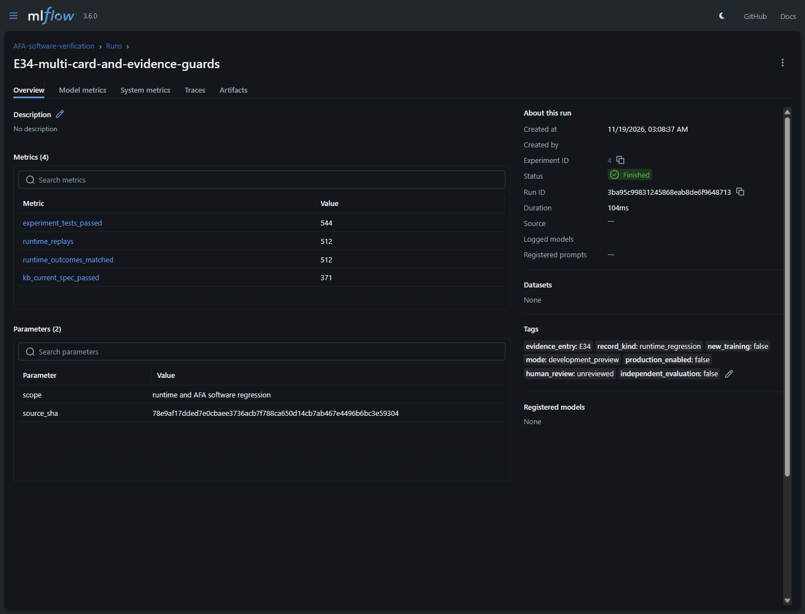

[MLflow E34](http://127.0.0.1:5000/#/experiments/4/runs/3ba95c99831245868eab8de6f9648713) · 실행 로그·결과·코드 해시는 `outputs/afa-e34/`에 있다.

### E35 — 대기 질문을 재실행하지 않기 / 2026-11-19

답 없이 재호출하거나 직전 요청과 같은 내용을 다시 보내면, 대기 중인 질문과 기존 도구 결과를 반환한다. 새 질문을 실행하거나 턴 번호를 올리지 않는다. 세안 카드 세 개에 공통인 부위 질문은 후보를 한 개로 합치고, 사용자가 답하면 연관 카드에 함께 반영한다. 새 금지·보류 상태나 답변은 다시 평가하며 필수 보류가 대기 질문보다 우선한다. 재호출과 공유 후보는 런타임 회귀로 확인했다.

### E36 — 권고와 보류에 영향을 주는 질문을 먼저 선택 / 2026-11-19

B-C05와 다른 지원 세안 카드가 함께 활성화되면, 현재 허용된 질문별로 KB 분기에서 가능한 답을 하나씩 가정한다. 실제 권고·보류·제품 근거 요구가 달라지고 다른 질문을 닫을 수 있는 답이 많은 질문을 우선한다. 가상 답마다 같은 가중치를 적용했다. 개발용 4상황에서 두 방식 모두 4/4 결과가 일치했고 질문은 25회에서 18회로 줄었다. 단독 카드와 지원 범위 밖의 요청은 기존 순서를 사용한다.

### E37 — 새 복합 사례 최종 검증 / 2026-11-19

정책 소스·개발 자료·적용 기준을 해시로 동결한 뒤 별도 합성 12상황을 작성했다. 개발용과 상황 ID, 가족 ID, 전체 답 조합의 중복은 없었다. 모든 답을 미리 제공한 동일 런타임을 권고·보류의 기준으로 삼았다. 첫 자료 대조에서 차가운 물을 포함한 한 사례의 기대 상태를 완료에서 보류로 고쳤다. KB의 B-C01 미해결 판단이 근거이며 최초 입력·실패 로그·감사 기록을 보존했다. 순위 정책과 사례 입력은 최초 동결 조건 그대로다.

| 사례 묶음 | 전체 | 기존 결과 일치 | 개선 결과 일치 | 기존 질문 | 개선 질문 |
| --- | ---: | ---: | ---: | ---: | ---: |
| 개발 | 4 | 4/4 | 4/4 | 25 | 18 |
| 고정 후 새 합성 사례 | 12 | 12/12 | 12/12 | 55 | 41 |

새 사례에서 6건은 질문이 줄고 6건은 동일했다. 재질문과 새 결과 오류는 0건이었다. 권고 5건·보류 7건이 두 방식에서 일치했다. 별도 기본 런타임 재실행도 12/12건에서 개선 순위와 일치했다. 지원 범위의 기본 규칙으로 적용했다. 이번 결과는 사람 검토 전의 합성 검증이다.

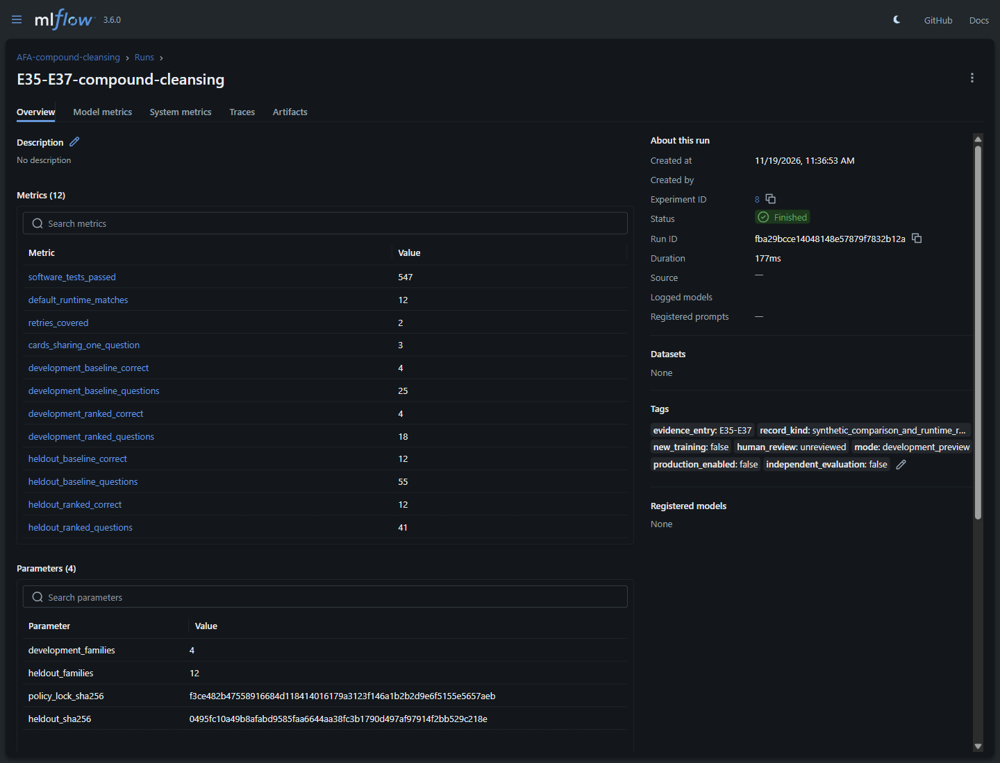

[MLflow E35–E37](http://127.0.0.1:5000/#/experiments/8/runs/fba29bcce14048148e57879f7832b12a) · 질문 순서별 원본과 고정 검증은 `outputs/afa-e35/`, `outputs/afa-e36/`, `outputs/afa-e37/`에 있다. MLflow의 Duration은 이미 실행한 결과를 등록한 시간이다. [합성 사례와 재현 방법](../data/afa/compound-v1/README.md)

### E38 — 제품 조회부터 질문과 최종 응답까지 / 2026-11-19

Python 런타임의 합성 세안 요청을 실제 로컬 실행 경로로 확인했다. 세안 방법은 기존 KB로 판단하고, 표시 사용법은 일치하는 버전의 로컬 제품 자료를 사용했다. AFA는 세안에 필요한 질문을 선택하고, Python 런타임이 대기·재개·종료를 맡았다.

| 확인한 흐름 | 입력 | 관찰한 결과 |
| --- | --- | --- |
| 첫 턴 권고 | 부위·물 온도·세안 도구가 확인됨 | 질문 0회. KB 안내와 확인된 제품의 표시 사용법, 출처를 반환했다. |
| 질문 후 재개 | 부위·물 온도만 확인됨 | 세안 도구를 1회 물었다. 한국어 답변을 받아 같은 요청에서 권고했고 기존 조회 결과를 재사용했다. |
| 필수 근거 부족 | KB가 제품 사용 조건을 요구함 | 카탈로그에 제품이 없는 경우와 표시 문장만 있는 경우 모두 보류했다. 부족한 근거인 `product.instructions`를 반환했다. |

후속 답변에서 제품 버전 또는 보유 확인 여부가 바뀌면 새 조회를 한다. 사용 안내에는 현재 제품과 버전이 일치하는 표시 사용법과 출처가 필요하다. 확인된 보유품·조회 결과·사용자 답변을 구분했고, 사용자 답변만으로 제품 근거를 확정하는 입력도 거절했다. 합성 자외선 차단제 대체 후보는 그 후보가 준비된 데모 제품에만 적용했다.

총 7가지 통합 검사를 실행했다. 기존 E37 사례 12건을 다시 실행했을 때 권고·보류 내용은 당시와 12/12건 일치했다. 과거 증빙과 질문 순서가 다른 3건은 E38 수정 이전 상태에서도 동일하게 나타났다. E38 수정 전후를 직접 비교하면 12/12건의 질문 순서와 결과가 모두 일치했다. 이 단계는 로컬 합성 소프트웨어 검사이며, 실제 카탈로그·사용자 평가·새 PPO 학습 범위는 포함하지 않았다.

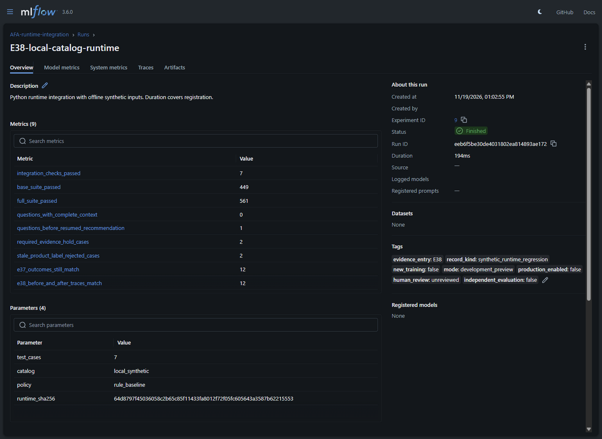

[MLflow E38](http://127.0.0.1:5000/#/experiments/9/runs/eeb6f5be30de4031802ea814893ae172)에서 통과 건수와 원본 로그를 확인할 수 있다. 화면의 Duration은 실행 결과를 등록한 시간이다. 명령, 종료 코드, 통합 보고서, 이전 사례 재실행과 소스 해시는 `outputs/afa-e38/`에 저장했다. 다음은 확인된 조회 근거를 KB가 읽을 수 있는 정형 값으로 전달하는 계약을 실제 데이터 소스와 함께 검증하는 것이다.

### E39 — 세안 질문을 한국어 대화로 다시 확인 / 2026-11-19

“세게 문지르지 않아요”가 강한 마찰로 기록되던 현상을 수정했다. 부정만으로는 마찰의 실제 강도를 확정하지 않고, “부드럽게 씻어요”처럼 함께 말한 내용이 있을 때 그 값을 반영한다. 첫 사용자 발화와 후속 답변에 같은 원칙을 사용한다. 대화형 CLI의 기본 보유품은 합성 세안제 하나로 설정했다. 야외 활동용 고정 시연은 기존 예시를 사용한다.

| 로컬 합성 대화 | 실제 질문 수 | 최종 결과 |
| --- | ---: | --- |
| 얼굴·미온수·도구를 처음에 모두 말함 | 0 | 안내 |
| 부위와 온도만 말함 | 1 | 세안 도구를 묻고 안내 |
| 세안 방법을 말한 뒤 반복 세안 확인 | 2 | 제거 대상과 반복 이유를 묻고 안내 |
| 세안 후 지속되는 불편 언급 | 1 | 본인 경험과 시점을 확인하고 보류 |

수정 전 첫 다섯 검사 중 네 개가 문제를 재현했다. 수정 후 물기를 닦는 표현을 추가한 집중 검사 6개와 한국어 시연 4개가 통과했다. 시연 4개에서 관련 없는 합성 선크림 후보는 0건이었다. 한국어 부정 표현 전체를 다룬 검증 범위는 아니며, 결과는 오프라인 합성 프리뷰에 적용한다.

**소형 언어 모델의 도구 선택 검토.** QLoRA로 학습한 모델을 행동 제안에 쓰는 방식은 비교할 수 있다. 첫 비교에서는 Python 처리 흐름에 선택 가능한 행동과 대상을 보여주고, 모델이 제안한 행동 이름·대상·인수를 검증한 뒤 실행한다. 질문이 필요한 분기에서 AFA가 질문을 고른다. 기존 v67은 정형 상태에서 다음 행동 하나를 맞히는 자료다. 실제 조회 호출과 그 결과를 다음 판단에 쓰는 흐름을 학습하려면 도구 정의, 실제 호출 형식, 찾음·실패·응답 내용을 포함한 별도 사례가 필요하다. 현재 규칙 → 학습 전 모델 → 같은 모델의 QLoRA 적용 후를 동일한 독립 사례에서 비교한다. 적절한 행동과 인수, 불필요한 조회·질문, 권고·보류, 잘못된 실행, 지연을 함께 기록한다. 이번 단계는 설계 검토와 소프트웨어 검사다. [팀의 모델 평가 계획](https://linear.app/ppopy/issue/PPO-21) · [Qwen 도구 호출 문서](https://qwen.readthedocs.io/en/stable/framework/function_call.html) · [TRL 도구 호출 학습 형식](https://huggingface.co/docs/trl/main/en/sft_trainer#tool-calling-with-sft)

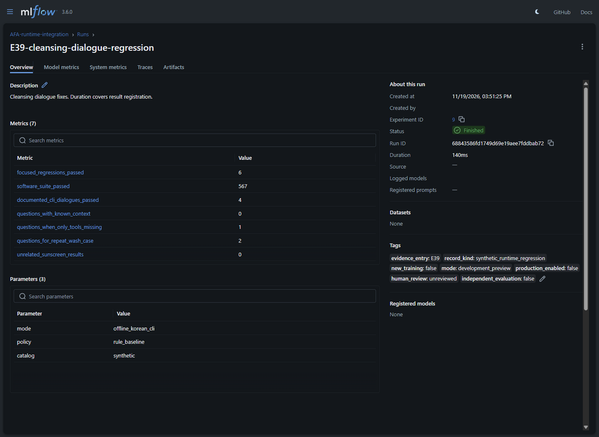

[MLflow E39](http://127.0.0.1:5000/#/experiments/9/runs/68843586fd1749d69e19aee7fddbab72)의 Duration은 결과를 등록한 시간이다. 사용자 발화·에이전트 질문·종료 상태와 수정 전후 검사 로그는 `outputs/afa-e39/`에 저장했다.

### E40 — 후속 질문에 번호로 답하는 세안 CLI / 2026-11-20

첫 요청은 자유 문장으로 받는다. AFA가 질문할 항목을 선택하면 CLI는 런타임의 현재 질문에 해당하는 번호와 답을 보여준다. 번호를 골랐을 때는 기존 관찰값으로 변환해 같은 요청을 이어간다. 증상의 대상과 지속 여부, 이미 알고 있는 항목의 정정도 선택할 수 있다. 답은 질문과 해당 요청의 진행 번호에 연결된다.

| 사용자 입력 | 처리 |
| --- | --- |
| 번호 선택 | 선택한 값을 반영한다. 자연어 해석을 호출하지 않는다. |
| 직접 입력 | 현재 질문만 로컬에서 해석한다. 사용자가 해석 결과를 확인하면 반영한다. |
| 답을 표현하기 어려움 | 값을 추측하지 않는다. 선택 화면에서 미확인으로 남기거나 다른 답을 고른다. |
| 모름 / 건너뛰기 | 미확인과 건너뛴 상태를 구분한다. |

직접 입력으로 도구를 확인한 사례와, 번호로 반복 세안 질문 두 개에 답한 사례를 실제 실행 명령으로 확인했다. 두 사례에서 AFA 질문은 총 3회였으며 두 요청 모두 안내로 종료했다. 집중 검사 39개에는 증상 선택 후 보류, 확인 취소, 정정, 지난 질문 차단과 첫 입력 이후 자연어 호출 검사도 포함됐다. 전체 소프트웨어 검사 576개가 통과했다. 이 결과는 입력 방식을 검증한 것이며 새 정책 학습이나 사용자 편의성 시험을 포함하지 않는다.

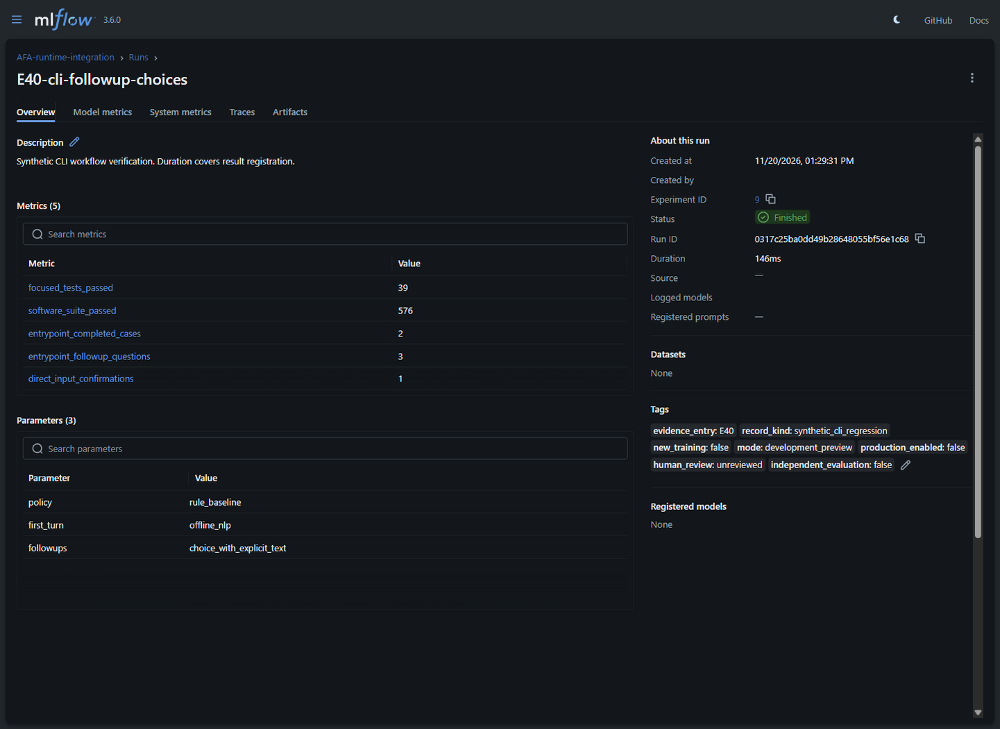

[MLflow E40](http://127.0.0.1:5000/#/experiments/9/runs/0317c25ba0dd49b28648055bf56e1c68) · 원본 명령·종료 코드·시연과 검사 로그는 `outputs/afa-e40/`에 있다. MLflow의 Duration은 결과 등록에 걸린 시간이다.

### E41 — CLI에서 모듈별 응답 출처 표시 / 2026-11-20

첫 발화는 입력 프롬프트에 NLP 경로를 표시하고, 처리 결과에도 Jev NLP 또는 오프라인 Kiwi/규칙 분석을 표시한다. 질문에는 실행된 선택 정책을 `AFA · 규칙 기반` 또는 `AFA · PPO`로 표시한다. PPO 제안이 허용되지 않아 규칙으로 질문한 경우에는 규칙 기반으로 표시한다. 같은 대기 질문을 다시 보여줄 때도 그 질문의 출처를 보존한다. 증상·상충 확인, 제품 조회와 최종 안내 또는 보류는 Agent Runtime이 담당한 경로로 구분한다.

오프라인 NLP와 합성 입력을 사용해 같은 도구 질문을 규칙과 기존 E29 체크포인트로 각각 실행했다. 두 설정에서 실제 출처표가 달랐고, 증상 확인과 KB 판단 보류 표기도 확인했다. 집중 검사 39개와 전체 검사 576개가 통과했다. 이 단계는 실제 동작을 구분해 보여주는 소프트웨어 검사다. 저장된 PPO로 질문을 골랐으며, 이 기록에서는 새 학습과 성능 비교를 수행하지 않았다.

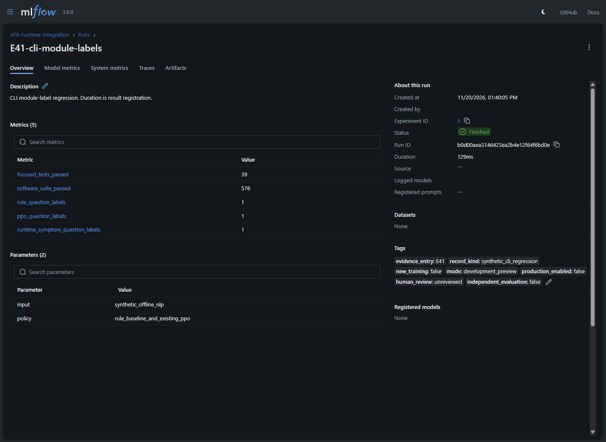

[MLflow E41](http://127.0.0.1:5000/#/experiments/9/runs/b0d00aea3146423ea2b4e12f64f6bd0e) · 실행 로그, 명령, 소스와 체크포인트 해시는 `outputs/afa-e41/`에 있다. MLflow의 Duration은 결과 등록에 걸린 시간이다.

### E42 — 증상을 하나씩 묻고 선택지는 최대 네 개로 / 2026-11-20

기존 CLI에서 증상 확인은 AFA보다 앞에서 별도로 실행됐다. 한 선택지가 대상·발생 여부·지속 상태를 함께 담았으며, 직접 입력과 정정도 답 목록에 올라왔다. 신규 CLI에서는 증상마다 지금 확인할 수 있는 한 항목만 AFA 후보에 넣는다. 규칙 기반 AFA는 최종 권고나 보류를 먼저 바꿀 수 있는 증상 질문을 우선한다. 이미 보류가 확정되면 새 질문을 실행하지 않는다.

예를 들어 건조함은 **누구의 이야기인지 → 본인이면 실제 있었는지 → 있었다면 한 번·반복·지속 중 어떤 양상인지**를 묻는다. 다른 사람의 이야기이거나 본인에게 발생한 적이 없으면 그 증상의 남은 질문을 생략한다. 필수 증상 정보가 미상 또는 거절이면 추측 없이 개별 권고를 보류한다. 번호 선택지는 화면당 최대 네 개이며, 직접 입력과 정정은 별도 명령이다. 현재 PPO가 지원하는 세안 도구 범위는 기존대로 평가에 쓴다.

건조함과 트러블이 함께 나오는 두 합성 CLI 사례를 저장된 PPO와 함께 실행했다. 반복되는 본인 건조함은 규칙 기반 AFA 질문 3개 뒤 보류되어 나머지 증상은 묻지 않았다. 두 증상이 모두 다른 사람 이야기이면 각각 대상만 확인한 뒤 해당될 때 PPO로 기존 세안 질문을 이어갔다. 집중 검사 46개와 전체 583개가 통과했다. 이 검사는 질문과 응답 연결을 확인한 것이며 새 모델 학습과 사용성 실험을 포함하지 않는다.

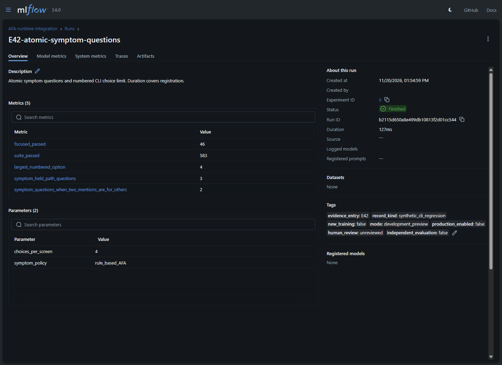

[MLflow E42](http://127.0.0.1:5000/#/experiments/9/runs/b2115d650a8e499db10813f2d01cc544) · 시연과 전체 로그는 `outputs/afa-e42/`에 있다. Duration은 MLflow 기록 등록에 걸린 시간이다.

### E43 — 제품 이름과 사용자가 이미 말한 증상 정보 보존 / 2026-11-20

Kiwi는 제품명 안쪽에서 조사로 읽힌 글자도 앞뒤가 같은 어절일 때 이어 붙인다. 오프라인 제품 후보는 사용 문맥, 위치 조사, 이름 중복을 확인해 남긴다. 이름 검색은 대소문자와 앞뒤 공백을 무시해 중복을 걸러내며 한 턴에 최대 다섯 건이다.

Jev는 정규식에서 빠진 항목만 한 번에 받는다. 원문 근거가 없다는 답, 확률 0.5 이하, 허용되지 않은 값은 채택하지 않는다. 원격 호출 실패 시에는 정규식으로 확인한 값만 남긴다. 제품 소유, 증상, 추출 항목은 후보 상태로 반환한다. 로컬 CLI는 명시적인 본인 증상을 전달받으면 대상과 발생 여부를 재질문하지 않고 양상부터 묻는다. strict 런타임은 후보를 사전 반영하지 않는다.

초기 전체 검사에서 “따가워” 같은 한 단어 증상만으로 발생을 분류하던 회귀를 발견했다. 대상이나 별도의 사건 설명 없이 들어온 짧은 언급은 기존처럼 미확인으로 보존한다. 최종 재실행에서 명세서 4절의 지정 단위 검사 53개와 별도 전체 검사 596개가 모두 통과했다. 오프라인 CLI의 재현 입력 2건도 확인했다. Jev 기능과 오류 처리는 모의 응답으로 확인했으며 실서비스 호출은 수행하지 않았다. 별도 KB 원본 감사에서는 기존 불일치 5건이 재현됐다.

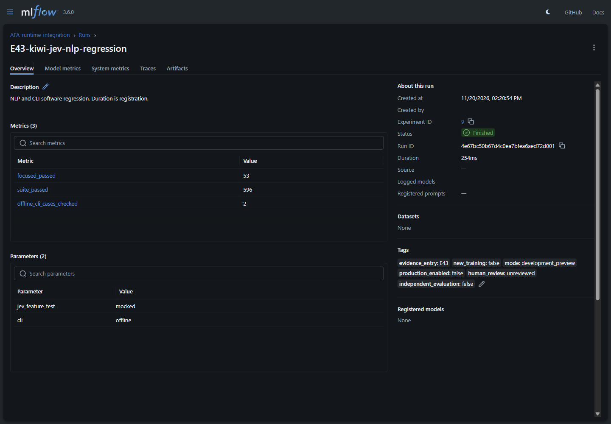

[MLflow E43](http://127.0.0.1:5000/#/experiments/9/runs/4e67bc50b67d4c0ea7bfea6aed72d001) · 실행 명령과 로그는 `outputs/afa-e43/`에 있다. Duration은 결과 등록에 걸린 시간이다.

### E44 — 로컬 CLI에서 PPO 먼저 사용 / 2026-11-20

세안 질문에 PPO를 바로 써보고 질문 순서를 개선할 수 있도록 로컬 CLI의 기본 모델을 E29 체크포인트로 지정했다. 체크포인트는 학습된 모델을 저장한 파일이다. 기본 경로는 `outputs/afa-e29/model-seed0.zip`이다. 실험 의존성은 `--group rl-train`으로 사용한다. `--ppo-model`로 다른 모델을 지정하거나 `--rule-based`로 규칙만 실행해 비교할 수 있다.

모델 파일이나 실행 패키지를 불러오지 못하면 규칙 기반으로 계속한다. 모델이 로딩된 뒤에도 B-C02(세안 도구·건조·마찰) 지원 범위 밖의 질문은 규칙 기반으로 고른다. 시작 화면은 모델 사용 가능 여부를, 질문 옆에는 실제 질문을 선택한 정책을 표시한다.

“얼굴을 미온수로 씻어요. 세안 방법을 확인해 주세요.”를 입력해 모델 옵션 없이 실제 PPO가 질문을 선택하는 것을 확인했다. 같은 입력에서 모델 파일이 없거나 규칙 모드를 지정하면 규칙 기반으로 표시됐다. PPO가 로딩된 상태에서 증상 양상을 확인하는 질문도 규칙 기반으로 표시됐다. 관련 검사 50개와 실험 패키지 전체 검사 600개가 통과했다. 원본 KB 감사에서는 기록된 불일치 5건이 재현됐다. 이번 단계는 기존 모델의 실행 경로 검사다. 질문 횟수와 결과 품질은 동일한 사례에서 규칙과 비교하는 별도 평가 지표다.

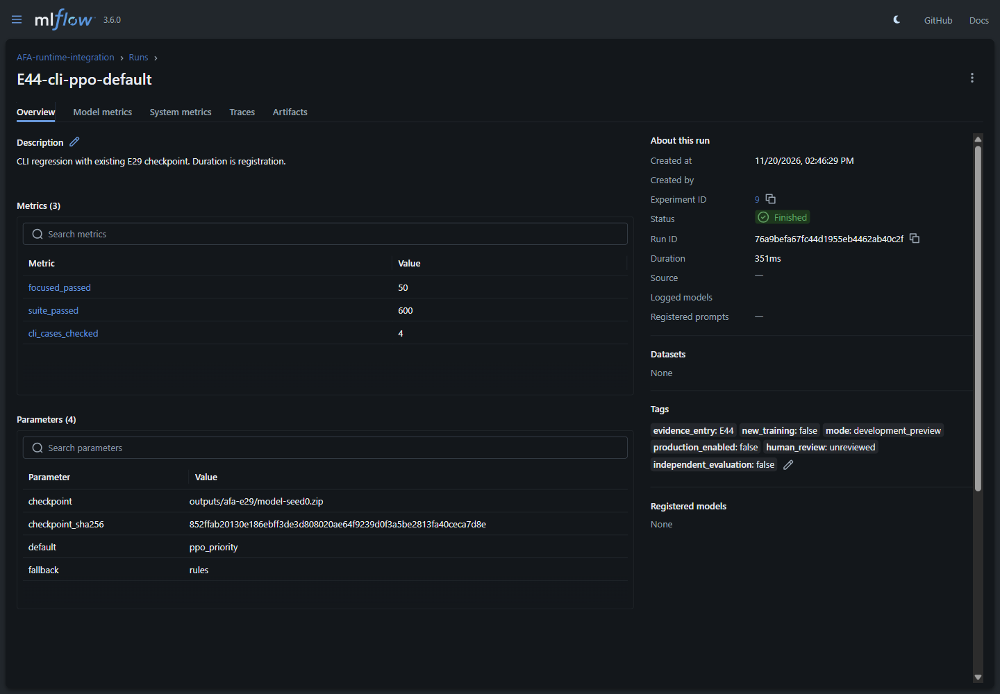

[MLflow E44](http://127.0.0.1:5000/#/experiments/9/runs/76a9befa67fc44d1955eb4462ab40c2f) · CLI 출력, 명령, 테스트 로그와 모델 해시는 `outputs/afa-e44/`에 있다. Duration은 결과 등록에 걸린 시간이다.

### E45 — 세정·보습·자외선차단·영역 간 조정 질문 비교 / 2026-11-20

`AgentRuntime(afa_policy=MyopicVOIAFAPolicy())`로 질문 정책을 주입할 수 있다. 현재 활성 카드에서 각 후보의 KB 분기 답을 균등하게 가상 대입한다. 현재와 판정이 달라진 답의 비율, 그 대입으로 닫히는 다른 질문의 평균 개수, 가상 답으로 구분되는 판정의 종류를 기록한다. 질문당 비용과 안전 우선 가중치의 기본값은 각각 1이다. 점수가 동률이면 슬롯 ID 순으로 고른다. 판정에 영향이 있는 후보가 없으면 현재 근거를 바탕으로 종료한다. 정책 후보 평가 전에 런타임이 필수 안전 보류를 처리한다. 제품 자료는 런타임의 조회 경로에서 처리한다.

합성 상황 8건을 각 정책에서 한 번씩 실행했다. 같은 활성 카드, 초기 정보, 합성 답변으로 고정 순서 규칙과 한 단계 정책을 비교했다. 질문은 고정 순서 27회(평균 3.375회), 새 정책 9회(평균 1.125회)였다. 런타임 상태와 KB의 전체 판정·보류 신호·제품 조회 항목·안내가 모두 일치한 상황은 7/8건이었다. `B-I02`에서 고정 순서는 선크림 밀림과 재도포 답을 모두 얻어 유지 판정에 도달했고, 새 정책은 답 하나로 판정이 바뀌지 않아 보류했다. `B-M01`과 `B-I01` 상황의 질문 수는 같았다. 이 수치는 내부 합성 비교이며 독립 평가나 임상 검증은 수행하지 않았다.

기본 실험 폴더 검사 473개, 선택 의존성을 포함한 전체 검사 585개, 새 정책 검사 18개가 통과했다. 이 수치는 Myopic VOI 작업 브랜치에서 얻었다. E40–E44는 원본 해시가 일치하는 다른 작업 브랜치의 공유 기록에서 가져왔다. 두 AFA 자료는 동결 해시가 기대하는 CRLF 체크아웃 형식으로 복원했다. KB 구조 95개, 경계·추적 371개가 통과했고 원본 감사 52/57 및 엄격 원본의 기존 불일치 5건을 재현했다.

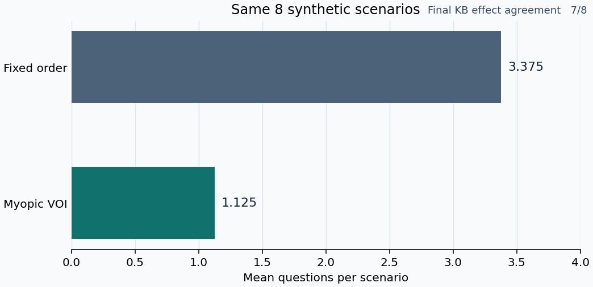

[MLflow E45](http://127.0.0.1:5055/#/experiments/1/runs/357bf1b4ed304842a8c5a2cfe2f87b9b) · MLflow API에서 조회한 값으로 그래프를 그렸다. 브라우저의 현재 URL을 확인하지 못해 UI 캡처는 중단됐다. JSON 비교 원본, 명령과 종료 코드, 검사 로그는 `outputs/afa-e45/`에 보관한다.

### E46 — Myopic VOI 합성 비교 확대 / 2026-11-20

질문 수와 조기 종료의 영향을 함께 보려고 같은 활성 카드와 답변표를 두 정책에 제공했다. 비교 대상은 KB에서 사용자 답으로 확인할 수 있는 분기 값으로 만든 62조건, 제품 근거 누락과 복합 카드를 포함해 작성한 12조건, v67의 E22 train 파생 4건이다. 총 78조건은 카드와 전체 응답표가 다른 51개 상황 및 46개 가족에 해당한다. 일부 상황은 사전 공개 답이 없는 경우와 답 하나를 미리 공개한 경우를 함께 포함한다. 각 정책은 조건당 1회 실행했고 무작위 표집은 사용하지 않았다.

E22는 기록된 미상 3개와 거절 1개, E22에서 이미 작성한 가상 답 8개를 보존한다. 원본 v67의 평가 분할과 액션 라벨은 사용하지 않았다. 새 합성 조건의 답변표에 없는 질문은 미상으로 처리했다. 사용자마다 답이 같다고 가정하는 고정 응답 재생이며, 다른 사용자 답이나 자연어 추출을 검증하는 실험은 수행하지 않았다.

| 활성 카드 범위 | 조건 | 평균 질문 고정 → Myopic | 최종 판정 일치 |
| --- | ---: | ---: | ---: |
| 세정만 | 21 | 2.10 → 1.62 | 21/21 |
| 보습만 | 13 | 3.38 → 1.54 | 11/13 |
| 자외선차단만 | 19 | 3.26 → 1.95 | 16/19 |
| 영역 간 조정 카드만 | 17 | 4.82 → 0.94 | 13/17 |
| 여러 영역의 카드 동시 활성 | 8 | 6.00 → 2.38 | 8/8 |
| 전체 | 78 | 3.59 → 1.62 | 69/78 |

질문은 280회에서 126회로 55% 줄었다. 최종 판정은 런타임 종료 상태, KB 판정·보류·조회·안내와 런타임 제품 근거 요청을 비교했다. 종료 상태만 보면 70/78건이 일치했다. E22 4건에서는 총 질문이 각각 9회였고 판정은 4/4 일치했다.

전체 대본 답을 처음부터 공개한 같은 런타임의 판정과는 고정 순서 76/78건과 Myopic 67/78건이 일치했다. 두 정책 모두 필수 안전 보류를 지켰던 2건에서는 미리 공개한 자외선차단 답이 내부 KB 안내를 바꿔 엄격 비교가 불일치했다. Myopic만 달랐던 9건은 보습 2건, 자외선차단 3건, 영역 간 조정 4건이다. 그중 8건은 고정 순서가 권고까지 도달했으나 Myopic은 보류했다. 나머지 1건은 두 정책 모두 보류했으나 `B-I02`의 조건부 안내가 달랐다. 단독 답으로 판정이 달라지지 않는 분기에서 두 답 이상이 필요한 경우를 점검할 후속 자료로 쓸 수 있다. 이 수치는 내부 합성 비교이고 전체 입력 판정은 독립 전문가 정답이 아니다.

기본 검사 474개와 선택 의존성을 포함한 전체 검사 586개가 통과했다. 비교 중 Myopic의 규칙 기반 복구는 0회였다. 어느 정책도 이 실행 중 응답한 슬롯을 다시 묻거나 제품 슬롯을 질문하지 않았다. 카드를 고정했으므로 NLP와 카드 라우팅을 평가 범위에 포함하지 않았다.

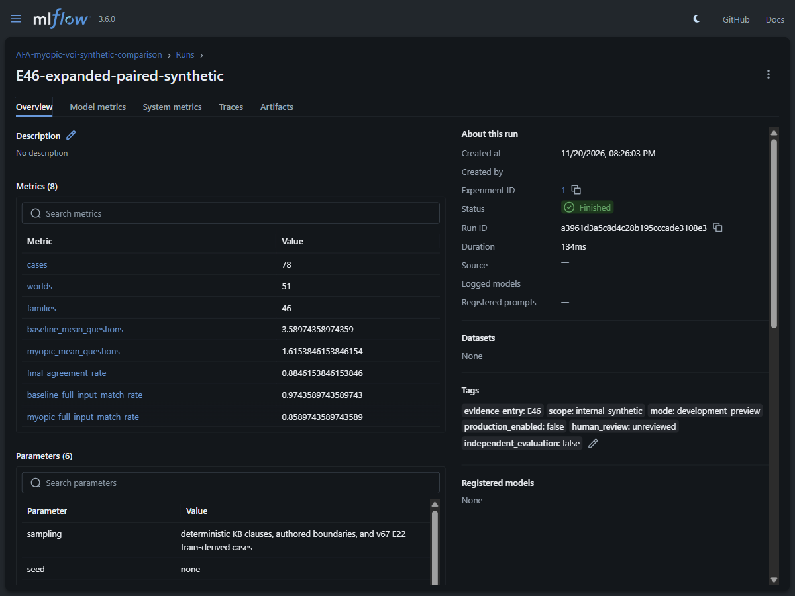

실험 폴더에서 `uv run --locked python -m beauty_agent.afa.myopic_evaluation --output ../../../../outputs/myopic-comparison.json`으로 재현한다. 조건별 대본·판정·질문 순서·계보·해시가 있는 JSON과 CSV 및 로그는 `outputs/afa-e46/`에 있다. 화면의 Duration은 결과 등록에 걸린 시간이다. [MLflow E46](http://127.0.0.1:5055/#/experiments/1/runs/a3961d3a5c8d4c28b195cccade3108e3)

### E47 — 기존 PPO를 포함한 동일 조건 3자 비교 / 2026-11-20

E46과 같은 합성 78조건과 KB 출력 비교식을 유지한 채 E29에서 학습한 B-C02 PPO의 seed 0 체크포인트를 기존 런타임 라우터에 주입했다. E46과 카드·초기 관찰·답변표·전체 입력 기준 판정·두 기존 정책의 질문과 판정이 조건별로 모두 일치함을 확인했다. PPO는 CPU에서 결정론적으로 추론했다. 질문 횟수에 영향을 주는 규칙 우선순위 옵션을 끄고 PPO가 지원하지 않는 턴에는 고정 순서를 사용했다. 체크포인트의 SHA-256은 E29의 원본 영수증과 일치했다. 새로 학습하거나 v67 평가 분할을 사용하지 않았다.

| 정책 | 전체 질문 | 평균 질문 | 전체 입력 판정과 일치 | 권고 완료 |
| --- | ---: | ---: | ---: | ---: |
| 고정 순서 | 280 | 3.59 | 76/78 | 58/78 |
| Myopic VOI | 126 | 1.62 | 67/78 | 50/78 |
| PPO 라우팅 | 280 | 3.59 | 76/78 | 58/78 |

최종 판정은 고정 순서와 PPO 라우팅이 78/78건 일치했고, Myopic은 두 정책 각각과 69/78건 일치했다. PPO 라우팅의 질문 280회 중 실제 모델 선택은 22회였고 지원 범위 밖 규칙 선택이 258회였다. PPO를 시도한 뒤 규칙으로 복구한 2회는 질문 선택이 아니라 종료였다. KB가 아는 `washcloth`와 `sponge`가 체크포인트의 도구 인코딩 범위 밖이었다. 필수 안전 보류 4건은 런타임이 직접 종료했다.

PPO가 직접 질문을 고른 11조건에서 세 정책 모두 총 22회, 평균 2.00회 질문했고 전체 입력 판정에 11/11건 일치했다. PPO는 고정 순서보다 2건에서 질문이 적고 2건에서 더 많았다. 질문 순서가 달라진 조건은 6건이었고, 이 11조건에서 PPO와 Myopic의 질문 경로는 모두 같았다. 이 결과는 B-C02 체크포인트를 사용하는 라우팅 비교다. 보습이나 자외선차단에서 PPO가 직접 질문을 고르는 성능은 이번 실험에서 측정하지 않았다. 전체 입력의 KB 판정은 독립 전문가 정답이 아니다.

기본 소프트웨어 검사 475개와 선택 의존성을 포함한 전체 검사 587개가 통과했다. 모의 PPO로 모델 선택·지원 범위 밖 규칙 선택·모델 시도 후 복구의 집계를 검증했다. 실험 폴더에서 `uv run --locked --group rl-train python -m beauty_agent.afa.myopic_evaluation --ppo-model <checkpoint.zip> --output ../../../../outputs/myopic-ppo-comparison.json`으로 재현한다. 조건별 질문·판정·선택 출처·해시를 담은 JSON과 CSV는 `outputs/afa-e47/`에 있다.

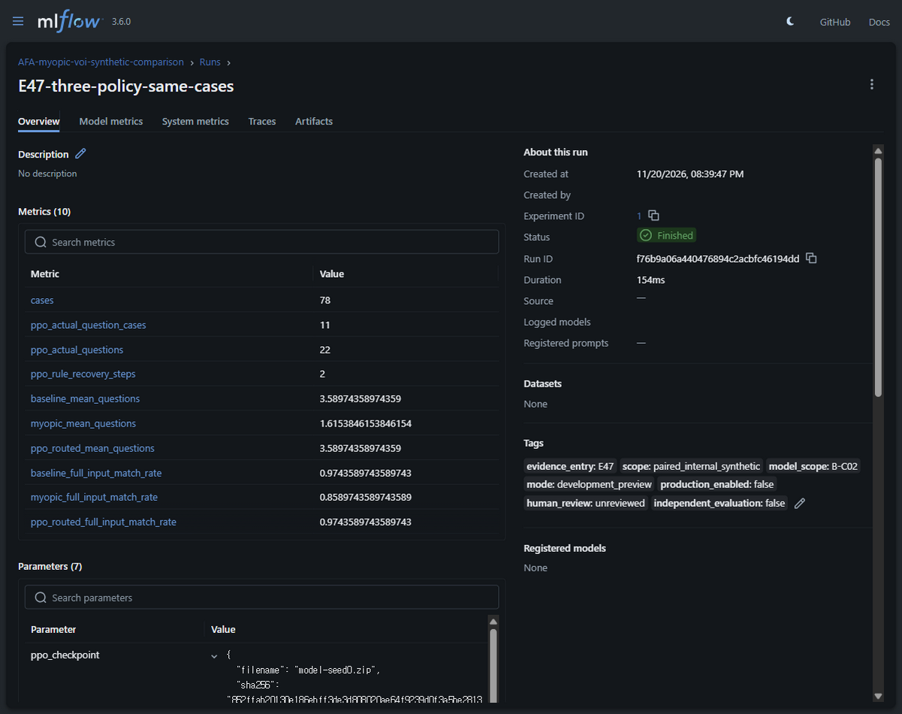

[MLflow E47](http://127.0.0.1:5055/#/experiments/1/runs/f76b9a06a440476894c2acbfc46194dd)에서 실행 조건과 결과를 확인한다. 화면의 Duration은 결과 등록에 걸린 시간이다.

### E48 — Myopic 보류 전 KB 분기 확인 / 2026-11-21

Myopic이 한 답으로 판정을 바꿀 수 있는 질문을 찾으면 기존 점수로 질문을 고른다. 그런 질문이 없고 현재 결과가 보류일 때, 실제 후보에서 두 답을 차례로 얻어 도달할 수 있는 KB 분기를 확인한다. 지금까지의 답과 양립하고 가상 답으로 실제 KB 판정이 바뀌는 순서가 있으면 첫 질문만 고른다. 실제 응답을 받은 뒤 다시 평가한다. 추적 사유는 `selected_dependency`다. 필수 안전 보류, 이미 응답한 슬롯, 제품 근거와 사용자 질문의 경계를 기존 방식대로 처리한다. 기본값 `stop_lookahead=2`를 사용하고, 기존 방식 1과 세 답을 확인하는 실험 옵션 3도 실행할 수 있다.

| 정책 | 총 질문 | 평균 질문 | 전체 답변 공개 판정과 일치 | 고정 순서와 판정 일치 |
| --- | ---: | ---: | ---: | ---: |
| 고정 순서 | 280 | 3.59 | 76/78 | 78/78 |
| 기존 PPO 라우팅 | 280 | 3.59 | 76/78 | 78/78 |
| 기존 Myopic | 126 | 1.62 | 67/78 | 69/78 |
| Myopic · 보류 전 두 답 확인 | 140 | 1.79 | 74/78 | 76/78 |
| Myopic · 보류 전 세 답 확인 | 143 | 1.83 | 75/78 | 77/78 |

E47의 합성 78조건(51개 상황, 46개 가족)을 각 정책에서 한 번씩 다시 실행했다. 기존 세 정책의 응답 경로와 판정이 E47 보고서와 조건별로 같음을 확인했다. 기본 두 답 확인은 기존 Myopic의 조건별 불일치 7건을 회복했으며, 기존에 일치하던 조건에서 새 불일치는 0건이었다. 고정 순서 대비 질문은 총 50% 적었다. 세 답 확인은 자외선차단 `B-P03`의 답 하나가 미리 공개된 조건을 추가로 회복했다. 같은 분기의 필요한 네 답이 모두 미공개인 조건은 두 방식 모두 여전히 보류했다. 두 정책이 공통으로 안전 보류한 2조건은 전체 답을 미리 공개한 기준과 내부 KB 안내가 달랐다. 비교 수치는 개발에 사용한 합성 사례의 결과이며 독립 평가를 수행하지 않았다.

기본 검사 479개와 선택 의존성을 포함한 전체 검사 591개가 통과했다. 선크림 밀림과 재도포 질문을 실제 응답에 따라 한 번씩 선택하고, 첫 답을 거절하면 두 번째 질문을 건너뛰는 경우를 확인했다. 78조건에 포함되지 않은 세정·재도포 복합 합성 사례도 별도 회귀 검사로 통과했다.

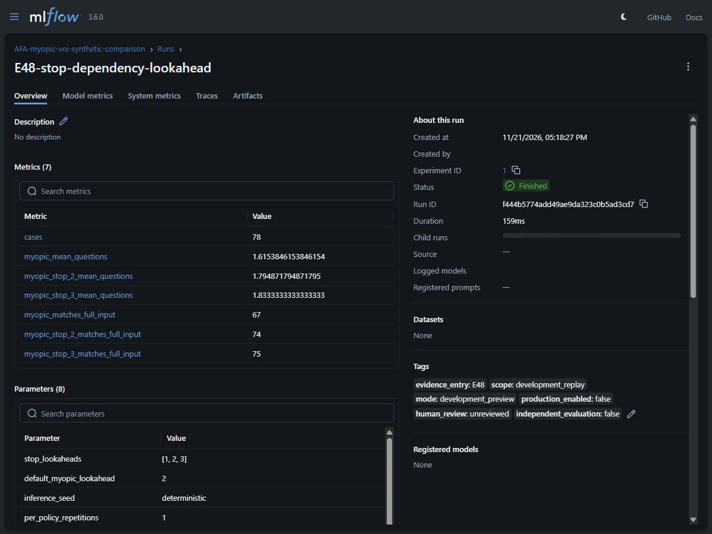

실험 폴더에서 `uv run --locked --group rl-train python -m beauty_agent.afa.myopic_evaluation --ppo-model <checkpoint.zip> --dependency-lookahead 2 --dependency-lookahead 3 --output ../../../../outputs/myopic-dependency-comparison.json`으로 재현한다. 조건별 질문·판정·해시와 회복/악화 목록은 `outputs/afa-e48/`에 있다. 화면의 Duration은 결과 등록 시간이다. [MLflow E48](http://127.0.0.1:5055/#/experiments/1/runs/f444b5774add49ae9da323c0b5ad3cd7)

### E49 — 1단계 AFA와 Control Plane 보류 확인 분리 / 2026-11-21

worktree 지침의 1단계 질문 선택 계약을 명시적으로 적용했다. `MyopicVOIAFAPolicy`는 가상 답 하나로 판정이 바뀌는 질문만 선택한다. 이 조건을 충족하는 후보가 없으면 허용된 `STOP`을 반환한다. `AgentRuntime`은 부족으로 종료하라는 유효한 결정을 받은 다음, 실제 보류 전에 현재 답과 양립하는 KB 결합 분기를 확인한다. 이 확인에서 고른 슬롯은 `afa_hold_review_slot`에 별도로 기록하고, 1단계 점수는 `zero_impact`를 유지한다. 기본 결합 확인 깊이는 두 답이다. 안전 보류는 AFA 호출 전에 처리하며 이미 답한 슬롯과 제품 근거 슬롯은 결합 확인의 사용자 질문 후보에서도 제외한다.

E48과 같은 합성 78조건(51개 상황, 46개 가족)을 정책별로 한 번씩 재실행했다. 고정 순서, 1단계 Myopic, 기존 PPO 라우팅, 두 답 확인, 세 답 확인의 **모든 조건별 질문 순서와 최종 판정이 일치**했다. 기본 두 답 확인은 전체 답변 공개 기준에 74/78건(94.9%) 일치했고 총 질문 140회(평균 1.79회)를 유지했다. 회귀 기준에는 최소 74건 일치와 최대 140회 질문을 적용한다. 이 비교로 확인한 범위는 같은 합성 조건의 질문 부담과 판정이다.

기본 검사 479개와 선택 의존성을 포함한 전체 검사 591개가 통과했다. AFA를 단독으로 실행하면 결합 분기 질문을 직접 선택하지 않고, 같은 관찰을 런타임에 넣으면 보류 전 확인이 질문을 제시하는지 각각 검사했다. 실제 응답 또는 거절 이후 다음 턴에서 확인 결과를 다시 계산한다. 합성 세안 대화도 CLI에서 권고까지 진행했다.

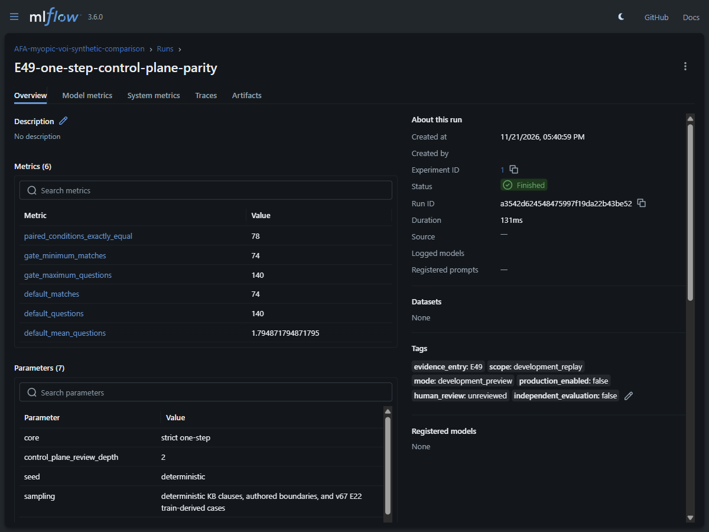

실험 폴더에서 `uv run --locked --group rl-train python -m beauty_agent.afa.myopic_evaluation --ppo-model <checkpoint.zip> --dependency-lookahead 2 --dependency-lookahead 3 --output ../../../../outputs/myopic-parity.json`으로 재현한다. 조건별 재실행 결과와 E48 대조 영수증은 `outputs/afa-e49/`에 있다. 화면의 Duration은 결과 등록 시간이다. [MLflow E49](http://127.0.0.1:5055/#/experiments/1/runs/a3542d624548475997f19da22b43be52)

### E50 — 기본 CLI에서 Myopic VOI 실행 / 2026-11-21

현재 worktree의 대화형 CLI에서 별도 모델 옵션을 주지 않으면 Myopic VOI를 사용하고 시작 화면에 정책명을 표시한다. `--ppo-model`로 체크포인트를 명시하면 기존 B-C02 비교 경로를 사용한다. 이번 단계는 텍스트로 답하는 대화형 CLI의 정책 연결이다.

합성 카탈로그와 오프라인 NLU 조건에서 한국어 세안 대화 1건을 실행했다. 세안 도구, 물기 제거, 세안 마찰 질문에 답한 뒤 `completed`와 권고가 표시됐다. CLI가 기본으로 고른 정책을 E49의 같은 78개 구조화 조건에 적용했을 때 질문 순서와 판정이 조건별로 모두 같았다. 전체 답변 공개 기준 일치 74/78건, 총 질문 140회를 유지했다. 78조건 비교는 카드를 고정한 회귀 검사이고 한국어 입력부터 실행한 대화는 1건이다.

실험 폴더에서 `uv run --locked python -m beauty_agent.cli --offline-nlp`로 시작하고 `/quit`으로 종료한다. 기본 검사 480개와 선택 의존성을 포함한 전체 검사 592개가 통과했다. 명시적으로 지정한 E29 PPO 체크포인트도 기존 라우터에 로드되는 것을 확인했다. 대화 로그·재현 명령·회귀 결과는 `outputs/afa-e50/`에 있다.

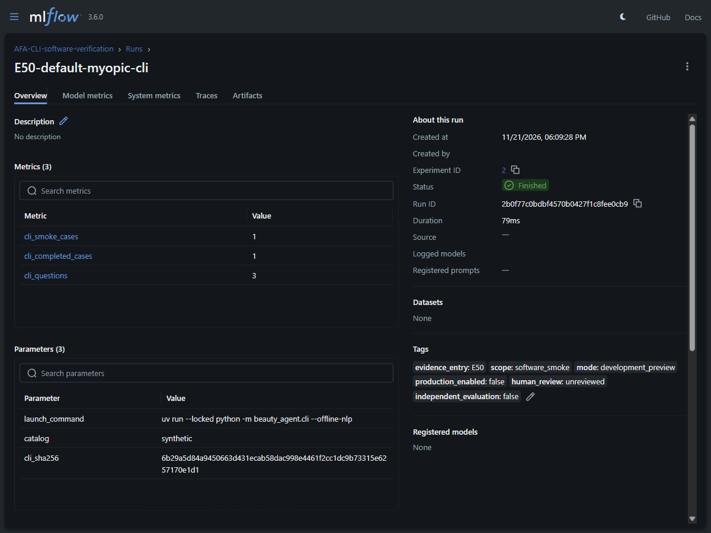

MLflow의 숫자는 합성 세안 대화 1건의 검사 기록이다. 화면의 Duration은 결과 등록 시간이다. [MLflow E50](http://127.0.0.1:5055/#/experiments/2/runs/2b0f77c0bdbf4570b0427f1c8fee0cb9)

### E51 — 네 질문 정책의 동일 조건 성능 비교 / 2026-11-21

기존 E49 78조건과 추가 합성 98조건을 동결해 총 176조건을 네 정책에 같은 KB·활성 카드·초기 관찰·응답표로 실행했다. 추가 패널은 E49의 전체 답변표와 중복되지 않는 49상황(14가족)을 각각 사전 답 없음과 답 하나 공개로 실행했다. 총 100상황·60가족이다. 네 정책은 현재 Myopic(보류 전 최대 두 답 확인), E29 seed 0 B-C02 PPO 라우팅, 과거 1단계 Myopic, 고정 순서다. 학습은 수행하지 않았다. 정책 실행 순서는 조건마다 순환했고 PPO는 결정론적 CPU 추론을 사용했다. E49의 78조건은 질문 순서와 판정이 기존 기록과 네 정책 모두 일치했다.

비교 기준은 같은 런타임에 합성 응답 전체를 먼저 준 결과다. 사용자 응답 일치는 종료 상태·권고·보류 이유·필요 제품 근거를 비교한다. 엄격 KB 일치는 내부 전체 판정·보류 신호·조회 목록과 안 보여준 안내까지 비교한다. 두 지표를 별도로 계산했다. 합성 기준은 전문가 정답이 아니며 사용자에게 어떤 조건이 얼마나 자주 발생하는지는 이 표에서 추정하지 않는다.

| 정책 | 총 질문 | 평균 질문 | 사용자 응답 일치 | 엄격 KB 일치 | 로컬 턴 p95 |
| --- | ---: | ---: | ---: | ---: | ---: |
| 현재 Myopic | 283 | 1.61 | 171/176 | 165/176 | 4.79ms |
| 기존 PPO 라우팅 | 527 | 2.99 | 173/176 | 167/176 | 1.47ms |
| 과거 Myopic | 255 | 1.45 | 159/176 | 151/176 | 4.35ms |
| 고정 순서 | 523 | 2.97 | 173/176 | 167/176 | 1.02ms |

추가 98조건에서 현재 Myopic·PPO·고정 순서는 조건별로 같은 사용자 응답을 냈고 해당 기준에는 모두 95/98건이 일치했다. 평균 질문은 각각 1.46·2.52·2.48회였다. 과거 Myopic은 1.32회·89/98건이었다. 보습 상태와 도포량, 세안·선크림 밀림의 결합 사례에서 현재 Myopic이 성급한 보류를 줄였다. 재도포·노출 8조건에서는 현재 Myopic이 24회, 고정 순서가 22회로 질문 수가 반대로 늘었다. 전체에서 고정 순서보다 질문이 적은 경우 88조건, 같은 경우 72조건, 더 많은 경우 16조건이었다.

전체 사용자 응답의 현재 Myopic과 고정 순서 차이 2건은 기존 B-P03 조건으로, 적어도 세 답이 남아 기본 확인 깊이로는 권고를 회복하지 못했다. 추가 패널의 공통 응답 불일치는 야외 활동 없음이 사전에 공개되지 않은 B-P01 1조건과 보습 느낌·사용 후 시간 단서가 겹친 B-I03 2조건이었다. 전체 입력에서 필수 안전 보류가 나온 12조건에서 네 정책 모두 보류 신호를 반환했다. 합성 실행 오류는 0건이었다.

PPO의 질문 527회 중 모델 직접 선택은 55회, 범위 밖 고정 순서는 472회였다. B-C02 단독 범위 37조건에서는 네 정책 모두 사용자 응답이 37/37건 일치했고, 고정 순서는 총 51회, 나머지 각 정책은 55회 질문했다. PPO가 직접 질문한 조건은 30건이고 입력 인코딩 범위 밖 값 2건은 종료 시점에 규칙으로 복구했다.

표의 p95는 로컬 `AgentRuntime.handle_turn` 경과 시간의 관측된 95번째 백분위다. 모델 로드, 사용자 입력 대기, 외부 도구 호출 시간은 포함하지 않았다. 구조화된 관찰을 넣고 카드를 고정했으므로 자연어 추출과 카드 라우팅 성능을 평가하지 않았다. 기본 검사 482개와 선택 의존성을 포함한 전체 검사 594개가 통과했다.

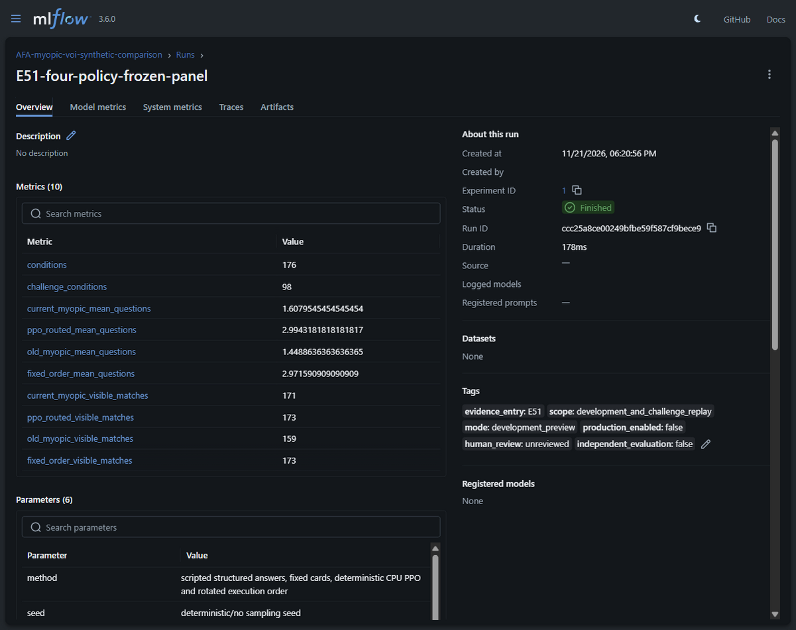

재현 명령은 [AFA README](../beauty_agent/afa/README.md)에 있고, 동결 응답표·조건별 JSON·정책별 CSV·조건군 집계·E49 대조·테스트 로그는 `outputs/afa-e51/`에 있다. 화면의 Duration은 결과 등록 시간이다. [MLflow E51](http://127.0.0.1:5055/#/experiments/1/runs/ccc25a8ce00249bfbe59f587cf9bece9)

### E52 — Myopic CLI 선택형 후속 질문 / 2026-11-21

- **목적:** E50에서 Myopic을 CLI 기본 정책으로 연결한 뒤에도 후속 질문이 자유입력으로 남아 있던 문제를 해결한다.
- **변경:** Control Plane이 질문과 선택지를 함께 반환한다. CLI에서 번호를 선택하면 같은 `request_id`와 대기 질문의 턴·질문·선택 ID로 정형 값을 제출한다. 첫 요청에서 NLU를 사용하며 선택 응답은 NLU 호출을 거치지 않는다. 필수 보류와 제품 근거 경계는 기존 Control Plane 판정을 따른다.
- **조건:** E51의 동결된 합성 176조건(기존 78조건, 추가 98조건), 같은 KB 및 기존 PPO 체크포인트를 사용했다. 실제 로컬 CLI의 한국어 세안 흐름과 세정·보습·자외선차단·영역 간 조정의 선택 검사를 별도로 실행했다.
- **검사와 결과:** 선택 경로와 기존 구조화 경로 사이에 176/176조건의 질문 순서 및 사용자 응답이 같았다. Myopic은 총 283회(평균 1.61회) 질문했고 전체 입력 참조와 정확 판정 165/176, 사용자 응답 171/176이 일치했다. 필수 보류 12/12건을 유지했다. 네 정책의 구조화 회귀에서 시간 필드를 제외한 조건별 결과가 모두 같았다. 실제 CLI에서 자유문 답변을 번호 안내로 돌려보내고 번호 세 번으로 세안 권고까지 완료했다.
- **한계:** 동결 합성 자료를 재실행한 소프트웨어 검사다. 일반 사용자 선택 분포, 임상 효과, iOS UX는 이 실행에서 측정하지 않았다. 한국어 표시명이 없는 값은 KB 표기를 사용한다.
- **증빙:** `outputs/afa-e52/cli-smoke.txt`, `choice-replay.json`, `comparison.json`, `pytest.txt`, `full-pytest.txt`, `mlflow-run.json`, `commands.json`, 요약 JSON E52.

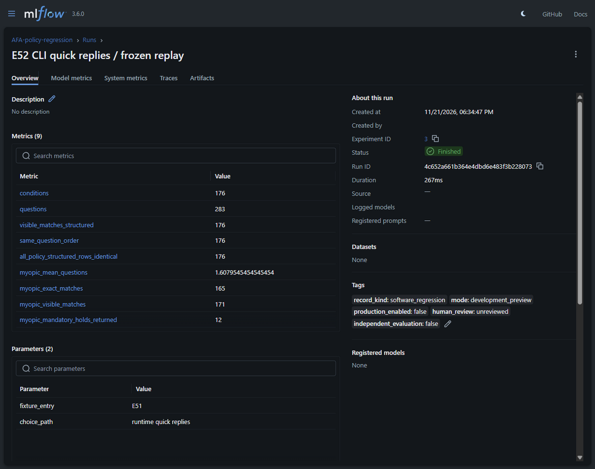

### E53 — Ppopy v3 AFA 계약 및 불변식 점검 / 2026-11-21

- **목적:** 루트 AGENTS.md의 Step 1~4에 따라 현재 AFA 실행 결과, 정형 버튼 계약, 경계 조건과 ITE 351 증빙을 점검한다.
- **KB 정합성:** 두 seed의 카드 ID 60개는 일치한다. 소스 블라인드 사용자 경로에서 B-P07 제조업체 선호를 제외한 59개를 v0.6 실행기로 평가했고, 세정 B-C02·보습 B-M01·자외선 B-P02·교차 B-I01 대표 입력 모두에서 가상 분기를 확인했다. v0.6.1의 변경 카드 레코드는 B-C03/B-C06/B-G03/B-G09/B-G16이다. 현재 실행기는 v0.6.1을 버전 검사에서 거부하며 B-C03은 v0.6.1에서 제거된 숫자 기준을 사용한다. 사례 6 규칙표의 워터·폼·표시 확인 밀크·표시 미확인 밀크는 각각 조정·유지·유지·확인으로 분기한다. 실제 어댑터는 그 답을 모두 미확인으로 처리했다. v0.6.1의 제품 ID·버전 기반 규칙을 실행기에 연결해야 한다.
- **버튼 및 trace:** 로컬 런타임의 `get_session`에서 실제 `AFAStepDecision`, `AFACandidateScore` 목록과 보류 전 확인 슬롯을 읽을 수 있다. 정형 버튼 질문의 ID와 acquire 대상이 맞고, 재시도에서도 같은 질문과 결정이 유지된다. AFA가 1단계 효과 0인 질문을 제외한 뒤 별도 Control Plane 확인이 발생하면 AFA 결정은 `stop(insufficient)`로 남는다. 부모 `followups.py`의 요청·턴·질문 식별자는 대응한다. 부모의 소스 열거형은 아직 `myopic_voi`가 없으며, 고정 선택지 표에 없는 보습·교차 슬롯에는 런타임 선택지를 전달해야 한다. 부모의 실제 `TurnTrace` 통합은 확인되지 않았다. 0ms는 번호 응답의 NLU 우회 경로를 의미한다.
- **검사:** `uv run --locked pytest -q` 492개 통과. 한 단계 영향 0 자동 제외 및 STOP, 제품 슬롯 차단, 응답 완료 상태 4종의 재질문 금지, 필수 보류 신호 3종의 AFA 선행 차단, 동점 결정성을 검사했다. 동일한 동결 176조건(100개 합성 상황)에서 네 정책의 조건별 결과가 E52와 동일했다. 시간 필드는 비교에서 제외했다.
- **정량 비교:** 정확 일치는 동일 런타임에 합성 답을 처음부터 모두 전달한 기준과 비교했다. 평균 질문 수는 작을수록, 일치율은 높을수록 좋다. 현재 Myopic 1.61회·165/176(93.75%), 고정 순서 2.97회·167/176(94.89%), PPO 라우팅 2.99회·167/176(94.89%), 과거 Myopic 1.45회·151/176(85.80%)였다. 각 정책의 제품 질문·재질문·필수 보류 누락은 0건이고 필수 보류 12/12건을 유지했다. B-C02 단독 37조건 중 30조건에서 PPO가 질문을 선택했고, 해당 37조건의 라우팅 결과는 평균 1.49회·37/37 일치였다.
- **한계와 다음 작업:** 이 수치는 현재 v0.6의 합성 소프트웨어 검사 결과다. v0.6.1 전환 검증에는 별도 버전 매핑 검토와 사례 6 연결 검사가 필요하다. 부모 통합은 소스 열거형, 버튼 값 전달, 로깅을 확인해야 한다.
- **증빙:** `outputs/afa-e53/kb-compatibility.json`, `comparison.json`, `comparison-receipt.json`, `pytest-final.txt`, `mlflow-run.json`, `commands.json`, 요약 JSON E53.

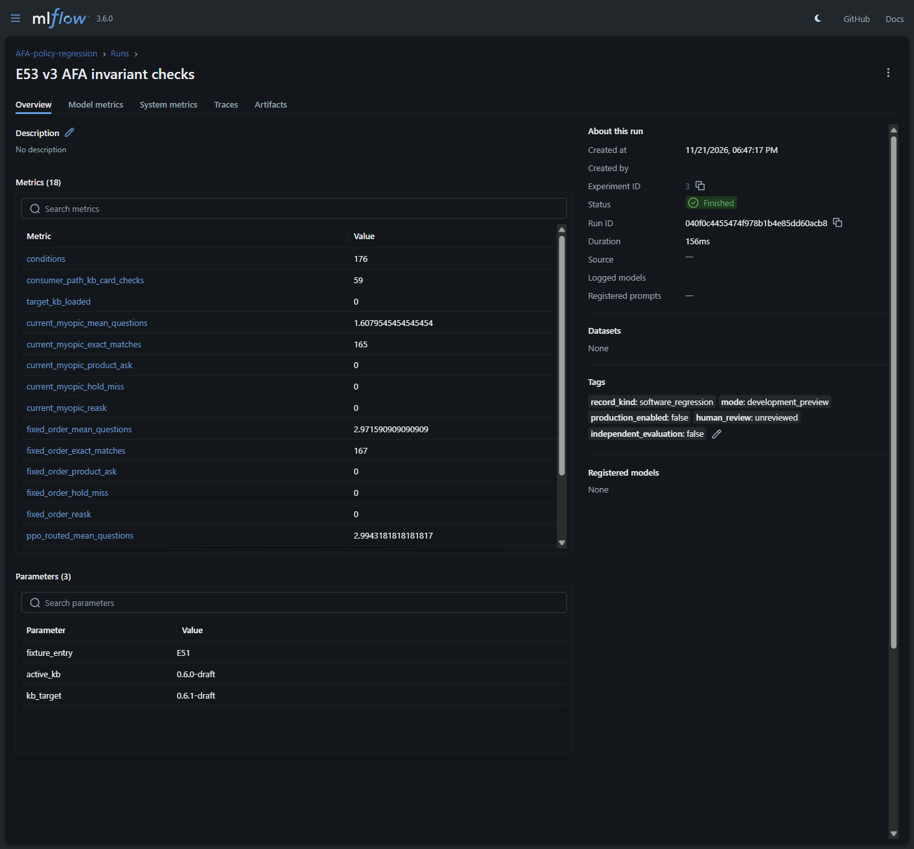

### E54 — Myopic으로 증상 후속 질문 선택 / 2026-11-21

- **목적:** 기본 Myopic CLI에서 NLP가 증상을 찾으면 고정 메뉴를 먼저 띄우는 경로를 없앤다.
- **변경:** 증상 확인 시 최근 한 번·반복·지속을 가정한 세 가지 KB 결과를 일반 질문과 같은 Myopic 점수로 비교한다. 선택되면 번호 선택지 다섯 개를 표시한다. 추출한 증상은 사용자가 응답할 때까지 미확정으로 유지한다. 일반 입력에서 드러난 관찰값 충돌도 고정 확인 메뉴 대신 기존 KB 후보 경로를 따른다.
- **실제 검사:** 같은 합성 한국어 세안 입력에서 증상 질문이 `myopic_voi`의 acquire로 선택됐다. 최근 한 번을 고르면 물기 제거 질문으로 이어졌고 반복을 고르면 AFA 실행 전에 필수 보류됐다. `uv run --locked pytest -q` 494개 통과. 별도 동결 176조건에서 네 정책의 시간 필드를 제외한 결과가 E53과 같았다.
- **한계:** 증상 질문 노출은 로컬 합성 입력으로 검사했다. 자연어 증상 분포, 실제 사용자 수행, v0.6.1 전환은 이 단계의 측정 범위에 포함되지 않았다.
- **증빙:** `outputs/afa-e54/cli-recent.txt`, `cli-repeated.txt`, `pytest.txt`, `comparison.json`, `mlflow-run.json`, `commands.json`, 요약 JSON E54.

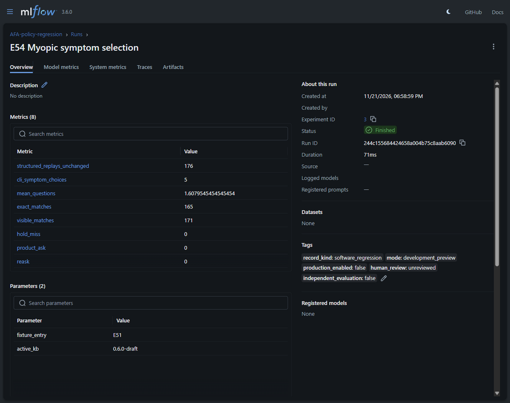

### E55 — PR #24 AFA v3 계약 호환 / 2026-11-21

- **목적과 변경:** 후보 점수는 v3 모델을 직접 공유한다. 기존 결정 클래스는 v3 결정 모델을 상속하면서 `from_legacy_action()`과 기존 런타임의 기본 출처 `rule_baseline`을 유지한다. 런타임은 v3 결정 객체를 직접 반환하는 정책도 수용한다.
- **검사:** Myopic이 반환한 acquire·stop·후보 점수를 v3 `model_validate()`로 직접 검증했다. 직렬화된 필드와 `TurnTrace` 속성 및 레거시 변환의 `product.*` 거절을 함께 검사했다. 기존 `test_v3_contracts.py`를 포함한 `uv run --locked pytest -q`는 503개, 계약·Myopic·NLP 초점 검사는 48개가 통과했다.
- **범위:** 모델 계약 및 실행 연결의 소프트웨어 회귀 검사다. 새 정책 성능 평가나 학습은 실행하지 않았다.
- **증빙:** `outputs/afa-e55/pytest.txt`, `focused.txt`, `commands.json`, `mlflow-run.json`, 요약 JSON E55.

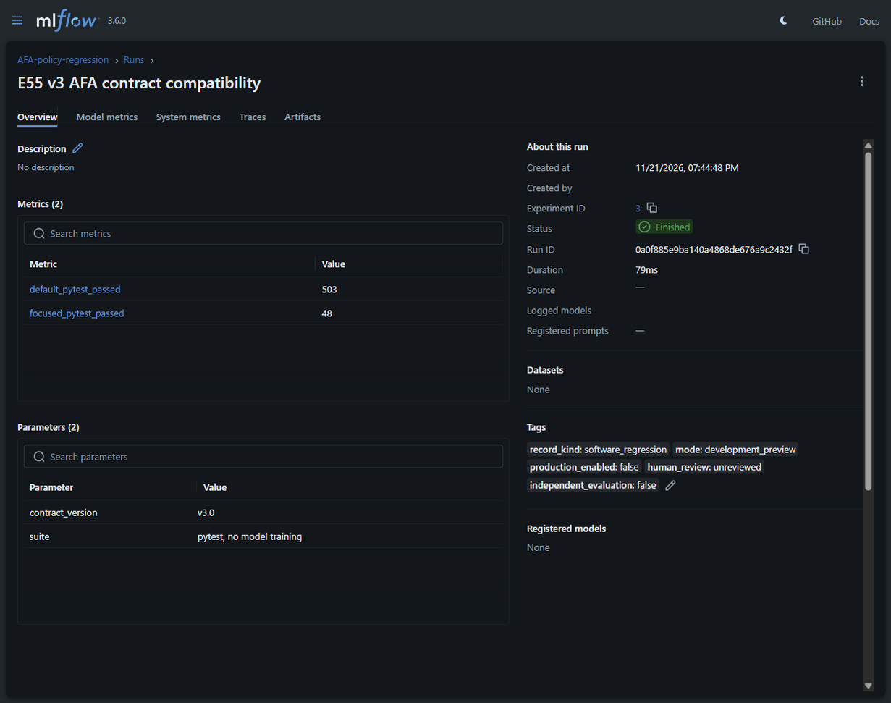

## 5. 테스트 숫자는 어떻게 읽어야 하나?

E39의 집중 검사 6개, 한국어 CLI 합성 시연 4개, 전체 소프트웨어 검사 567개가 통과했다. KB 경계·추적 검사 371개가 통과했고 엄격 원본의 기존 불일치 5건은 재현됐다.

E38은 통합 7개, 기본 소프트웨어 검사 449개, 전체 소프트웨어 검사 561개가 통과했다. KB 경계·추적 371개와 구조 95개도 통과했다. 엄격 원본에는 기존 불일치 5건이 재현됐다.

E37의 최종 전체 실험 테스트 547개와 KB 경계·추적 검사 371개가 통과했다. 기존 B-C02 합성 런타임 재실행 512건도 기준과 일치했다. 엄격 원본 검사에서는 기록된 5건의 불일치가 재현됐다.

E33 종료 검토에서 실험 모듈 전체 테스트 533개, KB 경계·추적 371개가 통과했다. KB 구조 검사 95개와 원본 27개 파일 해시도 확인했다.

E28에서 실험 모듈 전체 테스트 496개가 통과했다. KB 경계·추적 371개, 구조 검사 95개, 원본 해시 27개도 확인했다. 엄격한 원래 수용 테스트는 기존 5개 불일치였고 원본 감사는 57개 중 52개 충족이었다. 전체 테스트 로그와 학습 보고서를 따로 보관한다.

E29에서 선택 의존성까지 포함한 실험 모듈 전체 테스트 510개가 통과했다. Starlette의 기존 사용 중단 경고 1건이 있었다. 소스 매니페스트의 원본 27개 해시를 확인했다.

E30에서는 부분 관측 평가와 AFA 어댑터 테스트 11개가 통과했다. 소스 매니페스트의 원본 27개 해시를 다시 확인했다.

E31에서는 조기 종료·부분 관측·AFA 어댑터 테스트 14개가 통과했고 원본 27개 파일의 해시도 일치했다.

E27 문서 정정 후 AFA 테스트 104개와 KB 경계·추적 테스트 371개가 각각 통과했다. KB 구조 검사 95개와 원본 파일 27개의 해시도 확인했다. 엄격한 원래 수용 테스트는 62개 통과·기존 5개 불일치였으며 원본 감사는 57개 중 52개 충족으로 재현됐다. 이 횟수는 코드와 자료의 회귀 검사 수치다.

| 기록 | 당시 실험 모듈 전체 통과 수 | 근거·주의 |
| --- | ---: | --- |
| E00 | 305 | 당시 README 요약. 원본 pytest stdout은 별도 보존돼 있지 않음 |
| E01 | 314 | 당시 README 요약 |
| E02 | 336 | 당시 README 요약; Gym 검사 포함 |
| E03 | 342 | 저장된 verification index |
| E04 | 351 | 저장된 verification index |
| E05 | 356 | 저장된 verification index |
| E06 | 369 | 저장된 verification index |
| E07 | 전체 재실행 없음 | PPO 회귀 13개 재실행. 이전 369를 새 실행으로 세지 않음 |
| E08 | 382 | 저장된 verification index |
| E09 | 390 | 저장된 verification index |
| E10 | 421 | 저장된 verification index |
| E11 | 431 | 저장된 verification index |
| E12 | 446 | 저장된 verification index |
| E13 | **456** | 저장된 verification index. 이 문서 작성에서 새로 실행하지 않음 |
| E14 | 새 검사 실행 없음 | 문서·링크·설정·기존 수치 검토. 456은 마지막 실험 기록 |
| E15 | 새 실험 검사 실행 없음 | Linear 생성·배정·문서 동기화 확인. 456은 과거 기록 |
| E16 | **456** | 이동 후 전체 재실행 통과. 기본 범위 369 통과, 선택 패키지 차단 시 기본 수집도 369개 |
| E17 | **463** | MLflow 검사 7개 추가. 후속 변경 후 선택 검사 7개 재통과 및 실등록 검증 |
| E20 | 전체 재실행 없음 | 기본 검사 374개(새 EDA 5개 포함) 통과. 전체 선택 검사와 다른 범위이며 E17 기록을 대체하지 않음 |
| E21 | 전체 재실행 없음 | 기본 384개(새 응답 회귀 10개 포함) 통과. 전체 선택 검사와 별개 |
| E22 | **486** | Gym/PPO/MLflow까지 전체 재실행. EDA 5개·E21 10개·E22 8개가 E17 이후 추가됨 |

숫자가 늘어난 것은 검사 코드가 추가된 것이며 모델 정확도가 올라갔다는 뜻이 아니다. 서로 다른 단계의 수치를 합쳐 표본 수로 만들지 않는다.

공통 원본 검사도 구분한다.

| 검사 | 마지막 실험 기록 | 의미 |
| --- | --- | --- |
| 가져온 source manifest | 27/27 일치 | 원본 스냅샷 파일 보존 |
| KB 구조 검사 | 95/95 | 구조·참조·비활성 조건 검사 |
| 현재 명세/경계 검사 | 371 통과 | 현재 규칙 동작과 기존 불일치 보존 |
| 엄격 원본 검사 | **62 통과·5 실패** | T17, T20, T37, T45, V06-T04가 계속 미해결 |
| 원본 57개 감사 | **52/57**, 종료 코드 1 | 원본 수용 기준을 모두 만족한 것이 아님 |
| 규칙 coverage | 60카드·213분기·180경계 | 정형 입력 실행 범위. 자연어·임상 검증이 아님 |

456개와 371개 등은 목적·검사 대상이 다르므로 합산하지 않는다. “전체 테스트가 전부 녹색”이라고 발표하지 않는다. 원본 실패를 skip/xfail로 숨기거나 기대값을 고치지 않았다. [원본 검증 설명](../../../../../docs/verification.md)을 함께 참고한다.

## 6. 증빙 파일과 재현 방법

### 원본 → 요약 → 발표 문장의 연결

1. **원본 보고서:** 루트 `outputs/afa-*/`의 JSON·CSV·검증 index. 실제 측정과 개별 경로는 여기에 있다.
2. **단계 설명·고정 설정:** `data/afa/*/README.md`, contract/protocol/manifest. 조건과 한계를 확인한다.
3. **이동 가능한 요약 증빙:** [afa-policy-evidence.json](afa-policy-evidence.json)의 E00~E13 실험 이력, E14 문서 검토, E15 Linear 공유 연결, E16 구조 정리. 핵심 수치·원본 경로·SHA-256·파일 크기와 출처 유형을 보존했다.
4. **발표 설명:** 이 문서의 해석·허용 주장·단계별 설명을 사용한다.

`outputs/`는 Git에서 제외된다. 다른 PC에서 이 문서만 받았다고 원본 보고서·가중치가 함께 존재하는 것은 아니다. 발표 전에 필요한 합성 보고서를 별도 보관하거나 같은 코드·설정으로 새 경로에 재현한다. 요약 JSON은 전체 경로·로그를 대체하지 않는다.

SHA-256은 파일 동일성과 변경 추적을 위한 값이지, 전문가 승인·공인 검증 서명이 아니다. 현재 작업은 로컬 작업 트리이며 이 누적 기록에서 소스 commit을 새로 고정하지 않았다. 발표용 확정본은 별도 작업 브랜치의 코드 버전·설정·자료·로그를 함께 보관해야 한다. 이번 문서 작성은 commit/push/merge를 수행하지 않았다.

### 과거 해시와 현재 파일이 다른 경우

현재 캡처에서 E03의 `environment.py`, E05/E08의 설계 README, E07/E08/E09의 탐색용 README 등 일부 과거 index 참조 파일은 후속 수정으로 해시가 달랐다. 특히 E03 이후 reset 난수열 처리가 수정됐다. 원본 index는 고치지 않고 요약 증빙의 `historical_reference_check_at_capture.changed`에 기록했다.

따라서 “모든 옛 실행이 현재 코드와 완전히 같은 해시로 재현된다”고 주장하지 않는다. 당시 실행 결과, 후속 변경, 마지막 검증 기록을 구분한다. 알려진 문서/구현 변경을 숨기려고 과거 해시를 재생성하지 않는다. 초기 단계의 완전한 stdout·당시 소스 버전이 모두 별도 보관된 것은 아니라는 증빙 한계도 남긴다.

### 대표 재현 명령

`courses/ai-applications/experiments/cos-agent/`에서 실행한다. 아래는 재현 안내이며 이 문서 작성에서 실행한 명령이 아니다. 기존 폴더·보고서는 덮어쓰지 않으므로 새 이름을 사용한다.

```powershell
# 마지막 전체 실험 검사의 같은 범위
uv run --locked --group rl-train --group tracking pytest -q -o norecursedirs= tests

# 기존 시험 학습 모델의 읽기 전용 재실행
uv run --locked --group rl-train python -m beauty_agent.afa.ppo evaluate --run-dir ../../../../outputs/afa-stage5a-trial-v1

# 실행용 응답 자료 재현 대조
uv run --locked --group rl-train python -m beauty_agent.afa.joint_data verify

# 고정 순환 비교를 새로운 파일에 재실행
uv run --locked --group rl-train python -m beauty_agent.afa.fold_baselines --report ../../../../outputs/afa-presentation-replay/comparison.json
```

모델 로더는 코드·패키지·설정·가중치 해시를 검사한다. 후속 코드 변경으로 예전 모델 로드가 거부되면 당시 버전을 복원하거나 별도 새 실행을 만들고 기록한다. 검사 기능을 꺼서 증빙을 맞추지 않는다.

## 7. 발표에서 할 수 있는 주장과 할 수 없는 주장

| 발표 문장 | 판정 | 근거/수정 |
| --- | --- | --- |
| “정형 환경에서 질문 선택 정책의 학습·검증 경로를 구현했다.” | 가능 | E02~E07, E10 |
| “6개 train 상황의 PPO 시험에서 성급한 보류가 줄었다.” | 조건 명시 시 가능 | E07. 1 seed·256 step·train 진단이라고 반드시 표시 |
| “PPO가 기존 방식보다 질문을 적게 했다.” | 현재 불가 | E07은 탐욕과 같음. E13은 PPO 결과가 아님 |
| “순환 비교에서 계산 기준선은 전체 평균 질문을 약 1.06회 줄였다.” | 조건 명시 시 가능 | E13. 손세안 비용 증가도 함께 제시 |
| “모든 세안 상황에서 계산 방식이 더 좋다.” | 불가 | 손세안 4.75 vs 기존 4.50 |
| “456개 테스트를 통과해 임상적으로 정확하다.” | 불가 | 소프트웨어 검사와 임상 정확도는 다른 근거 |
| “1,440명의 독립 사용자로 평가했다.” | 불가 | 합성 48세계의 반복 실행 |
| “v67 1,025개로 PPO를 학습했다.” | 불가 | 재사용 감사만 수행 |
| “최종 test를 한 번도 보지 않았다.” | 불가 | 내부 기계 검증과 순환 실험에서 이미 점검·재사용 |
| “production에 쓸 준비가 끝났다.” | 불가 | development_preview, production_enabled=false 유지 |

### 발표 구성 예시 — 6장

1. **문제:** 같은 안내 수준을 유지하며 필요한 질문을 줄이고 싶다.
2. **설계:** 정책은 선택하고, KB·실행 게이트는 사실·행동 허용을 관리한다. 질문한 답만 공개한다.
3. **기술 검증:** 환경·보상·마스크를 먼저 검사하고 작은 PPO에서 실제 업데이트를 확인했다.
4. **실험 설계의 수정:** 평균 수치가 좋아도 손세안 유형이 빠져 있음을 발견해 보완했다.
5. **결과와 반례:** 전체 4.50→3.44, 손세안 4.50→4.75를 같은 장에 보여준다.
6. **남은 과제:** 64차원 PPO의 공정한 비교, 더 넓은 입력/응답 계약, 독립 참조·평가.

## 8. 다음 단계와 누적 기록 규칙

E35–E37에서 대기 질문 재사용, 질문 순위 비교, 새 합성 복합 사례 최종 검증을 마쳤다. 새 카드나 실제 운영으로 넓힐 때는 별도의 근거·검토 계약과 독립 평가를 사용한다.

E32는 B-C02의 안내 태그 두 개를 실제 권고 효과와 구분했다. E33의 고정 비교에서 PPO가 질문을 절감하지 못해 도구 우선 규칙을 기본으로 뒀다. 추가 카드와 독립적으로 검토한 새 평가 자료의 경계는 [적용 검토](afa-release-review.md)를 따른다.

E38은 로컬 조회와 질문·재개·권고·보류를 통합 검증했다. E39는 한국어 세안 대화와 CLI 기본 제품 자료를 보완했다. 후속 단계에서 검토한 제품 근거를 KB 관찰로 전달하는 계약을 검증한다. 기존 고정 실험의 원본·해시는 당시 버전의 증빙으로 남긴다.

실제 대화형 v67 활용은 별도의 상태·후보 확인·정정·제품 근거·반사실 응답 계약이 필요하다. 본 데이터/참조·독립 가족·임상/사용자 평가 준비 완료와 기술 점검 완료를 구분한다.

### 매 작업 완료 시 갱신할 것

- 현재 위치·요약 결과·한계가 달라지면 1~3절을 갱신한다.
- 2절에 새 E번호 행을 추가하고, 4절 끝에 아래 양식으로 새 기록을 덧붙인다. 과거 수치를 최신 값으로 덮어쓰지 않는다.
- 5절에는 이번에 실제로 실행한 검사만 추가한다. 재실행하지 않은 검사는 과거 기록이라고 표시한다.
- `afa-policy-evidence.json`에는 새 E번호와 원본 경로·해시·핵심 수치를 추가한다. 옛 receipt를 새 해시로 바꾸지 않는다.
- 이 문서 갱신 후 [PPO-32](https://linear.app/ppopy/issue/PPO-32) 본문에도 전체 내용을 동기화하고 다시 읽어 확인한다. 상세 절차·실패 처리는 `AGENTS.md`를 따른다.
- 잘못된 기존 설명은 조용히 지우지 말고 **정정 날짜·이유·영향·대체 증빙**을 추가한다. 바뀐 계획을 과거 구현 완료로 기록하지 않는다.
- 결과의 분모(고유 상황/가족/반복), train/확인 구분, seed·비용·모델 버전, 복구와 실패, 반례를 남긴다.
- 가능하면 다음 실행부터 원본 stdout/CSV·명령·종료 코드·소스 버전도 새 `outputs/` 경로에 보관한다. 개인 정보·비밀·원시 외부 자료는 포함하지 않는다.

### 새 기록 양식

```markdown
### E56 — 작업 이름 / YYYY-MM-DD

- 목적: 무엇을 확인하거나 해결하려 했는가?
- 변경: 코드/계약/자료/분할에서 무엇이 달라졌는가? 기존 버전은 어떻게 보존했는가?
- 조건: 자료와 역할, 고유 상황·가족 수, 반복, seed, 비용, 알고리즘/모델 버전.
- 결과: 실제 측정 수치와 검사 명령·통과/실패/미실행 범위.
- 해석: 결론, 반례·복구·실패, 아직 주장할 수 없는 것.
- 다음: 이 결과 때문에 다음에 무엇을 확인해야 하는가?
- 증빙: 원본 보고서/설정/코드/검증 index 링크, 요약 JSON의 같은 E번호.
```

다음 누적 기록 번호는 **E56**이다. E55는 PR #24의 AFA v3 계약 호환을 확인했다. E54는 Myopic으로 증상 확인 질문을 선택하도록 연결했다. E53은 v3 계약·불변식과 KB 버전 연결의 남은 항목을 확인했다. E52는 Myopic CLI 선택형 후속 질문과 동결 조건 회귀 검사다. E51은 기존 및 추가 합성 조건에서 네 질문 정책을 비교했다. E50은 기본 CLI에 Myopic VOI를 연결한 검사다. E49는 1단계 AFA와 보류 전 확인을 분리하고 E48 성능을 재현했다. E48은 보류 직전 여러 답이 필요한 KB 분기를 확인한 비교다. E47은 같은 합성 조건에서 기존 PPO를 포함한 3자 비교다. E46은 KB 분기와 v67 파생 자료를 포함해 비교 범위를 넓힌 실험이다. E45는 여러 활성 카드에서 한 단계 질문 정책을 합성 비교한 결과다. E44는 로컬 CLI의 PPO 우선 실행과 규칙 기반 복구 검사다. E43은 Kiwi·Jev NLP 파이프라인 검사다. E42는 증상 질문 분리와 CLI 선택지 제한 검사다. E41은 CLI 모듈 표시 검사다. E40은 세안 CLI의 선택형 답변과 직접 입력 검사다. E39는 한국어 세안 대화 회귀 검사다. E38은 로컬 런타임 통합 검사다. E35–E37은 질문 중복 방지, 순위 비교, 새 합성 사례 검증이다. E34는 복합 카드 선택과 제품 근거가 필요한 종료를 보완한 소프트웨어 검사다. E33은 세 seed 고정 내부 시험이고 E32는 종료의 실행 효과와 실제 체크포인트 이관 검증이다. E31은 조기 종료 조건의 합성 검증이다. E30은 고정된 정책의 선행 정보 조건 비교다. E29는 같은 seed 재학습과 AFA 어댑터 결과 반환 검사다. E28은 B-C02 첫 학습·기준선 비교와 초기 Context 진단이다. E27은 아키텍처와 AFA 역할 정정이다. E22는 작은 정적 train 파생 자료·자료 수준 누락 검사다. E21은 라벨·응답 후속 검토와 EDA 이슈 분리다. E18~E19는 안내·이미지 공유, E20은 새 전체 v67 데이터 분석이며 PPO 학습은 아니다. E00~E13은 기존 실행 이력, E14는 문서 검토, E15는 Linear 공유 연결, E16은 구조 정리, E17은 MLflow 기록이다. 문서 작성·공유·구조 정리 자체를 새 모델 성능 실험으로 세지 않는다.

<a id="technical-guide"></a>

## 9. 개발자용 해설 — 입력·호출·설정·결과를 연결하기

이 절은 코드를 열기 전 보는 안내서다. 발표 청중은 1~3절과 7절만 먼저 읽어도 된다. 아래 예시는 호출 형식을 설명하며, 이번 문서 수정에서 새로 실행한 실험이 아니다.

### 9.1 입력값: “아는 것”과 “아직 모르는 것”을 어떻게 담나?

현재 실험의 `method.*`는 세안 방법을 담는 변수 이름이다. `method.body_site`는 씻는 부위, `water_temperature`는 물 온도 범주, `tools`는 도구, `friction`은 마찰, `drying`은 말리는 방법이다. 이름의 점은 `method` 아래 항목이라는 뜻이며 함수 호출이 아니다. `hot`은 합성 자료의 범주일 뿐 실측 온도나 임상 기준을 뜻하지 않는다.

| 필드 | 쉬운 뜻 | 예시와 주의점 |
|---|---|---|
| `variable_id` | 어떤 항목에 대한 답인가? | `method.tools` |
| `state` | 답을 어느 정도 아는가? | `known`이면 값이 있음. `not_asked`는 아직 안 물음, `unknown`은 모른다는 답, `declined`는 답변 거절, `not_applicable`은 해당 없음, `conflicting`은 서로 맞지 않는 답 |
| `value` | 실제 답의 범주 | `hands`=손, `scrub_brush`=스크럽 브러시. `null`은 값 없음이며 손세안으로 추정하지 않음 |
| `source` | 답이 어디서 왔는가? | 현재 예시는 `synthetic_fixture`=미리 만든 합성 응답표 |
| `confirmed_by_user` | 응답이 확인된 값으로 들어왔는가? | 합성 사용자 확인도 `true`일 수 있음. 실제 사람 참여·전문가 승인 근거가 아님 |

현재 주요 성능 비교는 답이 준비된 합성 상황을 사용한다. 미상·거절·충돌 등은 별도 기능 검사 대상이며, 그 검사가 통과했다고 실제 사용자 응답 성능까지 측정한 것은 아니다. `approved_reference=false`, `human_review=unreviewed`도 그대로 유지한다.

### 9.2 호출 순서: 질문 하나가 어떻게 다음 관찰로 이어지나?

```python
from beauty_agent.afa.joint_environment import JointAFAEnv

env = JointAFAEnv(split="train", cost_protocol="unit_primary")
observation, info = env.reset(seed=0)
mask = env.action_masks()
next_observation, reward, terminated, truncated, info = env.step(0)
```

| 호출·반환값 | 실제로 하는 일 |
|---|---|
| `split="train"` | 준비 자료 구역을 선택한다. 최종 독립 평가를 뜻하지 않는다. |
| `cost_protocol="unit_primary"` | 질문마다 비용 1을 매긴다. 다른 비용표와 구분하는 실험 이름이다. |
| `reset(seed=0)` | 새 상황을 준비하고 첫 공개 입력을 돌려준다. 질문 실행은 0회다. `seed`는 난수 시작값이며 사용자 번호가 아니다. |
| `observation` | 정책에 보여주는 숫자 배열. 숨겨진 전체 정답표는 넣지 않는다. |
| `action_masks()` | 현재 허용된 행동이면 `True`, 닫힌 행동이면 `False`인 배열을 준다. |
| `step(0)` | 전역 행동 번호 0, 즉 부위 질문을 한 번 실행한다. 합성 응답을 반영하고 다음 공개 입력을 준다. |
| `reward` | 이번 행동의 점수. 위 질문 비용은 `-1`이다. 누적 점수는 `return`이라 부른다. |
| `terminated` | 초안·보류·과제 내 예산 소진 등으로 과제가 끝났는가? |
| `truncated` | 외부 시간 제한처럼 과제 자체와 별개인 이유로 실행이 끊겼는가? |
| `info` | 실행 내역과 평가용 부가 정보. 배열 전체를 정책 입력으로 넘기는 통로가 아니다. |

첫 부위 질문에 `face` 응답을 받은 경우 `info`의 `applied_action`은 `["ask_user", "method.body_site"]`, `execution_status`는 `awaiting_user`, `dispatch_count`는 1이다. 이 이름은 질문을 보낸 실행 상태를 기록한다. 환경은 이어 합성 응답을 받아 다음 관찰을 준비하므로 사람이 실제로 입력할 때까지 기다렸다는 뜻은 아니다. `terminated=False`, `truncated=False`라면 다음 선택을 계속한다. Gym의 반환 형식과 종료 구분은 [공식 환경 API](https://gymnasium.farama.org/api/env/)를 따른다.

행동 번호는 턴마다 바뀌는 후보 순번이 아니다. [고정 계약](../data/afa/stage0-v1/contract.json)의 같은 번호가 항상 같은 행동을 가리킨다.

| 번호 | 코드의 `(action, target_id)` | 뜻 |
|---|---|---|
| 0 | `ask_user`, `method.body_site` | 부위 질문 |
| 1 | `ask_user`, `method.water_temperature` | 물 온도 질문 |
| 2 | `ask_user`, `method.tools` | 도구 질문 |
| 3 | `ask_user`, `method.friction` | 마찰 질문 |
| 4 | `ask_user`, `method.drying` | 말리는 방법 질문 |
| 5 | `hold`, `insufficient_information` | 정보 부족으로 보류 |
| 6 | `hold`, `safety` | 안전 사유로 보류 |
| 7 | `request_draft`, `label_draft` | 저장 전 안내 초안 요청 |

첫 마스크는 `[True, False, False, False, False, True, False, False]`다. 부위를 묻거나 정보 부족으로 보류할 수 있다. **허용됨은 정답이라는 뜻이 아니다.** 충분히 답을 얻을 수 있는데 일찍 보류하면 오답 손실이 붙는다. 마스크 밖 행동은 오류로 거절하며 정상 행동처럼 상태를 반영하지 않는다. 마스크는 학습과 평가 양쪽에서 전달해야 한다([Maskable PPO 공식 사용법](https://sb3-contrib.readthedocs.io/en/v2.7.1/modules/ppo_mask.html)).

실제 코드에서는 `prepare_context`가 새 응답을 반영한 선택용 스냅샷을 준비하고, `apply_action`이 그 스냅샷에 대한 선택을 검사·실행·반영한다. 전자는 질문을 보내지 않고 후자가 한 번 보낸다. 여기서 `ActionContext`는 선택에 필요한 상황 묶음, `ActionProposal`은 `action`과 `target_id`를 담은 행동 제안이다. 준비 토큰은 오래된 스냅샷 실행을 막는 표식이며 로그인 권한 토큰이 아니다. 정책이 임의의 질문 문구를 보내더라도 사용자 문구는 코드의 제한된 렌더링 규칙을 따른다. 코드의 `reviewed_text` 같은 이름은 별도 임상 검토가 완료됐다는 증거가 아니다. 초안도 `requires_approval=True`, `saved=False`이며 실제 저장 승인이 아니다.

### 9.3 58차원·64차원: 질문 64개라는 뜻인가?

아니다. **정책이 한 번에 받는 숫자 칸의 수**다. 문자 범주를 숫자로 바꾸기 위해 여러 칸을 쓴다. 예를 들어 물 온도의 순서가 `[null, cold, lukewarm, hot]`이면 `hot`은 `[0, 0, 0, 1]`로 표시한다. 이런 표시를 one-hot이라 한다. 값이 비어 있는 이유는 별도의 `state` 칸으로 구분하므로 아직 안 물은 값과 답변 거절을 합치지 않는다.

| 숫자 칸의 용도 | v1 | v2 |
|---|---:|---:|
| 5개 항목 × 6개 답변 상태 | 30 | 30 |
| 각 항목의 가능한 값 표시 | 17 | 17 |
| 대상 카드 표시 | 2 | 2 |
| 허용 행동 8개 표시 | 8 | 8 |
| 남은 질문 수 | 1 | 1 |
| 질문별 비용 5개 + 남은 비용 | 0 | 6 |
| 합계 | **58** | **64** |

v1은 카드 하나를 대상으로 했고, v2는 두 카드를 함께 본다. **기존 58차원 모델을 64차원 환경에 그대로 연결할 수 없으며, v2 PPO 학습은 아직 하지 않았다.**

v2에서 도구를 추가로 묻는 이유도 숫자 칸 증가와 별개의 의미 문제다. B-C02는 도구 분기를 먼저 검사한다. 마찰이 강하다는 답만으로는 안내 문구가 정해져도, 나중에 도구 답을 알면 행동 종류가 달라질 수 있다. v2는 현재 답과 모순되지 않는 나머지 합성 응답 조합들에서 **최종 판단의 의미가 같은지** 확인한다. 다르면 질문을 더 열고, 이미 도구 답으로 판단이 안정됐다면 나머지 질문은 생략할 수 있다. 이 검사는 선언된 유한 범위 안의 일관성 검사이며 실제 세계 전체나 임상 타당성에 대한 보증이 아니다.

<a id="training-settings"></a>

### 9.4 PPO 설정값: E07에서 실제로 무엇을 얼마나 학습했나?

PPO는 행동 선택 확률을 조금씩 조정하는 강화학습 방법이다. 여기서는 대화 문장을 생성하는 대형 모델 대신 작은 신경망을 학습했다. `MaskablePPO`는 그중 허용 행동 마스크를 사용하는 구현이며, `MlpPolicy`는 숫자 입력을 받는 신경망의 라이브러리 이름이다. 다음은 [실제 실행 설정](../../../../../outputs/afa-stage5a-trial-v1/config.json)의 해설이다. `outputs/`는 로컬 증빙이므로 저장소 복제본에 없을 수 있다.

| 설정과 실제 값 | 쉬운 뜻·이 실험에서의 의미 |
|---|---|
| `seed=0` | 난수 시작값을 고정했다. 한 번의 시작값으로 진단했으며 반복 실험이나 독립 사용자 수가 아니다. 다른 환경까지 완전히 동일한 결과를 보장하지 않는다. |
| `total_timesteps=256` | 환경에서 행동 256회 분량을 수집하며 학습했다. 상황 256개나 대화 256개가 아니다. |
| `n_steps=32` | 행동 32회씩 모아 한 묶음으로 학습한다. 에피소드 길이 32라는 뜻이 아니다. |
| `batch_size=16` | 그 묶음 중 16개씩 나누어 한 번의 계산에 사용한다. |
| `n_epochs=4` | 모은 한 묶음을 네 차례 반복해서 학습한다. 새 상황 네 개를 추가하는 것이 아니다. |
| `learning_rate=0.0003` | 가중치 조정 크기에 곱하는 계수. 실제 변화량을 이 숫자로 제한한다는 뜻은 아니다. |
| `gamma=1.0` | 나중에 생길 비용도 할인하지 않고 같은 비중으로 본다. 유한 에피소드의 총비용 목적에 맞춘 설정이다. |
| `shaping_beta=0` | 보조 점수를 얹지 않았다. 실험 계약의 설정이며 SB3 생성자에 넣는 인자 이름은 아니다. |
| `gae_lambda=0.95` | 앞으로의 점수를 얼마나 길게 섞어 학습 신호를 계산할지 조절한다. 정확도 95%가 아니다. |
| `ent_coef=0` | 선택을 다양하게 하도록 별도 보너스를 주지 않는다. 확률적 행동 수집까지 꺼졌다는 뜻은 아니다. |
| `clip_range=0.2` | 이전 정책과의 차이가 과해지는 것을 줄이는 학습 목적식 설정. 모든 가중치 변화의 20% 상한이나 안전 보장률이 아니다. |
| `net_arch={"pi": [32, 32], "vf": [32, 32]}` | 행동 확률 계산부(`pi`)와 미래 점수 예측부(`vf`)에 각각 32칸짜리 중간층 두 개를 쓴다. 후자는 학습을 돕는 추정기이지 독립 정답 판정자가 아니다. |
| `device="cpu"`, `torch_threads=1` | CPU와 계산 스레드 한 개를 사용했다. GPU 성능 측정이 아니다. |
| 평가 `deterministic=True` | 평가 때 허용 행동 중 학습된 확률이 가장 큰 행동을 고른다. 항상 옳다는 뜻은 아니다. |

단일 환경에서 **256 ÷ 32 = 8묶음**, 묶음당 **32 ÷ 16 = 2개 작은 묶음**, 각각 **4회 반복**이다. 따라서 로그의 epoch update는 **8 × 4 = 32**, 파라미터별 optimizer step은 **8 × 2 × 4 = 64**로 읽는다. 같은 수집 자료를 반복 사용하므로 64회 업데이트를 독립 사례 64개로 세면 안 된다. 설정 의미는 [SB3 PPO 공식 API](https://stable-baselines3.readthedocs.io/en/v2.7.1/modules/ppo.html), 반복 학습 원리는 [PPO 원 논문](https://arxiv.org/abs/1707.06347)과 연결된다.

기록 환경은 Windows/Python 3.10.5, Torch 2.9.1+cpu, stable-baselines3·sb3-contrib 2.7.1, Gymnasium 1.2.3, NumPy 2.2.6이다. 이 설정은 작은 연결 진단의 조건이며 최적 설정으로 확정한 값이 아니다.

<a id="result-metrics"></a>

### 9.5 결과값: 무엇을 분모로 삼고 어떻게 해석하나?

| 결과 이름 | 뜻·읽는 방법 |
|---|---|
| `mean_questions` | 전체 에피소드의 평균 질문 횟수. 적을수록 좋지만 올바른 종료율을 함께 봐야 한다. |
| `mean_cost` | 질문별 가중 비용을 합친 뒤 에피소드 수로 나눈 값. 돈이나 실제 상담 시간을 측정한 것이 아니다. |
| `mean_return` | 에피소드마다 받은 점수의 합을 평균한 값. 현재 비용형 보상에서는 덜 음수일수록 좋다. |
| `correct_terminal_rate` | 전체 에피소드 중 의미가 참조와 맞고 종료 유형도 적절한 비율. 보류는 남은 질문 여부도 검사한다. |
| `semantic_match_rate` | 전체 에피소드 중 판단 의미가 참조와 같은 비율. 이것만으로 올바른 시점에 끝냈다고 할 수 없다. |
| `draft_rate`, `hold_rate` | 전체 에피소드 중 각각 초안·보류로 끝난 비율. 초안 비율이 높다고 품질이 높은 것은 아니다. |
| `wrong_hold_rate` | 잘못 보류한 수 ÷ **전체 에피소드 수**. 보류한 사례만을 분모로 하지 않는다. |
| `error_among_drafts` | 잘못된 초안 수 ÷ **초안 종료 수**. 초안이 없으면 `null`이며 오답률 0으로 바꾸지 않는다. |
| `policy_fallbacks` | 비교 정책이 자체 계산 대신 정해진 복구 선택을 사용한 횟수. 고유 상황 수가 아니라 선택 횟수다. |
| `runtime_rejects`, `runtime_fallbacks` | 실행 계층의 거절·대체 기록. 보고서의 0은 해당 실행 범위의 기록이며 임의의 모든 입력에서 안전하다는 증거가 아니다. 오류로 실행이 중단되면 완료 보고서와 별도로 봐야 한다. |

예를 들어 질문 비용이 1, 잘못 종료한 손실이 5라면 두 번 묻고 잘못 보류한 점수는 `-2 - 5 = -7`이다. 세 번 묻고 올바르게 끝낸 점수 `-3`이 더 좋다. 이 예는 E07의 v1 비용 설명이다. v2는 전체 질문 예산보다 오답 손실이 크도록 단위 비용에서는 6, 가중 비용에서는 8을 사용한다. 서로 다른 보상 버전의 `return`을 그대로 성능 순위로 비교하지 않는다.

`family_id`는 비슷한 응답 구조를 묶은 그룹, `world_fingerprint`는 같은 합성 상황을 짝지어 비교하는 식별자다. 실제 사람 식별자가 아니며 정책에 숨겨진 정답을 알려주는 입력으로 사용하지 않는다. E13의 1,440행은 **16가족 × 가족별 3상황 × 정책 5개 × seed 3개 × 비용표 2개**다. 고유 상황은 48개다. 각 가족을 확인할 때 나머지 45개 상황으로 기준선의 응답 확률을 준비했다. 이는 PPO 학습이나 실제 사용자 1,440명 평가가 아니다.
