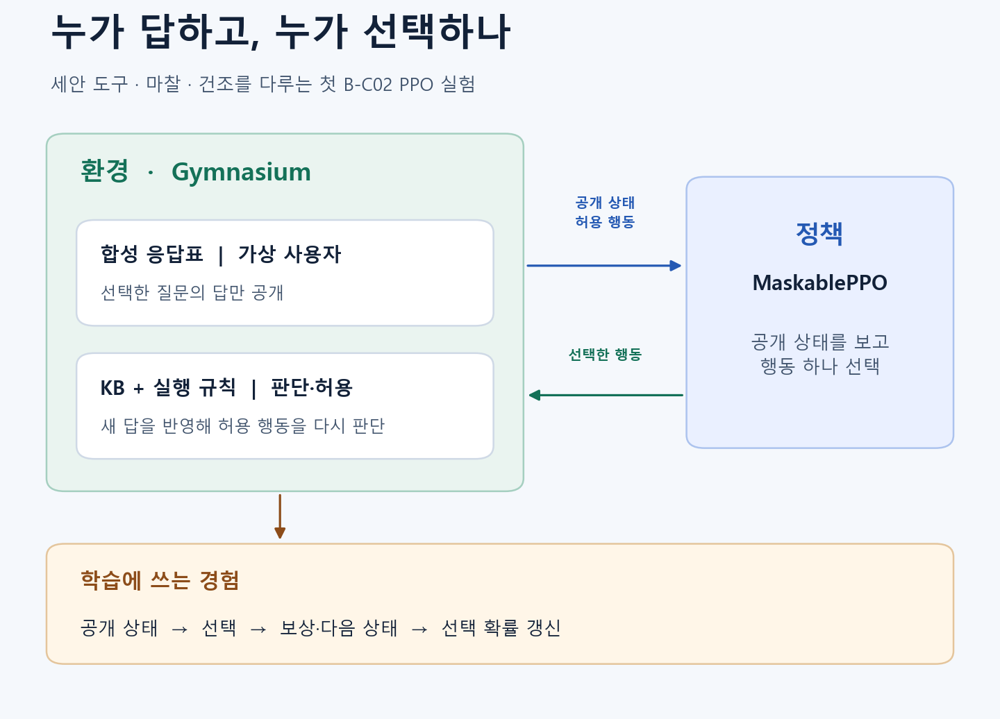
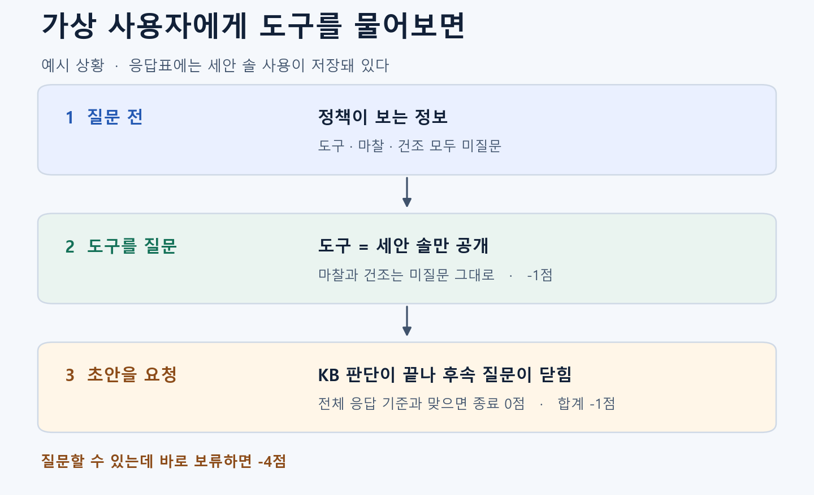

# AFA Policy RL 한눈에 보기

이 그림은 **B-C02 질문 정책의 학습 환경**이다. 실제 제품의 날씨·제품 조회와 추천 흐름은 [전체 에이전트 목표 구조](agent-runtime-target.md)에 있다.

**합성 응답표는 답을 주고, KB는 판단하고, PPO는 다음 행동을 고른다.** 목표는 올바르게 끝내면서 필요한 질문 수를 줄이는 것이다.

- **공개 상태**는 지금까지 받은 답이다. `아직 안 물음`, `모름`, `답변 거절`을 구분한다.
- **행동 마스크**는 지금 선택 가능한 행동의 체크표다. 판단이 끝나면 필요 없어진 질문을 닫는다.
- **학습**은 시행 중 모은 행동과 보상으로 다음 행동의 선택 확률을 조정한다. 마지막 판단이 맞는지는 같은 KB에 그 상황의 응답을 모두 넣어 계산한 기준과 비교한다.

## 질문 한 번 따라가기

## 어떤 자료가 어디에 쓰이나?

| 자료 | 역할 |
| --- | --- |
| **v67 원본 · 1,025상황 / 2,453턴** | 기록을 분석하고 기존 행동 라벨을 검토했다. |
| **v67 파생 · 4상황** | 질문에 맞는 답이 공개되고 점수가 붙는지 검증했다. |
| **첫 PPO용 합성 · 64상황** | 도구·마찰·건조 응답을 조합한 가상 사용자 설정이다. 비슷한 상황을 가족으로 묶어 **학습 32 / 검증 16 / 시험 16**으로 나눴다. |

**학습 32상황에서 같은 상황을 여러 번 뽑아 플레이한다.** 첫 질문이 도구인지 건조인지에 따라 얻는 관찰과 보상이 달라진다. **64상황**은 준비한 가상 설정 수이고, **4,096스텝**은 첫 실행에서 계획한 행동 선택 수다. E26에서는 실행 연결과 초기화까지 검증했으며, 해당 PPO 모델의 학습 기록은 **0스텝**이다. [실행 설정과 재현 방법](../data/afa/ppo-preflight-v1/README.md)

## 기술과 코드 찾기

| 궁금한 것 | 맡는 기술·코드 |
| --- | --- |
| 응답표와 환경은 어디서 만드나? | [PPO 실험 진입점과 환경](../beauty_agent/afa/ppo_preflight.py) · **Gymnasium**이 시작과 한 번의 행동 API를 제공하고, **NumPy**로 공개 상태를 숫자 15개에 담는다. |
| 누가 답을 공개하고 행동을 검사하나? | [응답표](../beauty_agent/afa/v67_fixtures.py) · [실행 어댑터](../beauty_agent/afa/v67_runtime.py) · [KB 어댑터](../beauty_agent/modules/kb_adapter.py) · [종료 채점](../beauty_agent/afa/v67_reward.py) |
| 누가 행동 선택을 학습하나? | **sb3-contrib의 MaskablePPO** · **Stable-Baselines3** 기반 학습 흐름과 **PyTorch** 신경망을 사용한다. |
| 어디서 결과를 보나? | **MLflow**에서 조건·점수를 확인하고 **Matplotlib**로 그래프를 만든다. [실험 기록 코드](../beauty_agent/afa/tracking.py) |
