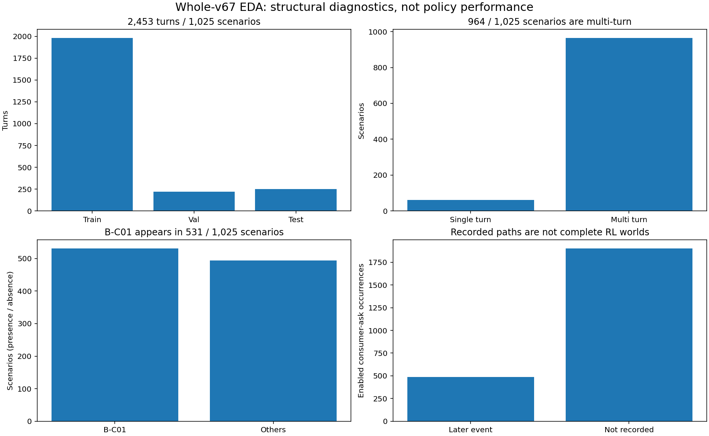
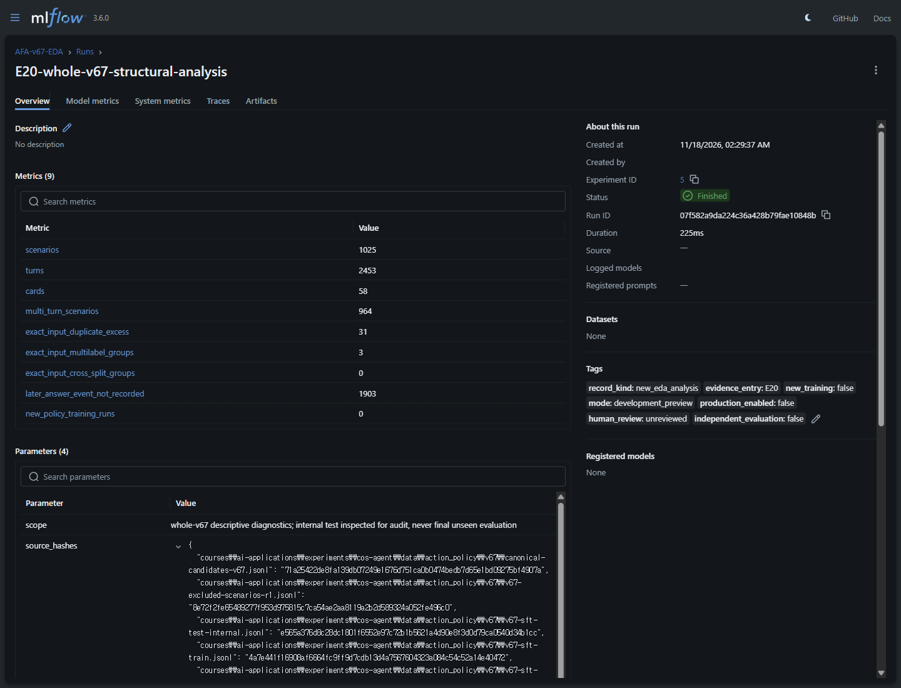

# v67 전체 데이터 EDA — 절차를 배우며 읽는 결과 보고서

분석 대상은 기존 v67이다. E26 첫 PPO에는 별도로 구성한 B-C02 합성 64상황을 사용하도록 준비했다. [목표 구조와 실험 범위](agent-runtime-target.md)

실행: 2026-11-18 · 범위: 1,025 시나리오 / 2,453턴 · 원본 수정 없음 · 새 학습 없음.

공유: [PPO-33 — AFA v67 EDA 상세·후속 검토](https://linear.app/ppopy/issue/PPO-33). 전체 AFA 진행은 [PPO-32](https://linear.app/ppopy/issue/PPO-32)에서 연결한다.

## 먼저 숲 보기: 이번 EDA가 답하려는 질문

“데이터가 크다”와 “원하는 학습에 충분하다”는 다르다. 이번에는 전체 구조·분포·누락된 응답 경로·분할·일부 내용 품질을 확인했다. **실제 사람·임상 정확도·PPO 성능을 측정한 것이 아니다.** 새 RL 환경이나 보상값을 확정하지 않았다.

| 순서 | 질문 | 방법 | 결과가 바꾸는 결정 |
| --- | --- | --- | --- |
| 1 | 무엇을 한 개로 셀까? | 시나리오와 턴을 따로 집계 | 턴 2,453개를 독립 사용자 수로 부르지 않음 |
| 2 | 원본이 맞고 제약을 지키나? | 해시·분할·허용 액션·명시적 게이트 전수 검사 | 구조 오류와 내용 적절성을 구분 |
| 3 | 어디에 치우쳤나? | 행동·카드·길이·상태·분할별 비율 | 평균만 좋은 결과를 경계 |
| 4 | 다른 질문을 골라도 답이 있나? | 현재 활성 질문과 이후 정형 이벤트 대조 | 기록 경로와 자유 탐색 환경을 구분 |
| 5 | 중복·다른 라벨·맥락 문제가 있나? | 입력 지문 비교 + train 12턴/12시나리오 흐름 검토 | 조용히 정리하지 않고 검토 목록 작성 |

## 처음 나오는 말부터 이해하기

EDA(Exploratory Data Analysis, 탐색적 데이터 분석)는 **학습 전에 자료의 구성과 문제를 살펴보는 과정**이다. 그래프를 많이 만드는 것이 목표가 아니라, 자료를 어떤 용도로 쓸 수 있을지 판단하는 것이 목표다.

| 용어 | 이 프로젝트에서의 뜻 |
| --- | --- |
| 시나리오 / 턴 | 시나리오는 한 상황의 전체 대화, 턴은 그 안의 한 번의 입력과 행동 선택이다. |
| KB / 카드 | KB는 판단에 쓰는 규칙 묶음이다. 카드는 물 온도(B-C01), 세안 도구·건조·마찰(B-C02)처럼 주제별로 묶인 규칙이다. 합성 대화 데이터와 역할이 다르다. |
| 슬롯 / 관찰 | 슬롯은 `method.body_site` 같은 정보 칸이고, 관찰은 그 칸에 현재 기록된 값과 상태다. 미상·거절·충돌을 구분한다. |
| 후보 / 제안 / 라벨 | 후보는 지금 고를 수 있는 행동, 제안은 그중 기록에서 선택한 행동이다. 그 제안을 학습 목표로 사용할 때 라벨이라 부른다. 허용 후보라는 이유만으로 최선의 라벨이 되지는 않는다. |
| ActionContext / target_id | 선택 순간의 공개 상황 묶음 / 행동이 향하는 질문·후보 등의 식별자다. 같은 행동이라도 대상이 다르면 다른 선택이다. |
| train / val / test | 학습용 / 개발 중 비교용 / 평가용 분할이다. 이번에는 구조 감사 목적으로 전체를 읽었으며 내부 test를 새 독립 최종 평가로 주장하지 않는다. |
| 반사실적 응답 | 실제 기록에서 묻지 않은 다른 질문을 골랐을 때 받을 답이다. “물 온도를 물었던 기록”만으로 “도구를 먼저 물으면 어떤 답을 받나”가 정해지지는 않는다. |

### 그래프 한 장을 함께 읽어 보기



이것은 실제 집계로 만든 그래프 원본이며 MLflow 화면 캡처와 다르다. 왼쪽 위는 분할별 **턴** 수, 오른쪽 위는 대화 길이별 **시나리오** 수다. 왼쪽 아래 Others는 B-C01이 없는 494개 상황을 뜻한다. 오른쪽 아래는 **질문 후보 출현** 2,392회 중 이후 관찰 이벤트가 기록된 경우와 없는 경우다. 네 그래프의 분모가 다르므로 막대 높이를 서로 비교하면 안 된다.

이후 각 절은 **무엇을 셌나 → 무엇을 발견했나 → 어떤 결정을 바꾸나** 순서로 읽으면 된다. 예를 들어 카드 분포의 치우침은 즉시 삭제할 근거가 아니라, 평가 결과를 카드별로도 확인할 근거가 된다.

## 1. 분석 단위: 턴과 상황은 다르다

| 분할 | 시나리오 | 턴 |
| --- | ---: | ---: |
| train | 858 | 1,980 |
| val_internal | 76 | 221 |
| test_internal | 91 | 252 |

한 시나리오에 여러 턴이 있다. 단일 턴 61개, 2턴 530개, 3턴 405개, 4턴 28개, 5턴 1개다. **964/1,025=94.05%가 다중 턴**이다. 평균은 2,453/1,025≈2.39턴이지만, 평균만으로 분포를 알 수 없어서 길이별 막대그래프도 만든다.

canonical의 split=train은 생성 풀 표시다. 실제 소속은 SFT 파일에서 scenario_id로 연결했다. 후반 턴 답을 첫 턴 프로필로 합치지 않았다. 이미 사용한 내부 test를 이번 구조 감사에서 읽었으므로 완전히 미노출된 독립 최종 평가셋이라고 부르지 않는다.

## 2. 전수 검사: 무엇을 확인했고 무엇을 못 확인했나?

기존 dataset_cli.verify로 2,453턴 전체의 무결성·명시적 액션 제약 검사를 통과했다. 중복 턴 ID·분할 간 scenario/group/family/product/정규화 발화 및 파생 계보 겹침은 검사 범위에서 0이다. 제안이 활성 후보에 있는지, 필수 hold 무시·답한 슬롯 재질문·차단 조건이 남은 초안 등도 검사한다.

**통과했다는 뜻:** 파일과 명시적 제약이 맞는다. **뜻하지 않는 것:** 모든 자연어 의미·최적 질문·전문가 정답을 승인했다. 같은 문맥에서 허용된 행동이 여러 개일 수 있다. 의미적 유사성 누출은 정규화 문자열·기록 계보 검사만으로 배제되지 않는다.

## 3. 분포: 개수보다 비율과 분모를 함께 본다

### 행동 라벨 — 분모는 2,453턴

| 행동 | 턴 | 비율 |
| --- | ---: | ---: |
| ask_user — 사용자에게 질문 | 711 | 28.98% |
| confirm_candidate — 추출 후보 확인 | 442 | 18.02% |
| hold — 판단·진행 보류 | 665 | 27.11% |
| request_draft — 초안 요청 | 223 | 9.09% |
| retrieve_evidence — 제품 등 근거 조회 요청 | 204 | 8.32% |
| resolve_conflict — 충돌한 기록 확인 | 208 | 8.48% |

정답으로 **선택된** `(action,target_id)`는 127종, 전체 **후보에 등장한** 쌍은 177종이다. 후보에는 있지만 선택되지 않은 쌍도 있으므로 둘을 혼동하지 않는다. 후보 수는 2~17개, 활성 후보는 1~16개다. 활성 후보 1개인 137턴에서는 선택 여지가 없다. 활성 소비자 질문이 둘 이상인 턴은 298개이며, 이것만으로 질문 순서 최적화 효과를 입증한 것은 아니다.

분할별로 비율도 다르다. 예를 들어 hold는 train 566/1,980=28.59%, test 49/252=19.44%다. 초안은 train 145/1,980=7.32%, test 40/252=15.87%다. 검증의 단순 전체 점수만 비교하면 자료 구성의 영향을 놓칠 수 있다. 이번 관찰을 이유로 test를 재배치하거나 그 점수로 설정을 고르지 않는다.

### 카드 범위 — 분모는 1,025 시나리오

| 카드 | 등장 시나리오 | 전체 시나리오 대비 |
| --- | ---: | ---: |
| B-C01 | 531 | 51.80% |
| B-C02 | 80 | 7.80% |
| B-C04 | 51 | 4.98% |
| B-C06 | 30 | 2.93% |
| B-M02 | 23 | 2.24% |
| B-Q04 | 22 | 2.15% |
| B-G12 | 20 | 1.95% |
| B-B01 | 10 | 0.98% |
| B-S02 | 10 | 0.98% |
| B-G05 | 9 | 0.88% |

58종을 다루지만 B-C01이 531/1,025=51.80%에 등장한다. 카드 수가 많다고 균등한 커버리지는 아니다. 한 상황이 여러 카드를 가질 수 있어 카드별 등장 수의 합을 시나리오 수로 읽으면 안 된다. B-I03과 B-P07은 참조되지 않는다. B-P07은 기존 공유 정책상 제외 카드라 단순 누락 오류로 분류하지 않는다. B-I03은 적용 범위·생성 범위를 검토할 항목으로 남긴다.

### 관찰 상태 — 분모는 턴 스냅샷 안의 슬롯 출현 횟수

known 3,095회, unknown 378회, declined 122회, conflicting 238회, not_applicable 1회다. 같은 슬롯이 여러 턴에 반복되므로 사람 수나 고유 응답 수가 아니다. known인데 value=null인 행은 발견되지 않았다. unknown/거절/충돌은 단순 결측 오류가 아니라 보존해야 하는 상태다.

## 4. RL에 바로 넣을 수 있나? 기록과 환경을 구분하기

현재 활성화된 소비자 관찰 질문 후보 2,392회에 대해, 같은 상황의 **이후 턴**에 해당 슬롯의 정형 관찰 이벤트가 있는지 확인했다. 489회는 있었고 1,903회(79.56%)는 기록되지 않았다.

이것은 1,903개의 불량 행이나 실제 사용자 응답 결측률이 아니다. 분모는 반복될 수 있는 **후보 출현 횟수**이며 선택되지 않은 질문도 포함한다. 이후 이벤트가 있어도 unknown/거절/정정일 수 있고, 정책이 다른 분기를 택한 뒤에도 같은 응답이 적절한지까지 보증하지 않는다. 단순히 **기록된 경로만으로 자유로운 질문 순서의 시뮬레이터를 만들기 어렵다**는 근거다.

카드의 observable_inputs 중 consumer_question_allowed인 선언 슬롯을 비교하면, 모든 슬롯이 이벤트 어딘가에 기록된 상황은 365개다. 이 수치도 RL 가용 상황 수가 아니다. 단축 분기 때문에 모든 슬롯을 질문할 필요가 없고, 나중의 답을 처음부터 공개해서도 안 된다. 나머지 660개를 불량으로 판정하지 않는다.

관찰 state/value가 턴 사이에 달라진 scenario-slot 쌍은 227개다. 정정·충돌·미상 해결 등이 가능하므로 마지막 값 하나로 합치는 방식을 피해야 한다. 제품 확인·후보 확인·충돌 해결 같은 이벤트도 별도 처리 계약이 필요하다. 제품 조회 요청이 제품 근거의 실제 확보를 뜻하지 않는다.

## 5. 중복과 라벨 품질: 바로 삭제하면 안 되는 이유

전체 ActionContext JSON이 완전히 같은 입력의 중복 초과 행은 31개다. 각 그룹에서 첫 행을 뺀 나머지 수이며 중복 그룹 수가 아니다. 같은 입력이 분할을 넘는 그룹은 0이지만, 같은 입력에 서로 다른 행동 쌍이 붙은 그룹은 3개다.

- train-022-t01 ↔ train-224-t01: body_site 질문과 insufficient_information 보류.
- train-306-t01 ↔ train-327-t01: 같은 종류의 질문/보류 차이.
- train-847/848/849/851의 첫 턴: drying과 tools 질문 차이.

질문 두 개가 모두 타당할 수 있으므로 모두 오답으로 판정할 수 없다. 반면 질문 비용·성급한 보류에 벌점을 주는 RL 목적에서는 허용 행동이라는 이유로 동일 품질이라고 볼 수 없다. **선택 기준을 정리할 검토 항목**이며 원본을 삭제·덮어쓰지 않았다.

라벨 출처는 authored_proposal 1,925턴과 baseline_with_ko_reason 528턴이다. review의 approved_reference 표시는 기존 합성 SFT 작성 파이프라인의 표시이며 사람/임상 승인과 다르다. 이번 분석도 AI 에이전트의 개발 점검이다.

## 6. 내용 검토: train에서 행동별 2턴씩, 총 12턴을 읽었다

각 행동 안에서 턴 ID의 SHA-256 순서로 2개씩 골랐다. 결과를 본 뒤 편한 사례로 교체하지 않았다. 선택된 턴의 컨텍스트·후보·제안과 같은 시나리오의 전체 기록 흐름을 읽었다. 전체 의미 전수 승인이나 전문가 검토가 아니며, 12개에서 나온 문제 비율을 전체 오류율로 추정하지 않는다. test 내용으로 라벨 정책을 조정하지 않았다.

| 검토 턴 ID | 제안 행동 | 확인·후속 검토 |
| --- | --- | --- |
| luna-v3-train-684-t01 | ask_user | 부위가 없고 물 온도만 있음. 부위 질문은 현재 후보와 부합. |
| luna-v3-train-439-t01 | ask_user | 제품 언급과 소유·버전 확인을 구분. 정형 products 이벤트 전 확인 상태를 바꾸면 안 됨. |
| luna-v3-train-582-t01 | confirm_candidate | 추출 후보는 관찰이 아님. 다음 턴 문구에 아직 조언 미요청/이제 요청 표현이 함께 있어 문장 품질 검토 대상. |
| luna-v3-train-919-t01 | confirm_candidate | 사용자는 burning 우선 확인을 요청하나 제안 target은 clarify:turn1:0. 추출 순서상 peeling이 0, burning이 1이다. mapping은 두 증상을 unsupported로 기록. 후보 연결·요청 우선순위와 라벨을 별도 검토할 필요가 있음. |
| luna-v3-train-074-t01 | hold | 품질 확인 보류 신호가 있음. 손상을 안전성·진품 판단으로 확대하지 않음. |
| luna-v3-train-885-t02 | hold | 부위 답변 거절을 유지. 없는 답을 face로 채우지 않음. |
| luna-v3-train-878-t01 | request_draft | 목 사용·표시 사용법 미저장 초안. 게이트 통과가 얼굴 카드 개인화 판정 완료를 뜻하지 않음. |
| luna-v3-train-060-t03 | request_draft | 용기 처리 미상을 유지한 채 표시 초안을 요청. 향후 행동 계획을 과거 실제 실행으로 바꾸면 안 됨. |
| luna-v3-train-189-t02 | resolve_conflict | 정상 기억→충돌→unknown 해결. 마지막 unknown을 첫 턴에 주입하면 시간 누출. |
| luna-v3-train-524-t02 | resolve_conflict | 도구 손 사용→충돌→시점 확인으로 해결. 이벤트 순서 보존 필요. |
| luna-v3-train-507-t01 | retrieve_evidence | 사용자 헹굼 방법과 제품 표시를 구분. 조회 요청은 조회 결과가 아님. |
| luna-v3-train-629-t01 | retrieve_evidence | 제품 설명으로 개인 마찰 unknown을 채우지 않음. 다음 턴에도 unknown 유지. |

특히 train-919는 **활성 후보에 속하는 제안이라 자동 검사를 통과하지만 사용자의 후보 우선순위와 맞는지는 별개**라는 예다. 아직 원본 라벨을 수정하지 않았으며 후보 식별·매핑과 문구 요구를 대조할 후속 항목으로 남긴다.

## 7. 현재 48개 환경과 비교하면?

전체 v67에서 카드가 C01/C02 범위인 상황은 603개, 제안 쌍이 현재 8개 행동 카탈로그에 속하는 턴은 1,125개다. 서로 분모도 다르고 런타임 적합성도 뜻하지 않는다. 현재 48개는 v67의 48행을 고른 것이 아니라 별도의 완결된 합성 격자다.

기존 48개는 환경·보상·질문 순서 진단에 유지할 수 있다. 전체 v67의 6가지 행동·177개 후보 쌍·시간 순서·제품/후보 확인을 대표하는 완성 환경으로 부르면 안 된다. 이후 v67 기반 환경을 확장할 때는 train 계보를 유지하며 응답 경로·이벤트·조회 결과 계약을 따로 설계해야 한다.

질문 순서의 효율 개선 여지는 기존 E13에서 전체 4.50→3.4375회, 손세안 4.50→4.75회의 반례까지 측정했다. 이번 EDA는 그 정책 비교를 재실행하거나 v67 전체에 같은 효과가 난다고 주장하지 않는다.

## 8. 다음 의사결정과 재현

**E22 후속 상태(2026-11-18):** 작은 train 부모 4개에서 정적 응답 자료·24개 질문 순서·60개 응답 연결 검증과 별도 919 라벨 파생본을 만들었다. [후속 설명서 6절](afa-v67-response-contract.md#e22-fixtures)에 출처·가정·실제 검사·미지원 기능을 기록했다. 다음은 제한된 실행 어댑터 연결이며 전체 v67 RL 학습 준비 완료는 아니다.


**E21 후속 상태(2026-11-18):** 아래 1번의 5항목을 검토했고, 2~3번은 기록된 다음 이벤트의 사전 검사와 별도 응답 계약으로 구체화했다. [후속 결과](afa-v67-response-contract.md)에 결정·train 1,980턴 집계·수정 제안·미구현 경계를 적었다. 582는 의도 변경으로도 읽히므로 확정 문구 오류로 분류하지 않는다. 다음 구현은 작은 train 파생 응답 픽스처와 완비 검사다. 아래 목록은 E20 당시의 순서이며 PPO 학습은 여전히 미실행이다.


1. 3개 동일 입력/상이 라벨 그룹과 train-919·582를 검토 목록으로 두고 선택 기준을 정리한다.
2. v67를 보존한 채, 현재 환경에 필요한 이벤트/관찰/후보/제품 근거 어댑터의 지원 범위를 명시한다.
3. 다른 질문을 골랐을 때의 응답을 어떻게 정의할지 결정한다. 없는 값을 unknown으로 채우지 않는다.
4. 그다음 데이터 범위·학습/개발 확인 역할·비용·성공 기준을 고정해 PPO 비교를 설계한다.

코드: `beauty_agent/afa/eda.py`(표준 라이브러리 분석), `eda_views.py`(선택 시각화·MLflow 기록). 원본 SHA-256은 report.json에 있다. 문자 길이 3,394~14,713은 JSON 직렬화 문자 수이며 토큰 수가 아니다. 토크나이저를 선택하지 않았으므로 모델 토큰 EDA는 미실행이다. 의미적 유사도 전수 분석·독립 전문가 승인·RL rollout은 수행하지 않았다.

실험 폴더에서 새 outputs 경로를 지정한다. 기존 경로를 덮어쓰지 않는다.

```powershell
uv run --locked python -m beauty_agent.afa.eda --output ../../../../outputs/afa-eda-new
uv run --locked --group tracking python -m beauty_agent.afa.eda_views ../../../../outputs/afa-eda-new --publish
uv run --locked pytest -q tests/afa/core/test_eda.py
```

MLflow의 `AFA-v67-EDA` 실행에서 Artifacts의 그래프와 report.md를 확인한다. 원본 학습 파일을 바꾼 실험이 아니라 새 데이터 분석 기록이다. 정책 성능 점수와 다른 실험으로 분리했다.

## 9. MLflow에서 직접 확인하기와 검사 범위

[이번 EDA 실행 열기](http://127.0.0.1:5000/#/experiments/5/runs/07f582a9da224c36a428b79fae10848b) → **Overview**에서 집계값 확인 → **Artifacts**에서 `charts/00-overview.png`와 나머지 6개 그래프, `report.json`, `report.md`, `review-samples.json`, `manual-review.md` 순서로 본다. 로컬 서버를 시작하는 방법은 [MLflow 안내](afa-mlflow.md)에 있다. 다른 PC에서는 아래 캡처와 PPO-32의 이미지를 볼 수 있다.



캡처의 scenarios=1,025, turns=2,453, cards=58은 데이터 규모다. `exact_input_multilabel_groups=3`은 같은 입력에 다른 선택이 기록된 그룹 수이며 오류 확정 수가 아니다. `later_answer_event_not_recorded=1903`의 분모·제한은 4절을 따른다. `new_policy_training_runs=0`으로 이번에 학습하지 않았음을 구분했다. 화면의 Duration은 결과 등록에 걸린 시간이며 전체 분석·검토 시간이나 모델 학습 시간이 아니다.

새 EDA 단위 검사 **5개 통과**, 선택 패키지를 제외한 기본 실험 검사 **374개 통과**(기존 Starlette 경고 1개), 가져온 파일 manifest **27/27 일치**를 확인했다. Gym/PPO/MLflow를 포함한 전체 선택 검사는 이번에 재실행하지 않았고 마지막 전체 기록은 E17의 463개다. 원본 엄격 검사의 알려진 5개 실패도 이번에 수정하거나 숨기지 않았다.

로컬 재현 증빙은 저장소 루트 `outputs/afa-eda-v1/`에 보관했다. `final/report.json`에 원본 8개 파일 해시·분모·검사 결과가 있고, `base-tests.txt`, `eda-tests.txt`, `source-manifest.txt`, `verification.json`으로 이번 검사 범위를 확인한다. 분석 코드·검사 코드의 SHA-256과 사본도 MLflow의 provenance에 보관한다. `outputs/`는 Git에서 제외되므로 공유본에는 이 설명서·누적 기록·요약 증빙과 이미지가 남는다.
