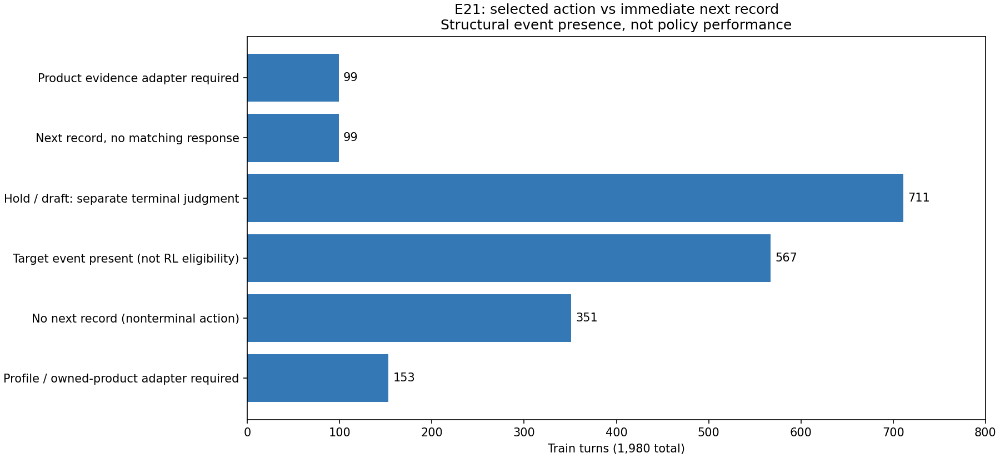
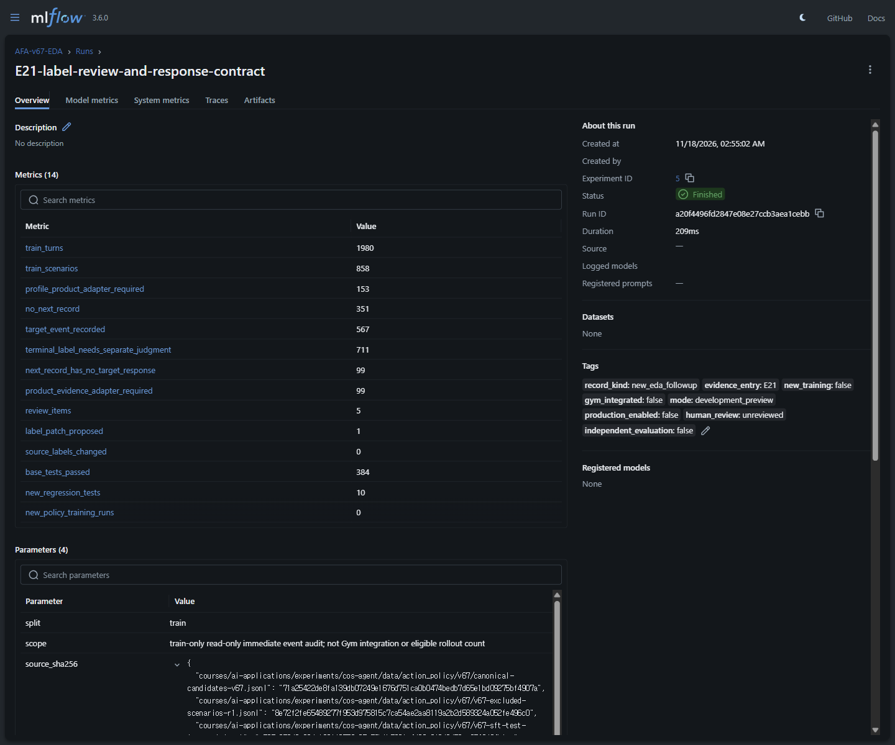
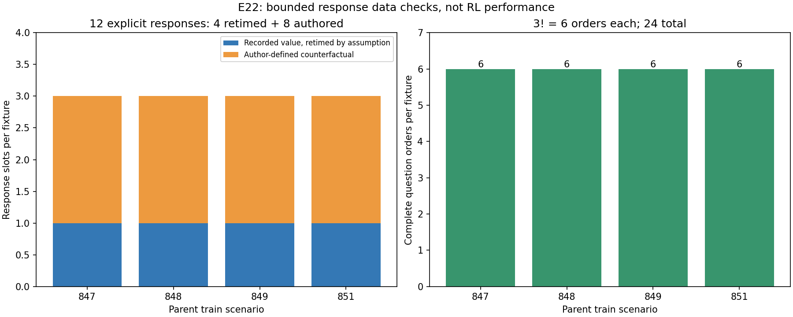
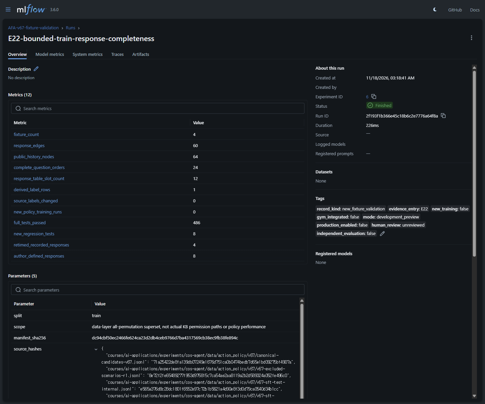
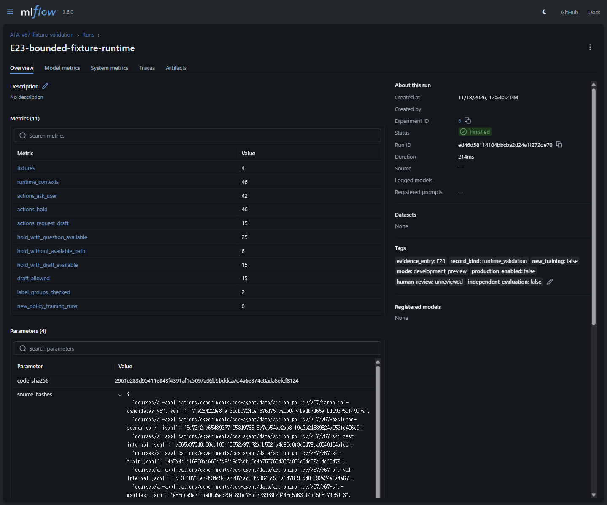
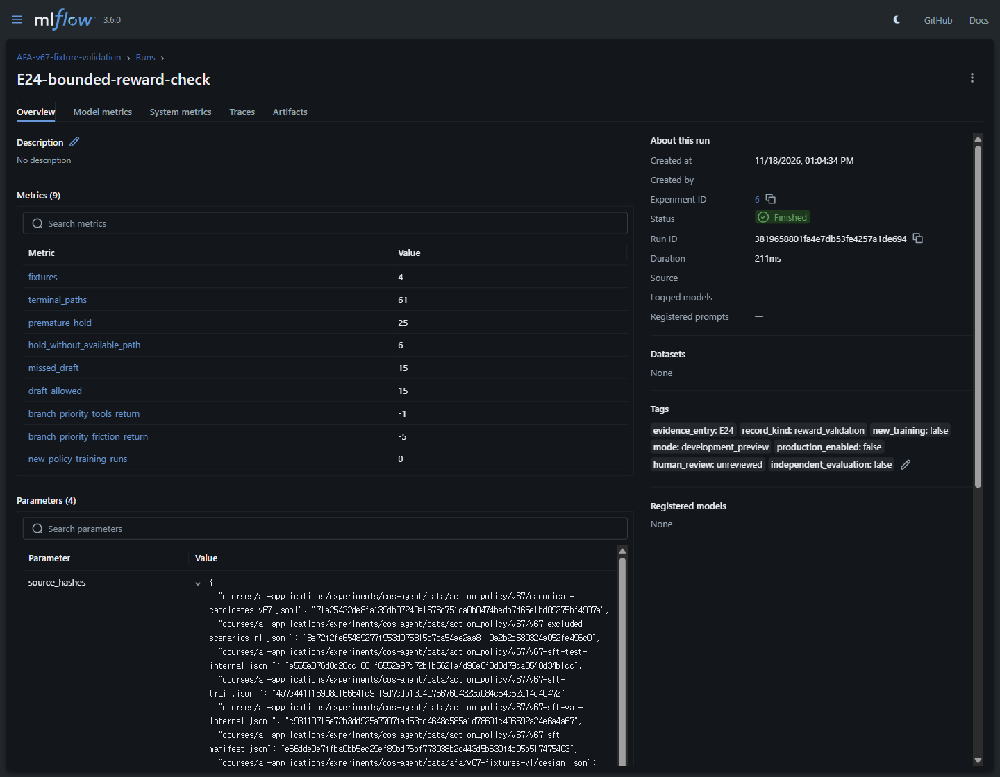
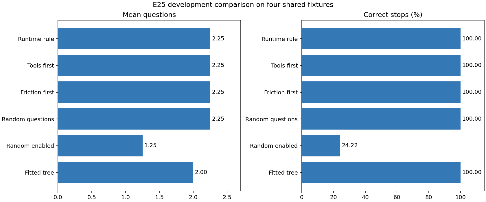
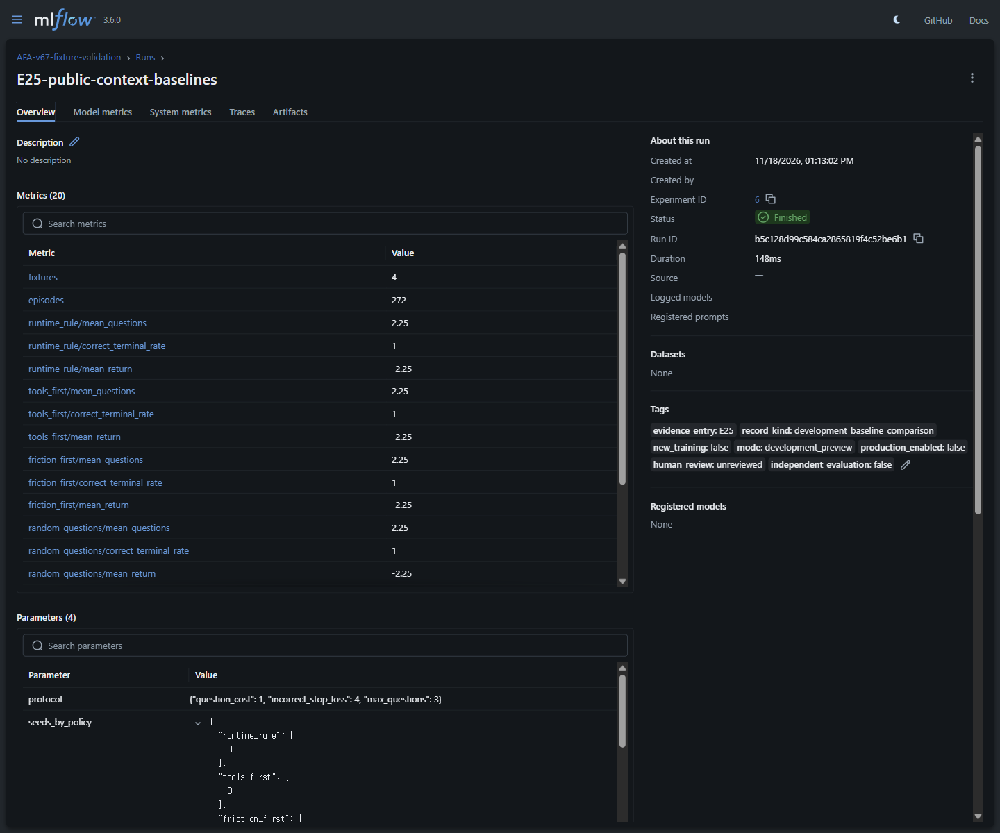
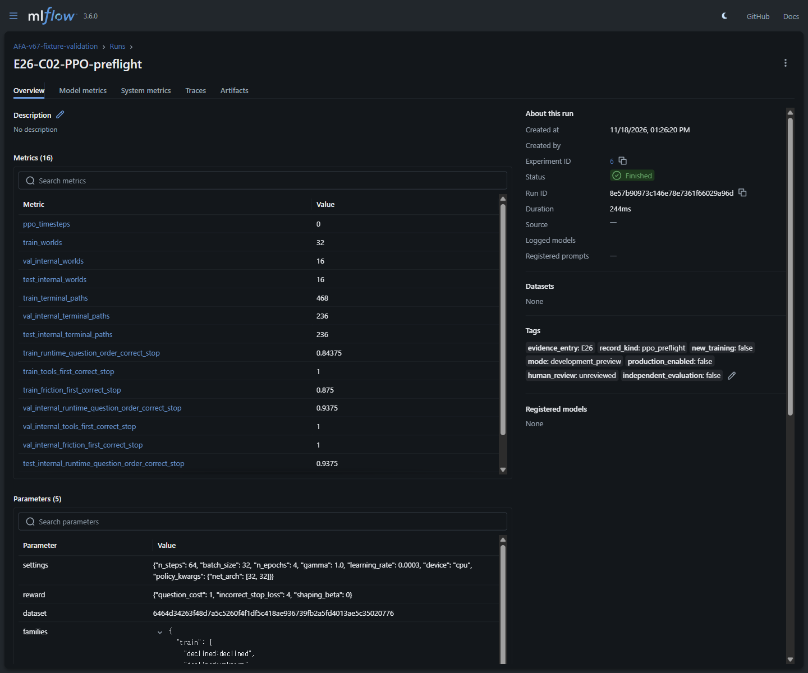

# v67 EDA 후속 — 라벨 검토와 응답 연결 계약

이 계약과 실행 결과는 질문 정책 연구 기록이다. 전체 요청의 도구 실행과 추천 반환은 별도 Python 런타임이 담당한다. [최신 목표 구조](agent-runtime-target.md)

2026-11-18 · E21 · train 858상황 / 1,980턴 · 원본 수정·새 PPO 학습 없음.

공유: [PPO-33 — AFA v67 EDA 상세·후속 검토](https://linear.app/ppopy/issue/PPO-33). 전체 AFA 진행은 [PPO-32](https://linear.app/ppopy/issue/PPO-32)에서 연결한다.

## 이번 작업은 어디에 필요한가?

[전체 EDA](afa-v67-eda.md)는 자료의 구성과 의심 지점을 찾았다. 이번 단계는 그 결과를 근거로 **어떤 라벨을 같은 정답으로 볼지, 정책이 질문했을 때 어떤 기록을 응답으로 연결할지** 점검한다.

```text
전체 EDA → 라벨·다음 응답 점검(이번) → 필요한 응답 픽스처 설계 → 환경 연결·검증 → PPO 비교
```

픽스처는 실험에 사용할 상황과 응답을 명시적으로 적어 둔 입력 자료다. 기존 대화에서 묻지 않은 질문에 답을 만들려면, 별도의 파생 픽스처에 부모 시나리오·분할·버전과 응답 조건을 기록해야 한다. E21 시점에는 미구현이었으며, E22에서 작은 정적 범위를 구현했다([6절](#e22-fixtures)). 시간에 따른 정정·제품/후보 확인까지 지원하는 전체 응답 환경은 아직 아니다.

## 1. 의심 지점 5개를 다시 검토한 결과

| 항목 | 코드·대화에서 확인한 사실 | 이번 결정 |
| --- | --- | --- |
| 022/224 첫 턴 | 같은 입력에 부위 질문 / 정보 부족 보류. 둘 다 런타임 게이트 통과. | 실행 허용 여부와 비용상 좋은 선택을 구분한다. 성급한 보류의 비용·요청 의도 기준 없이 하나를 유일 정답으로 정하지 않는다. |
| 306/327 첫 턴 | 같은 입력에 질문 / 보류. “관련 질문이 없다”는 보류 이유와 실제 부위 질문 후보가 맞지 않음. | 이유 문구와 선택 선호를 검토 대상으로 유지한다. 원본 라벨 자동 수정 없음. |
| 847/848/849/851 첫 턴 | 같은 입력에서 도구 / 건조 질문. 둘 다 활성 질문. | 허용된 질문 순서 대안으로 분류한다. 서로 다른 숨겨진 합성 상황과 응답 분기가 같은 공개 입력을 가질 수 있다. 단일 라벨 불일치를 모두 오류로 계산하면 안 된다. |
| 919 첫 턴 | 사용자는 burning만 먼저 확인 요청. 추출 배열 0=peeling, 1=burning인데 제안은 `clarify:turn1:0`. 다음 응답 alias는 1만 확인. | 명시 요청·첫 제안의 대상 불일치를 확인했다. 대상과 근거 참조를 함께 1로 바꾸는 수정안을 작성했다. 원본·현재 학습 입력에는 적용하지 않았다. |
| 582 둘째 턴 | 한 발화에 “아직 요청하지 않음” 뒤 “이제 조언을 원함”. | 어색한 합성 문구일 수 있으나 같은 발화 내 의도 변경으로도 읽힌다. 확정 오류·자동 제외로 분류하지 않는다. 현재 런타임에 별도 조언 요청 의도 상태가 있다는 가정도 추가하지 않는다. |

이번 상세 검토 대상은 5항목에 걸친 train 10턴이다. E20의 행동별 12턴 표본과 다른 집계이며 합쳐 전체 오류율을 추정하지 않는다. AI 에이전트의 개발 검토로 사람·임상 승인과 다르다.

### 919 수정안은 무엇을 바꾸나?

```text
첫 제안 target_id:     clarify:turn1:0 → clarify:turn1:1
evidence_refs: candidate:clarify:turn1:0 → candidate:clarify:turn1:1
```

현재 실행 게이트는 두 제안을 모두 허용한다. 원래 제안의 대상 0에 대응하는 확인은 바로 다음 이벤트에 없고, 수정안의 대상 1에 대한 확인은 있다. **둘째 턴에 남아 있는 0을 확인하는 제안은 그대로 타당할 수 있다.** 대상 번호를 일괄 치환하면 그 턴까지 잘못 바꾸게 된다.

이 수정안은 [review-decisions.json](../data/afa/v67-review-v1/review-decisions.json)에 원래 입력·제안 해시와 함께 남겼다. 다음 파생 학습 자료를 만들 때 조건부 패치로 적용할 수 있으며, 현재 원본의 동결 해시와 분할은 보존했다. 수정안이 있다고 임의의 다른 후보 우선순위까지 자동 해결한 것은 아니다.

## 2. 기록의 “다음 턴”이 질문의 “답”인가?

예를 들어 부위를 물은 뒤 다음 턴에 사용자가 물 온도 기록을 정정할 수도 있다. 대화 기록으로는 가능하지만, 물 온도 이벤트를 부위 질문의 응답으로 사용하면 잘못된 환경이 된다.

E20은 전체 자료에서 **활성 질문 후보와 이후 어느 턴의 관찰 이벤트**를 대조했다. 이번에는 **train에서 실제 선택된 행동과 바로 다음 턴**을 비교했다. 범위·분모·관찰 방식이 다르므로 1,903건과 아래 수치를 빼거나 개선율로 비교하면 안 된다.

| 분류 | 턴 수 | 뜻 |
| --- | ---: | --- |
| 해당 대상의 응답 이벤트 있음 | 567 | 관찰 162, 후보 확인 304, 명시적 충돌 해결 101. 응답의 존재만 확인했다. |
| 다음 기록 자체가 없음 | 351 | 비종료 행동으로 기록이 끝남. 실패 종료나 시간 초과로 변환하지 않는다. |
| 다음 기록은 있지만 해당 응답 없음 | 99 | 다른 후보·다른 슬롯·빈 이벤트 등이 가능하다. 자동 불량 판정이 아니다. |
| 프로필·보유 제품 어댑터 필요 | 153 | 다음 턴이 있는 구조 질문 중 별도 업데이트 계약이 필요한 경우. |
| 제품 근거 결과 어댑터 필요 | 99 | 다음 턴이 있는 조회 요청. 조회 요청이나 제품 목록만으로 근거 획득 성공을 만들 수 없다. |
| 보류·초안 라벨 | 711 | 사용자 응답 연결 대신 종료 의미·시점 검사가 별도로 필요하다. |
| 합계 | **1,980** | 겹치지 않는 이번 분류의 합. |

분류는 보류·초안 → 다음 기록 없음 → 대상 응답 → 미지원 어댑터 → 그 밖의 미대응 순으로 검사한다. 따라서 조회 행동 전체가 99개라는 뜻은 아니다. train 조회 160턴 중 다음 기록이 없는 61턴은 351에 포함된다. **567은 RL 가용 턴·완결 에피소드 수가 아니다.**

## 3. 코드로 막은 실수와 아직 남은 경계



막대의 합은 train 1,980턴이다. 대응 이벤트가 있다는 파란 막대를 정책 성공 수나 RL 가용 턴 수로 읽지 않는다. 그래프 원본이며 화면 캡처와 구분한다.

[v67_responses.py](../beauty_agent/afa/v67_responses.py)의 `require_recorded_response`는 기록된 행동과 같은 행동·대상·후보 확인 초점인지 확인하고, 바로 다음 턴의 대응 이벤트를 찾는다. `confirmation_focus`는 후보의 주체·실제 발생·시점 중 무엇을 확인하는지다. 초점이 달라져도 같은 응답을 무조건 쓰지 않는다.

| 상황 | 처리 |
| --- | --- |
| 도구를 물은 기록에서 건조 질문으로 변경 | 다른 경로로 판단해 응답 재사용 거부 |
| 응답 없음 | `MissingRecordedResponse` 발생. 데이터/어댑터 계약 오류이며 가짜 unknown·보상 벌점·`truncated=True`로 바꾸지 않음 |
| 실제 unknown·거절·충돌 응답이 기록됨 | 해당 상태와 값을 그대로 반환 |
| 후보 확인 | 선언된 alias → 원래 턴·추출 위치를 검증. 그 후보만 대상으로 삼고 KB 관찰은 만들지 않음 |
| 충돌 해결 | 같은 슬롯의 관찰과 명시적 `resolve_conflicts`가 함께 있어야 함 |
| 같은 턴에 자발적 추가 업데이트도 있음 | 다음 기록 전체를 사본으로 함께 반환. 다른 업데이트를 조용히 버리지 않음 |
| 보류·초안 | 별도 종료 판단 대상으로 분류. 이 검사에서 성공 점수를 만들지 않음 |

이 함수는 **행동 실행·상태 커밋·Gym 전이·보상 계산을 하지 않는 사전 검증 도구**다. 바로 다음 이벤트에 해당 키가 있어도 질문과 인과적으로 맞는 응답인지, 전체 다음 상태를 안전하게 적용할 수 있는지까지 보증하지 않는다. 기존 마스크를 “답이 기록된 질문만 허용”하도록 줄여 자유 탐색 문제를 숨기지 않았다.

전체 규칙은 [response-contract.json](../data/afa/v67-review-v1/response-contract.json)에 적었다. 미래의 반사실 응답 자료는 시나리오·현재까지 공개한 이력·행동·대상·확인 초점을 키로 삼고, 지원하는 도달 가능 행동의 응답이 완비됐는지 rollout 전에 검사해야 한다. 나중의 정정을 첫 턴 상태로 합치면 안 된다.

## 4. 검사·재현과 다음 단계

새 회귀 검사 10개, 선택 패키지를 제외한 기본 실험 검사 **384개 통과**(기존 Starlette 경고 1개). 실제 unknown/거절/충돌 보존, 원본 비변경, 다른 질문 응답 재사용 거부, 후보 번호 검증, 충돌 해결의 명시성, 조회·종료 한계를 확인했다. 기존 Gym/PPO/MLflow 전체 검사와 원본 엄격 검사는 재실행하지 않았다. 알려진 원본 5개 실패는 그대로다.

실험 폴더에서:

```powershell
uv run --locked python -m beauty_agent.afa.v67_responses --output ../../../../outputs/afa-v67-response-new
uv run --locked pytest -q tests/afa/core/test_v67_responses.py
uv run --locked pytest -q
```

로컬 증빙은 루트 `outputs/afa-v67-review-v1/`에 있다. 분석 결과·코드/원본 해시·검사 stdout·리뷰 결정·계약을 MLflow의 `AFA-v67-EDA`에서 E21 실행으로 기록한다.

**E21 당시의 다음 구현:** 작은 train 파생 범위에서 부모 계보·명시 응답·시간 순서를 갖춘 응답 픽스처를 작성한다. 919 수정안은 별도 파생 자료에서만 조건부 적용하고, 프로필/제품 확인·근거 조회 결과를 지원할지 먼저 범위를 정한다. 그 뒤 응답 완비 검사와 환경 연결을 통과한 범위에서 PPO 비교를 진행한다. E22에서 완료한 정적 범위와 다음 경계는 6절에 이어 기록한다.

## 5. 실제 MLflow 기록 화면

[E21 실행 열기](http://127.0.0.1:5000/#/experiments/5/runs/a20f4496fd2847e08e27ccb3aea1cebb)에서 Overview의 집계와 Artifacts의 그래프·원본 보고서·검토 결정·계약·코드 해시·검사 로그를 함께 확인한다.



`target_event_recorded=567`은 대응 이벤트 존재 수, `label_patch_proposed=1`은 수정 제안 수, `source_labels_changed=0`은 원본 변경 없음이다. `base_tests_passed=384`는 기본 검사 범위이며 전체 선택 검사 수와 다르다. 화면의 Duration은 결과 등록 시간으로, 전체 검토·테스트 시간이나 학습 시간이 아니다.

<a id="e22-fixtures"></a>

## 6. E22 — 작은 train 파생 응답 자료와 누락 검사 / 2026-11-18

**이번 목적:** 원래 대화에서 묻지 않은 질문을 정책이 고르더라도, 사전에 정의한 답을 받게 한다. [자료 폴더](../data/afa/v67-fixtures-v1/README.md)와 [생성·검증 코드](../beauty_agent/afa/v67_fixtures.py)를 추가했다. 기존 v67 원본·분할·48개 환경과 별개다.

### 범위를 작게 정한 이유

첫 부모는 train-847/848/849/851의 B-C02(도구·마찰·건조) 상황 4개다. 모두 첫 턴에는 얼굴 사용만 공개돼 있다. 제품/프로필·후보 확인·조회·시간 정정을 한 번에 섞지 않고 **질문 순서를 바꾼 경우의 응답 연결**부터 검사한다. 이 4개는 같은 초기 공개 문맥을 가지며 독립 최종 평가 표본이 아니다.

부모 시나리오 ID·group/family/product 계보·실제 train 소속·원본 해시를 각 파생 자료에 기록했다. canonical의 split=train만 믿지 않고 실제 SFT 분할 소속을 대조한다. 초기 공개 입력에는 부모 ID·숨겨진 응답표·미래 응답·라벨을 넣지 않는다.

### 기록된 답과 새로 만든 답을 구분한다

| 응답표의 출처 | 개수 | 해석 |
| --- | ---: | --- |
| 원래 기록의 값을 순서 변경 실험에 사용 | 4 | drying unknown 1·declined 1, tools unknown 2. 값·상태를 보존했다. 다른 순서에도 같은 답이라는 정적 가정은 별도로 표시한다. |
| 새로 작성한 가상 응답 | 8 | 예: 도구=hands, 마찰=gentle. 원래 기록에서 추론하거나 확보한 사용자 사실이 아니다. |
| 합계 | **12** | 4상황 × 질문 3개의 응답표. 처음부터 공개된 body_site 4개는 이 분모에 포함하지 않는다. |

모든 전달 응답의 source는 `synthetic_fixture`로 통일하고, 원래 관찰 객체·원래 턴 위치·출처 분류는 환경 전용 계보에 보존한다. `confirmed_by_user=true`는 이 합성 입력 계약의 형식이며 실제 사람이 검토·확인했다는 증거가 아니다. 기록된 unknown/거절을 known으로 덮어쓰지 않는다.

원래 다음 턴의 문장에는 “다음에는 도구를 물어봐 달라” 같은 순서 의존 표현이 있다. 다른 분기에서는 그 문장을 그대로 재생하지 않고 **정형 응답만** 전달한다. 이번 범위에서는 나중에 값·상태가 바뀌거나 정정·충돌 해결·후보 확인·제품 갱신이 있는 부모를 거부한다. 시간에 따른 응답 환경이 구현됐다는 뜻이 아니다.

### 24개 순서·60개 응답 연결은 어떻게 계산했나?

한 상황에서 3개 질문을 모두 묻는 순서는 `3 × 2 × 1 = 6`개다. 4상황이므로 24개다. 아직 질문 전 1개, 첫 질문 후 3개, 두 질문 후 6개, 세 질문 후 6개로 **이력을 구분하면 상황당 16개, 전체 64개**다. 각 상황에서 이 이력을 이어 주는 질문 연결은 15개라 전체 60개다.

이는 **자료 수준에서 가능한 질문 순서를 넓게 검사한 수**다. KB의 단축 분기·질문 노출·억제 규칙 때문에 실제 런타임에서는 더 일찍 질문을 끝내거나 일부 질문을 허용하지 않을 수 있다. 응답이 정의됐다는 이유로 그 질문을 실행해도 되는 것은 아니다. 기존 마스크를 바꾸거나 원본 KB에 없는 실행 권한을 만들지 않았다. 24는 실제 사용자·독립 상황 수나 성공률이 아니다.

응답 키는 `fixture_id + 공개 이력 지문 + action + target_id + confirmation_focus`를 바탕으로 만든다. 지문은 내용을 해시한 식별자다. 같은 관찰 값을 얻었더라도 질문 순서가 다르면 공개 이력 지문도 다르다. `ResponseBook`은 전체 연결을 먼저 검사하며, 하나라도 없거나 바뀌면 시작 전에 실패한다. 미등록 이력·다른 행동·다른 확인 초점·답한 항목 재질문도 오류로 알린다. 가짜 unknown·보상 벌점·시간 초과로 바꾸지 않는다.



왼쪽은 각 상황의 응답 3개를 출처별로 나눈 그림이고 오른쪽은 상황별 질문 순서 6개다. 단위가 다르므로 높이를 직접 비교하지 않는다. 데이터 검사 그래프이며 정책 성능이 아니다.

### 919 라벨은 파생 파일에서만 수정했다

원래 입력과 제안의 해시가 E21 검토 당시와 같을 때만 첫 턴 라벨을 파생한다. 대상과 근거 참조를 1로 바꾸고 **설명문도 burning/1에 맞췄다.** E21의 두 필드 수정 제안만 적용하면 설명문에 0이 남기 때문에, E22에서 세 번째 필드인 reason_summary도 함께 수정했다. 원본 검토 JSON을 과거에 이미 수정한 것으로 덮어쓰지 않았다.

`derived-labels.jsonl`의 별도 1행이며 `approved_reference=false`, `training_ready=false`, 사람 미검토로 기록했다. 현재 학습 로더·원본 SFT는 이 파일을 읽지 않는다. 둘째 턴의 남은 0 확인은 바꾸지 않았다. 이 라벨 1행과 위의 응답 상황 4개는 역할이 다르며 합쳐 5개의 완성 RL 상황으로 세지 않는다. 후보 확인 응답 환경은 여전히 후속 범위다.

### 검사 결과·남은 작업

새 회귀 검사 **8개 통과**, Gym/PPO/MLflow를 포함한 전체 실험 검사 **486개 통과**(기존 Starlette 경고 1개), 가져온 source manifest **27/27 일치**. E17의 463개에 이후 EDA 5개·응답 검사 10개·이번 8개가 더해진 범위다. 원본 KB 엄격 검사의 알려진 5개 실패는 이번에 재실행·수정하지 않았다. 통과 수는 모델 정확도가 아니다.

이번 완성 범위는 **정적인 작은 응답 자료와 자료 수준 누락 검사**다. 행동 실행·Gym 전이·보상·종료 정답·성능 비교·PPO 학습·독립 평가는 미실행이다. 기존 64차원 v2 환경에 이 파일만 갈아 끼우면 동작하는 상태가 아니다. 처음부터 알려진 부위, unknown/거절, KB가 실제 허용하는 행동과 종료 판단을 반영하는 별도 어댑터가 필요하다.

다음은 이 제한된 자료를 실제 실행 준비/단일 행동 실행 계층에 연결하고, 응답 공개·재질문 금지·마스크·종료·롤백을 검사하는 단계다. 지원하는 도구 범위는 그대로 제한하고, 성능 학습 전에 환경의 판단·보상 계약을 먼저 확인한다.

실험 폴더에서:

```powershell
uv run --locked python -m beauty_agent.afa.v67_fixtures verify --report ../../../../outputs/afa-fixture-check-new.json
uv run --locked pytest -q tests/afa/core/test_v67_fixtures.py
uv run --locked --group rl-train --group tracking pytest -q -o norecursedirs= tests
```

원본 증빙은 루트 `outputs/afa-v67-fixtures-v1/`의 report.json·최종 번들 검증·검사 로그·코드/자료 해시에 있다. [MLflow E22 실행](http://127.0.0.1:5000/#/experiments/6/runs/2f193f1b366e45c18b6c2e7776a64f8a)의 Artifacts에서 실제 자료와 로그도 확인할 수 있다.



화면의 fixture_count=4, complete_question_orders=24, response_edges=60은 서로 다른 집계다. derived_label_rows=1은 별도 라벨 파생본, source_labels_changed=0은 원본 변경 없음이다. new_policy_training_runs=0이며 Duration은 결과 등록 시간으로 전체 검사·학습 시간이 아니다.


<a id="e23-runtime"></a>

## 7. E23 — 질문·보류 기준과 실제 실행 연결 / 2026-11-18

**AFA의 목표가 부족한 정보를 얻는 것이라면**, 필수 슬롯을 물을 수 있고 보류 신호나 답변 거절이 없을 때 질문을 우선한다. 예를 들어 세안 부위가 없고 부위 질문이 열려 있으면 먼저 부위를 묻는다. 022/224와 306/327 첫 턴을 기존 게이트에 다시 넣어 두 선택이 모두 허용됨을 확인했다. 특히 327의 “관련 질문 없음”은 열린 부위 질문과 맞지 않는다. 기록 정리처럼 과제 목적이 다르면 보류도 가능하므로 두 그룹은 단일 라벨 학습 보류로 표시했다. 입력·라벨 해시와 판단을 [검토 파일](../data/afa/v67-fixtures-v1/acquisition-label-review.json)에 기록했다.

세안 도구·마찰·건조를 다루는 B-C02 응답 자료 4개를 [실행 어댑터](../beauty_agent/afa/v67_runtime.py)에 연결했다. 처음에는 세안 부위만 관찰로 공개한다. 에이전트는 기존 KB가 연 질문 중 하나를 고르고, 선택한 대상의 응답만 다음 상태에 반영한다. 제품과 프로필은 Stage 0의 고정 합성 입력을 사용한다. 후보 확인·제품 조회·시간 정정은 별도 어댑터가 필요한 범위다.

| 검증 항목 | 결과 |
| --- | ---: |
| 실제 규칙에서 도달한 공개 이력 | 46 |
| 질문 응답 연결 | 42 |
| 질문 응답 상태 | known 31, unknown 9, declined 2 |
| 실행 가능한 보류 | 46 |
| 실행 가능한 초안 요청 | 15 |

E22는 가능한 질문 순서를 넓게 펼쳐 60개 응답 연결을 확인했다. E23에서는 기존 KB가 여는 질문을 따라가며 42개를 실행했다. 예를 들어 849는 도구를 먼저 물어 솔 사용을 확인하면 세안 방식 카드가 결론에 도달해 건조·마찰 질문이 닫힌다. 보류 46개 중 질문이 남아 있던 경우는 25개, 초안을 요청할 수 있던 경우는 15개, 실행 가능한 질문이나 초안이 없던 경우는 6개였다. 이 표는 각 이력에서 실행 가능한 선택을 한 번씩 시험한 결과다. 정책 점수와 보상은 다음 비교 설계에서 다룬다.

회귀 검사 5개와 기본 실험 검사 397개를 통과했다. 답변 거절 후 재질문, 오래된 입력에 대한 행동, 너무 이른 초안 요청을 거부했다. 응답이 누락되면 실행 전에 멈추고, 실행 실패 시 공개 상태와 행동 횟수를 유지해 다시 시도할 수 있었다. 가져온 원본 27개 파일 해시도 일치했다.



화면의 42는 질문 실행 수이고 46은 공개 이력 수다. Duration은 MLflow 기록 시간이다. 결과와 개별 실행 경로는 로컬에서 확인할 수 있다. [MLflow E23](http://127.0.0.1:5000/#/experiments/6/runs/ed46d58114104bbcba2d24e1f272de70)

실험 폴더에서 검증을 재현한다.

```powershell
uv run --locked python -m beauty_agent.afa.v67_runtime --report outputs/afa-runtime-check-new.json
uv run --locked pytest -q tests/afa/core/test_v67_runtime.py
```


<a id="e24-reward"></a>

## 8. E24 — 질문 비용과 종료 채점 / 2026-11-18

첫 B-C02 개발용 채점 설정에서 질문당 **1점**, 잘못된 종료에 **추가 4점**을 비용으로 둔다. 최대 세 질문이므로 4는 가능한 전체 질문 비용 3보다 크다. 점수는 총비용의 음수로, 세 번 묻고 올바르게 끝내면 −3점, 질문 없이 성급하게 보류하면 −4점이다. 실험 설계값이며 사용자 시간·금액과 무관하다. 할인율은 1, 중간 보너스는 0으로 두었다.

올바른 종료는 현재 KB의 카드 상태·행동 종류·권고 문구·보류 신호·전체 판정이 응답표 전체를 반영한 KB 기준과 맞는지 확인한다. 시나리오에서 기록된 미상·거절은 기준 계산에서도 유지한다. 질문이나 초안이 가능한데 보류하면 각각 성급한 보류와 초안 누락으로 채점한다. 필수 안전 보류는 실행 규칙에 따르며 이번 네 상황에는 해당 사례가 없었다. 응답 누락·실행 불가 행동은 기존 어댑터의 오류 처리에 따른다.

| 기본 4상황의 종료 경로 | 건수 |
| --- | ---: |
| 기준과 일치한 초안 | 15 |
| 질문·초안 경로가 없고 기준과 일치한 보류 | 6 |
| 질문이 남은 보류 | 25 |
| 초안이 가능했던 보류 | 15 |
| 합계 | **61** |

질문 순서와 선택을 바꿔 전수 검사했다. 상황 847은 질문 3개 후 보류, 848·849·851은 각각 질문 1개 후 초안이 가장 낮은 비용의 유효 경로였다. 각 상황의 가능한 경로를 모두 본 뒤 찾은 최솟값이므로 정책 성능 지표에는 사용하지 않는다.

**별도 우선순위 검증.** 상황 849의 실험용 사본에 강한 마찰을 추가했다. 도구부터 묻고 초안을 요청하면 전체 응답 기준과 일치해 −1점이다. 마찰부터 물어 초안을 요청하면, 규칙은 초안을 허용하고 카드 상태도 똑같이 difference로 나오지만 권고 행동이 전체 응답 기준과 달라 −5점이다. 이 별도 사례의 두 경로는 위 61개와 개발용 데이터 분포에서 제외했다.

기본 검사 399개 통과. [코드](../beauty_agent/afa/v67_reward.py)에 채점 함수와 전수 검사가 있다. 실험 폴더에서 `uv run --locked python -m beauty_agent.afa.v67_reward --report outputs/afa-v67-reward-new.json`으로 재현한다. 다음 비교에서는 정책에 공개된 관찰만 전달하고, 같은 비용표와 종료 기준으로 질문 전략을 비교한다.



기본 네 상황의 종료 경로 61개와 별도 우선순위 검증의 −1점·−5점을 기록했다. [MLflow E24](http://127.0.0.1:5000/#/experiments/6/runs/3819658801fa4e7db53fe4257a1de694)


<a id="e25-baselines"></a>

## 9. E25 — 공개 정보 기반 기준선 비교 / 2026-11-18

어떤 질문 전략이 비용을 줄이면서 올바르게 끝내는지, B-C02 train 파생 네 상황과 같은 E24 채점표로 비교했다. 매 선택에 공개된 관찰·이력과 활성 행동을 사용했다. 고정 방식은 상황당 한 번, 무작위 방식은 상황당 32번 실행했다. 같은 seed의 첫 선택은 네 상황에서 동일하다. 전체 272회 실행의 고유 상황 수는 4개다.

| 방식 | 실행 수 | 평균 질문 | 올바른 종료 | 평균 점수 |
| --- | ---: | ---: | ---: | ---: |
| 기존 런타임 규칙 | 4 | 2.25 | 4/4 | −2.25 |
| 도구 우선 | 4 | 2.25 | 4/4 | −2.25 |
| 마찰 우선 | 4 | 2.25 | 4/4 | −2.25 |
| 필요한 질문 중 무작위 | 128 | 2.25 | 128/128 | −2.25 |
| 보류 포함 전체 허용 행동 중 무작위 | 128 | 1.25 | 31/128 | −4.28125 |
| 네 상황에 맞춰 계산한 공개 정보 결정 트리 | 4 | **2.00** | 4/4 | **−2.00** |

전체 행동을 무작위 선택하면 질문은 줄지만 성급한 보류 72회와 초안 누락 25회가 생긴다. 올바른 종료와 질문 수를 함께 평가해야 하는 이유다. 평균이 같은 고정 정책들도 상황별로 다르게 작동했다. 예를 들어 849는 도구 우선이면 1회, 기존 규칙은 3회가 필요했다. 851에서는 기존 규칙이 1회, 도구 우선은 3회였다.

결정 트리는 네 상황을 동일한 비중으로 두고, 동일한 공개 입력에는 동일한 행동을 고르게 제한한 뒤 모든 가능한 선택의 총점으로 분기를 골랐다. 실행에서는 공개 입력으로 분기를 찾는다. 건조부터 묻고 849에서 거절이 오면 도구를 다음에 물어 기존 규칙보다 1회를 줄였다. 847·848·849·851의 질문 수는 각각 3·2·2·1이다. **2.00회는 이 네 개발 상황으로 계산하고 같은 상황에서 측정한 값**이다. 각 상황의 답을 미리 알고 최선의 경로를 고르면 평균 1.50회가 되지만, 같은 첫 입력에 서로 다른 질문을 골라야 하므로 공개 정보 정책의 비교 기준으로 사용할 수 없다.



질문 수가 낮아도 종료율이 함께 떨어지면 같은 품질로 절약한 것이 아니다. 최종 PPO 비교에는 별도 가족 평가 자료가 필요하다. 후보 기준선은 기존 규칙과 공개 정보 기반 분기 정책이다. 작은 네 상황은 구현과 비교 방법의 개발에 사용한다.



기본 실험 검사 400개 통과. 실험 폴더에서 `uv run --locked python -m beauty_agent.afa.v67_baselines --report outputs/afa-v67-baselines-new.json`으로 재현한다. [MLflow E25](http://127.0.0.1:5000/#/experiments/6/runs/b5c128d99c584ca2865819f4c52be6b1)


<a id="e26-ppo-preflight"></a>

## 10. E26 — 가족 분리와 PPO 학습 전 검증 / 2026-11-18

B-C02를 첫 PPO 비교 범위로 골랐다. 도구·마찰·건조의 명시적 가상 응답 조합 64개를 만들고, 같은 도구·마찰 조합의 건조 변형을 한 가족으로 묶었다. 이전에 본 개발 상황과 우선순위 반례에 해당하는 5가족은 학습에 뒀다. 각 분할에는 도구 응답 4종이 모두 있다. 데이터의 분할은 다음과 같다.

| 분할 | 가족 | 상황 | 검증한 종료 경로 | 도구 우선 평균 질문 | 도구 우선 올바른 종료 |
| --- | ---: | ---: | ---: | ---: | ---: |
| 학습 | 8 | 32 | 468 | 2.375 | 32/32 |
| 검증 | 4 | 16 | 236 | 2.25 | 16/16 |
| 시험 | 4 | 16 | 236 | 2.25 | 16/16 |

총 940개 종료 경로를 재생했고 모든 상황에서 적절한 종료에 도달할 수 있었다. 질문으로 열린 단계의 비용은 −1, 잘못된 종료의 추가 손실은 −4였다. 도구 우선 기준선이 올바른 종료를 모두 지켰으므로, PPO의 개선은 같은 종료 품질에서 평균 질문 비용을 줄일 수 있는지로 본다. 기존 v67과 48개 환경은 별도 자료다. 새 자료는 합성 내부 비교용이며 기존 연구 자료와 응답 조합이 겹칠 수 있다.

Gym 환경에서 공개 상태 15차원과 고정 행동 인덱스 6개, 실행 마스크를 연결했다. 첫 학습 구성은 CPU·seed 0·4,096스텝이다. 실제 사전 검증에서는 MaskablePPO를 초기화하고 허용 행동을 하나 예측했다. 학습 스텝은 0이다. 전체 실험 테스트 496개를 통과했다. 실행 방법과 비교 범위는 학습 전 검증 안내에 있다. [학습 전 검증 안내](../data/afa/ppo-preflight-v1/README.md)



화면의 PPO 스텝 0은 초기화까지 확인한 실행을 뜻한다. [MLflow E26](http://127.0.0.1:5000/#/experiments/6/runs/8e57b90973c146e78e7361f66029a96d)
