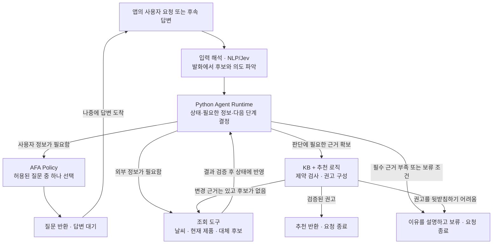

# Ppopy 목표 구조 — 런타임·질문 선택·추천

**Python 런타임이 요청을 진행한다. AFA는 사용자에게 물어야 할 때 질문을 고른다. KB와 추천 로직은 확인된 정보로 권고를 구성한다.**

## 한 요청이 움직이는 방식

| 구성 | 맡는 역할 |
| --- | --- |
| **입력 해석** | Jev 등으로 자유 발화를 읽고 후보를 만든다. 사용자 확인이 필요한 후보는 별도로 보관한다. |
| **Python 런타임** | 확인된 관찰·보유품·루틴·생활습관·민감도와 조회 결과를 관리한다. 허용 행동, 도구 실행과 실패, 답변 대기·재개, 최종 반환을 맡는다. 첫 흐름의 분기는 Python 규칙으로 정의한다. |
| **AFA 질문 정책** | 런타임이 준비한 질문 후보에서 다음 질문을 선택한다. 예를 들어 야외 체류 시간과 사용 후 불편 중 어떤 정보가 먼저 필요한지 고른다. |
| **날씨·제품 도구** | 날씨의 지역·관측 시각과 제품의 정체·버전·출처를 결과에 표시한다. 내부 제품 정보가 없으면 필요에 따라 외부 검색으로 근거를 찾고, 버전과 출처를 확인한 정보만 반영한다. |
| **KB·추천 로직** | 규칙, 제품 근거, 사용자 제약을 대조해 생활습관 조정·보유 제품의 활용이나 사용법 조정·특정 제품 사용 제외 또는 보류·대체 제품 추천을 구성한다. 한 응답에 여러 권고를 묶을 수 있다. |

**질문 반환은 대기**다. API 호출은 일단 마치고 답변이 오면 같은 요청을 재개한다. **조회 결과는 재판단으로 돌아간다.** **추천과 보류는 해당 요청의 종료**다. 조회 결과는 찾음·정보 없음·실패를 구분하고, 실패나 미상은 그대로 상태에 남긴다.

예를 들어 “오늘 야외에 오래 있는데, 가진 제품으로 루틴을 어떻게 조정할까?”라면 날씨와 확인된 보유 제품을 조회한다. 야외 체류 시간처럼 부족한 사용자 정보가 있으면 AFA가 다음 질문을 고른다. KB와 추천 로직은 확인된 근거로 보유품 활용과 습관 조정을 검토하고, 변경 근거가 있으면 대체품을 검색·비교한다. 검증한 권고 또는 필요한 정보가 부족하다는 이유를 반환한다.

권고에서 **후보 제외**, **사용 보류**, **근거가 확인된 금기**는 서로 다른 의미로 표현한다. 민감 정보는 요청에 필요한 범위에서만 사용하며, 조회로 확인되지 않은 제품 성질이나 사용자 사실은 미상으로 보존한다.

## 현재 구현은 어디까지인가?

| 실제 경로 | 확인된 상태 |
| --- | --- |
| **Python/CLI 세션** | 로컬 합성 제품 조회와 KB 확인 후, AFA가 질문을 고르거나 정보 확인을 마친다. 질문은 같은 요청 ID로 재개한다. 권고에는 보유 확인된 제품의 일치하는 버전·표시 사용법·출처를 사용한다. KB가 요구하는 별도 제품 근거가 없으면 권고를 보류한다. |
| **기존 HTTP 데모** | 별도 데모 함수로 연결된다. 전체 세션과 PPO를 사용하는 앱 경로는 목표 구조에 해당한다. |
| **B-C02 PPO 실험 E26** | 도구·마찰·건조의 합성 64상황을 가족 단위로 학습 32·검증 16·시험 16으로 나눴다. 15차원 공개 관찰, 고정 행동 6개와 마스크, 보상, 초기화까지 검증했다. 이 실험의 학습 기록은 0스텝이다. 실험의 보류·초안 선택은 좁은 과제의 채점 경계다. |

첫 구현 순서는 **전체 행동 목록과 결과 계약 정의 → Python 규칙으로 한 요청의 조회·질문·추천·보류를 재현 → AFA 질문 선택 연결**이다. 초기 계약에는 각 행동의 선택 주체·입력·허용 조건·실행 결과·다음 상태를 적는다. SLM은 규칙 기반 분기가 어려운 사례를 평가한 뒤 선택 가능한 플래너로 검토한다. LangGraph는 저장된 상태의 재개와 복구 필요가 커질 때 검토하며, 조회 순서를 AFA에 맡기는 것도 별도 비교 과제다.

[현재 코드와 호출 경로](../../../../../docs/architecture.md) · [PPO 실험 구조](afa-ppo-data-flow.md) · [AFA 진행과 증빙](afa-policy-progress.md)
