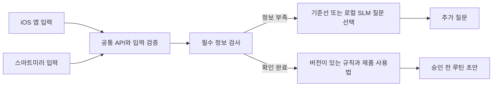

# 구조 결정 ADR 001

상태: 초기 제안 / 합성 프로토타입 구현. 2026-11-02.

FastAPI/Pydantic은 Python 기존 엔진과 연결하기 쉽고 입력 스키마를 자동 문서화합니다. 처음에는 프레임워크 기반 자율 반복 루프 없이 작은 상태 전이로 시작합니다. 모델은 언어 해석과 도구 선택을 점진적으로 맡고, 권한·버전·승인·계산은 서버 코드가 담당합니다.

현재 SLM 역할은 허용된 누락 질문의 우선순위 하나를 고르는 것으로 제한됩니다. 완전한 도구 사용 에이전트나 자유 대화 개인화는 아닙니다. 도구 실행 계약을 검증하기 전 모델의 자유 출력으로 저장·제품 확정·추천 강도를 변경하지 않습니다.

서버 우선 구조는 클라이언트 로직 중복을 줄이지만 네트워크 의존성이 생깁니다. 오프라인 미러 요구가 확정되면 로컬 서비스 배포와 승인 루틴 캐시 정책을 따로 결정합니다. 현재 응답·대화·프로필은 저장하지 않습니다.

모델은 특정 제품명으로 고정하지 않았습니다. 설치 가능한 모델의 라이선스, 한국어 질문 선택 성적, JSON 형식 준수, 지연·RAM/VRAM을 측정한 뒤 정확한 모델 태그/리비전을 고정합니다. 현재 환경의 GPU 사양을 조사하거나 모델을 설치·학습하지 않았습니다.
