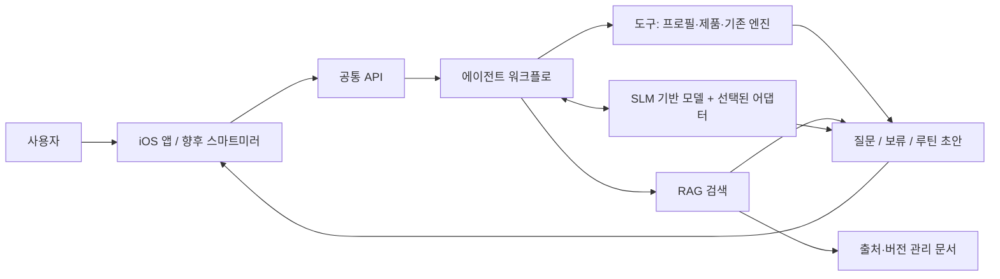
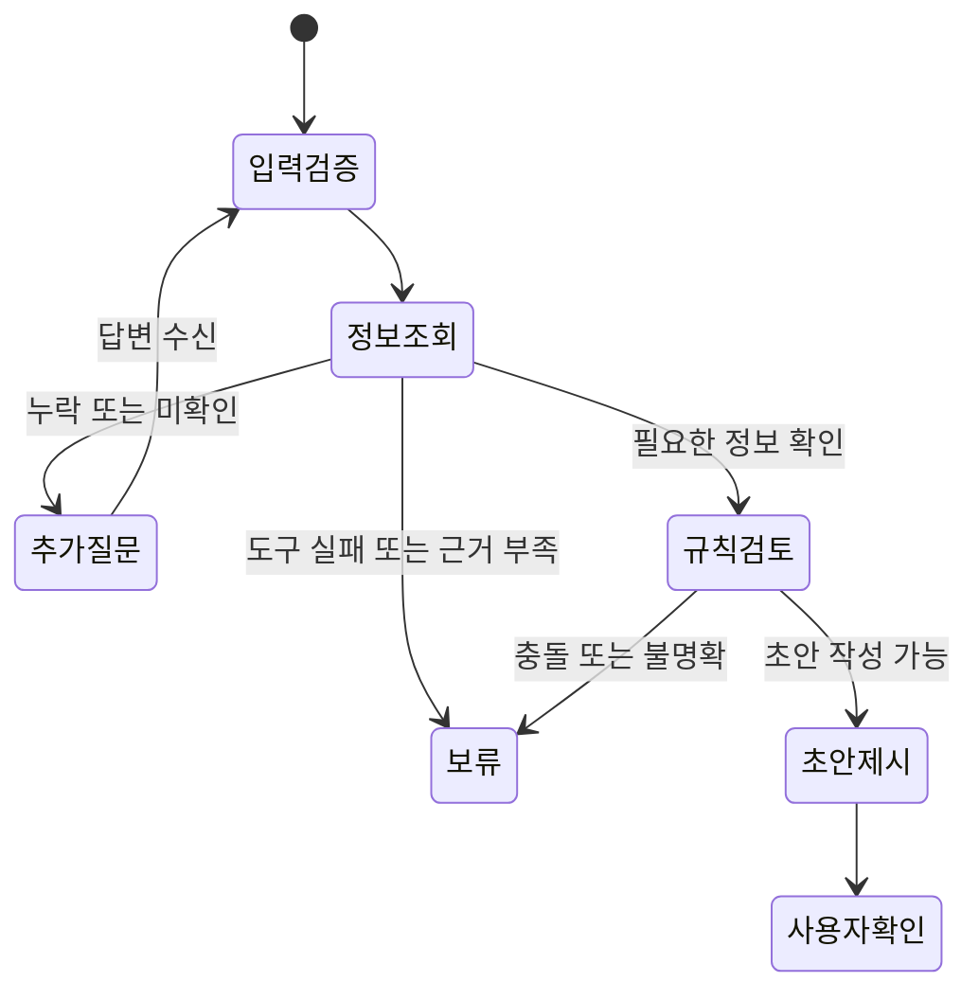

# BeautyLIFE SLM 기반 개인화 화장품 관리 에이전트: 전체 개발 마일스톤

작성일: 2026-11-02\
상태: **개발 계획 초안**. 단계별 요구사항과 순서는 진행 중 검토해 갱신한다. 기간·담당자·실제 성능은 아직 확정하지 않았다.

이 문서는 에이전트 개발 경험이 없는 사람이 **왜 이 일을 하는지, 무엇을 만들어야 다음 단계로 갈 수 있는지** 이해하도록 작성했다. 한 번에 모두 구현하는 지시가 아니다. 한 단계의 작은 결과를 검토하면서 다음 작업을 정한다.

## 1. 프로젝트 목표와 현재 위치

### 1.1 만들고자 하는 서비스

SkinAnalysis iOS 앱에서 입력받은 피부 고민, 보유 화장품, 사용 경험 등을 활용하여 사용자의 화장품 관리를 돕는 에이전트다. 향후 스마트미러에서도 공통 기능을 사용한다.

첫 사용자 흐름의 **제안**:

> 사용자가 보유 제품과 사용 습관을 입력한다 → 부족한 정보를 확인한다 → 제품의 확인된 정보와 규칙을 검토한다 → 아침·저녁 루틴 초안을 설명한다 → 사용자가 수정하고 확인한다.

추후 사용 기록·피드백을 받아 루틴 수정안을 제안하는 관리 흐름으로 확장한다. 초기 범위와 사용자 시나리오는 아직 확정 전이다.

### 1.2 사용자가 구상한 핵심 기술

1. Qwen 계열 등 SLM을 후보로 검토한다.
2. Google AI Plus 이용 환경의 Colab에서 QLoRA 기반 SFT를 실험한다.
3. 화장품 규제 등 문서를 RAG로 검색해 답변에 활용한다.
4. 에이전트 워크플로를 만들고 iOS 앱 및 향후 스마트미러와 연결한다.

정확한 모델·버전, 학습 과제, 데이터 규모, GPU, 배포 방식, 일정은 **미정**이다. Colab 요금제 혜택과 자원은 계정에서 확인한다.

### 1.3 현재 확인된 상태

- 이 작업 공간의 [초기 코드](../README.md)는 합성 데이터용 실험 골격이다. 학습된 SLM, 실제 앱 연동, 실제 제품 추천, 사용자 데이터 저장 기능은 완료되지 않았다.
- 기존 SkinAnalysis에는 React/Vite 앱 셸과 iOS 관련 구성, `skin_engine` 및 기존 입력 계약이 있다. 확인 범위와 연동 시 주의점은 [기존 프로젝트 분석](context-and-integration.md)을 따른다. 기존 앱·엔진 전체의 최신 배포 상태는 별도 확인이 필요하다.
- Linear의 [ERI-11](https://linear.app/kjhgr/issue/ERI-11), [ERI-13](https://linear.app/kjhgr/issue/ERI-13), [ERI-14](https://linear.app/kjhgr/issue/ERI-14), [ERI-17](https://linear.app/kjhgr/issue/ERI-17)은 참고 계획이다. 이 문서의 일정이나 완료 상태를 Linear의 구현 현황으로 간주하지 않는다.

## 2. 전체 구조와 핵심 개념



| 용어 | 의미 | 이 프로젝트에서의 역할 |
|---|---|---|
| 기반 모델 | 이미 사전학습된 언어 모델 | 한국어 이해·생성의 출발점 |
| SFT | 입력과 바람직한 답변 예시로 진행하는 지도 파인튜닝 | 질문 선택·구조화 출력 등 특정 작업 개선 |
| QLoRA | 양자화된 기반 모델을 고정하고 작은 LoRA 어댑터를 학습하는 방식 | 학습 메모리 부담 완화 |
| 어댑터 | 기반 모델에 추가하여 사용하는 학습된 파라미터 | 기반 모델의 특정 작업 행동 변경 |
| RAG | 질문과 관련된 문서를 찾아 모델 입력에 제공하는 방식 | 최신성·출처가 필요한 자료 조회 |
| 에이전트 | 모델, 도구, 상태와 절차를 연결하는 프로그램 | 질문·조회·초안 생성·확인 순서 관리 |
| 기준선 | 개선 전 비교 대상 | 학습·검색·에이전트의 추가 가치 측정 |

SFT는 모델의 동작 방식을 개선하는 실험이고, RAG는 필요한 자료를 검색하는 기능이다. 사용자가 가진 제품·실제 사용 경험은 별도 시스템의 사용자별 데이터를 조회하여 반영한다. 사용자별 모델을 학습한다는 의미는 아니다.

## 3. 마일스톤 지도와 의존 관계

기본 흐름은 **SLM 기준선과 QLoRA 실험 → RAG → 에이전트 → 앱 연동 → 운영·확장**이다. 후속 단계의 입력 형식은 앞 단계 설계에서 미리 고려한다. 고정된 자료를 이용한 근거 확인·규칙 검토는 학습 결과를 기다리지 않고 준비할 수 있다.

| 번호 | 마일스톤 | 완료 시 얻는 결과 | 선행 조건 |
|---|---|---|---|
| M0 | 범위·첫 시나리오 | 한 가지 사용자 흐름과 목표 | 없음 |
| M1 | 환경·재현성 | Colab 및 로컬 개발 실험 기록 방법 | M0 초안 |
| M2 | 평가셋·기반 SLM 기준선 | 학습 전 성능과 오류 목록 | M0, M1 |
| M3 | SFT 데이터 | 검토된 학습/검증/최종 평가 분리 | M2 평가 설계 |
| M4 | QLoRA 학습 | 어댑터와 재현 가능한 학습 기록 | M1~M3 |
| M5 | SLM 비교·선택 | 학습 전후 비교 및 채택 여부 | M4 |
| M6 | RAG 문서·검색 | 버전 관리된 문서, 검색 및 평가 | M0; M5와 독립 준비 가능 |
| M7 | 근거 기반 답변 | 검색 결과를 사용하는 답변·인용 | M5의 선택 모델, M6 |
| M8 | 에이전트·도구 | 질문·조회·초안 워크플로 | M0, M7, 도구 계약 |
| M9 | 승인·기록 | 사용자 확인 후 저장·조회·수정 | M8, 인증·저장 설계 |
| M10 | iOS 연동·통합 평가 | 앱 입력부터 결과까지 합성 흐름 | M8, 해당 앱 계약 |
| M11 | 운영 준비·제한적 출시 | 운영 가능한 배포 및 검증 근거 | M9~M10, 운영 조건 |
| M12 | 스마트미러·고도화 | 기기별 검증과 후속 실험 | 공통 API 및 요구사항 |

M5에서 개선이 없으면 그 결과를 기록하고 기반 모델이나 기준선을 유지한 채 RAG·에이전트 개발을 계속할 수 있다. M6의 **검색 인프라**를 만들기 전에도 검토된 소수의 고정 자료 조회는 가능하다. M10의 합성 앱 왕복은 저장이 없는 경우 M9보다 먼저 진행할 수 있다.

### 공통 완료 기준

각 단계마다 다음을 남긴다.

- [ ] 목적·입력·출력·범위와 제외 범위를 정했다.
- [ ] 실행 또는 검토 가능한 산출물과 버전을 남겼다.
- [ ] 정상·누락·오류 시나리오에 대한 결과와 한계를 기록했다.
- [ ] 의존 단계와 다음에 결정할 사항을 기록했다.
- [ ] 미구현·미검증 사항을 완료로 표시하지 않았다.

## 4. M0 — 범위와 첫 사용자 시나리오

**목적:** 무엇을 만들지 사용자 관점에서 구체화한다. 모델이나 DB부터 고르지 않는다.

### 작업

1. 첫 사용자와 목표를 한 문장으로 쓴다. 예: “보유 화장품을 이용한 루틴 초안을 확인하고 싶다.”
2. 시작 조건을 정한다. 어떤 제품·사용법·프로필이 이미 확인되었는가?
3. 정상 흐름을 입력 → 조회 → 질문 → 초안 → 사용자 확인으로 작성한다.
4. 누락·거절·제품 버전 미상·사용법 불명·도구 장애 시 결과를 쓴다.
5. 첫 SLM 과제 후보를 고른다. 예: 사용자의 문장에서 사용 시간과 빈도를 구조화한다.
6. 규제 질의, 제품 정보 확인, 루틴 제안을 서로 다른 작업으로 구분한다.
7. 합성 사례 1건에 앱 입력·예상 도구 결과·사용자에게 보일 응답을 적는다.

**산출물:** 사용자 시나리오, 입력/출력 예시, 범위 표, 미결정 목록.\
**완료 기준:** 개발 경험이 없는 사람도 성공·질문·보류 조건을 예제로 설명할 수 있다.\
**다음 행동:** M1 준비와 함께 M2 평가 항목을 만든다.

## 5. M1 — 개발 환경과 재현성

**목적:** 학습과 앱 개발을 각자 재현할 수 있도록 작업 환경을 분리한다.

| 환경 | 역할 | 확인할 내용 |
|---|---|---|
| 로컬 PC | 문서, API, 합성 테스트, Git | Python, 의존성, 실행 방법 |
| Colab | 기반 모델 실행 및 SFT 실험 | 실제 할당 GPU/VRAM, 사용 가능 시간, 컴퓨팅 한도 |
| 모델 저장소 | 기반 모델·어댑터 확보 | 모델 카드, 라이선스, 버전, 접근 조건 |
| 저장 공간 | 실험 설정·체크포인트 보존 | 복구·접근 권한·민감정보 포함 여부 |
| 추후 서버/기기 | 앱이 호출할 추론 환경 | 지연, 비용, 안정성, OS·메모리 |

### 작업

- [ ] Colab에서 GPU 종류·메모리와 Google AI Plus 계정의 실제 혜택을 확인한다.
- [ ] 실행마다 Python·라이브러리·CUDA 등 환경 버전, 모델 revision, 데이터 버전, seed, 학습 설정을 기록한다.
- [ ] 테스트용 합성 자료와 실제 사용자 자료의 저장·접근 경로를 구분한다.
- [ ] 짧은 실행으로 모델을 불러오고 결과 및 VRAM 사용량을 확인한다.
- [ ] 중단에 대비해 어댑터·학습 설정·재개에 필요한 체크포인트를 보관한다. 저장 공간과 사용 권한을 사전 확인한다.

Colab의 GPU 종류·사용 가능 시간은 변동할 수 있다. 개인 요금제 제공량은 시점과 계정에 따라 확인하며, Colab 학습 성공을 상시 추론 서비스 준비 완료로 간주하지 않는다. [Colab FAQ](https://research.google.com/colaboratory/faq.html)

**산출물:** 환경 기록, 재실행 가이드, 짧은 모델 로드 결과, 비용·자원 기록 초안.\
**완료 기준:** 새 런타임에서 동일 모델과 소규모 예제를 다시 실행할 수 있다.

## 6. M2 — SLM 과제와 학습 전 기준선

**목적:** 파인튜닝이 개선해야 할 문제를 관찰 가능하게 만든다.

### 과제 후보

| 후보 | 입력 | 기대 출력 | 평가할 핵심 |
|---|---|---|---|
| 답변 구조화 | “저녁에 쓰지만 횟수는 몰라요” | 사용 시간 `pm`, 횟수 `unknown` | 누락 정보를 만들어내지 않는가 |
| 추가 질문 선택 | 사용법이 미확인된 보유품 | 사용법 확인 질문 | 필요한 질문을 고르는가 |
| 도구 선택 | 제품 상세를 확인해야 하는 요청 | 허용된 조회 도구와 인자 | 존재하지 않는 도구를 호출하지 않는가 |
| 근거 기반 설명 | 확인된 정보와 규칙 결과 | 출처·제한이 반영된 설명 | 원문 범위를 확대하지 않는가 |

처음에는 하나를 우선 과제로 정한다. 유사 과제를 나중에 추가하되 평가셋은 과제별로 구분한다.

### 작업

1. 모델 후보의 라이선스·한국어·출력 형식·실행 자원을 확인하고 정확한 버전/리비전을 고정한다.
2. 정상, 모호함, 미상, 거절, 충돌, 무관한 요청 등 합성 개발 사례를 만든다.
3. 각 사례에 기대 행동과 판정 이유를 적는다. 사람이 검토하지 않은 정답은 미확정으로 표시한다.
4. 학습하지 않은 모델과 고정 프롬프트를 실행한다. 프롬프트 개선 기준선도 필요하면 별도로 기록한다.
5. 형식 오류, 정보 누락, 허위 추출, 잘못된 질문, 응답 시간 등을 나누어 기록한다.
6. 학습이 필요한 오류와 제품 데이터·코드·검색 문제를 구분한다.

**산출물:** 과제 정의, 모델 후보 표, 버전 고정 기준선 결과, 오류 분류표.\
**완료 기준:** 같은 합성 사례로 기반 모델 결과를 다시 만들고, 학습으로 개선할 문제를 설명할 수 있다.\
**분기:** 기반 모델이 이미 충분히 동작한다면 SFT 필요성과 연구 목적을 다시 검토하되, 사용자 희망에 따른 학습 실험은 별도 비교로 계속할 수 있다.

## 7. M3 — SFT 데이터 수집·검토·분리

**목적:** 모델이 배울 입력과 기대 출력을 신뢰할 수 있는 형태로 준비한다.

### 7.1 데이터 설계

| 기록 항목 | 의미 |
|---|---|
| `example_id` | 사례의 고유 식별자 |
| `task` | 답변 구조화·질문 선택 등 작업 유형 |
| `input` | 모델에 제공하는 문장과 허용된 문맥 |
| `expected_output` | 검토된 목표 출력 |
| `source` / `permission` | 작성·수집 출처와 이용 가능 여부 |
| `review_status` | 미검토·검토 완료·불일치 등 |
| `group_id` | 같은 사용자/제품/대화·변형을 묶는 ID |
| `version` | 데이터셋 버전과 변경 이력 |

예시 형식은 과제 설계용이며 실제 학습 도구 형식은 모델의 채팅 템플릿에 맞춘다.

```json
{
  "example_id": "extract-demo-001",
  "task": "extract_usage",
  "input": "저녁에 쓰는데 일주일에 몇 번인지는 모르겠어요.",
  "expected_output": {"period": "pm", "days_per_week": null, "frequency_status": "unknown"},
  "review_status": "example_only",
  "group_id": "synthetic-conversation-001"
}
```

### 7.2 준비 절차

1. 합성 예시와 이용 허가가 확인된 자료를 확보하고 출처를 남긴다. 모델로 생성한 답변도 사람 검토 전에는 정답이 아니다.
2. 정상·부정·미상·거절·모순·제품 버전 미상·관련 없는 지시 등 사례 범주를 정한다.
3. 검토 기준과 불일치 처리 방법을 작성한다. 검토자와 검토 여부를 사실대로 기록한다.
4. 동일 사용자/대화, 제품·처방군·주장 변형 등 과제에 알맞은 단위로 묶어 학습·검증·최종 평가를 분리한다.
5. 분리 후 문장 중복, 거의 동일한 사례, 출처 중복을 점검하고 분리 manifest와 데이터 해시를 남긴다.
6. 예시 수·유형 분포·문맥 길이·누락률을 확인한다. 민감정보가 포함된 자료는 목적·동의·보관·삭제 절차를 별도 확정한다.
7. 모델별 대화 템플릿과 학습 목표를 확인하고, 응답만 학습하려는 경우 마스킹이 실제로 적용되는지 표본 토큰으로 검사한다.

최종 평가셋은 프롬프트와 학습 설정을 반복 조정하는 데 사용하지 않는다. 크기·비율은 데이터 수집 상황을 보고 결정하며, 작은 표본 성적의 일반화 범위를 제한한다.

**산출물:** 데이터 사전·검토 기준·버전별 데이터·분할 manifest·분포 분석.\
**완료 기준:** 학습/검증/평가의 용도와 검토 상태를 설명할 수 있고, 확인된 중복·누출 문제를 해결했다.

## 8. M4 — Colab QLoRA SFT

**목적:** 기반 모델과 같은 과제에 대해 어댑터를 학습하고 재현 가능한 결과물을 만든다.

### 개념

SFT는 입력·정답 예시로 모델을 학습하는 방식이다. QLoRA 실험에서는 보통 기반 모델을 4비트로 로드해 고정하고, LoRA 어댑터의 파라미터를 학습한다. 실제 구현의 모듈·정밀도·호환성은 선택한 모델과 라이브러리 버전으로 검증한다. [TRL PEFT/QLoRA](https://huggingface.co/docs/trl/en/peft_integration), [SFTTrainer](https://huggingface.co/docs/trl/en/sft_trainer)

### 작업 순서

1. 정확한 기반 모델 revision, tokenizer, chat template, 데이터 버전, 라이브러리 버전을 고정한다.
2. 짧은 노트북으로 모델 로드 → 합성 예시 토큰화 → 손실 계산 → 작은 학습 → 어댑터 저장·재로드를 확인한다.
3. 학습 대상 모듈, LoRA rank/alpha, 양자화 설정, 최대 입력 길이, 배치·누적, 학습률·스텝을 기록한다. 초기 값은 GPU와 사전 실험에 따라 결정한다.
4. 학습 대상 파라미터·loss 마스킹·잘린 입력/정답 비율을 점검한다.
5. 짧은 학습에서 loss, 오류, 소요 시간, GPU 메모리, 예산 사용을 관찰한다.
6. 검증셋을 이용해 체크포인트를 선택한다. 중단·재개 시 필요한 파일과 상태를 확인한다.
7. 기반 모델 없이 어댑터만으로 실행 가능한 것으로 오해하지 않도록 호환 모델·버전과 함께 저장한다.

**산출물:** 노트북/스크립트, 어댑터, 실행 manifest, 환경·시간·메모리 기록, 체크포인트.\
**완료 기준:** 기록된 환경에서 어댑터를 다시 로드해 샘플 추론을 재현할 수 있다. 학습 완료와 모델 품질 검증은 별도다.

## 9. M5 — 모델 평가와 선택

**목적:** 학습이 실제 작업에 도움이 되는지 같은 조건에서 비교한다.

| 비교 항목 | 기반 모델 | 학습 모델 |
|---|---|---|
| 입력·기대 행동 | 동일한 최종 평가 사례 | 동일 |
| 기반 모델·프롬프트·근거 | 버전 기록 | 가능한 한 동일; 변경 사항 명시 |
| 학습 어댑터 | 비활성 | 활성 |
| 결과 | 형식·내용·실패·지연 | 동일 지표 |

### 평가 기준 후보

- 구조화 과제: 필드별 정확도, 미상 처리, 누락·잘못된 값, JSON 스키마 유효율.
- 질문 선택: 필요한 질문 비율, 불필요한 질문, 질문 누락, 정보 부족 시 보류.
- 도구 선택: 도구·인자 정확도, 허용되지 않은 도구 시도, 오류 처리.
- 근거 설명: 존재하는 인용과 실제 내용의 일치, 근거 범위 확대, 근거 부족 시 보류.
- 공통: 사례 수와 실패 수, 응답 시간 p50/p95, 메모리·호출 비용, 대표 오류.

사전 정한 사례에 대해 가능하면 사람이 기준표로 설명의 충실도와 이해도를 평가한다. 검토자 수와 역할을 적고, 미확정 정답은 제외하거나 별도 집계한다. 형식이 맞는 것과 내용이 옳은 것을 분리한다.

**산출물:** 동일 조건 비교표, 평가셋 manifest, 성공/실패 사례, 채택 결정.\
**완료 기준:** 결과를 분모와 함께 보고하고, 학습 모델·기반 모델 중 사용할 경로와 이유를 기록한다. 개선이 없으면 기존 모델 유지 또는 학습 개선 후 재평가한다.

## 10. M6 — RAG 자료 준비와 검색

**목적:** 질문에 필요한 문서 조각을 찾고 원문까지 추적할 수 있게 한다. RAG는 모델 가중치를 갱신하지 않는다.

### 10.1 문서 범주

| 자료 종류 | 답할 수 있는 질문의 예 | 확인 사항 |
|---|---|---|
| 법령·규제·행정 자료 | 특정 표시나 성분과 관련해 어떤 조항이 있는가 | 관할·효력·시행일·개정 여부·적용 범위 |
| 제품 라벨·공식 제품 정보 | 이 제품 버전의 표시 사용법은 무엇인가 | 정확한 제품/버전·출처·확인일 |
| 연구·공식 근거 자료 | 제시된 특정 주장에 어떤 근거가 있는가 | 연구 대상·조건·적용 범위·검토 상태 |
| 내부 규칙 | 앱이 어떤 조건에서 보류하는가 | 규칙 ID·버전·작성/검토 상태 |

규제상 조건과 제품의 개인별 효능은 서로 다른 질문이다. 출처가 존재한다는 사실만으로 효능이나 법적 적합성이 검증되는 것은 아니다.

### 10.2 구축 절차

1. 첫 질문 범위를 좁히고 공식 출처 및 자료 이용 조건을 확인한다.
2. 문서 ID, 기관, 제목, 원문 URL, 문서 유형, 발행·시행·개정일, 확인일, 버전/해시, 적용 지역, 검토 상태를 기록한다.
3. PDF/HTML에서 텍스트를 추출하고 제목·조항·표·각주 누락을 표본 대조한다. 추출 실패나 스캔 문서는 별도로 표시한다.
4. 조문·항·문맥이 보존되도록 분할하고 각 조각에 원문 위치와 버전을 연결한다. 검색용 원문·추출 텍스트·파생 인덱스를 구분한다.
5. 간단한 키워드 검색 기준선을 만든다. 필요하면 임베딩 검색·재정렬을 추가하고 같은 질문으로 비교한다.
6. 질문·관련 원문 조각·기대 출처가 포함된 검색 평가셋을 만든다. 관련 문서가 없거나 오래된 버전, 충돌하는 문서, 표에 근거가 있는 경우도 포함한다.
7. 검색된 상위 결과에 관련 근거가 포함되는지, 정확한 문서/조항/버전인지, 결과가 없는 경우를 올바르게 처리하는지 평가한다.
8. 문서 갱신·폐기·재색인·이전 버전 보존 및 잘못된 색인 롤백 절차를 문서화한다.

**산출물:** 자료 목록, 문서·조각 메타데이터, 검색 인덱스, 검색 평가셋과 결과.\
**완료 기준:** 정해진 질문에서 찾아온 조각을 정확한 원문과 버전까지 추적할 수 있고, 검색 실패를 숨기지 않는다.

## 11. M7 — RAG 기반 답변과 검증

**목적:** M6에서 찾은 근거를 사용해 설명하고 범위가 부족하면 보류한다.

### 작업

- [ ] 사용자 질문과 검색된 문서를 구분해 모델에 전달한다. 문서 안의 명령은 신뢰할 지시가 아닌 자료로 처리한다.
- [ ] 인용 ID·문서명·조항/위치·버전을 응답과 연결한다.
- [ ] 문서가 없거나 상충·버전 불명·적용 범위 불명일 때 설명과 판단을 보류한다.
- [ ] 제품별 사용법, 과학적 주장, 법적 해석을 구분하고 출처의 범위를 넘지 않게 답변한다.
- [ ] **검색 품질**과 **답변 충실도**를 별도로 측정한다. 실제 존재하지 않는 인용, 잘못된 조항, 정보 부족, 악성 문서 텍스트 사례를 포함한다.
- [ ] 기반 모델과 M5에서 선택한 모델을 같은 검색 결과로 비교하여 검색 오류와 모델 설명 오류를 구분한다.

**산출물:** 답변·인용 계약, 근거 평가 사례, 실패 분석.\
**완료 기준:** 평가 사례에서 답변의 각 근거를 원문에 대조하고, 근거 부족 시 보류가 정상 결과로 표현된다.

## 12. M8 — 에이전트 워크플로와 도구

**목적:** 앱의 요청을 받아 필요한 도구를 호출하고, 정보를 확인한 뒤 초안 또는 질문을 반환한다.

### 12.1 기본 단계 제안



### 12.2 도구 후보

| 도구 | 입력 → 출력 | 부작용 |
|---|---|---|
| 프로필 조회 | 서버가 확인한 사용자 문맥 → 확인된 프로필 | 읽기 |
| 제품 식별·상세 | 제품 후보/ID → 정확한 제품·버전·출처·상태 | 읽기; 자동 확정하지 않음 |
| 기존 루틴/규칙 분석 | 확인된 정보 → 규칙 결과·누락·한계 | 읽기/계산; 기존 엔진과 계약 확인 |
| 문서 검색 | 질문·자료 유형 → 관련 조각·출처 | 읽기 |
| 루틴 저장 | 승인된 초안 참조 → 저장 결과 | 쓰기; M9에서 구현 |

각 도구에 입력·출력 스키마, 소유권, 실패 코드, 타임아웃, 재시도와 부작용을 정의한다. 모델은 허용된 도구만 선택하고, 서버는 입력·권한·상태를 다시 검사한다. 검색 자료와 사용자 문장의 지시가 권한이나 정책을 바꾸지 못해야 한다.

### 작업

1. 기존 `CareAnalysisRequest`, `skin_engine`과 제품 조회 경로를 다시 확인하고 그대로 재사용할 수 있는 계약을 찾는다.
2. 입력의 미상/거절/미질문·사용자 확인·제품 버전을 보존하는 adapter를 설계한다.
3. 도구 없이 고정 사례 → 읽기 도구 → 검색 → 초안 순으로 한 단계씩 연결한다.
4. 사용자 명시 제약 및 검토된 제품 사용법·규칙을 코드에서 확인한다. 규칙 출처가 없거나 정보가 불충분하면 추가 질문 또는 보류한다.
5. 도구 호출 횟수·시간·출력 크기·비용 한도를 정하고 모델/도구 실패 시 사용자에게 다음 행동을 알린다.
6. 같은 입력과 도구를 사용하는 **폼·규칙/템플릿 기준선**과 **SLM 에이전트**를 비교한다.

**산출물:** 상태도, API/도구 계약, 합성 흐름, 회귀 결과, 기준선 비교.\
**완료 기준:** 합성 입력에서 올바른 질문·보류·초안이 나오고, 모델 출력만으로 권한·사용법 검증을 우회할 수 없다.

## 13. M9 — 사용자 승인·저장·지속 관리

**목적:** 사용자가 확인한 내용을 올바른 계정에 안전하게 저장하고 이후 기록에 활용한다.

### 승인 및 저장

- [ ] 초안 ID와 내용·제품·규칙 버전을 고정하고, 사용자가 확인한 대상을 화면에 표시한다.
- [ ] 서버에서 인증된 사용자와 승인된 동일 초안을 확인한다. 초안 내용이 바뀌면 재확인을 요구한다.
- [ ] 만료·취소·중복 요청·동시 수정·다른 사용자 접근을 처리한다. 재시도 시 중복 저장을 막을 정책을 정한다.
- [ ] 저장·재조회·수정·삭제 흐름을 테스트한다. 초안 해시만으로 승인이나 권한이 증명된다고 취급하지 않는다.

### 지속 관리

- [ ] 제품 사용 여부·빈도·피부 불편감·사용자 피드백을 직접 기록할 범위부터 정한다.
- [ ] 발생 시각, 기록 시각, 시간대, 관련 제품/루틴 버전을 구분한다.
- [ ] 일정 기간 요약과 변경 제안을 제공하되 사용자의 확인 후 적용한다.
- [ ] 기록 누락을 미사용으로 간주하지 않고 미상 상태를 보존한다.

**산출물:** 승인 상태 전이, 저장 계약·데이터 모델, 권한·중복·충돌 회귀, 기록·요약 예시.\
**완료 기준:** 같은 초안의 승인부터 저장·재조회가 연결되고 취소·변경·다른 사용자 접근은 차단된다. 보관·삭제 조건은 실제 사용자 적용 전 검증한다.

## 14. M10 — iOS 앱 연결과 통합 검증

**목적:** 기존 앱이 실제로 수집하는 정보를 에이전트에 전달하고 질문과 결과를 표시한다.

### 작업

1. 기존 앱의 최신 브랜치에서 입력·인증·제품 확인·결과 표시 경로와 테스트 상태를 확인한다.
2. 기존 `CareAnalysisRequest`와 공통 에이전트 계약의 필드 매핑을 작성한다. 제품 ID만으로 제품 버전을 추정하지 않는다.
3. 앱 → 서버가 인증한 사용자 문맥 → 에이전트 → 응답의 데이터 흐름과 책임을 확정한다.
4. 합성 데이터로 `입력 → 질문 → 답변 → 초안`을 연결한다. 클라이언트가 보낸 임의 사용자 ID를 권한 근거로 사용하지 않는다.
5. 네트워크 끊김·취소·중복 요청·앱 백그라운드 전환·버전 불일치·응답 만료를 확인한다.
6. 승인·저장 경로는 M9가 준비된 경우 별도 연결한다. 기존 동의·철회·세션 정책과 충돌하지 않도록 검증한다.
7. 원격 저장소의 관련 테스트 및 앱 환경에서 가능한 시연을 기록한다. iPhone 실기기 여부를 명시한다.

**산출물:** 필드 매핑, API 계약, 합성 E2E 결과, 앱 시연과 미해결 목록.\
**완료 기준:** 실제 앱 경로의 합성 사례가 왕복하고 미상·버전·오류 의미가 유지된다. 앱 연동 완료가 실제 사용자 운영 승인을 뜻하지 않는다.

## 15. M11 — 실제 운영 준비와 배포

**목적:** 실험 환경에서 검증한 기능을 운영 가능한 환경으로 이전한다.

### 작업

- [ ] 추론 위치, 모델/어댑터 배포 포맷, API 호스팅과 이용 예산을 정한다. Colab은 실험 환경으로 보고 별도 운영 경로를 검증한다.
- [ ] 모델·어댑터·토크나이저·프롬프트·제품/규칙·인덱스 버전을 함께 기록하고 이전 버전으로 되돌릴 수 있게 한다.
- [ ] 사용자 인증, 리소스 소유권, 전송·저장 보호, 동의, 보관 기간, 철회·삭제, 백업 처리와 관리자 권한을 기존 서비스 설계와 연결한다.
- [ ] 개인정보와 입력 원문을 운영 로그에 남기지 않도록 설계한다. 최소한의 오류 유형·시간·버전·지연을 기록한다.
- [ ] 모델 불능·검색 실패·도구 장애·동시 요청·비용 초과 시 보류와 복구 방식을 검증한다.
- [ ] 규제 문서·제품 정보의 관리 책임자, 갱신·검토·배포 및 오래된 문서 중단 절차를 정한다.
- [ ] 실제 서비스 범위, 위험한 응답과 이상반응 문의 처리 경로, 필요 시 사람 검토·적절한 전문가 안내를 정한다. 별도 법률·도메인 검토는 실제 수행 여부를 기록한다.
- [ ] 합성 smoke test → 제한된 환경의 검증 → 필요한 동의와 운영 조건을 갖춘 사용자 시험 순으로 진행한다. 계획·사람 승인·완료 사실은 구분한다.

**산출물:** 배포 설정, 모델/데이터 버전 manifest, 모니터링·장애 대응·롤백 문서, 시험 결과.\
**완료 기준:** 필요한 조건과 담당자가 확인되고, 실패 시 이전 상태로 복구하는 절차를 시험했다. 실제 출시 판단은 합성 테스트 통과와 구분한다.

## 16. M12 — 스마트미러와 선택 확장

**목적:** 공통 기능을 새로운 기기에 연결하고 실제 환경의 제약을 확인한다.

1. 미러의 OS·CPU/GPU·RAM, 화면 크기, 터치/음성, 네트워크와 사용 장소를 정한다.
2. 서버 호출과 기기 내 실행의 지연·메모리·비용·오프라인 조건을 비교한다. iOS 온디바이스도 별도 검증 대상이다.
3. 앱과 동일한 API 의미·승인 흐름을 유지하면서 미러에 맞는 입력/출력 UI를 설계한다.
4. 공유 공간에서의 화면 노출, 세션 종료, 주변 사용자에게 정보가 보이는 상황을 검토한다.
5. 실기기에서 네트워크 중단·재시작·응답 지연을 시험한다. 모델 포맷 변환이나 양자화가 바뀌면 품질을 다시 평가한다.

바코드·제품 라벨 OCR, 날씨, 음성, 추가 제품 추천, 다중 에이전트 등은 가치와 데이터·운영 조건이 확인될 때 후속 범위로 정한다. 실제 보유 제품·규칙·승인 흐름과 별도로 검증한다.

**산출물:** 기기 요구사항, 실행 위치 비교, 미러 UI/기기 테스트 보고서.\
**완료 기준:** 실제 선택한 하드웨어에서 합의한 사용자 흐름과 장애 동작을 검증했다.

## 17. PCA·FAMD·Feature selection은 어디에 들어가는가?

이 세 가지는 **선택적인 정형 데이터 분석/별도 예측 모델 연구**다. QLoRA SFT, 문서 RAG, 에이전트 워크플로의 필수 선행 단계는 아니다.

| 방법 | 할 수 있는 일 | 이 프로젝트의 가상 예 |
|---|---|---|
| PCA | 수치형 변수들을 새 축으로 요약 | 사용 횟수·수면 시간 등 수치 데이터 패턴 탐색 |
| FAMD | 수치형과 범주형이 섞인 데이터를 새 축으로 요약 | 사용 빈도와 선호 제형을 함께 탐색 |
| Feature selection | 기존 변수 중 분석 목적에 필요한 변수를 선택 | 별도 예측 모델의 입력 변수 비교 |

PCA/FAMD의 축은 원래 변수를 조합한 새 표현이며, feature selection은 원래 변수의 일부를 고른다. PCA의 높은 분산이나 변수 기여도는 예측력·인과관계·안전상 중요성을 보장하지 않는다. 분석 결과만으로 사용자 제약이나 안전에 필요한 입력을 제거하지 않는다.

**선택 연구 절차:** 분석 질문·대상·정답 정의 → 이용 가능 데이터와 결측/표본 수 검토 → 학습·검증·평가를 사용자·시간 등 적절한 단위로 분리 → 학습 데이터에서만 전처리·변수 선택·PCA/FAMD를 적합 → 같은 분할에서 원본 변수/변수 선택/차원 축소를 비교 → 해석·불확실성·오류 보고. 교차검증에서는 각 학습 fold에서 전처리를 다시 적합해 정보 누출을 막는다. [FAMD 문서](https://search.r-project.org/CRAN/refmans/FactoMineR/html/FAMD.html), [데이터 누출 주의사항](https://scikit-learn.org/stable/common_pitfalls.html)

## 18. 평가와 기록을 처음부터 이어가기

| 대상 | 비교 또는 점검 | 주요 결과 |
|---|---|---|
| SLM | 기반 모델 vs QLoRA 어댑터 | 과제 정확성·형식·미상 처리·시간/자원 |
| RAG 검색 | 키워드 기준선 vs 선택 검색 방식 | 관련 출처·버전이 검색되는 비율, 실패 사례 |
| RAG 답변 | 동일 검색 근거로 모델 비교 | 인용 존재와 내용 충실도, 근거 부족 보류 |
| 에이전트 | 폼+규칙/템플릿 vs 같은 도구의 SLM | 전체 작업 성공, 적절한 질문, 상태 변경 |
| 앱·미러 | 같은 합성 시나리오의 기기별 동작 | 입력 의미·결과·오류 처리 일치 |
| 운영 | 장애·복구·권한 및 버전 | 지연·가용성·복구 결과·비용 |

최소 30개 시나리오는 기존 Linear 계획의 **초기 평가 목표**로 참고할 수 있다. 표본 수와 목표치는 설계 단계에서 재검토하며 실측값으로 기재하지 않는다. 모든 수치에는 분자·분모, 데이터/모델 버전, 제외·미확정 사례 수를 포함한다. [기존 평가 계획](evaluation-plan.md)과 함께 갱신한다.

## 19. 예상되는 문제와 대응

| 문제 | 확인할 점 | 다음 행동 |
|---|---|---|
| GPU 메모리 부족 | 모델 크기, 입력 길이, 배치, 실제 VRAM | 더 작은 실험·입력 길이/배치 조정; 실험 조건 기록 |
| 학습 loss 감소, 평가 개선 없음 | 검토 품질·분할·과제 일치·과적합 | 오류 분류 후 데이터/설정 수정, 기반 모델 유지 고려 |
| 검색 결과가 틀림 | 문서 추출·분할·키워드·버전 | 원문 대조 후 인덱스 수정, 검색 평가 재실행 |
| 검색은 맞지만 설명이 틀림 | 답변이 근거를 확대하는지 | 모델/프롬프트·검증을 수정하고 동일 검색 결과로 비교 |
| 정보가 부족함 | 미상/미확인/거절 구분 여부 | 추가 질문 또는 보류; 유사 제품으로 대체하지 않음 |
| 모델이 도구 지시를 조작함 | 입력 검증·허용 도구·서버 권한 | 실행 차단 및 회귀 사례 추가 |
| 앱과 계약 불일치 | 필드 의미·스키마 버전 | 매핑/호환 버전 수정 후 앱 회귀 검사 |
| 응답 지연·장애 | 모델 호출, 검색, 네트워크별 시간 | 타임아웃·보류·복구 경로 확인, 측정 후 개선 |

## 20. 지금 결정하지 않은 사항

1. 첫 시나리오의 정확한 사용자 입력과 출력 범위.
2. 첫 SFT 과제 및 평가 기준, 데이터 출처·검토자·규모.
3. Qwen 계열 세부 모델과 라이선스·리비전, Colab 실제 자원.
4. 규제 문서의 대상 국가·문서 범위·갱신 주체, 제품/근거 자료의 범위.
5. 기존 SkinAnalysis 엔진과 계정·동의·카탈로그를 재사용할 구체 경로.
6. 저장소 통합 여부, 앱/미러의 서버·온디바이스 실행 위치.
7. 일정·예산·실사용 범위·운영 담당과 검토 절차.

이 항목들은 확정된 사실이 아니라 이후 작업의 의사결정 목록이다.

## 21. 당장 시작할 첫 작업

**M0의 첫 사용자 시나리오와 SLM 과제 후보를 한 페이지로 정한다.**

1. 합성 사용자 1명과 보유 제품 1~2개를 가정한다.
2. 사용자가 앱에서 입력하는 내용과 모르는 정보를 적는다.
3. 에이전트가 해야 할 질문·조회와 사용자가 볼 초안을 적는다.
4. 그중 SLM이 맡을 일 하나를 고르고, 입력·기대 출력 예시를 몇 개 만든다.
5. 잘못된 출력과 올바른 보류 사례를 함께 적는다.

이 결과가 M2의 기준선과 M3의 데이터 설계의 출발점이다. 실제 제품 정보나 임상적 효능을 검증한 결과로 표시하지 않는다.

## 22. 참고 문서

- [프로젝트 개발 가이드](project-guide.md) · [기존 프로젝트 분석](context-and-integration.md) · [구조 결정](architecture.md) · [MVP 범위](mvp-scope.md) · [평가 계획](evaluation-plan.md)
- [Google Colab FAQ](https://research.google.com/colaboratory/faq.html)
- [Hugging Face TRL SFTTrainer](https://huggingface.co/docs/trl/en/sft_trainer) · [PEFT와 QLoRA](https://huggingface.co/docs/trl/en/peft_integration)
- [scikit-learn PCA](https://scikit-learn.org/stable/modules/decomposition.html#pca) · [Feature selection](https://scikit-learn.org/stable/modules/feature_selection.html) · [FactoMineR FAMD](https://search.r-project.org/CRAN/refmans/FactoMineR/html/FAMD.html)
