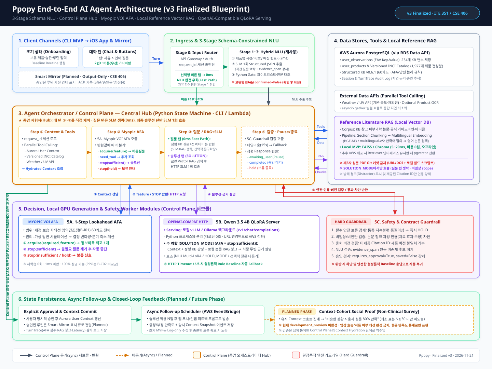
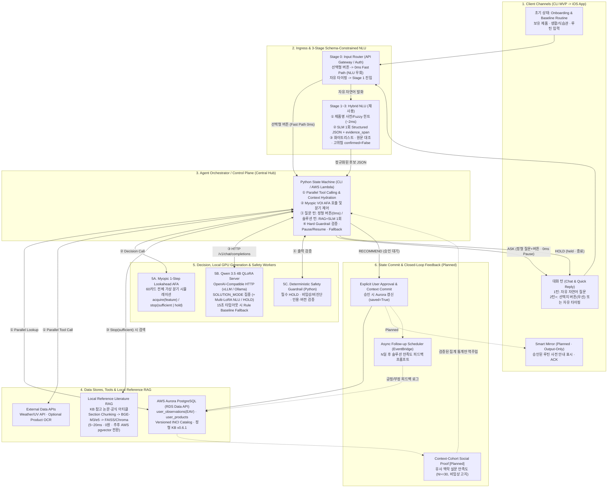
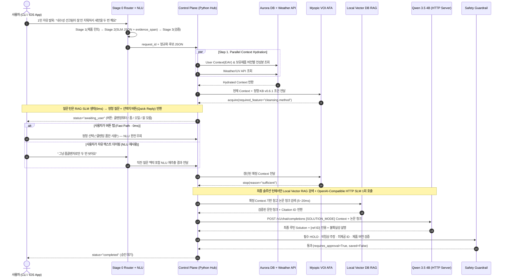

# Ppopy End-to-End AI Agent Architecture (v3 확정본)

> **목적**: 팀원 간 Ppopy 프로젝트의 전체 파이프라인·기술 스택·외부 데이터 연동 경계·개발 순서를 통일하기 위한 최종 확정 아키텍처 문서입니다.  
> **개발 원칙**: 먼저 **CLI MVP(Thin Wrapper)**로 세정·보습·자외선차단 3개 축 전체 흐름을 검증한 뒤, 동일한 1턴 코어(`request_id` Pause/Resume)를 HTTP API로 감싸 **iOS 앱**에 연결합니다.  
> **저장소 경계**: `development_preview`, `production_enabled=false`, 합성 입력 전용을 유지하며 `[Planned]` 항목은 향후 확장 범위입니다.

---

## 1. 최종 확정된 6대 아키텍처 결정

| 항목 | 확정 내용 | 채택 이유 |
| --- | --- | --- |
| **1. NLU Layer** | **3단계 Schema-Constrained NLU** (`Stage 0` 버튼 Fast Path 0ms → `Stage 1` 제품명 사전 힌트 → `Stage 2` SLM 1회 Structured JSON + `evidence_span` → `Stage 3` 화이트리스트·미확정 후보 검증) | 구절 분할 문맥 손실·외부 Jev 다중 호출·정규식 유지보수 제거. **2턴 이후 자유 타이핑도 직전 질문 문맥과 함께 동일 NLU 재사용** |
| **2. Control Plane** | **Deterministic Python State Machine (Central Hub)** | 매 턴 Tool Calling·AFA·RAG·SLM·Guardrail·Pause/Resume을 직접 지휘 |
| **3. AFA Policy** | **Myopic 1-Step Lookahead (VOI / Expected Branch Pruning)** + 정형 KB `v0.6.1` | 재학습 0회, 1ms 미만, 3영역 60카드 즉시 일반화, 100% 설명 가능 *(기존 PPO는 B-C02 비교군)* |
| **4. 질문 턴 UX** | **정형 KB 질문 + 선택지 버튼(Quick Reply) 기본 제공 (0ms)** | 모바일 UX 최상, 질문 턴 SLM·RAG 호출 0회로 응답 지연·비용 최소화 *(버튼 탭=Fast Path, 타이핑=NLU 재사용)* |
| **5. Reference RAG** | **로컬 Vector DB (FAISS/Chroma) + 다국어 임베딩 (`BGE-M3` / `multilingual-e5`)** | 로컬 Qwen과 함께 5~20ms·0원 구동. `Retriever` 인터페이스 추상화로 추후 AWS `pgvector` 1줄 전환. **`SOLUTION_MODE`에서만 호출** |
| **6. SLM 서빙** | **OpenAI-Compatible HTTP 추론 서버 (`vLLM` / `Ollama`, `/v1/chat/completions`)** | Python 프로세스와 분리(재로딩 0초), URL 변경만으로 상용 API ↔ 로컬 Qwen 3.5 4B QLoRA ↔ AWS GPU 교체, **15초 타임아웃 Baseline Fallback** |

---

## 2. 전체 아키텍처 다이어그램 (SVG · 발표/문서 공유용)

---

## 3. Hub-and-Spoke 파이프라인 (Mermaid Flowchart)

---

## 4. 멀티턴 시퀀스 (버튼 Fast Path + 자유 타이핑 NLU 재사용)

---

## 5. 자연어 → DB Field 매핑 구조

자연어를 DB 컬럼에 직접 넣지 않고, **표준 슬롯 사전(Canonical Schema) → PostgreSQL EAV 테이블**로 2단계 매핑합니다:

1. **SLM 정규화**: 자유 발화(*"수건으로 세게 닦아요"*) → 표준 코드값(`{"variable_id": "method.drying", "value": "rubbing_strongly", "evidence_span": "수건으로 세게 닦아요"}`).
2. **Python 검증 및 저장**:
   - **고정 테이블 (`user_products`)**: 확인된 보유 제품(`product_id`, `version`, `confirmed=true`).
   - **관찰 EAV 테이블 (`user_observations`)**: KB의 234개 변수를 컬럼 추가 없이 `(user_id, variable_id, state, value, confirmed_by_user, observed_at)` 행(Row)으로 저장.

---

## 6. 단계별 개발 순서 (Critical Path)

1. **Phase 0 — 계약 고정 (Contract-First PR)**: 4개 모듈 간 Pydantic JSON 스키마(`AFA`, `RAG`, `SLM Input/Output`, `CLI/iOS TurnResponse`) 및 검증 테스트 확정.
2. **Phase 1 — 코어 뼈대 & CLI MVP**: Control Plane + 3영역 `Myopic VOI AFA` + `Hard Safety Guardrail` 완성 (초기엔 Mock/Base SLM으로 전체 CLI 루프 검증).
3. **Phase 2 — 로컬 Reference RAG & 3단계 NLU** *(Phase 1과 병렬)*: `BGE-M3/e5` + `FAISS/Chroma` (`Recall@5 ≥ 90%`) + Citation ID 포맷 확정, 3단계 NLU 검증.
4. **Phase 3 — 합성 데이터 재가공 & 신규 생성**: [qlora-synthetic-dataset-guide.md](qlora-synthetic-dataset-guide.md) 기준으로 `v67` 재가공 + 신규 3영역/Hard Negative(25%+) 생성 → Cross-Model Critic 검수 → Python 자동 게이트 통과분 고정.
5. **Phase 4 — QLoRA SFT (`Qwen 3.5 4B`) 학습 & ITE 351 비교 평가**: 로컬 `vLLM`/`Ollama` HTTP 서버로 교체 연결 후 `범용 LLM` vs `Base+RAG` vs `QLoRA+RAG+Myopic AFA+Guardrail` 정량 비교.
6. **Phase 5 — iOS 래핑 & AWS 통합 (CSE 406)**: 동일 1턴 코어를 HTTP API로 래핑해 iOS 연동 + 타임아웃 Fallback 검증. 이후 `[Planned]` EventBridge 피드백 Log-only 수집 → 표본 $N \ge 30$ 충족 시 Social Proof 활성화.
