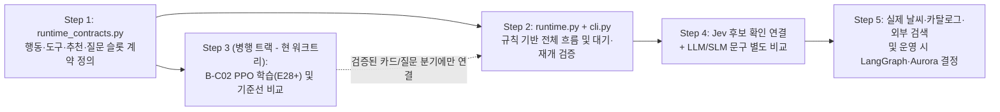

# Handoff: Python Agent Runtime 및 로컬 통합 CLI 구현

> **용도**: `active-feature-acquisition` 워크트리에서는 RL-AFA(PPO 질문 선택 정책, E26/E28+) 학습·평가를 병행하고, 타깃 워크트리(`agent-skeleton-loop` 또는 `ppopy-antigravity`)에서는 **전체 요청을 진행하는 Python Agent Runtime과 로컬 통합 CLI**를 독립적으로 구현하기 위한 인수인계 및 Step 1~2 실행 청사진입니다.

---

## 1. 배경 및 목표 (B 중심 혼합안)

1. **개발 트랙 분리**:
   - **현재 워크트리 (`active-feature-acquisition`, `codex/ppo-23-afa-stage0`)**: B-C02 PPO 학습 및 기준선 대비 질문 비용·종료율 검증 전담.
   - **런타임 워크트리 (`agent-skeleton-loop` 또는 `ppopy-antigravity`)**: 사용자 보유 화장품·피부 민감도·루틴·생활습관·날씨와 제품 근거를 결합하여 **조회 → 재판단 → 질문 대기/재개 → 다중 권고/보류 종료**를 완주하는 **Python Agent Runtime + 로컬 통합 CLI** 구현 전담.
2. **운영·안전 경계 유지**:
   - 모든 구현과 테스트는 `mode="development_preview"`, `production_enabled=False`, 합성 데이터(`synthetic_test`) 경계를 유지합니다.
   - 실제 앱 인증, Aurora DB 영속 저장, 결제, 얼굴 분석, 자동 개선 판정은 이번 로컬 런타임 Step 1~2 범위에 포함하지 않습니다.

---

## 2. 핵심 아키텍처 원칙 (4대 경계)

### ① 역할 분리: Runtime = 흐름·도구·상태 제어 / AFA = 질문 선택 플러그인
- **Python Agent Runtime (`beauty_agent/runtime.py`)**:
  - 입력 해석(Jev 후보) 반영, 외부/내부 도구 조회(날씨·현재 제품·대체품), KB 규칙 평가(`PreviewEngine`), 질문 반환 후 대기(`awaiting_user`) 및 다음 호출에서 같은 요청 재개, 최종 권고/보류 반환을 결정론적 Python 규칙으로 진행합니다.
- **AFA Policy 슬롯 (`QuestionSelector`)**:
  - Runtime이 *"사용자 질문이 필요하다"*고 판단한 분기에서만 호출되며, 허용된 질문 후보 중 다음 질문 1개(`target_id`)를 선택하는 플러그인 인터페이스입니다.
  - Step 1~2에서는 `RuleBasedQuestionSelector`(규칙 기준선)로 먼저 구현하고, 추후 `active-feature-acquisition`에서 검증된 PPO 모델을 동일 인터페이스로 교체 투입합니다.

### ② CLI와 코어 엔진 분리 (추후 iOS 앱 무수정 연동)
- `input()`, `print()`, 터미널 상태 출력 등 CLI 전용 코드는 얇은 껍데기 **`beauty_agent/cli.py`** 에만 둡니다.
- 본체 런타임 **`beauty_agent/runtime.py`** 는 순수 Pydantic 입출력 계약(`RuntimeTurnRequest` → `RuntimeTurnResponse`)만 주고받으므로, 추후 iOS 앱·FastAPI(`api.py`) 연결 시 런타임 로직 수정 없이 HTTP 어댑터만 교체할 수 있습니다.

### ③ 기존 동결 해시 보호 (AFA 워크트리와 충돌 방지)
- `data/afa/stage0-v1/contract.json`, `data/afa/joint-v2-v1/manifest.json`, `data/afa/coverage-repair-v1/manifest.json` 등은 **`beauty_agent/actions.py`** 와 **`beauty_agent/modules/kb_adapter.py`** 의 SHA-256 해시를 고정 검증합니다.
- 따라서 런타임 워크트리에서는 기존 `actions.py`, `kb_adapter.py`, `loop.py`의 기존 계약을 뜯어고치지 말고, **신규 모듈(`runtime_contracts.py`, `runtime.py`, `cli.py`, `tests/test_runtime_cli.py`)** 을 추가해 기존 모듈을 `import`하여 재사용합니다.
- *(참고: PR #17의 `INFORMATION_HOLD_SIGNALS`, `_step_lock`, `evidence_requests` 보완 사항은 `actions.py`/`kb_adapter.py` 해시 변경을 수반하므로, 신규 런타임 파일에서는 동일한 정책 로직을 자체 어댑터/래퍼에서 수용하거나 병합 시 별도 해시 갱신 E번호로 관리합니다.)*

### ④ 후보 · 조회 미상 · 제품 보류의 엄격한 구분
- **Jev 추출 후보**: 확인 전 후보(`pending_clarifications`)와 확정 관찰(`ObservationSlot(confirmed_by_user=True)`)을 분리합니다. 자동 추출 결과를 사용자 확인 없이 `known`으로 승격하지 않습니다.
- **도구 조회 결과**: `status`를 `"found"`, `"not_found"`, `"failed"`로 명시적으로 구분하고, `source`, `version`, `observed_at`를 보존합니다. 미상(`not_found`)이나 실패(`failed`)를 `known`으로 채우지 않고 상태에 남긴 채 재판단으로 복귀합니다.
- **제품 제외·보류 3분류**:
  - `candidate_excluded`: 후보군 제외 (예: 사용자 제외 목록 또는 조건 불일치로 대체/추천 후보에서 뺌)
  - `usage_held`: 사용 보류 (예: 근거 미확인 또는 품질/불편 확인 전까지 사용 보류)
  - `verified_contraindication`: 근거가 확인된 금기 (예: 확인된 알레르겐·라벨 금기)

---

## 3. Step 1~5 권장 개발 순서 및 병행 구조



### Step 1. 목표 런타임 계약 정의 (`beauty_agent/runtime_contracts.py`)
- **목적**: 질문·날씨 조회·제품 조회·대체품 조회·추천(다중 권고)·최종 보류의 입력, 허용 조건, 결과(`found/not_found/failed`), 다음 상태를 Pydantic 계약으로 고정합니다.
- **신규 파일**: `courses/ai-applications/experiments/cos-agent/beauty_agent/runtime_contracts.py`
- **핵심 계약 초안** (기존 `beauty_agent/contracts.py`의 `Contract`, `ObservationSlot`, `Profile`, `OwnedProduct`, `Question` 재사용):

```python
from typing import Literal, Protocol
from pydantic import Field, JsonValue
from .contracts import Contract, ObservationSlot, OwnedProduct, Profile, Question

RuntimeActionKind = Literal[
    "ask_user",
    "confirm_candidate",
    "resolve_conflict",
    "lookup_weather",
    "lookup_product",
    "lookup_alternative",
    "recommend",
    "hold",
]

ToolStatus = Literal["found", "not_found", "failed"]
ExclusionDisposition = Literal[
    "candidate_excluded",
    "usage_held",
    "verified_contraindication",
]
RuntimeStatus = Literal["awaiting_user", "completed", "held"]


class ToolLookupResult(Contract):
    tool_name: Literal["weather", "product_catalog", "alternative_search"]
    query_key: str = Field(min_length=1, max_length=120)
    status: ToolStatus
    source: str = Field(min_length=1, max_length=120)
    version: str | None = None
    observed_at: str | None = None  # ISO-8601 UTC timestamp
    data: dict[str, JsonValue] = Field(default_factory=dict)
    error_reason: str | None = None


class ExclusionItem(Contract):
    product_id: str = Field(min_length=1, max_length=100)
    disposition: ExclusionDisposition
    reason: str = Field(min_length=1, max_length=300)
    evidence_refs: list[str] = Field(default_factory=list)


class RecommendationItem(Contract):
    category: Literal["lifestyle_adjustment", "owned_product_usage", "alternative_candidate"]
    title: str
    guidance: str
    product_id: str | None = None
    evidence_refs: list[str] = Field(default_factory=list)


class RecommendationBundle(Contract):
    lifestyle_adjustments: list[RecommendationItem] = Field(default_factory=list)
    owned_product_usage: list[RecommendationItem] = Field(default_factory=list)
    exclusions_or_holds: list[ExclusionItem] = Field(default_factory=list)
    alternatives: list[RecommendationItem] = Field(default_factory=list)
    requires_approval: Literal[True] = True
    saved: Literal[False] = False


class QuestionCandidate(Contract):
    slot_id: str
    question_text: str
    card_ids: list[str] = Field(default_factory=list)


class QuestionSelector(Protocol):
    """AFA Policy가 향후 구현·교체할 질문 선택 슬롯."""
    def select_question(
        self,
        observations: dict[str, ObservationSlot],
        candidates: list[QuestionCandidate],
        context_meta: dict[str, JsonValue],
    ) -> str: ...  # returns selected slot_id


class RuntimeSessionState(Contract):
    mode: Literal["development_preview"] = "development_preview"
    production_enabled: Literal[False] = False
    request_id: str
    turn_index: int = 0
    status: RuntimeStatus = "awaiting_user"
    profile: Profile = Field(default_factory=Profile)
    products: list[OwnedProduct] = Field(default_factory=list)
    confirmed_observations: dict[str, ObservationSlot] = Field(default_factory=dict)
    tool_results: dict[str, ToolLookupResult] = Field(default_factory=dict)
    pending_question_id: str | None = None
    history: list[dict[str, JsonValue]] = Field(default_factory=list)


class RuntimeTurnRequest(Contract):
    deployment_context: Literal["synthetic_test"] = "synthetic_test"
    request_id: str
    message: str = ""
    profile: Profile | None = None
    products: list[OwnedProduct] | None = None
    observations: dict[str, ObservationSlot] = Field(default_factory=dict)
    resolve_conflicts: tuple[str, ...] = ()


class RuntimeTurnResponse(Contract):
    mode: Literal["development_preview"] = "development_preview"
    production_enabled: Literal[False] = False
    request_id: str
    status: RuntimeStatus
    executed_actions: list[RuntimeActionKind] = Field(default_factory=list)
    questions: list[Question] = Field(default_factory=list)
    recommendation: RecommendationBundle | None = None
    hold_reason: str | None = None
    tool_results: dict[str, ToolLookupResult] = Field(default_factory=dict)
```

### Step 2. 규칙 기반 Python 런타임 & 로컬 통합 CLI (`runtime.py`, `cli.py`, `tests/test_runtime_cli.py`)
- **목적**: 모델 학습이나 외부 네트워크 없이 합성 데이터·`PreviewEngine`·규칙 질문 선택기만으로 목표 흐름 전체를 재현하고 대기·재개를 검증합니다.
- **완료 기준**:
  1. `runtime.py` 내 각 단계(입력/관찰 반영 → 도구 조회 → KB 평가 → 분기/질문 선택 → 권고/보류 구성)가 상태 입출력 함수로 분리되어 있음.
  2. 첫 번째 합성 2턴 시나리오가 `pytest`에서 통과:
     - **Turn 1**: *"오늘 야외에 오래 있는데 가진 제품으로 루틴을 어떻게 조정할까?"* + 보유 제품 2종(확인된 세안제 A, 상세 미등록 선크림 B) → `lookup_weather`(합성 조회 `found`) + `lookup_product`(제품 B `not_found`) → 재판단 결과 필요한 질문(`sun.outdoor_time` 등)을 규칙 선택기로 고르고 `status="awaiting_user"`로 반환 및 세션에 저장.
     - **Turn 2**: 같은 `request_id`에 사용자 답변(`observations={"sun.outdoor_time": ...}`) 전달 → 재개(Resume) 후 KB 평가 → **생활습관 조정 + 보유품 A 활용 + 미확인 제품 B 사용 보류(`usage_held`) + 대체품 후보(`lookup_alternative`)** 를 `RecommendationBundle`로 반환하고 `status="completed"`로 종료.
  3. `uv run python -m beauty_agent.cli` 실행 시 터미널에서 Turn 1 → Turn 2 대화 및 상태 출력이 정상 동작함.

### Step 3 (병행 트랙 — `active-feature-acquisition` 워크트리)
- `beauty_agent/afa/ppo_preflight.py` 기반 B-C02 PPO 실제 학습(E28+) 및 규칙 기준선 대비 질문 비용·종료 일치율 비교.
- 검증된 카드/질문 분기에 대해서만 Step 2의 `QuestionSelector` 인터페이스로 플러그인 연결.

### Step 4 & Step 5 (후속 확장)
- **Step 4**: Jev 추출 후보 확인(`confirm_candidate`) → KB 관찰 변환 어댑터 연결, 검토 문구 vs LLM/SLM 문장 생성 별도 비교 평가.
- **Step 5**: 합성 조회 어댑터를 실제 날씨 API·카탈로그 DB·DB 미스 시 외부 검색으로 교체. 다중 서버/프로세스 재시작 복구 요구가 확정될 때 LangGraph(`StateGraph`) + AWS Aurora `Checkpointer` 도입.

---

## 4. 타깃 워크트리 세팅 명령어 (PowerShell)

현재 저장소 루트(`C:\Users\mms12\orca\workspaces\cos-agent\active-feature-acquisition`)에서 PowerShell을 열고 아래 명령을 실행하면, 새 워크트리(`agent-skeleton-loop`)를 만들고 필요한 미추적 설계 문서들을 복사합니다. *(이미 `ppopy-antigravity` 워크트리를 쓰고 싶다면 경로만 `../ppopy-antigravity`로 바꾸면 됩니다.)*

```powershell
# 1. 최신 main/d859780 기준으로 새 워크트리 생성 (브랜치: codex/agent-runtime-cli)
git worktree add ../agent-skeleton-loop -b codex/agent-runtime-cli d859780

# 2. target 문서 및 아키텍처·인수인계 문서 복사
New-Item -ItemType Directory -Force "../agent-skeleton-loop/docs" | Out-Null
New-Item -ItemType Directory -Force "../agent-skeleton-loop/courses/ai-applications/experiments/cos-agent/docs" | Out-Null

Copy-Item "docs/architecture.md" "../agent-skeleton-loop/docs/architecture.md"
Copy-Item "courses/ai-applications/experiments/cos-agent/docs/agent-runtime-target.md" `
          "../agent-skeleton-loop/courses/ai-applications/experiments/cos-agent/docs/agent-runtime-target.md"
Copy-Item "courses/ai-applications/experiments/cos-agent/docs/handoff-agent-runtime.md" `
          "../agent-skeleton-loop/courses/ai-applications/experiments/cos-agent/docs/handoff-agent-runtime.md"

# 3. 타깃 워크트리에서 가상환경/의존성 확인
cd ../agent-skeleton-loop/courses/ai-applications/experiments/cos-agent
uv sync --locked
uv run --locked pytest -q
```

---

## 5. `agent-skeleton-loop` 새 세션에 붙여넣을 시작 프롬프트

```text
안녕! 이 워크트리(`agent-skeleton-loop`, 브랜치 `codex/agent-runtime-cli`)에서 Python Agent Runtime과 로컬 통합 CLI 구현을 시작하려고 해.

먼저 아래 문서를 순서대로 읽고 현재 코드베이스를 파악해 줘:
1. `AGENTS.md` 및 `courses/ai-applications/experiments/cos-agent/AGENTS.md`
2. `courses/ai-applications/experiments/cos-agent/docs/handoff-agent-runtime.md`
3. `courses/ai-applications/experiments/cos-agent/docs/agent-runtime-target.md`
4. `courses/ai-applications/experiments/cos-agent/beauty_agent/contracts.py`, `loop.py`, `actions.py`, `action_runtime.py`, `modules/kb_adapter.py`
5. `skin_engine/kb_preview/engine.py`

인수인계 문서의 규칙대로 기존 동결 해시 파일(`actions.py`, `modules/kb_adapter.py`)은 수정하지 않고 신규 파일(`runtime_contracts.py`, `runtime.py`, `cli.py`, `tests/test_runtime_cli.py`)로 분리해서 작업할 거야.

지금 바로 Step 1(`runtime_contracts.py` 계약 확정)과 Step 2(첫 합성 2턴 시나리오: 야외 활동 + 확인 세안제 A + 상세 미등록 선크림 B → 질문 대기/재개 → 다중 권고/보류 종료를 통과하는 `runtime.py`, `cli.py`, `tests/test_runtime_cli.py`) 구현 계획을 세우고 Step 1부터 진행해 줘.
```
