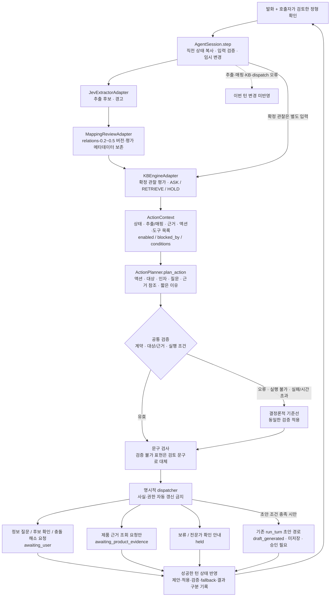
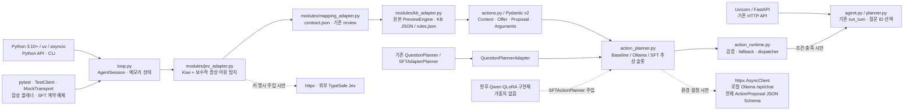

# 액션 중심 모듈형 에이전트 루프

합성 개발 프리뷰입니다. 항상 `development_preview`, `production_enabled=false`이며 무저장입니다. SLM은 발화와 현재 상태를 해석해 **다음 액션을 제안**하고, 코드는 계약·실행 조건을 검증한 뒤 허용된 dispatcher만 실행합니다. 실제 Jev/Ollama 추론·Qwen 학습·다운로드·배포는 실행하지 않았습니다.

기존 `POST /v1/agent/turn`, `TurnRequest`/`TurnResponse`, `run_turn()`은 유지합니다. HTTP 경로는 기존 질문 ID 선택 방식이며 새 액션 루프는 **Python API와 CLI에서만** 실행합니다. 새 HTTP 엔드포인트는 없습니다.

## 실제 워크플로



## 적용 스택과 파일



## 액션 계약과 실행 조건

`ActionProposal`은 `action`, `target_id`, `arguments`, 선택적 `question_ko`, `evidence_refs`, 짧은 `reason_summary`로 구성합니다. 이유는 선택 요약이며 내부 사고 과정은 요구하지 않습니다. 임의 도구·URL·제품 사실·확인 완료·권한 필드는 계약에 없고 추가 필드는 거부합니다.

| action | 제공된 대상 | 코드의 실행·대기 결과 |
| --- | --- | --- |
| `ask_user` | 프로필/제품 확인 블로커 또는 미답변 소비자 관찰 슬롯 | `awaiting_user`: 질문 요청만 반환 |
| `confirm_candidate` | 현재 미확정 추출 후보 ID | `awaiting_user`: 대상·부정 여부·관찰 시점 확인 요청 |
| `retrieve_evidence` | KB의 제품 근거 누락 슬롯 | `awaiting_product_evidence`: 요청만 반환, 실제 DB/검색 연결 없음 |
| `resolve_conflict` | `conflicting`인 사용자 관찰 슬롯 | `awaiting_user`: 충돌 해소 요청만 반환 |
| `hold` | 코드가 제공한 안전/정보 부족 대상 | `held`: 개별 권고 보류, 진단·개선 판정 없음 |
| `request_draft` | `label_draft` | 조건 충족 시 기존 경로로 `draft_generated`, 저장·승인 수행 없음 |

`ActionContext.available_actions`는 단일 우선순위 계층에 제한하지 않고 모든 제안 가능 대상을 함께 제공합니다. 각 항목에는 도구, 실행 조건, 허용 근거, 검토 문구, `enabled`, `blocked_by`가 있습니다. 모델은 제약 안에서 질문·확인·조회 등 서로 다른 액션을 선택합니다. 필수 안전 보류가 있으면 다른 액션은 비활성화합니다.

초안은 미확정 후보·프로필/제품 블로커·충돌·KB 미해결 판정·질문·조회·필수 보류가 없어야 활성화됩니다. 후보 확인에 `unknown`/`declined`로 답하면 재질문하지 않지만 미해결 한계가 남으므로 초안을 막습니다. dispatcher도 허용 액션과 기존 초안 필수 조건을 실행 직전에 검사합니다.

`ActionArguments.wording`은 `reviewed`/`contextual`, `confirmation_focus`는 `all`/`subject`/`polarity`/`time`입니다. 확인 초점은 `confirm_candidate`에서만 사용할 수 있습니다. 도구는 코드에 고정된 `request_user_input`, `await_product_evidence`, `hold_guidance`, `generate_label_draft`뿐이며 모델이 실행 도구 이름을 지정하지 않습니다.

## 모델 판단과 질문 표현의 한계

모델은 발화·현재 상태·추출/매핑·이력·근거를 읽고 액션과 대상을 제안합니다. 기준선만 충돌 → 후보 확인 → 필수/관찰 질문 → 조회 → 초안 → 보류 순서로 결정합니다. 이 순서는 모델의 후보 목록을 하나로 줄이지 않습니다. 필수 보류 시 기준선도 보류만 선택할 수 있습니다.

JSON Schema로 자유 질문의 의미적 타당성을 보장할 수 없습니다. 현재 최종 문구는 **지정 대상의 코드 검토 문구 또는 코드가 렌더링한 문맥·확인 초점 변형과 정확히 일치할 때만** 사용합니다. 모델의 자유 제안 문구는 그 외에는 대체하고 `unverified_question_wording`을 기록합니다. 따라서 자유 질문의 의미 검증이나 SFT 성능 개선을 주장하지 않습니다. 모델은 확인 초점을 대상·긍정/부정·시점 중 선택할 수 있지만, 초점을 묻는 것만으로 확인이 완료되지는 않습니다.

여기서 검토 문구는 코드가 정의한 개발용 표현이며 도메인·임상 승인을 뜻하지 않습니다. 추출기가 반환한 임의 label·clarification 문장은 검토 문구로 취급하지 않고 코드의 증상 이름·관계 확인 표현을 사용합니다.

`known`(명시적 부정 `False` 포함), `unknown`, `declined`, `not_applicable`로 사용자 답변이 확인된 슬롯은 일반 질문에서 제외합니다. `not_asked`는 질문 가능하며 `conflicting`은 해소 액션으로 구분합니다. KB 원시 누락 목록은 trace에 남고 실제 질문은 답변 상태로 필터링합니다. 제품 자료 공백은 조회로만 제공하며 비공개 농도·pH를 소비자 질문으로 바꾸지 않습니다. 제조업자 의견 카드 B-P07은 제외합니다.

## 확인·세션·트레이스

`AgentSession.step()`은 입력 변경을 임시 복사본에 적용합니다. 추출·매핑·KB·dispatch 오류 시 해당 턴을 반영하지 않습니다. 플래너 실패는 기준선으로 복귀하여 정상 턴으로 처리합니다. 플래너는 컨텍스트의 깊은 복사본을 받으므로 액션 활성 상태를 바꾸어 게이트를 우회할 수 없습니다.

“네”나 모델의 확인 주장은 사실 갱신이 아닙니다. 검토한 `Profile`/`OwnedProduct`, `confirmed_by_user=True`인 `ObservationSlot`은 호출자가 명시적으로 전달합니다. 관찰은 숫자·불리언·구조화 JSON을 보존합니다. 상충 값은 `conflicting`으로 남고 `resolve_conflicts`와 정형 관찰만 이를 해결합니다.

`CandidateConfirmation(subject, state, observed_at)`은 pending ID별 정형 응답입니다. 긍정/부정 완료에는 명시적 대상과 UTC 시점이 필요합니다. `unknown`/`declined`는 시점 없이 기록할 수 있고 사실 확정으로 취급하지 않습니다. 후보 응답과 KB 관찰은 별개이며 모델의 확인 요청으로 pending/confirmed 관찰을 변경하지 않습니다.

`PipelineTrace`는 `proposed_action`, `applied_action`, `validation_results`, `fallback_reason`, `execution_status`를 분리합니다. 잘못된 JSON은 구조화 제안이 없어 `proposed_action=None`이며 이유만 기록합니다. 조회 요청을 성공으로, 초안 요청을 생성 완료로 기록하지 않습니다. 기존 `selected_route`를 호환용으로 유지하고, 보류·조회 대기는 기존 응답 계약의 `needs_information`, `draft=None`입니다.

## 모델 연결과 호환성

- `ActionPlanner.plan_action(ActionContext)`: 규칙 기반, Ollama, 향후 SFT의 공통 비동기 계약입니다. 반환은 `ActionProposal` 또는 이를 표현하는 JSON 문자열/객체이며 공통 decoder가 같은 `ActionProposal` 계약으로 검증합니다.
- `RuleBasedActionPlanner`: 외부 호출 없는 결정론적 기준선입니다.
- `OllamaActionPlanner`: 전체 액션 Schema와 컨텍스트를 고정 로컬 URL `127.0.0.1:11434/api/chat`에 전달합니다. 기존 질문 ID 전송을 재사용하지 않습니다. HTTP 타임아웃 15초, 전체 추론 마감 18초, 응답 64KiB 상한, 공통 플래너 마감 기본 20초를 적용합니다.
- `SFTActionPlanner`: 향후 Qwen QLoRA 구현체용 추상 슬롯입니다. `AgentSession(planner=구현체)`로 주입하며 같은 검증·fallback을 적용합니다. 학습 가중치·추론 런타임은 추가하지 않았습니다.
- 기존 `QuestionPlanner`, `PlannerContext`, `PlannerOutput`, `SFTAdapterPlanner`, `select_question()`은 유지합니다. `.plan()`만 구현한 플래너는 `QuestionPlannerAdapter`로 자동 변환합니다. 기존 Ollama 질문 선택 경로도 호환 테스트로 유지합니다.

마감은 비동기 취소에 협조하는 구현에 적용됩니다. 향후 동기 GPU 추론을 연결할 때는 실행 격리·중단 정책이 필요합니다. 실제 모델 품질·한국어 판단력·추론 지연은 미검증입니다. 기본 Jev 어댑터는 Kiwi/어휘 후보 탐지이며 실제 Jev 추론으로 표시하지 않습니다. Kiwi 미설치 시 기존 구두점 폴백을 사용합니다.

## 합성 SFT 데이터 계약

[examples/action_sft.synthetic.json](../examples/action_sft.synthetic.json)은 런타임에서 캡처한 `ActionContext`와 직접 작성한 목표 `ActionProposal` 7개입니다. 후보 질문 → 명시적 응답 → 관찰 질문 → 관찰 응답 → 초안 요청의 3턴 체인과 조회·충돌·보류 사례가 포함됩니다.

입력은 발화, 현재 정형 상태, 추출/매핑, 비활성 KB의 제공 근거, 액션·도구·조건, 이전 턴 이력입니다. 출력은 액션·대상·질문/인자·근거 참조·짧은 이유입니다. 합성 관찰, KB 출처 기록, 설계 목표를 provenance로 구분합니다. 모두 `human_review=unreviewed`, `approved_reference=false`이며 승인 정답·독립 평가셋이 아닙니다. 기준선 선택을 정답으로 복사하지 않았고 모델 판단 개선을 주장하지 않습니다.

생성기는 네트워크/모델 없이 실제 루프에 합성 추출기와 작성한 목표 플래너를 주입합니다. 테스트는 재생성 일치와 모든 목표의 계약·실행 조건을 검사합니다. 향후 학습 전 사람의 독립 검토, 데이터 분할·라이선스·평가 기준이 필요합니다.

## 실행과 검증

실험 디렉터리에서:

```powershell
uv run pytest
uv run python -m beauty_agent.loop --demo
uv run python -m beauty_agent.loop --demo --scripted
uv run python -m scripts.build_action_examples
```

CLI는 `/state`, `/quit`, `/update {JSON}`을 지원합니다. 정형 JSON은 `AgentSession.step()` 인자입니다. 고정 데모는 B-C01만 평가하며 미확정 상태와 정형 확인 후 초안 전이를 표시합니다.

액션 경계는 `tests/test_action_planner.py`, 기존 루프 호환은 `tests/test_agent_loop.py`, HTTP 회귀는 기존 `tests/test_agent.py`에서 확인합니다. 모두 합성 플래너와 MockTransport로 실행하며 실제 모델은 필요 없습니다. 원본 검증은 루트 [docs/verification.md](../../../../../docs/verification.md)의 명령을 따릅니다. KB validator는 반드시 `--report outputs/kb-structure.json`으로 실행합니다. 원본 KB·source manifest·동결 감사는 수정하지 않습니다.

엄격 원본 테스트와 57 시나리오 감사의 기존 다섯 불일치는 별도 결과로 보고합니다. 현재 명세 테스트 통과를 원본 수용 성공으로 해석하지 않습니다. 실제 사용자 수집, 저장·승인, 결제, 얼굴 분석, 자동 개선 판정, 실제 DB/검색 연결은 이번 범위에 없습니다.

### 이번 액션 계약 변경의 검증 결과

| 검사 | 결과 |
| --- | --- |
| 실험 `uv run pytest` | 281개 통과: 신규 액션 경계 49개, 기존 루프 44개 및 나머지 회귀 포함 |
| 합성 SFT 계약 | 7개 예제 재생성 일치·실행 조건 검증, 3턴 체인 포함 |
| 고정 루프 CLI | `needs_information` → 정형 확인 → `draft`, 제안·적용·실행 상태 기록 확인 |
| 원본 소스 매니페스트 | 27/27 해시 일치 |
| KB validator (`--report outputs/kb-structure.json`) | 95/95 통과 |
| 경계·현재 명세 검사 | 371개 통과 |
| 엄격 원본 검사 | 62개 통과·기존 5개 실패: T17, T20, T37, T45, V06-T04 (종료 코드 1) |
| 동결 57 시나리오 감사 | 52/57 충족·기존 불일치 5건 (종료 코드 1) |
| KB coverage / 합성 CLI | 60카드·213조건 분기·180경계 사례 / 비활성 프리뷰 실행 확인 |

Starlette/httpx 사용 중단 경고 1건은 기존과 같습니다. 위 수치는 서로 다른 검사이며 임상 효과·모델 품질·승인된 정답 수로 합산하지 않습니다.
