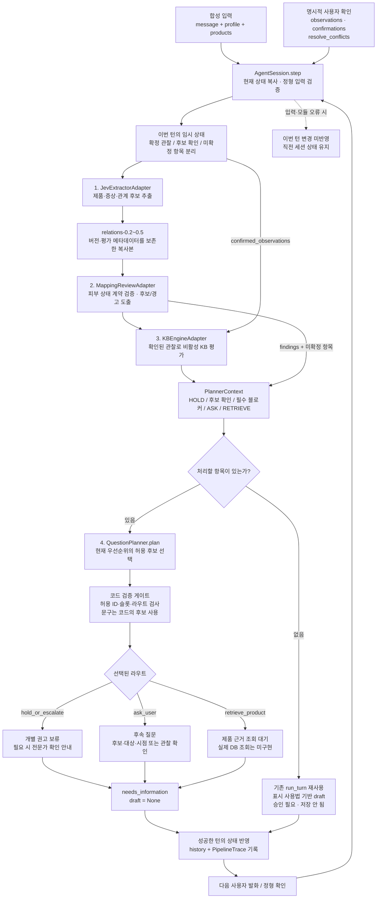
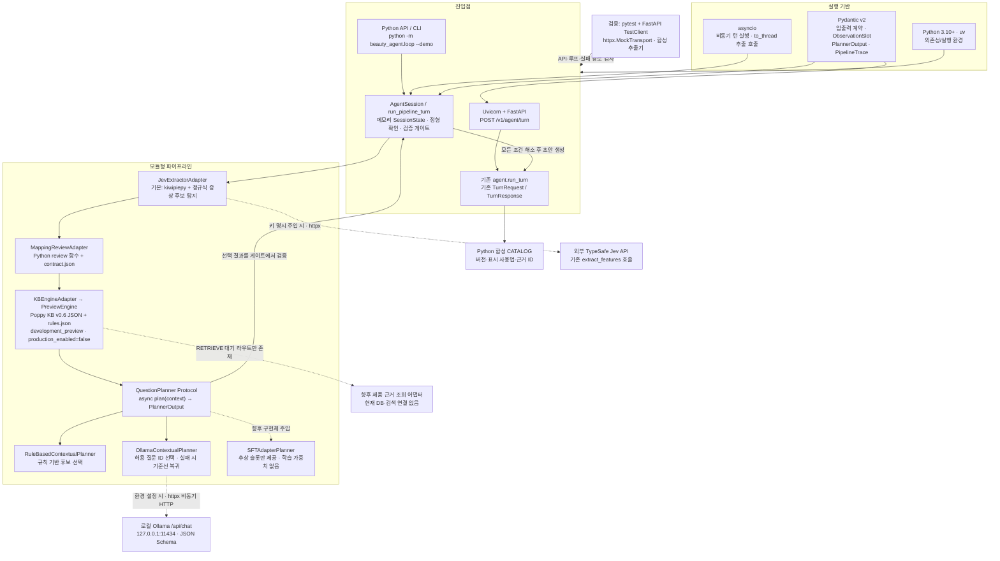

# 모듈형 에이전트 루프 — 합성 개발 프리뷰

`beauty_agent.loop.run_pipeline_turn()`은 Jev 어댑터 → Mapping Review → KB 프리뷰 → 교체 가능한 플래너를 연결합니다. 기존 `run_turn()`과 `POST /v1/agent/turn`의 입출력과 동작은 그대로 유지합니다. 새 HTTP 엔드포인트는 추가하지 않았습니다. `PipelineTurnResponse`만 별도로 `trace`를 포함합니다.

## 에이전트 워크플로

단일 턴은 `run_pipeline_turn()`으로 실행하고, 다중 턴은 `AgentSession.step()`이 입력 확인과 상태 누적을 감쌉니다. 아래의 정형 확인은 호출자가 명시적으로 전달하는 값이며 자연어 추출 결과의 자동 확정이 아닙니다.



플래너 우선순위는 **안전 보류 → 미확정 후보 확인 → 프로필·보유품 등 필수 블로커 → KB 관찰 질문(ASK) → 제품 근거 조회(RETRIEVE)**입니다. 제품 pH·농도 등 제품 근거는 소비자 질문으로 전환하지 않습니다. 추출 후보와 그 확인 기록은 KB 관찰과 별도로 유지합니다.

## 적용 스택과 연결 구조

실선은 구현된 연결이고 점선은 선택 연결 또는 향후 확장입니다. 선택 연결은 실제 서비스·모델 추론 검증 완료를 뜻하지 않습니다. 기존 HTTP API는 기존 `run_turn()`을 호출하며 모듈형 루프는 Python API와 CLI로 실행합니다.



Kiwi를 사용할 수 없는 환경에서는 기존 분할기의 구두점 기반 폴백을 사용합니다. 기본 추출 경로는 Jev 추론을 수행하지 않으며, Ollama도 설치된 모델을 자동 다운로드하지 않습니다. 세션·트레이스는 메모리에만 유지하고 저장·결제·얼굴 분석·자동 개선 판정은 활성화하지 않습니다.

## 실행

실험 디렉터리에서:

```powershell
uv run pytest
uv run python -m beauty_agent.loop --demo
uv run python -m beauty_agent.loop --demo --scripted
```

대화형 데모는 `/state`, `/quit`, `/update {JSON}`을 지원합니다. `/update`의 JSON은 `AgentSession.step()`의 인자(`message`, `profile`, `products`, `observations`, `confirmations`, `resolve_conflicts`)입니다. 고정 시연은 B-C01만 대상으로 증상 후보 확인 전 `needs_information`과 정형 확인 후 `draft`를 출력합니다. 데모의 합성 제품과 미온수 관찰을 실제 제품 사실·임상 결과로 해석하지 않습니다.

## 어댑터와 플래너

- `JevExtractorAdapter()`의 기본값은 Kiwi 분할과 증상 어휘 탐지입니다. 외부 호출 없이 대상·긍정/부정·시간을 미상으로 둡니다. 트레이스에 `offline_candidate_detection_not_jev_inference`를 표시합니다. 실제 Jev는 `JevExtractorAdapter(key=...)`로 명시적으로 연결하며, 기존 함수의 실제 이름인 `extract_features()`를 호출합니다. 키는 기록하거나 자동 로드하지 않습니다. 테스트는 합성 추출기를 주입합니다.
- 최신 main의 Mapping Review는 `relations-0.2`부터 `relations-0.5`까지 직접 지원합니다. 어댑터는 버전과 평가 메타데이터를 보존한 복사본을 전달합니다. 최신 형식을 레거시 헤더로 낮추지 않으므로 미평가·불확실 후보의 검사를 유지합니다. 잘못된 계약 스냅샷은 오류이며 후보는 확정 관찰로 승격하지 않습니다.
- KB는 저장소 원본 `PreviewEngine`을 그대로 호출합니다. `consumer_question_allowed`인 관찰만 `ASK`, 제품 누락 필드는 `RETRIEVE`로 분리합니다. 조회는 대기 경로만 구현했으며 실제 제품 DB 조회는 아직 없습니다. 비공개 정보는 미상으로 남습니다. 제조업자 의견 카드 B-P07은 제외합니다.
- `QuestionPlanner.plan(context)`는 비동기 인터페이스입니다. `RuleBasedContextualPlanner`, `OllamaContextualPlanner`, 향후 구현용 추상 `SFTAdapterPlanner`를 제공합니다. `AGENT_PROVIDER=ollama`와 `OLLAMA_MODEL`로 기존 로컬 전송을 사용합니다. 안전 보류 → 후보 확인 → 기존 필수 블로커 → KB 관찰 질문 → 제품 근거 조회 순으로 처리합니다.
- Ollama는 구조화된 컨텍스트를 받아 현재 우선순위의 허용 질문 ID를 고릅니다. 자유 문장 생성 대신 코드가 소유한 질문과 라우트로 `PlannerOutput`을 구성합니다. 기존 15초 HTTP 타임아웃, 64KiB 응답 상한과 실패 시 기준선 복귀를 재사용합니다. 전체 응답의 절대 마감 제한은 기존과 같이 미구현입니다. 사용자 정의 플래너도 현재 허용 후보의 ID·슬롯·라우트를 검사하며 문구는 코드의 후보를 사용합니다.

## 상태와 확인

`AgentSession(request, planner=..., extractor=..., card_ids=...)`를 만들고 `await session.step(message, ...)`를 호출합니다. 세션은 메모리에만 존재하며 매 턴 프로필·보유품·관찰·미확정 질문·트레이스를 누적합니다. 입력 검증 또는 모듈 오류가 발생하면 해당 턴의 상태 변경은 적용하지 않습니다.

자유 문장의 “네”만으로 프로필·보유품·관찰을 확정하지 않습니다. 호출자는 검토한 `Profile`/`OwnedProduct`와 `confirmed_by_user=True`인 `ObservationSlot`을 명시적으로 전달해야 합니다. 제품 필드는 사용자 관찰로 받지 않습니다. 서로 다른 알려진 값은 `conflicting`으로 남기며 `resolve_conflicts`에 명시한 슬롯만 해결합니다.

증상 후보는 `trace.pending_clarifications`의 ID별로 `CandidateConfirmation(subject, state, observed_at)`을 전달합니다. 시간은 명시적인 UTC ISO 문자열이어야 합니다. 확인된 후보와 KB 관찰은 별개이며, 확인만으로 증상 값이나 피부 상태를 KB에 자동 매핑하지 않습니다. 동일한 발화를 새 턴에서 반복해도 새 후보로 확인합니다. 필요한 KB 관찰은 별도의 정형 입력으로 전달합니다.

기존 응답 상태 계약을 보존하므로 보류와 조회 대기는 `status=needs_information`, `draft=None`이며 `trace.selected_route`로 구분합니다. 보류·조회 메시지는 소비자 질문 목록에 넣지 않습니다. 필수 블로커, 후보 확인, KB 질문·조회·보류가 모두 해소되어야 기존 표시 사용법 기반 초안을 생성합니다.

## 검증 범위

2026-11-09 로컬 검증: `uv run pytest` 81개 통과(기존 58 + 신규 23), 원본 해시 27/27 일치, KB 구조 95/95 통과, 경계·현재 명세 371개 통과. 엄격 원본 테스트는 기존과 동일한 62개 통과·5개 실패(T17, T20, T37, T45, V06-T04)입니다. 고정 CLI 시연의 두 상태 전이도 확인했습니다. 테스트 실행에는 기존 Starlette/httpx 사용 중단 경고 1건이 있습니다.

리뷰 수정 후 `uv run pytest`는 95개 통과(기존 81 + 회귀 14), 원본 해시는 27/27 일치했습니다. `ObservationSlot.value`는 재귀 JSON 값으로 숫자·불리언·구조화 답변을 보존합니다. B-C03의 접촉 시간 객체와 B-S06의 정수 사용 횟수를 실제 KB로 전달하는 테스트를 추가했습니다. 플래너의 슬롯·질문 ID는 `resolve:` 접두사와 100자 제품 ID를 수용하도록 최대 108자로 확장했습니다. 기존 HTTP 계약은 유지합니다.

최신 main (`b2dbc0b`, PR #12 포함) 동기화 후 `uv run pytest`는 232개 통과했습니다. 이 중 루프 테스트는 44개이며, 스키마 0.2~0.5의 호환성과 최신 스키마의 평가 메타데이터 검사 유지 사례를 포함합니다. 원본 해시 27/27, KB 구조 검사 95/95, 경계·현재 명세 테스트 371개도 통과했습니다. 동결 감사는 기존과 같은 52/57 충족 및 불일치 5건(종료 코드 1)을 유지합니다.

기존 API/회귀 테스트와 신규 `tests/test_agent_loop.py`는 합성 입력 및 MockTransport만 사용합니다. 실제 Jev 서비스, Ollama 추론, SFT 학습, 앱 연동, 저장·승인 및 실제 사용자 수집은 검증하거나 활성화하지 않았습니다. 항상 `development_preview`, `production_enabled=false`입니다.

저장소 루트에서 원본 검증:

```powershell
New-Item -ItemType Directory -Force outputs | Out-Null
$env:PYTHONUTF8='1'
python tools/verify_source_manifest.py
python KB/Poppy_KB_v0.6/validate_poppy_kb_v0_6.py --report outputs/kb-structure.json
python -m skin_engine.kb_preview.audit --output outputs/original-acceptance57.json
```

인수인계에 적힌 `tools/run_kb_57_audit.py`는 없으므로 실제 감사 모듈 명령을 사용합니다. 동결 감사는 기존과 같은 52/57 충족과 불일치 5건으로 종료 코드 1을 반환합니다. 별도의 371개 경계·현재 명세 테스트 통과는 이 원본 수용 기준 통과를 뜻하지 않습니다. 원본 매니페스트·KB·감사 기대값은 변경하지 않습니다.
