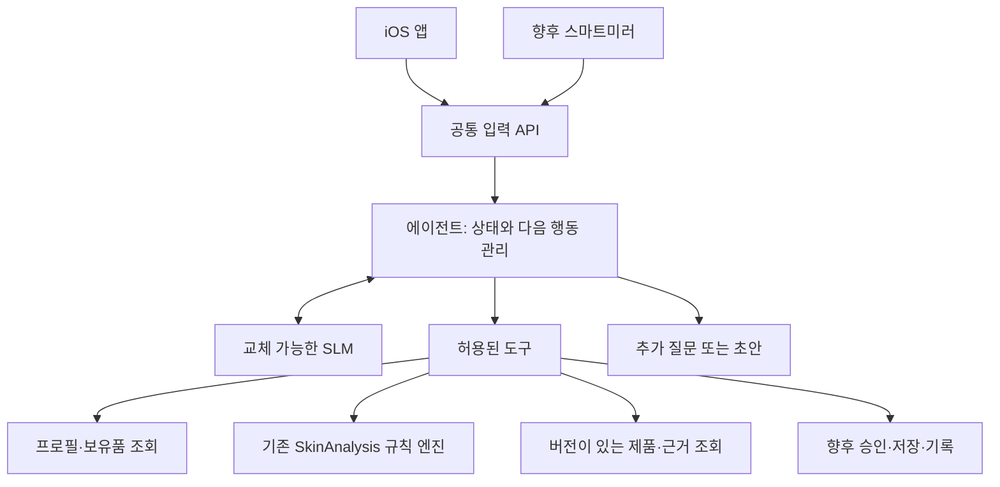

# 프로젝트 개발 가이드

작성일: 2026-11-02. 현재 단계는 방향·역할·입출력·개발 순서를 정하는 단계입니다. 이 문서의 추천 구조는 점진적으로 수정할 수 있습니다. 먼저 만들어 둔 코드는 실험 자료이며, 앞으로 개발할 기능의 확정 구현으로 취급하지 않습니다.

SLM SFT → RAG → 에이전트 → 앱·미러 연동의 전체 단계와 세부 완료 기준은 [전체 개발 마일스톤](development-milestones.md)을 참고합니다. 이 문서의 단계 구분은 간단한 개요이며, 마일스톤은 사용자님이 제안한 학습·RAG 중심 순서를 반영한 상세 계획입니다.

## 1. 우리가 만들려는 것

사용자의 프로필, 보유 화장품, 사용 경험과 기록을 받아 **현재 가진 제품을 어떻게 관리하고 사용할지 함께 결정하는 에이전트**를 만듭니다. 첫 진입점은 기존 SkinAnalysis iOS 앱이고, 나중에 스마트미러가 같은 기능을 이용합니다.

처음부터 모든 제품 추천·피부 분석·대화 기능을 다루지 않습니다. 첫 개발 목표 후보는 다음 한 흐름입니다.

> 앱에서 확인한 프로필과 보유 제품을 전달 → 부족한 정보 질문 → 제품 정보와 규칙 확인 → 설명이 있는 루틴 초안 → 사용자 확인

사용자 확인 이후의 저장·수정·이력은 이 흐름이 이해되고 검증된 다음 붙입니다. 지속 관리는 이후 사용 기록과 피드백을 받아 수정안을 제시하는 방향으로 확장합니다.

## 2. 네 구성요소의 역할

| 구성요소 | 담당하는 일 | 예시 |
|---|---|---|
| iOS 앱·스마트미러 | 입력 수집, 확인 화면, 결과 표시 | 사용 제품 선택, 질문 답변, 초안 확인 |
| 에이전트 | 다음 행동 결정, 필요한 도구 호출, 대화 흐름 관리 | 제품 정보가 없으면 조회, 모호하면 질문 |
| SLM | 언어 이해와 표현 | 사용자 답변에서 후보 정보 추출, 필요한 질문 선택, 근거에 맞춰 설명 |
| 도구·규칙·데이터 | 확인 가능한 사실 조회와 정형 처리 | 제품 버전 조회, 사용법 검토, 승인 검사, 기록 저장 |

SLM을 학습시키는 일과 에이전트를 만드는 일은 서로 다른 작업입니다. 사전학습된 작은 모델을 연결해도 에이전트 개발을 시작할 수 있습니다. 파인튜닝은 기준 모델의 구체적인 실패를 관찰하고 데이터가 준비되었을 때 판단합니다.

## 3. 제안하는 전체 구조

첫 제안은 서버에서 공통 에이전트를 실행하고 앱·미러가 API로 호출하는 방식입니다. “두 기기에 탑재”는 공통 기능을 제공한다는 의미로 먼저 설계합니다. 인터넷 없이 기기 안에서 모델까지 실행해야 하는지는 아직 결정하지 않았습니다. 이 선택은 iPhone과 미러의 메모리·지연·비용·개인정보 처리 조건을 확인한 뒤 정합니다.

기존 저장소의 엔진·제품 데이터·세션 체계를 먼저 재사용할 수 있는지 확인합니다. 이 폴더는 에이전트 흐름과 모델 연결을 실험하는 별도 작업 공간으로 사용하고, 기존 앱을 복제해 새로 만드는 방향으로 확대하지 않습니다. 장기적으로 별도 서비스로 유지할지 기존 저장소에 통합할지는 첫 연동 뒤 결정합니다.

## 4. 개인화의 수준을 단계적으로 넓히기

1. **입력 반영:** 보유 제품과 사용자가 명시한 제외 조건을 반영합니다.
2. **제약 반영:** 확인된 사용법·현재 빈도·사용 경험을 함께 검토합니다. 정보가 부족하면 질문하거나 보류합니다.
3. **기록 반영:** 사용 기록과 피드백을 바탕으로 변화와 수정 필요성을 설명합니다.

현재 코드는 1단계의 일부와 합성 사용법 배열만 보여줍니다. 피부 고민별 효능 계산은 하지 않습니다. “개인화”라는 말만으로 효과가 검증되었다고 보지 않고, 어떤 입력이 어떤 결정에 반영되는지 확인할 수 있게 만듭니다.

## 5. 먼저 정할 입력과 출력

최종 필드명을 확정하기 전에 아래 정보의 의미부터 합의합니다.

| 입력 범주 | 필요한 내용 |
|---|---|
| 프로필 | 사용자가 확인한 고민·선호·제외 조건; 미상/거절 여부 |
| 보유품 | 정확한 제품 ID·버전·보유 확인 상태 |
| 현재 사용 | 사용 시간·빈도·사용 경험; 확인 시점 |
| 요청 | 사용자가 지금 하려는 일 |
| 서버 문맥 | 검증된 사용자·접근 권한·동의 상태; 클라이언트 자기신고와 구분 |

출력은 `추가 정보 필요`, `판단 보류`, `초안 제시`, 향후 `승인 후 저장`처럼 행동 상태를 구분합니다. 화면에 보여줄 설명과 프로그램이 처리할 상태·근거 ID를 함께 전달하는 방향입니다. 사용자에게 모호한 자유 문장만 반환하면 앱과 미러가 다음 화면을 안정적으로 결정하기 어렵습니다.

기존 앱의 `CareAnalysisRequest`는 출발점으로 참고하되 그대로 복사해서 최종 계약으로 고정하지 않습니다. 특히 제품 ID와 정확한 제품 버전, 사용자 확인과 자료 검토, 미상과 false를 구분해야 합니다. 구체적인 관찰 내용은 [기존 프로젝트 분석](context-and-integration.md)에 정리했습니다.

## 6. 개발은 작은 단위로 진행하기

| 단계 | 핵심 질문 | 완료를 판단할 결과물 |
|---|---|---|
| 지금: 설계 | 누가 무엇을 담당하고 어떤 데이터를 주고받는가? | 이 가이드, 구조 제안, 입력/출력 초안, 보류 결정 목록 |
| 첫 흐름 | 모델 없이도 입력→질문/초안을 이해할 수 있는가? | 합성 사례 하나와 실행 가능한 기준선 |
| 앱 연동 | 실제 앱 입력 의미를 유지하며 전달하는가? | 합성 입력으로 앱→API 왕복 시연 |
| SLM 연결 | 같은 흐름에서 모델이 어떤 가치를 더하는가? | 모델 전후 질문/설명 비교와 오류 사례 |
| 승인·저장 | 확인한 내용만 올바른 사용자에게 저장되는가? | 저장·재조회·수정 흐름과 권한/승인 검사 |
| 지속 관리 | 기록을 다음 결정에 사용할 수 있는가? | 기록→요약→수정 제안 사례 |

단계는 고정 주차나 납기 약속이 아닙니다. 한 단계의 결과를 함께 검토한 뒤 다음 작은 작업을 정합니다. 이미 만든 실험 코드가 있다고 해서 설계 검토나 앱 연동이 완료된 것은 아닙니다.

## 7. 지금의 방향과 보류한 선택

| 항목 | 현재 방향 | 상태 |
|---|---|---|
| 공통 기능 | iOS·미러가 같은 에이전트 기능 사용 | 사용자 목표 |
| 초기 구현 | Python API와 작은 상태 전이 | 제안·실험 골격 있음 |
| 기존 엔진 | 도구로 연결하는 방식 우선 검토 | 재사용 범위 확인 필요 |
| 모델 연결 | 모델을 교체할 수 있는 adapter | 제안·Ollama 실험 코드 있음 |
| 모델 이름/크기 | 한국어·형식 준수·지연·메모리 비교 후 선택 | 미정 |
| 실행 위치 | 서버 우선으로 시작 | 제안; 온디바이스 요구 미정 |
| DB·인증 | 기존 체계와 중복을 피하고 연동 검토 | 미정 |
| 파인튜닝 | 기준 모델·데이터 준비 뒤 QLoRA SFT를 실험하고 비교 | 사용자 구상; 과제·채택 여부 미정 |
| RAG | 규제 자료 검색을 구축하고 질문·출처 기준으로 평가 | 사용자 구상; 자료 범위·방식 미정 |
| 다중 에이전트 | 단일 흐름에서 필요성이 확인되면 검토 | 보류 |
| OCR·날씨·음성 | 핵심 루틴 흐름 뒤 확장 | 보류 |

특정 프레임워크나 모델을 채택하는 것 자체를 목표로 삼지 않습니다. 새 의존성은 실제로 필요한 기능이 생길 때 추가합니다.

## 8. 앞으로의 작업 방식

- 한 번에 사용자 흐름 하나 또는 설계 질문 하나를 다룹니다.
- 변경 전에 목적·범위·완료 기준을 짧게 설명하고, 구현 뒤 동작과 남은 한계를 함께 기록합니다.
- 예제는 합성 데이터로 시작합니다. 실제 데이터 연결은 해당 단계에서 기존 동의·접근 제어·보관 체계와 함께 설계합니다.
- 사용자 입력·제품 자료·모델 출력은 모두 검증 대상입니다. 모델이 제품 사실이나 저장 권한을 만들어내게 하지 않습니다.
- 설명의 자연스러움, 제품/근거의 정확성, 작업 완료 여부를 따로 확인합니다.
- Linear는 참고 맥락이며, 현재 요청과 실제 검증 결과를 바탕으로 범위를 조정합니다. 문서 계획을 구현 완료로 기록하지 않습니다.

다음 작업으로는 **첫 사용자 시나리오 하나와 입력·출력 예시를 함께 구체화**하는 것을 제안합니다. 그 후 필요한 코드만 작게 발전시키면 됩니다.
