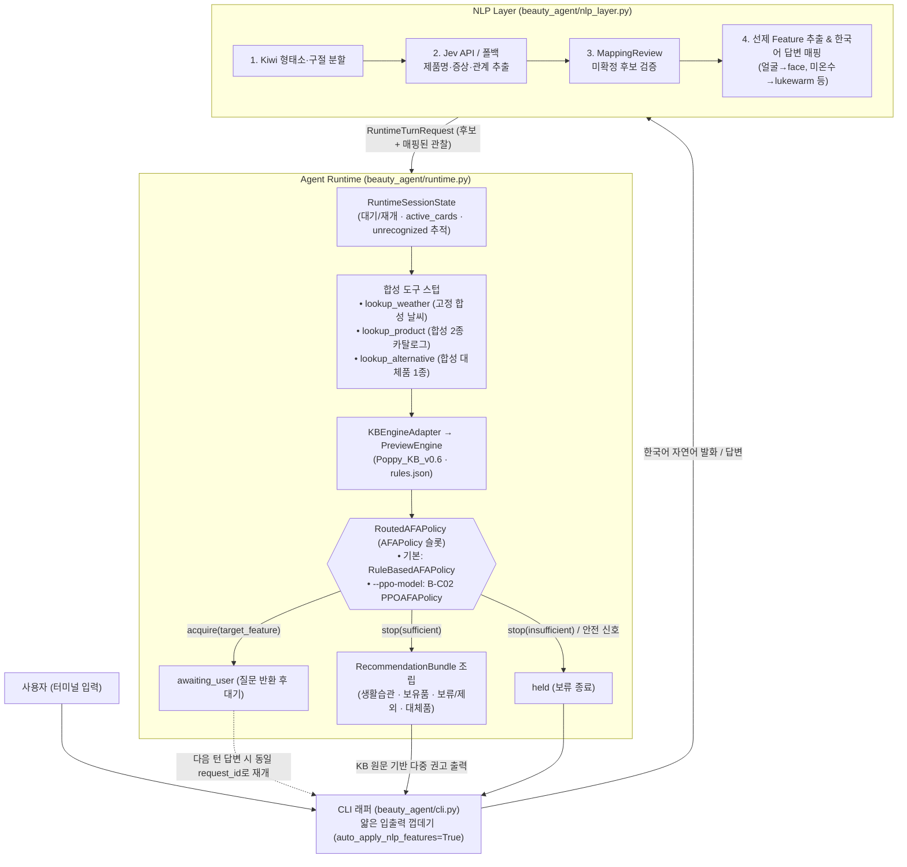
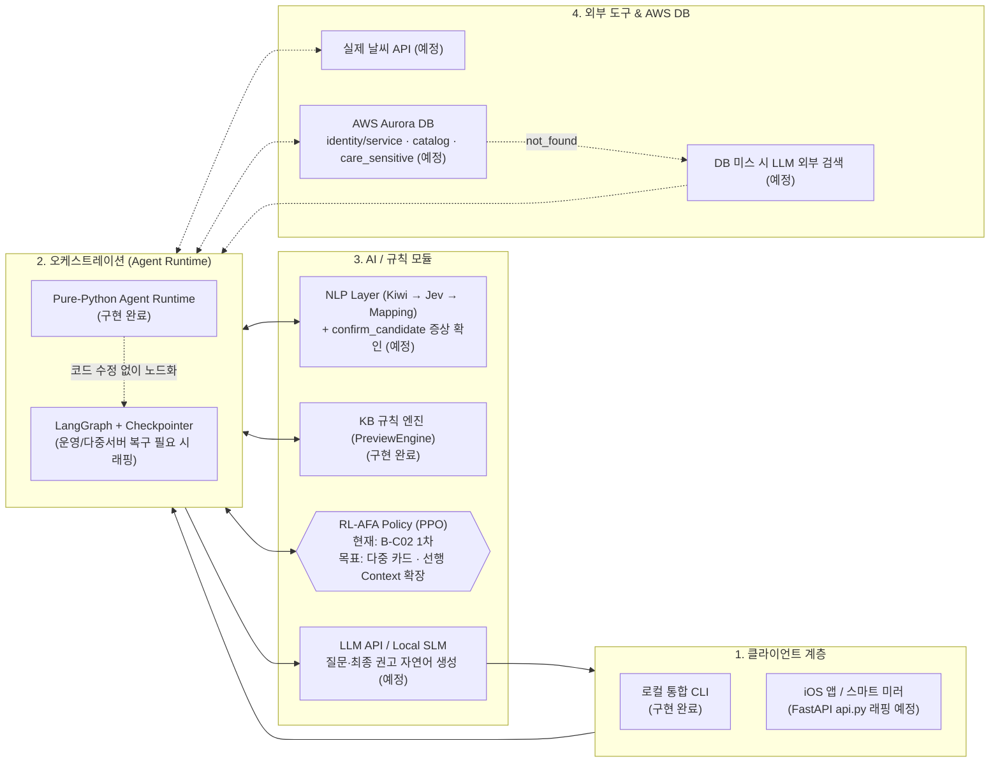

# Agent Runtime 아키텍처 — 현재 구현(As-Is) vs 청사진(To-Be)

이 문서는 `cos-agent`의 **현재까지 구현된 런타임 구조(As-Is)** 와 **목표 아키텍처 청사진(To-Be)** 을 한눈에 보기 쉽게 정리한 시각 자료입니다.

---

## 1. 현재까지 구현된 아키텍처 (As-Is · 실행 가능)

지금 `uv run --locked python -X utf8 -m beauty_agent.cli` 및 `pytest`(66개 통과)로 실제로 동작하는 구조입니다.

---

## 2. 전체 아키텍처 청사진 (To-Be · 목표 구조)

현재 구현된 코어(실선) 위에 앞으로 단계적으로 붙일 확장 계층(점선)을 합친 목표 구조입니다.

---

## 3. 구현 완료 vs 남은 청사진 요약

| 계층 | 현재 구현 완료 (`As-Is`) | 청사진 남은 작업 (`To-Be`) |
| --- | --- | --- |
| **인터페이스** | [cli.py](../beauty_agent/cli.py) 로컬 멀티턴 CLI | FastAPI(`api.py`) 연결 → iOS 앱 연동 |
| **NLP** | [nlp_layer.py](../beauty_agent/nlp_layer.py) (`Kiwi→Jev→Mapping`, 선제 추출, 한국어 답변 매핑) | `confirm_candidate` 증상 확인 루프 연결 |
| **Runtime** | [runtime.py](../beauty_agent/runtime.py) (상태·대기/재개·KB·PR#17 보완·`RecommendationBundle`) | `nlp.product_queries` → 제품 조회 연결, 운영 시 LangGraph 래핑 |
| **AFA Policy** | `RuleBasedAFAPolicy` + `B-C02` [policy_adapter.py](../beauty_agent/afa/policy_adapter.py) | 다중 카드 + 선행 Context 확장 PPO 학습 (Codex 병행) |
| **도구 · 출력** | 합성 날씨·카탈로그(2종)·대체품(1종) + KB 원문 출력 | 실제 날씨/Aurora DB/LLM 검색 + LLM/SLM 자연어 문구 생성 |
