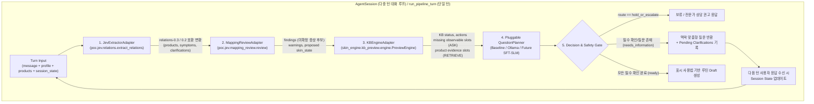

# 에이전트 모듈형 파이프라인 및 대화 루프(Loop) 구현 계획

## Goal Description

QLoRA 모델 학습을 진행하기에 앞서, **에이전트의 전체적인 골격(Skeleton)과 단일/다중 턴 대화 루프(Loop)**를 먼저 모듈화하여 구축합니다.
각 단계(**자연어 추출 → 피부 상태 매핑 검증 → KB 슬롯/라우팅 평가 → 질문 생성기 → 상태 업데이트/초안 생성**)를 독립적인 어댑터와 인터페이스로 분리하여, 지금은 규칙 기반 또는 로컬 Ollama로 즉시 동작하고 추후 학습된 **SFT-SLM 어댑터만 플러그인처럼 끼워 넣을 수 있는 구조**를 완성합니다.

---

## User Review Required

> [!IMPORTANT]
> **하위 호환성 및 저장소 규칙(`AGENTS.md`) 보장**
> 1. **기존 API 및 테스트 100% 보존**: 기존 `POST /v1/agent/turn`과 `run_turn`, `test_agent.py`의 동작은 그대로 통과하도록 유지합니다.
> 2. **원본 KB 및 매니페스트 불변**: `skin_engine/kb_preview/engine.py`나 `KB/Poppy_KB_v0.6/` 원본 파일은 수정하지 않고, `beauty_agent` 내부의 어댑터(`kb_adapter.py`)에서 import하여 호출합니다 (`mode="development_preview"`, `production_enabled=False` 유지).
> 3. **권한 경계 유지**: Jev 추출값과 Mapping Review 후보(`candidate_requires_user_and_time_confirmation`)는 **사용자 확인 전까지 확정 사실(`confirmed`)로 자동 승격하지 않으며**, 에이전트 루프가 이를 확인하기 위한 후속 질문(`clarification` / `KB question`)을 생성하도록 연결합니다.

---

## 전체 아키텍처 및 에이전트 루프 구조



---

## Proposed Changes

모든 변경 및 신규 파일은 `courses/ai-applications/experiments/cos-agent/` 내부에 구성합니다.

### 1. 데이터 계약 및 파이프라인 컨텍스트 정의 (`beauty_agent/contracts.py`)

#### [MODIFY] contracts.py
기존 `TurnRequest`, `TurnResponse`, `Profile`, `OwnedProduct`, `Question`, `Draft`를 그대로 유지하면서, 파이프라인 각 단계의 입출력과 다중 턴 세션 상태를 담는 계약을 추가합니다.

```python
class ObservationSlot(Contract):
    variable_id: str
    state: Literal["known", "unknown", "not_asked", "declined", "conflicting", "not_applicable"] = "unknown"
    value: str | bool | list[str] | None = None
    source: Literal["user_report", "synthetic_fixture", "automated_extraction"] = "user_report"
    confirmed_by_user: bool = False


class PipelineTrace(Contract):
    """매 턴마다 4개 모듈이 판단한 근거를 투명하게 기록하는 트레이스"""
    jev_products: list[str] = Field(default_factory=list)
    jev_symptoms: list[dict] = Field(default_factory=list)
    jev_clarifications: list[str] = Field(default_factory=list)
    mapping_findings: list[dict] = Field(default_factory=list)
    mapping_warnings: list[str] = Field(default_factory=list)
    kb_evaluated_cards: list[str] = Field(default_factory=list)
    kb_missing_ask_slots: list[str] = Field(default_factory=list)
    kb_retrieve_slots: list[str] = Field(default_factory=list)
    selected_route: Literal["ask_user", "retrieve_product", "hold_or_escalate", "ready_for_draft"]


class PlannerOutput(Contract):
    """질문 생성 모듈(Baseline / Ollama / 향후 SFT-SLM)의 공통 출력 인터페이스"""
    route: Literal["ask_user", "retrieve_product", "hold_or_escalate"] = "ask_user"
    target_slot: str = Field(default="general", max_length=100)
    question_id: str = Field(default="contextual_followup", max_length=100)
    question_ko: str = Field(min_length=1, max_length=500)
    reasoning_summary: str = Field(default="", max_length=500)
```

---

### 2. 4대 핵심 모듈 어댑터 구현 (`beauty_agent/modules/`)

각 하위 시스템(`poc/jev`, `mapping_review`, `skin_engine/kb_preview`)의 스키마 차이를 흡수하고 깔끔한 인터페이스로 연결하는 어댑터 계층을 만듭니다.

#### [NEW] jev_adapter.py
- 사용자의 자연어 `message`를 `poc.jev.relations.extract_relations`에 통과시켜 제품(`products`), 증상(`symptoms`), 불확실성(`clarifications`), 경고(`warnings`)를 추출합니다.
- **스키마 브리지 역할**: 현재 `extract_relations()`는 `relations-0.3`을 반환하고 `mapping_review/review.py`는 `relations-0.2` 헤더를 검사하므로, 어댑터에서 안전하게 호환 뷰(`to_mapping_review_features`)를 생성해 전달합니다.

#### [NEW] mapping_adapter.py
- Jev 추출 결과와 현재 세션의 `skin_state` 스냅샷 초안을 `poc.jev.mapping_review.review.review`에 전달합니다.
- `candidate_requires_user_and_time_confirmation`으로 판정된 증상(`stinging`, `itching`, `redness_tendency`)이나 `no_direct_skin_state_field`(`severity`, `onset_time` 등)를 추출하여 **사용자에게 재확인이 필요한 후보 목록**으로 변환합니다.

#### [NEW] kb_adapter.py
- `skin_engine.kb_preview.engine.PreviewEngine`을 로드하여 현재까지 확인된 관찰 사실(`facts`)을 기반으로 관련 KB 카드(예: 세안 `B-C01~C04`, 보습 `B-M01~M04`, 자극/장벽 `B-B01`, `B-H01` 등)를 평가합니다.
- 평가 결과에서:
  - **`ask_slots` (`ASK`)**: `consumer_question_allowed == True`이고 아직 `unknown`인 사용자 관찰 슬롯과 KB 기본 질문 가이드를 수집합니다.
  - **`retrieve_slots` (`RETRIEVE`)**: `product.*`이거나 `retrieve_product_evidence` 액션에 해당하는 슬롯을 분리하여, 질문 생성기가 **사용자에게 절대 역질문하지 않도록** 컨텍스트에 명시합니다.
  - **`hold_signals`**: `refer_for_professional_review` 또는 `defer_specific_recommendation`이 발생한 경우 보류 신호를 반환합니다.

---

### 3. 교체 가능한(Pluggable) 질문 플래너 인터페이스 (`beauty_agent/planner.py`)

#### [MODIFY] planner.py
- 기존 `select_question(message, questions)` 함수는 그대로 유지합니다.
- 새로 **`QuestionPlanner` 프로토콜(인터페이스)**과 구현체들을 추가합니다:
  1. **`RuleBasedContextualPlanner` (`baseline`)**:
     - 우선순위 규칙: (1) KB 보류/위험 신호 확인 → (2) Jev/Mapping Review의 미확정 증상·시점·제품 인과 명확화 질문 → (3) 에이전트 필수 구조적 블로커(`confirm_profile`, `add_products` 등) → (4) KB의 누락된 관찰 가능 슬롯(`ask_slots`) 질문 생성.
  2. **`OllamaContextualPlanner` (`ollama`)**:
     - 구조화된 파이프라인 컨텍스트(`message`, `jev_summary`, `mapping_findings`, `kb_ask_slots`, `forbidden_retrieve_slots`)를 프롬프트로 전달하고 `PlannerOutput` JSON(`route`, `target_slot`, `question_ko`, `reasoning_summary`)을 생성합니다.
  3. **`SFTAdapterPlanner` (향후 학습 모델 슬롯)**:
     - 추후 QLoRA 학습이 완료되면 동일한 `QuestionPlanner.plan(context) -> PlannerOutput` 시그니처로 어댑터만 주입할 수 있는 추상 클래스/스텁을 제공합니다.

---

### 4. 다중 턴 에이전트 루프 및 세션 매니저 (`beauty_agent/loop.py` & `agent.py`)

#### [NEW] loop.py
다중 턴 대화 상태(`SessionState`)를 관리하고 매 턴마다 파이프라인을 실행하는 `AgentSession` 클래스를 구현합니다:

- **`SessionState`**:
  - `turn_index`: 현재 턴 번호
  - `profile`: `Profile` 상태
  - `products`: 보유 제품 목록
  - `confirmed_observations`: 사용자 확인이 완료된 KB 관찰 슬롯(`dict[str, ObservationSlot]`)
  - `pending_clarifications`: Jev/Mapping Review에서 발견되어 아직 사용자 확인을 기다리는 항목들
  - `history`: 각 턴의 사용자 발화, 생성된 질문, `PipelineTrace` 기록
- **`AgentSession.step(message: str, ...) -> TurnResponse`**:
  1. 사용자의 새 발화(`message`)로부터 `JevExtractorAdapter` 실행
  2. 이전 턴에서 물어본 `pending_clarifications`나 미확인 슬롯에 대한 답변이 들어왔는지 상태 갱신
  3. `MappingReviewAdapter` 실행하여 피부 상태 매핑 검증
  4. `KBEngineAdapter` 실행하여 KB 카드 평가 및 `ASK` / `RETRIEVE` / `HOLD` 슬롯 도출
  5. `QuestionPlanner`를 호출하여 이번 턴의 최적 후속 질문(`PlannerOutput`) 생성
  6. 모든 필수 블로커와 핵심 확인 사항이 해소되면 루틴 `Draft` 생성, 아니면 `needs_information` 상태와 맥락 질문 반환

#### [MODIFY] agent.py & api.py
- 기존 `run_turn(request: TurnRequest) -> TurnResponse`는 100% 하위 호환성을 유지합니다.
- 전체 4단계 모듈 파이프라인과 트레이스를 함께 반환하는 `run_pipeline_turn(request)` 및 데모용 CLI 대화 루프 실행기(`python -m beauty_agent.loop`)를 추가합니다.

---

## Verification Plan

### Automated Tests
1. **신규 모듈 및 루프 단위/통합 테스트 (`tests/test_agent_loop.py`)**:
   - **단일 턴 파이프라인 테스트**: 복합 발화(예: `"어제 밤에 약산성 폼클렌저로 바꾸고 나서 볼이 따가워"`)가 들어왔을 때 `Jev -> Mapping Review -> KB Engine -> QuestionPlanner`가 순서대로 동작하고 `PipelineTrace`에 정확히 기록되는지 검증
   - **`ASK` vs `RETRIEVE` 경계 테스트**: 제품 성분/농도/pH 관련 발화가 들어왔을 때 `kb_retrieve_slots`로 분리되고 사용자에게 비공개 제품 스펙을 역질문하지 않는지 검증
   - **다중 턴 루프(`AgentSession`) 상태 전이 테스트**:
     - Turn 1: 증상 및 제품 발화 → 시점/증상 확인 질문 생성 (`needs_information`)
     - Turn 2: 사용자 확인 및 누락 슬롯 응답 → 프로필/제품 확인 완료 후 최종 `draft` 도달 확인
   - **Pluggable Planner 교체 테스트**: Mock SFT-SLM Planner를 주입했을 때 루프 코드 수정 없이 질문 생성기가 교체되는지 검증
2. **전체 회귀 테스트 실행**:
   ```powershell
   # cos-agent 전체 단위 테스트 (기존 58개 + 신규 루프 테스트)
   uv run pytest
   # 원본 소스 매니페스트 해시 무결성 검증 (27/27)
   python tools/verify_source_manifest.py
   # KB 57 시나리오 동결 감사 검증
   python tools/run_kb_57_audit.py
   ```

### Manual Verification
- 터미널에서 대화형 데모 루프(`uv run python -m beauty_agent.loop --demo`)를 실행하여 다중 턴 시나리오에서 각 모듈(Jev, Mapping Review, KB, Planner)의 중간 트레이스와 최종 생성 질문을 직접 확인할 수 있습니다.
