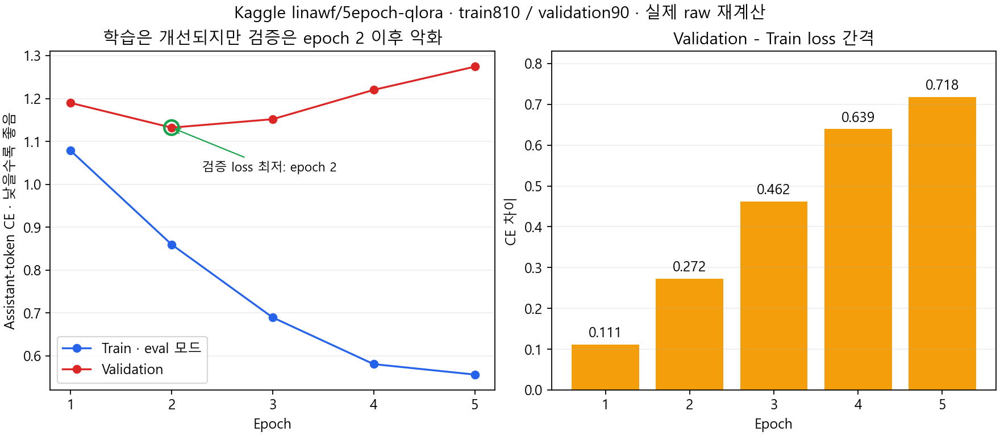
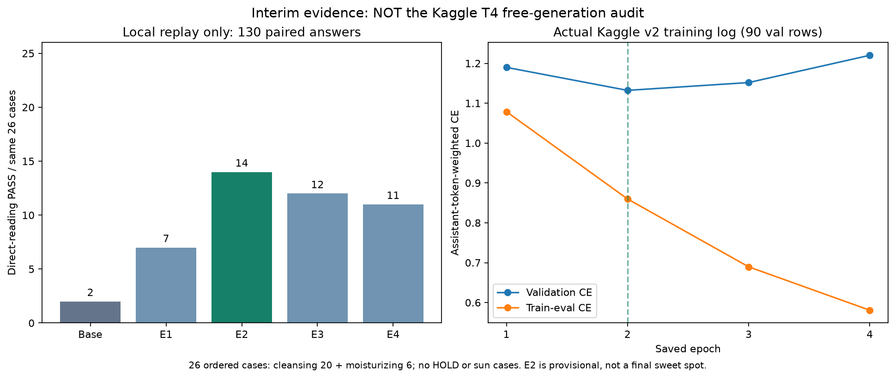

# QLoRA 학습·Early stopping·raw 답변 검수 기록 — 팀원 검증용

**모델 파일 없이 실제 설정·loss·출력·검수 근거를 공유하는 중간 기록이에요.**
가중치, optimizer 상태, 토크나이저, 원문 PDF, 자격 증명은 포함하지 않아요.
`development_preview`, `production_enabled=false`를 유지해요. 기존 데이터셋·KB·엔진은 수정하지 않아요.

## 먼저 확인할 정정과 범위

1. **초기 학습률을 낮춘 실행이 아니에요.** 기존 Kaggle Version 1과 Early stopping Version 2 모두 `learning_rate=0.0001`이에요. `2e-4 → 1e-4` 실험이라고 부르면 안 돼요. 두 원본 `config.json`을 확인해 주세요.
2. Version 1은 5 epoch, Version 2는 최대 5 epoch 설정에서 validation loss 2회 연속 비개선으로 **4 epoch 뒤 중단**, loss 기준 선택은 **epoch 2**예요.
3. **직접 읽은 133개 raw는 실제 Kaggle v2 어댑터를 로컬 WSL vLLM/NF4/BF16으로 재생한 답변**이에요. Kaggle T4/Transformers/NF4/FP16 답변으로 표현하지 않아요.
4. 완전한 5모델 비교는 **동일 26개 사례 × 5 = 130개 답변**이에요. 27번째 사례는 Base/E1/E2만 있어 3개를 추가 검수했지만 순위 비교에서는 제외해요. 26개는 세정 20+보습 6, 세 계열의 순서상 앞부분이며 HOLD·자외선은 없어요.
5. 이 기록 작성 시 새 Kaggle T4 생성 실행은 진행 중이었어요. **Kaggle T4 450개 의미 전수검수·최종 sweet spot·사람 승인·Cross-Model Critic 완료가 아니에요.** 상태 파일은 해당 UTC 시각의 스냅샷이지 실시간 상태판이 아니에요.

## 팀원이 바로 볼 자료

| 자료 | 검증할 내용 |
|---|---|
| [로컬 raw 비교 HTML](local_replay/review.html) | 다운로드 후 브라우저에서 열면 사례별 실제 입력·문헌·Base/E1~4 원문과 판정 이유를 나란히 볼 수 있어요. GitHub에서는 HTML 소스만 보일 수 있어요. |
| [답변별 검수 CSV](local_replay/manual_reviews.csv) · [JSONL](local_replay/manual_reviews.jsonl) | 133개 판정, 문제 구절, 근거 구절, 둘의 연결 이유, 대상 응답 SHA-256이에요. |
| [수정하지 않은 생성 raw](local_replay/raw_answers.jsonl) | 실제 text·모델 tag·토큰·지연·내용 해시. 자동 후보 플래그는 의미 정답 판정이 아니에요. |
| [동일 26개 판정표](local_replay/semantic_summary.json) · [사례별 변화](local_replay/case_progression.csv) | 비교는 `balanced_per_model`을 사용해요. 미완성 27번째 사례가 포함된 전체 개수를 모델 순위 분모로 쓰지 않아요. |
| [전체 검증 입력 90개](local_replay/validation_inputs.json) | 교사 답변과 생성 답변을 구분하고, 실제 생성에는 system+user만 사용했는지 확인해요. |
| [기존 설정](training_v1_5epoch/config.json) · [재실행 설정](training_v2_early_stopping/config.json) | 두 초기 학습률이 같은지, Early stopping만 어떻게 달라졌는지 확인해요. |
| [기존 epoch 기록](training_v1_5epoch/epoch_history.json) · [재실행 기록](training_v2_early_stopping/epoch_history.json) | loss, 토큰, 업데이트, 시간, FP16 skipped update 수를 확인해요. |
| 각 학습 폴더의 `history/epoch-*/{train_eval_losses,val_losses}.jsonl` | 실제 행별 assistant loss와 토큰 수로 집계 loss를 재계산할 수 있어요. teacher-forced CE이지 자유 생성의 내용 정확도가 아니에요. |
| [Early stopping 결과](training_v2_early_stopping/early_stopping.json) | best_epoch=2, stopped_epoch=4, patience=2, min_delta=0을 확인해요. |
| [체크포인트 메타데이터](checkpoint_metadata) | 별도 수령한 어댑터를 원본 COMPLETE.json의 SHA-256과 대조할 수 있어요. 메타데이터에 파일명이 있어도 실제 가중치가 Git에 들어 있다는 뜻은 아니에요. |
| [Kaggle 입력 대조 기준](kaggle_t4_pending/case_input_review_criteria.jsonl) | 90개 입력을 읽고 정리한 검수 초점이에요. **새 출력의 PASS/FAIL 판정이 아니에요.** |

## 학습 설정과 실제 loss

원본 모델은 `Qwen/Qwen3-4B-Instruct-2507`, 고정 revision은
`cdbee75f17c01a7cc42f958dc650907174af0554`예요.
900건 중 train 810건만 학습, val_internal 90건은 개발 검증·checkpoint 선택용이며 독립 최종 test가 아니에요.
데이터 SHA-256은 `99182590f83bc3dad9e3cb71c9153f418642b6aaf7d97ebcc728ac68d0425cac`예요.

두 실행 모두 초기 LR 1e-4, cosine scheduler, warmup 0.03, batch 1×gradient accumulation 8,
NF4/double quant/FP16, LoRA r16·alpha32·dropout0.05, max_seq_length2048이에요.
scheduler 때문에 실행 중 LR은 변하지만 초기 LR 인하 비교 실험은 아니에요.

| Epoch | Train-eval CE | Validation CE | Version 2 |
|---|---:|---:|---|
| 1 | 1.078731 | 1.189842 | 완료 |
| 2 | 0.859810 | **1.132167** | loss 최저 |
| 3 | 0.689622 | 1.151760 | 비개선 1회 |
| 4 | 0.580731 | 1.220122 | 비개선 2회·저장 후 종료 |
| 5 | 0.556446 | 1.274232 | **Version 1만 존재** |

두 실행의 E1~4 loss 값은 같지만 실행 시간·run fingerprint는 달라요.
훈련 loss는 내려가고 검증 loss는 E3부터 올라가는 패턴은 과적합 징후지만,
특정 답변 오류의 원인을 학습률·양자화·데이터 중 하나로 인과 확정한 대조 실험은 아니에요.



## 로컬 raw 비교 — 현재의 제한적 결론

| 모델 | PASS | 논리·사실·출처 FAIL | 안내 누락·형식만 FAIL | 미확정 |
|---|---:|---:|---:|---:|
| Base | 2 | 22 | 2 | 0 |
| E1 | 7 | 16 | 3 | 0 |
| E2 | 14 | 11 | 1 | 0 |
| E3 | 12 | 13 | 1 | 0 |
| E4 | 11 | 12 | 2 | 1 |

이는 Codex가 실제 원문을 읽고 기록한 **단일 검수자의 루브릭 판정**이지,
독립 전문가 정답·팀원 승인·Cross-Model Critic·일반 정확도·임상 성능이 아니에요.
FAIL에는 잘못된 안내 외에 누락·잘못된 인용 연결·형식 위반도 있어요.
E2는 이 부분집합의 후보일 뿐 최종 선택이 아니며, E1부터 오류가 있고 E3/E4에서 회복하는 사례도 있어요.



### raw 연결 예시 1 — E2에서 개선 후 다시 다른 오류

`syn-sol-0212` 입력은 `가루가 남은 손으로 얼굴에서 비비기`, 문헌은
`먼저 손에 묻은 오염물을 씻고`예요. 제품 정보는 빈 목록이에요.

- E1: `순서는 바꾸지 않아요.` 다음에 `손에 묻은 가루를 먼저 씻고 얼굴을 씻는 순서로 바꿔 보세요.` → 유지와 변경이 한 답변 안에서 모순돼요.
- E2: `손가락에 묻은 가루를 얼굴에서 비비기 전에 손을 먼저 씻어 보세요.` → 입력을 문헌 순서에 연결해요.
- E3: `손에 묻은 물을 먼저 씻고` / `이 제품의 제거 성능` → 오염물을 물로 바꾸고 미제공 제품을 전제해요.
- E4: `손에 묻은 물을 씻고` → 핵심 안내 방향이 맞아도 근거 설명이 달라져요.

전체 입력과 답변은 [사례 2 원문](local_replay/cases/002_syn-sol-0212.json)에 있어요.

### raw 연결 예시 2 — E2도 최선이 아닌 반례

`syn-sol-0227` 새 제품 자료는 `새 제품 용도와 물 마무리 확인.`이에요.
E2는 앞에서 `새 제품은 얼굴에 쓰고 물로 마무리하는 젤이에요.`라고 하고 뒤에서
`사용 뒤 물 마무리 지시를 확인한 것은 아니에요.`라고 뒤집어요.
E3/E4는 확인된 물 헹굼을 유지해 PASS예요.
[사례 17 전체 원문](local_replay/cases/017_syn-sol-0227.json)을 대조해 주세요.

### 팀원에게 특히 재검토를 부탁하는 판정

- 맞는 안내지만 인용이 없다는 이유의 FAIL을 논리 오답과 구별해 주세요.
- `젤형 클렌저는 … 헹구도록 되어 있어요`처럼 두 교육 예시를 일반 규칙으로 넓힌 범위 판정,
  화장수 문헌을 로션 주장에 붙인 인용 정합성 판정에는 해석 차이가 있을 수 있어요.
- 오타만으로 추론 실패를 과대평가하지 말고, 실제 행동·표시·안내 순서에 미치는 영향도 봐 주세요.
- 교사 답변도 사실의 권위로 쓰지 않아요. 예를 들어 syn-hold-0132 교사 답변의 상자 유출 위치는 입력에 없으므로 생성 답변의 사실 근거로 삼으면 안 돼요.
- 반박·수정 판정은 기존 raw나 과거 검수 기록을 덮어쓰지 말고, 대상 응답 해시와 함께 새 검토 파일에 남겨 주세요.

## 모델 없이 실행하는 검증

이 폴더에서 실행해요. Python 표준 라이브러리만 사용하며 학습·모델 다운로드·GPU 추론·외부 전송은 하지 않아요.

```bash
python verify_artifacts.py
```

포함 파일 해시, 810/90 분할, 행별 loss의 토큰 가중 집계, 두 초기 학습률,
133개 응답/검수의 해시 및 인용 구절 연결, 동일 26개 판정 합계를 검사해요.
**인용 구절이 실제 존재하는지 검사하는 것과 주장에 충분한 근거인지 판단하는 것은 달라요.**
이 스크립트는 새 의미 PASS를 생성하지 않아요.

그래프를 raw 집계로 다시 그리려면 matplotlib 환경에서 아래 명령을 사용해요.
기존 그래프를 덮어쓰지 않도록 별도 출력 경로를 지정해 주세요.

```bash
python rebuild_figures.py --output reproduced_loss_and_review.png
python -m pytest reproduce/tests -q
```

공유 전 작은 CPU 모델을 포함한 Early stopping 경계·재개 검사 **15개가 통과했어요**.
이는 실제 4B 모델을 새로 학습하거나 출력 의미를 재승인한 검사가 아니에요.
실행 환경과 확인 범위는 [검사 기록](checks/verification_environment.json)에 있어요.
소스 매니페스트는 원본 LF 바이트에서 `checked=27, failed=[]`를 확인했어요.
Windows 자동 CRLF 체크아웃은 바이트 해시를 바꿀 수 있어요. 이 경우 소스 내용이나
매니페스트를 재작성하지 말고 원본 Git 바이트와 줄바꿈을 대조해 주세요.

`reproduce/`에는 실제 학습 source와 early-stopping 준비 노트북, 작은 CPU 모델 경계 테스트,
Kaggle 추론 전용 노트북·runner를 넣었어요. 기본 Early stopping 준비본은 `RUN_TRAINING=False`예요.
모델을 다시 실행하려면 별도 가중치/원본 입력 패키지/환경이 필요하며, 이 자료만으로 새 GPU 검증을 수행했다고 주장하지 않아요.
`original_*` helper는 원래 `outputs/` 경로를 보존한 이력용이며 새 체크아웃의 실행 진입점이 아니에요.

## Kaggle 원본과 후속 작업

- 학습 원본: <https://www.kaggle.com/code/linawf/5epoch-qlora> — Version 1/2를 구분해요.
- 별도 추론 실행: <https://www.kaggle.com/code/linawf/ppopy-raw-checkpoint-continuation> — Version 2.
- 비공개 실행은 팀원 계정에 별도 접근 권한이 필요할 수 있어요. 이 PR로 계정 권한을 변경하지 않아요.
- T4 새 생성은 로컬에 없던 답변을 먼저 만들고 기존 답변도 같은 T4 조건으로 재생성해 450개 비교 조건을 맞춰요.
- 새 T4 응답에 기존 로컬 PASS를 자동 복사하지 않아요. 현재 포함된 90개 입력 기준은 출력 검수 결과가 아니에요.
- 파일별 크기·SHA-256은 `artifact_manifest.json`, 원본 복사 내역은 `copy_receipts.json`에 있어요.
- [Reference RAG 출처·재사용·귀속 조건](../../../../data/rag/SOURCES.md)을 유지해요. 원문 PDF는 Git에 넣지 않아요.

가중치는 이 패키지에 없어요. 이전 로컬 2 epoch/Hugging Face 어댑터를 이번 Kaggle v2 어댑터와 같은 파일로 혼동하지 말고,
별도 수령한 가중치의 COMPLETE.json SHA-256을 대조해 주세요.
