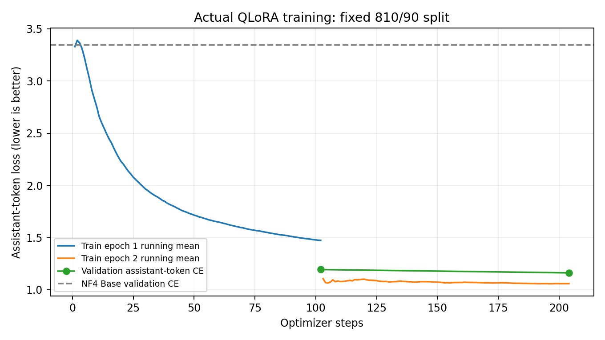

# Qwen3-4B RAG-free QLoRA 학습·개발 검증 결과

실제 실행 로그를 집계했어요. 810건만 학습하고 90건은 epoch 선택에 재사용한 개발 검증이에요. 독립 최종 test나 임상 성능 평가가 아니에요. 가중치는 로컬에만 보관하며 업로드하지 않았어요.

| 모델 | val token loss | 인용 허용 목록 위반/90 | solution 인용 누락/60 | KB 인용/90 | 방해 ID 인용/20 | HOLD 지시 regex 후보/30 | 길이 제한 도달/90 |
|---|---:|---:|---:|---:|---:|---:|---:|
| base | 3.34636 | 0 | 50 | 0 | 0 | 13 | 64 |
| epoch-1 | 1.19354 | 0 | 0 | 0 | 0 | 0 | 0 |
| epoch-2 | 1.16187 | 0 | 0 | 0 | 0 | 0 | 0 |

자동 지표와 val loss 기준 선택: **epoch-2**. 선택 규칙: `fewest deterministic safety/citation violations, then lowest val token loss; semantic review reported separately`.

## 해석의 경계

ID/regex 검사는 인용의 의미 정합성, 방해 내용의 간접 언급, 사실 발명·비진단 준수를 완전히 판정하지 못해요. `semantic_review.jsonl`의 실제 내용 검수와 raw 응답을 함께 봐야 해요. 검수가 없으면 해당 지표는 미검수이며 0%/PASS로 채우지 않아요. runtime fallback은 모델의 정답으로 세지 않아요.

실제 기록된 내용 검수는 `semantic_review.jsonl`에 있어요. 검수 범위·근거·불확실성을 각 행에서 확인해요.

**내용 검수: 모델 응답 6/270개, 고유 상황 2/90개. 전수 검수 완료: False. 사람 승인: false.**

| 모델 | 실제 내용 검수 | PASS | FAIL | 미확정 | 남은 응답 |
|---|---:|---:|---:|---:|---:|
| base | 2 | 0 | 2 | 0 | 88 |
| epoch-1 | 2 | 1 | 1 | 0 | 88 |
| epoch-2 | 2 | 1 | 1 | 0 | 88 |

초기 일부 행의 결과를 전체 오류율로 일반화하지 않아요. 안내와 근거의 모순도 검출돼 자동 지표만으로 최종 checkpoint를 승인하지 않아요.

## 실제 HTTP 서빙 측정

상세 지연·timeout·fallback 및 백엔드는 `http_summary.json`과 raw 기록을 보세요. 클라이언트 상한은 15초/64KiB이며 fallback을 모델 성공에 포함하지 않아요.

| 모델 | 실제 모델 응답/9 | timeout/9 | 클라이언트 p50 초 | 클라이언트 p95 초 |
|---|---:|---:|---:|---:|
| ppopy-base-nf4 | 0 | 9 | 15.013 | 15.017 |
| ppopy-epoch-2 | 8 | 1 | 12.355 | 15.010 |

시간제한 fallback의 약 15초를 성공한 모델 응답시간으로 해석하지 않아요. 이 9건은 전체 90건이나 사용자 모집단의 지연 보장이 아니에요.

## 실제 GPU 메모리 표본

학습 PyTorch allocated 최고 5261.5 MiB, reserved 최고 7566.0 MiB예요. 아래는 모델 단독이 아니라 다른 앱·데스크톱도 포함한 GPU 전체 2초 표본이에요. 순간 최고를 보장하지 않아요.

| 구간 | 표본 수 | 전체 GPU 메모리 중앙값 MiB | 표본 최고 MiB |
|---|---:|---:|---:|
| training_optimizer_interval | 6262 | 7648.0 | 7830.0 |
| throughput_probe | 23 | 6940.0 | 7072.0 |
| vllm_quality | 589 | 7014.0 | 7122.0 |
| http_benchmark | 128 | 7043.0 | 7179.0 |

RAG 두 모델과의 동시 상주 시험은 이 기록에 없어요.
