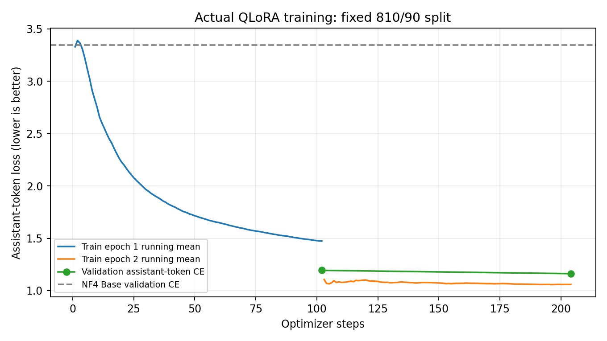
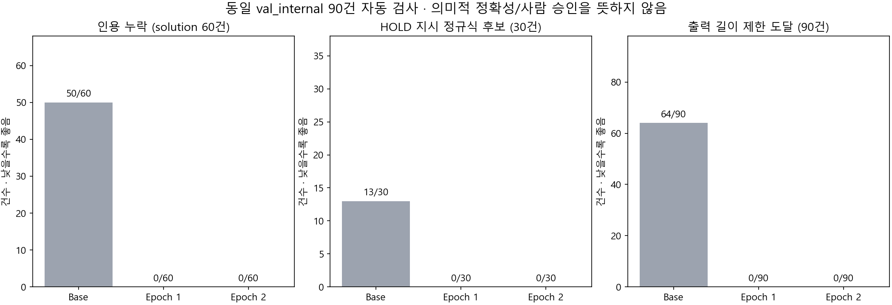
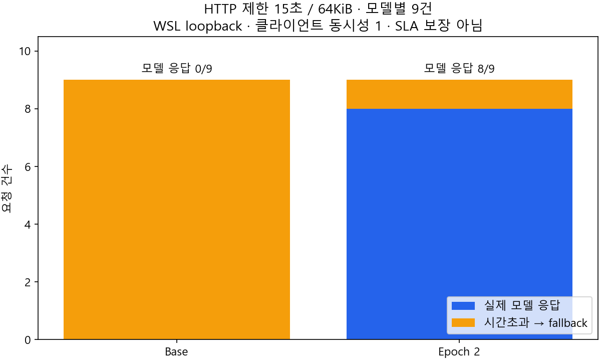

# 로컬 Qwen3-4B QLoRA · 팀원 검수 패키지

**실제 2 epoch 학습·Base/각 epoch 90건 생성 결과이며, 가중치는 별도로 전달해요.** Kaggle 5 epoch 결과가 아니에요. 모델 출력의 의미 전수 검수와 사람 승인은 미완료예요. 학습 데이터의 기존 승인과 새 모델 출력의 승인은 구분해요. production_enabled=false를 유지해요.

## 먼저 볼 파일

1. [실측 비교·한계](METRICS.md): loss, 인용 형식, HOLD 정규식 후보, timeout, VRAM.
2. [실제 출력 변화·반례](RAW_OUTPUT_PROGRESSION.md): 동일 입력의 Base→Epoch 1→Epoch 2 전체 출력 6개와 raw 근거·해석. 한 사례는 Epoch 2에서 오히려 안내와 근거가 충돌해요.
3. [검수 요청 Base 90건](raw/run_receipts/base_review_request.jsonl), [Epoch 1 90건](raw/run_receipts/epoch-1_review_request.jsonl), [Epoch 2 90건](raw/run_receipts/epoch-2_review_request.jsonl): 입력·교사 답변·모델 생성 답변을 대조해요. 교사 답변을 모델 출력으로 오인하지 않아요.
4. `raw/*_predictions.jsonl`: 실제 생성 답변 270개와 응답별 해시·토큰·지연·자동 검사. `raw/semantic_review.jsonl`은 실제 읽은 6개 응답의 부분 검토이며 Cross-Model 또는 사람 승인으로 간주하지 않아요.
5. [체크포인트 대조표](checkpoints/manifest.json): 별도 수령할 Epoch 1/2 어댑터 가중치의 크기·해시. 원본 Qwen은 공식 고정 revision을 사용해요. 병합된 전체 모델과 optimizer/scheduler 재개 상태는 저장하지 않았으므로 제공한다고 주장하지 않아요.

## 그래프







## 검수 절차

- 모델별 같은 row_id를 비교해요. 핵심 안내·근거·미확인 한계가 서로 모순되지 않는지 확인해요.
- allowed_evidence_refs ID가 맞는 것 외에 실제 문헌이 주장을 뒷받침하는지, distractor 주제의 간접 언급, 입력에 없는 사실 발명, HOLD의 지시 누출을 읽어 확인해요.
- 판단은 row_id, 모델 tag, candidate content SHA-256, 판정, 출력 raw 구절, 근거 raw 구절, 둘의 연결 이유와 함께 별도로 기록해요. 원본 출력이나 과거 FAIL을 고쳐 쓰지 않아요.
- Base/Epoch 1/Epoch 2 모두 같은 90건이며 val_internal은 checkpoint 선택용이에요. 별도 미노출 test나 임상 성능으로 표현하지 않아요. 현재 Codex 검토는 고유 상황 2/90, 응답 6/270뿐이에요.

## 별도 가중치 수령 후 확인

`checkpoints/epoch-1/adapter_model.safetensors`, `checkpoints/epoch-2/adapter_model.safetensors` 위치에 별도 받은 파일을 놓으면 다음 명령으로 크기·해시를 확인할 수 있어요. 가중치 파일은 이 브랜치에 올리지 않아요.

```bash
python verify_artifacts.py
python verify_artifacts.py --weights-root checkpoints
```

첫 명령은 포함된 자료만 검증하고 가중치는 미포함으로 남겨요. 둘째 명령은 별도 가중치가 없거나 해시가 다르면 실패해요. inference는 PEFT로 NF4 원본 모델에 어댑터를 적용하는 방식이며 [상위 실행 안내](../../README.md)와 고정 requirements를 참고해요. 어댑터만 단독 로딩하는 전체 모델이 아니에요.

## 원본 보존과 재현 범위

- raw 파일은 복사 당시 바이트를 보존했어요. 과거 receipt의 `upload_executed=false`, `generation_evaluation_complete=false`는 **해당 시점의 상태**예요. 후속 `pipeline_status.json`, `selection.json`, 실제 270개 출력으로 완료 범위를 확인해요. 과거 receipt를 현재 상태에 맞춰 덮어쓰지 않았어요.
- `raw/archive/base_sequential_69_predictions.jsonl`은 변경 전 순차 실행의 실제 부분 결과이며 주 비교 270건에 합산하지 않아요. 속도 probe의 원본 비교는 `throughput_probe.json`에 있어요.
- 학습은 Windows Transformers NF4, 생성은 WSL vLLM NF4로 백엔드가 달라요. 일괄 생성 동시성 4와 HTTP 15초 시험 동시성 1도 구분해요. HTTP fallback은 모델의 성공 응답이 아니에요.
- 가중치/환경/캐시/전체 원문 PDF/개인정보/자격 증명은 포함하지 않아요. full source PDFs는 기존 Drive 보관 정책을 유지해요. Reference RAG 재사용·귀속은 [SOURCES.md](../../../../data/rag/SOURCES.md)를 참고해요.
- 이 패키지는 이미 실행한 결과의 공유이며 새 학습·전수 검수·사람 승인을 수행한 것이 아니에요. 파일별 크기·SHA-256은 `artifact_manifest.json`으로 대조해요.
