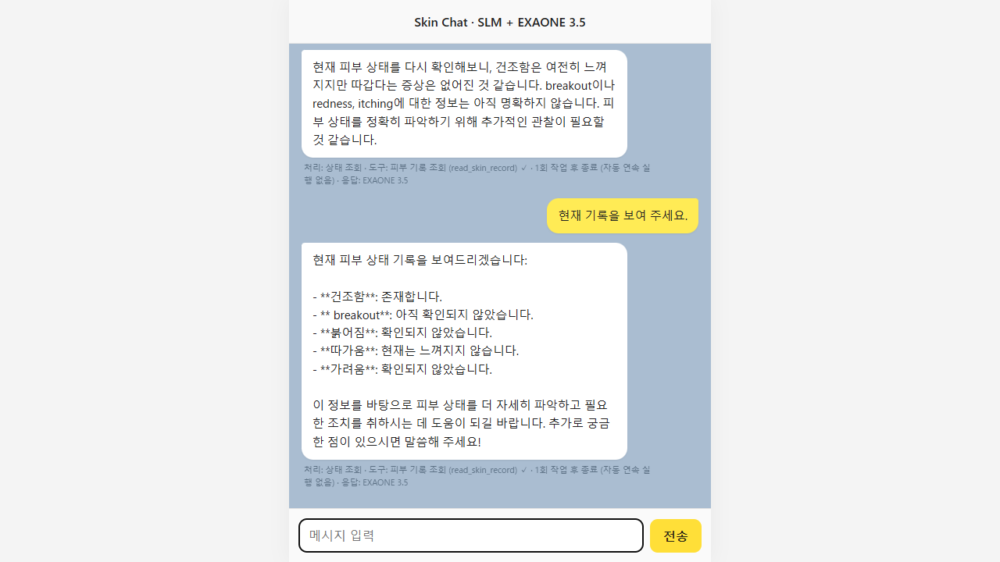

# 化粧品デモとEXAONEの比較

## デモ画面の記録

保存済みの画面キャプチャです。状態の照会と返答の表示例を示します。この画像だけでは、モデル単体の精度や34件の評価結果は証明できません。元ファイル: `output/playwright/skin-exaone35-cosmetics.png`、SHA-256: `2de6c6561a1a13917ec1a8efb9d450d46aba587428337a0c76949cd13eed0184`。

## 概要

肌の記録・照会デモとモデル接続を確認。記録まで進まない例があり、構成全体の確認と単独モデルの追加学習結果は区別する。E51は当時のAPI接続準備の記録であり、後のローカル34件比較そのものではない。

## 元の実験記録

### E33 研究用重みと標準肌デモの接続差を確認

- 内容：実際に読み込む重みと実行経路を見直し、同じ処理で比較。
- 結果：旧87/120のkotraj重みは標準肌デモで未使用。v44の動作＋状態25/34→11/34、状態だけは31/34→31/34。
- 条件・限界：Qwenの返答と小型モデルの判断は別。状態だけでは誤ったツールを見逃す。

### E51 EXAONE API用Webチャットを作成

- 内容：韓国語UI、ツールの引数/結果表示、SQLite記録、複数回呼び出しを実装。
- 結果：単体・HTTP検査6件と画面確認。実API呼び出しは未実施。キー未設定の状態まで確認。
- 条件・限界：模擬応答での機能検査。EXAONE単体で、JEV・Qwen・xLAMを裏で使用していない。

## 根拠ファイル

各記録の根拠とコピー状態は [records.json](records.json)、収録ファイルとSHA-256は [sources.json](sources.json) を参照。

このディレクトリは保存済み記録の整理です。モデル重み・データセット全体・実行環境を含む再現パッケージではありません。

## ??34???

34??????????? `sources/output/exaone35-cosmetics-v1/assistant-review-v1/` ??summary?judgments???????????????????AI???????????

## 実行に必要なファイル

[コピー済みファイル・実行の入口・不足](実行ファイルと不足.txt)
