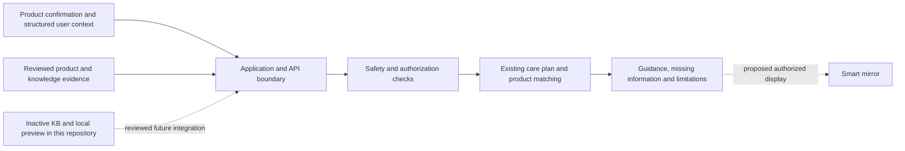

# CSE 406 — Software Engineering

Poppy and the proposed Smart Mirror interface share the product topic described in the root README. This repository supplies a reusable knowledge specification and local preview; the existing production application remains in SkinAnalysis.

## System responsibilities

The broader application's existing stack is React/TypeScript/Vite, Capacitor/iOS, Python, and AWS/PostgreSQL services. Those deployable application sources are not bundled here. The imported local preview is Python and JSON, and runs without cloud access.

## Course requirements to specify

| Area | Behavior and acceptance evidence to define |
| --- | --- |
| Product input | Confirm the product, option, market and formulation version; keep unresolved identity visible |
| User context | Reuse known information; distinguish unknown, declined, conflicting and not applicable inputs |
| Routine review | Explain the evidence and scope; keep the six-ingredient application plan distinct from product availability and the KB preview |
| Safety | Apply safety before adherence and effect; do not infer strength from severity, diagnose, or claim automatic improvement |
| Smart mirror | Show time/weather by default; presence may trigger a generic display, but personal guidance needs an authorized user context |
| Failure handling | Define offline, stale evidence, unavailable API, missing identity, session expiry and unauthorized display behavior |
| Verification | Separate synthetic preview tests, integration tests, user understanding, and release approval |

The mirror requirements above remain a proposal. Presence detection is not identity verification. A working mirror integration, hardware validation, and study outcomes have not been established by this export.

## Runnable starting point

Run the [local preview](../../skin_engine/kb_preview/README.md), inspect the [KB](../../KB/README.md), and use [verification](../../docs/verification.md) to distinguish implementation checks from open acceptance gaps. The fixture is synthetic and does not collect user information.

Course deliverables should record requirements, architecture decisions, interface contracts, failure cases and validation results. Team roles remain those already listed in the root README; no new allocation or completion approval is inferred here.
