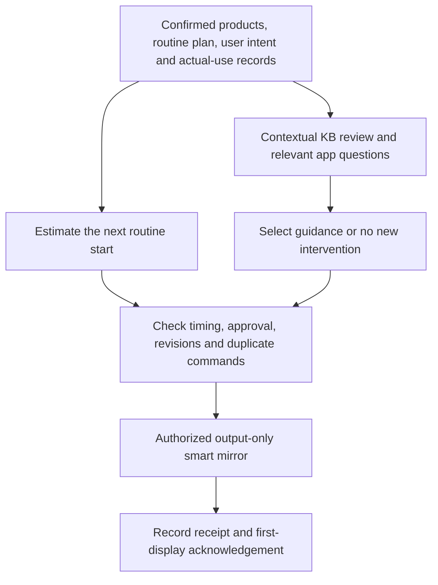

# CSE 406 — Software Engineering

Team CosMate's Ppopy project combines product confirmation, routine records and contextual KB review with proactive guidance on an authorized smart mirror.

## Phase 2 submissions

The [latest Revised LaTeX package](submissions/phase2/2026-11-06/README.md) contains two independently buildable main documents:

- [Submission A](submissions/phase2/2026-11-06/Ppopy_Submission_A.tex): proposal and functional/quality requirements.
- [Submission B](submissions/phase2/2026-11-06/Ppopy_Submission_B.tex): A plus the development environment, itemized budget, processing specifications and verification plans.

The initial presence-triggered concept remains in the [root proposal history](../../README.md#initial-proposal-concept). The latest specification estimates the next routine start from user-confirmed actual-use times and checks the upcoming routine before that start. KB findings and user intent determine whether to show guidance, ask a useful question in the app, or take no new action.

## Proposed workflow

The app handles product photos/screenshots, product confirmation, questions, edits and display approval. The mirror shows selected guidance before the estimated start and otherwise uses its time/weather screen. A review result, display command, acknowledged display and actual-use report are separate records. R1–R10 and Q1–Q3 in the submissions define account controls, evidence checks, history-based timing, expiry, failure handling and traceability.

## Implementation available here

The broader application uses React/TypeScript/Vite, Capacitor/iOS, Python and AWS/PostgreSQL services. Those deployable application sources are not bundled in this public course repository. The imported [local preview](../../skin_engine/kb_preview/README.md) uses Python and JSON without cloud access; its [KB](../../KB/README.md) remains an inactive development snapshot.

Real account authentication, cloud storage, timing/delivery integration and the physical mirror are integration targets in the submissions. For executed snapshot checks and the five open original acceptance mismatches, see [verification](../../docs/verification.md). Synthetic preview tests do not establish working mirror integration or production approval. Team roles remain those listed in the root README.
