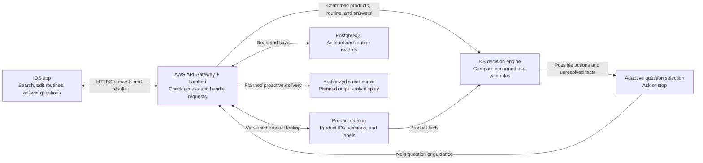
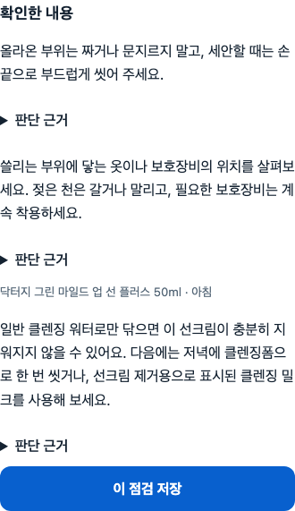
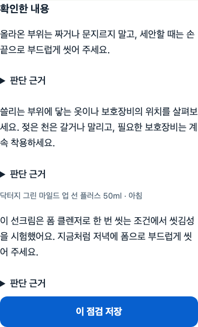

# Ppopy · Phase 2 C/D

**Team CosMate · CSE 406 Software Engineering · November 20, 2026**

Doyeong Koo, Takgeon Kang, and Geonil Won

This update continues [Submission B](../2026-11-06/Ppopy_Submission_B.tex). Its R1–R10 and Q1–Q3 identifiers are used below to connect each use case to the original specification.

## V. Architecture Design & Implementation (Partial)

### A. Overall architecture

### B. Directory organization

| Directory or location | Representative files | Module or purpose |
| --- | --- | --- |
| [`KB/Poppy_KB_v0.6.1/`](../../../../../KB/Poppy_KB_v0.6.1/) | `sunscreen_removal_review.json` | Versioned sunscreen-removal rules and exceptions |
| [`skin_engine/kb_preview/`](../../../../../skin_engine/kb_preview/) | `__main__.py` | Public entry point for running a synthetic routine check |
| [`tests/`](../../../../../tests/) | `test_kb_preview_current_spec.py` | Current-spec checks and reproduction of the historical audit |
| [`tools/`](../../../../../tools/) and [`docs/`](../../../../../docs/) | `verify_source_manifest.py`, `verification.md` | Public source integrity and reproducible checks |
| [Shared iOS source snapshot](https://github.com/rnehdud/ppopy/tree/codex/ios-app-source-share/app-snapshot) | Selected React and native source | Reference for app screens and navigation |
| Private app project, `frontend/src/` | `MirayExplore.tsx`, `MemberKbPanel.tsx` | Product search and member routine review in the deployed app |
| Private app project, `skin_engine/kb_preview/` and `db/` | `member_afa.py`, versioned SQL migrations | Member question selection, answer revision, and persistence |

### C. iOS client and product catalog · R2–R3

The client uses React and TypeScript inside a Capacitor iOS shell. Explore supports text and photo input. For an exact brand match, the client can show bundled catalog entries and then merge matching server results by product ID. Product details and routine review use the same product ID and version. Missing or conflicting ingredient labels keep the product searchable while deferring ingredient-based guidance that depends on those labels. The inventory holds owned products, and the morning and evening routines record the products actually selected for use.

### D. Knowledge base and adaptive questions · R4–R6

The Python engine compares confirmed use information with cleansing, moisturizing, and sun-protection rules. It considers rule exceptions and distinguishes missing or conflicting observations from confirmed facts. Adaptive feature acquisition (AFA) selects a follow-up when its possible answers lead to different actions. When the user edits an answer, the engine recalculates dependent guidance and drops questions that no longer apply. Evidence specific to one product version applies only where the version matches.

### E. Public API and stored results · R1, R7, R10

API Gateway invokes a versioned Python Lambda that checks account access and consent. Users can explicitly save a routine check and reopen its result later. The combined candidate was deployed on November 20. Four direct and four public probes returned the expected unauthenticated responses. The signed build installed and launched on an iPhone 13 Pro.

### F. Smart mirror integration · R8–R9

The Phase 2 design uses confirmed prior routine times to estimate the next start and show relevant guidance on an authorized output-only mirror. Pairing, proactive delivery, and display acknowledgement are pending in this implementation update.

## VI. Use Cases

### A. Find a product and inspect its ingredient label · R2, Q2

1. Open **Explore** and enter **Senka** as the brand.
2. Open the standalone **Perfect Whip Facial Wash** result and check its ingredient list.
3. Search for **Rovectin Aqua Deep Cleansing Water 400 mL** and open the product details.
4. Confirm that all 30 shared ingredients are visible for that product version. Two matched sources differ in ordering, so the display does not imply concentration rank.

**Evidence.** Automated checks covered 1,977 product and routine bindings and five ingredient-evidence states. The combined candidate's on-device feature check is pending.

### B. Revise, save, and reopen a routine check · R3–R7, Q3

1. Open **Routine Check**, confirm the morning and evening routine, and select the recent-breakout concern.
2. In the synthetic test, confirm that the general-care path applies, then answer that the recent change is unknown. If the app asks about repeated rubbing, answer yes.
3. Revise the earlier answer to indicate that none of the listed changes applies. Verify that the dependent rubbing question and guidance disappear.
4. Save the check, reopen it from **Saved Checks**, and compare the reopened result with the revised guidance. Open an older result to verify it remains readable.

**Evidence.** A browser test using the member HTTP path and disposable PostgreSQL reproduced revision, saving, and reopening. An existing AFA v3 sample retained the same stored representation. Interactive verification on the installed candidate is pending.

### C. Compare sunscreen-removal answers with the routine held fixed · R4–R6, Q3

1. Open [synthetic Case 6](../../../../../KB/Poppy_KB_v0.6.1/case-6/README.md) with the registered sunscreen, evening cleansing water, and moisturizer.
2. Leave the routine and the first three answers fixed. Choose cleansing water only for actual evening removal and review the resulting advice.
3. Edit that answer to foam and compare the new advice.
4. Save and reopen the chosen result. Review the case notes and product-version-specific rule for the scope of the advice.

| Cleansing water only | Foam cleanser |
| --- | --- |
|  |  |

**Evidence.** These screenshots show executed tests with a synthetic development account and a later development policy. The installed candidate uses AFA v4.

### Verification status

The candidate passed 67 frontend checks and 169 server and data checks, including an expiry boundary check that passed in a separate rerun. The signed bundle's web assets and catalog matched the tested candidate. The [public preview verification record](../../../../../docs/verification.md) separately documents five discrepancies in its historical 57-case audit.
