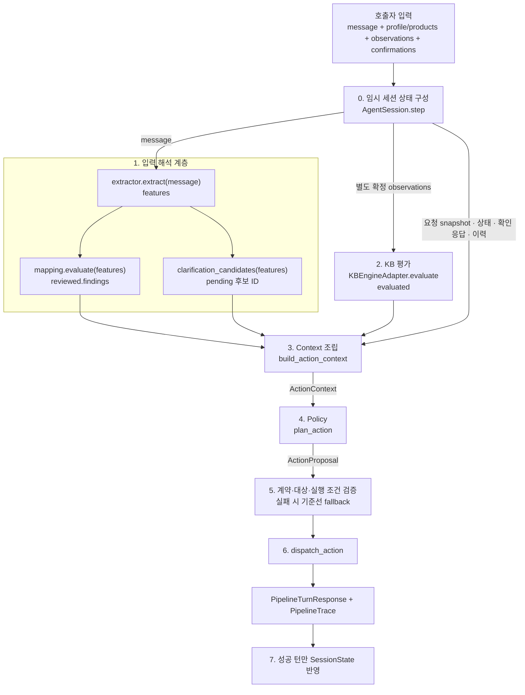

# Ppopy Architecture — 현재 코드와 데이터 흐름

**최신 설계는 Python 런타임이 전체 요청을 진행하고, AFA가 질문이 필요한 순간에 질문을 고르는 구조다.** 목표 구조도와 날씨·제품·추천 경계는 [Ppopy 목표 구조](../courses/ai-applications/experiments/cos-agent/docs/agent-runtime-target.md)에 있다. 아래는 기존 코드 호출 경로의 검토 기록이며, E26의 별도 PPO 실험 상태는 7절에 갱신했다.

> **NLP는 입력 해석 계층, Agent Runtime은 상태·실행 관리, Policy는 다음 행동 선택이다.**
>
> 논리적으로 NLP를 정책 판단 앞단에 두는 것이 자연스럽다. 다만 현재 코드는 NLP 전용 서버를 먼저 호출하는 구조가 아니라, **세션 실행 함수가 NLP와 KB를 호출해 정책 입력을 조립**한다. 이 문서는 논리 계층과 실제 호출 경계를 함께 표시한다.
>
> 기준: 2026-11-16, 코드 `d859780`. 합성 `development_preview`, `production_enabled=false`. RL 정책·실제 서비스 통합은 미완료다.

## 1. 먼저 구분할 것: 현재 실행 경로는 세 개다

| 경로 | 진입점 → 실제 처리 | 결과 |
| --- | --- | --- |
| **A. NLP 필드 추출 PoC** | `test_jev_text.py` → `extract_skin_state` → `prepare_handoff` | 백엔드 피부 상태 후보·제품 검색 질의·앱 전달 준비 |
| **B. 다중 턴 액션 루프** | `AgentSession.step` → `run_pipeline_turn` → `decide_action` → `dispatch_action` | 질문·확인·조회 대기·보류·합성 초안 |
| **C. 기존 HTTP 데모** | `POST /v1/agent/turn` → `agent.run_turn` | 필수 확인 질문 또는 합성 초안 |

**A → B → C로 연결되어 있지 않다.** B가 초안을 생성할 때 C와 같은 `run_turn` 함수를 재사용하지만 HTTP를 호출하지는 않는다.

이전 구조도는 이 경로들을 하나의 완성된 서비스 흐름처럼 배치했다. 아래에서는 **실제로 연결된 B를 중심으로** 설명하고 A·C는 별도 경로로 보여준다.

## 2. B 경로의 논리 계층과 사용 기술

| 계층 | 질문 | 구성·기술 | 실제 입력 → 출력 |
| --- | --- | --- | --- |
| **입력 해석: NLP** | 발화에 어떤 정보가 있는가? | `JevExtractorAdapter`, TypeSafe Jev 선택 연결, 기본 Kiwi/어휘 탐지 | `message` → `features` |
| **입력 해석: Mapping Review** | 추출 계약이 맞고 어떤 확인이 필요한가? | `MappingReviewAdapter`, Python·관계 schema 검토 | `features` → `reviewed.findings` |
| **상태·근거 준비** | 확정 관찰로 무엇을 판단할 수 있는가? | `SessionState`, Pydantic, `KBEngineAdapter`·Python PreviewEngine·JSON KB | 별도 확정 `observations` → `evaluated` |
| **판단 입력 조립** | 지금 어떤 행동이 가능한가? | `build_action_context`, Pydantic `ActionContext/ActionOffer` | 요청·후보·매핑·KB·상태·이력 → `ActionContext` |
| **선택: Policy** | 다음 행동과 대상은 무엇인가? | `ActionPlanner`, RuleBased / 선택적 Ollama, 향후 SFT·RL | `ActionContext` → `ActionProposal` |
| **실행: Agent Runtime** | 제안이 유효하며 무엇을 실행할 것인가? | `decide_action / validate_action / dispatch_action`, asyncio·검증·fallback | 제안 → 적용 행동·응답·trace |

**세션 실행 관리**는 이 계층 전체를 감싼다. `AgentSession.step()`은 입력을 임시 상태에 반영하고 파이프라인을 호출한 뒤 성공한 턴만 커밋한다.

여기서 **논리 계층**은 책임 구분이다. NLP를 별도 프로세스나 API로 배포했다는 의미가 아니다. 또한 파일 `action_runtime.py`의 책임은 주로 정책 호출·검증·dispatch이며, 세션 전체 관리는 `loop.py`에 있다.

## 3. 실제 데이터 파이프라인 — 두 입력이 Context에서 합쳐진다

아래 그림 전체는 `AgentSession.step()`이 관리하는 **현재 Python/CLI 호출 범위**다.



### 가장 중요한 데이터 경계

**`features → reviewed → observations → KB`라는 자동 변환은 없다.**

- `MappingReviewAdapter`의 findings는 Context와 trace에 들어간다. 확정 관찰을 만들지 않는다.
- `pending_clarifications`는 추출 features로 만든 확인 대상이다. 기존에 응답한 후보 ID는 제거한다.
- KB 입력은 호출자가 별도로 보낸 **`confirmed_by_user=True`인 ObservationSlot**이다. `product.*` 관찰은 이 입력 경로에서 거부한다.
- `CandidateConfirmation`을 받으면 해당 후보 응답을 기록하지만 **KB ObservationSlot을 자동 생성하지 않는다.**
- 따라서 후보 확인과 KB 관찰 갱신을 연결하는 앱/adapter 계약은 별도로 필요하다. NLP를 앞단에 배치해도 이 경계를 생략할 수 없다.

기본 KB 카드 선택도 확정 관찰에 의존한다. `card_ids`를 지정하지 않으면 관찰 키와 관련된 카드를 선택하므로, **발화에서 증상을 찾았다는 이유만으로 해당 KB 카드가 자동 활성화되지는 않는다.**

### 같은 데이터 이름으로 끝까지 추적하기

| 데이터 | 생성 위치 | 다음 소비자 | 의미 |
| --- | --- | --- | --- |
| `features` | `extractor.extract` | Mapping Review·후보 ID 생성·Context | 미확정 추출 결과 |
| `reviewed` | `mapping.evaluate` | Context·trace | 계약/매핑 검토 결과 |
| `confirmed_observations` | `AgentSession.step`의 정형 입력 검증 | KB·Context | 사용자가 확인한 관찰 |
| `evaluated` | `KBEngineAdapter.evaluate` | Context·trace | 카드 판정·ASK/RETRIEVE/HOLD 신호 |
| `ActionContext` | `build_action_context` | Planner·실행 게이트 | 정책 입력과 실행 가능 행동 목록 |
| `ActionProposal` | `plan_action` | `decide_action / validate_action` | 아직 실행 전인 정책 제안 |
| `ActionDecision` | `decide_action` | dispatcher·trace | 원안·적용안·검증·fallback 구분 |
| 응답·trace | dispatcher와 `run_pipeline_turn` | 호출자·세션 history | 질문/대기/초안과 실제 처리 결과 |

현재 Context에는 정형 상태뿐 아니라 **원문 message·request_snapshot·features·mapping_findings·history**도 포함된다. 전체 세션의 Context와 별도로 E26 B-C02 실험에는 15차원 정형 관찰 인코더가 있다. 세션은 이를 호출하지 않는다.

## 4. NLP를 앞 레이어로 빼는 것이 맞는가?

**책임을 설명하는 구조도에서는 맞다. 현재 코드에서 이미 외부화됐다고 그리면 틀리다.**

NLP는 “무엇을 말했는지” 해석하고 Policy는 “무엇을 더 확인할지” 선택한다. 그래서 위 그림처럼 NLP를 Context 조립과 Policy 앞의 독립 논리 계층으로 표현한다. 다만 실제 호출자는 여전히 `run_pipeline_turn()`이다.

| 현재 코드 사실 | 향후 물리 분리 시 필요한 변경 |
| --- | --- |
| `step(message, ...)`가 NLP 호출까지 포함 | 전처리 결과를 받는 명시적 입력 계약 필요 |
| `features`는 현재 함수 내부 중간 데이터 | 원문 revision·추출 schema/모델 버전·오류 상태 바인딩 필요 |
| NLP/Mapping 실패는 턴 미반영 | 분리 후에도 실패·재시도·중복 처리와 상태 원자성 유지 |
| 매 턴 발화가 새 후보를 만들 수 있음 | 이전 추출 결과의 중복 적용·오래된 결과 혼입 방지 |

따라서 이번 문서는 **NLP를 앞단 논리 계층으로 정리하되 서비스 분리 리팩터링은 수행하지 않는다.** 먼저 실제 데이터 계약을 확정해야 한다.

## 5. A 경로 — 현재 기본 Jev PoC는 B의 추출기와 다르다

```text
test_jev_text.py / run_input()   [기본: legacy=False]
  → skin_state.extract_skin_state(utterance, key)
      → 원문 chunk 분할
      → Jev로 6개 backend skin_state 필드 후보 판정
      → 별도 product_queries 생성
  → mapping_review.backend.prepare_handoff(...)
  → 후보 / 부족한 앱 입력 / 확인 binding / 비활성 payload
```

| 구분 | A: 기본 Jev PoC | B: 액션 루프 |
| --- | --- | --- |
| 추출 함수 | `skin_state.extract_skin_state` | `JevExtractorAdapter.extract` |
| 추출 대상 | backend 피부 상태 6필드 + 별도 제품 검색 질의 | `relations.extract_features` 계열 제품·증상·관계 후보 |
| 기본 실행 | Jev 필드 추출 경로 | 키 미주입 시 Kiwi·보수적 어휘 탐지 |
| 다음 단계 | `prepare_handoff` | Mapping Review → Context → Policy |
| 상태 갱신 | 앱 확인/계약 검증 후 payload 준비 | 정형 observations/confirmations를 step에 별도 전달 |

A의 9키 앱 payload에서 `kind`와 실제 `observed_at`은 앱의 확인 입력이며 추정하지 않는다. 후보·완성 입력·확인 binding을 구분하고, `prepared_disabled`도 서버 저장 권한이 아니다. 제품 질의도 검증된 제품 사실·보유 확인과 다르다.

**현재 A의 9키 payload를 B의 ObservationSlot으로 변환·주입하는 연결은 없다.** 두 입력 계약을 맞추는 adapter가 필요하다는 것이 코드 검토 결과다. 현재 테스트의 `extractor=` 주입 가능성과 이 통합의 구현 완료는 다른 말이다.

## 6. C 경로와 실제 출력의 의미

### 기존 HTTP API

```text
FastAPI POST /v1/agent/turn
  → agent.run_turn(TurnRequest)
  → missing_information(request)
      ├ 부족: planner.select_question → 확인 질문
      └ 충족: 로컬 합성 CATALOG의 표시 사용법 → Draft
```

이 경로는 `AgentSession`, Jev/Mapping, KB 액션 Context를 거치지 않는다. 기술은 **FastAPI·Uvicorn·Pydantic**, 질문 선택은 기준선 또는 설정된 Ollama다.

### B의 dispatcher가 실제로 하는 일

| 액션 | 결과 | 수행하지 않는 일 |
| --- | --- | --- |
| `ask_user / confirm_candidate / resolve_conflict` | `awaiting_user` | 질문 요청만으로 관찰 확정하지 않음 |
| `retrieve_evidence` | `awaiting_product_evidence` | 실제 검색·DB 조회 미구현 |
| `hold` | `held` | 진단·자동 개선 판정 아님 |
| `request_draft` | 조건 충족 시 `agent.run_turn` 재사용 | 승인·저장·개인별 효능 계산 아님 |

초안은 **로컬 합성 CATALOG의 표시 사용법**을 배열한다. KB 판정문을 그대로 맞춤 루틴으로 변환하는 생성기가 아니다. KB·후보·블로커는 초안 요청을 허용할지 제한한다. 유효한 요청에도 dispatcher가 실행 직전 다시 검사한다.

## 7. RL-AFA와 제품 서비스는 어디에 붙는가?

| 확장 | 정확한 연결 위치 | 상태 |
| --- | --- | --- |
| **AFA 질문 정책** | 목표 구조에서 런타임이 질문 분기에서 호출 | E26 별도 Gym 환경·15차원 인코더·6개 행동·마스크·초기화 검증. 해당 PPO는 0스텝이며 세션 연결은 목표 범위다 |
| **학습 데이터** | v67 verify/export → 향후 이벤트 환경·BC/RL 평가 | 3분할 합성 자료·변환기 있음. RL replay buffer 아님 |
| **실제 제품 근거 조회** | 현재 `await_product_evidence` 요청 처리 뒤의 별도 도구/결과 입력 계약 | 미연결 |
| **앱·DB** | 검증된 계정·동의·제품 문맥·확정 입력을 공급하고 결과를 저장할 서비스 경계 | 공개 실험에는 실제 인증·저장 통합 없음 |
| **스마트미러** | 승인·시각·revision·기한·중복 검사를 거친 표시 전달 서비스 | 출력 전용 통합 목표. 현재 루프 응답이 바로 표시 명령은 아님 |

RL 우선 방향은 [PPO-23](https://linear.app/ppopy/issue/PPO-23)을 따른다. Gymnasium·PyTorch·MaskablePPO는 제한된 E26 개발 실험에 사용한다. 서비스의 질문 정책을 같은 모델로 확정하는 결정은 별도다. v67의 미래 이벤트·작성 output·oracle을 정책 입력에 누출하지 않고, 정정·거절·미지원 전이를 보존하는 환경을 먼저 만든다. 자료는 [PPO-24](https://linear.app/ppopy/issue/PPO-24)를 따른다.

기존 앱/서비스 목표 기술인 React·TypeScript·Capacitor, AWS API Gateway/Lambda·Aurora PostgreSQL은 이 로컬 파이프라인의 실행 의존성과 구분한다. DB 매핑은 초안이며 완성된 저장 adapter가 아니다.

## 8. 소스 근거와 검증

모든 경로는 `courses/ai-applications/experiments/cos-agent/` 기준이다.

| 확인한 사실 | 소스 |
| --- | --- |
| 상태 staging, NLP/KB 호출 순서, 성공 턴 반영 | [loop.py — AgentSession.step / run_pipeline_turn](https://github.com/rnehdud/ppopy/blob/d859780f4ae8f2cd46d14ea2bcdf70dcb9b63873/courses/ai-applications/experiments/cos-agent/beauty_agent/loop.py) |
| 후보·KB·이력을 Context로 합치는 지점 | [actions.py — build_action_context](https://github.com/rnehdud/ppopy/blob/d859780f4ae8f2cd46d14ea2bcdf70dcb9b63873/courses/ai-applications/experiments/cos-agent/beauty_agent/actions.py) |
| Planner 호출·검증·fallback·dispatch | [action_runtime.py](https://github.com/rnehdud/ppopy/blob/d859780f4ae8f2cd46d14ea2bcdf70dcb9b63873/courses/ai-applications/experiments/cos-agent/beauty_agent/action_runtime.py) |
| 기본 offline 후보와 선택적 Jev | [jev_adapter.py](https://github.com/rnehdud/ppopy/blob/d859780f4ae8f2cd46d14ea2bcdf70dcb9b63873/courses/ai-applications/experiments/cos-agent/beauty_agent/modules/jev_adapter.py) |
| Mapping이 관찰을 생성하지 않는 경계 | [mapping_adapter.py](https://github.com/rnehdud/ppopy/blob/d859780f4ae8f2cd46d14ea2bcdf70dcb9b63873/courses/ai-applications/experiments/cos-agent/beauty_agent/modules/mapping_adapter.py) |
| 확정 관찰 입력과 카드 선택 | [kb_adapter.py](https://github.com/rnehdud/ppopy/blob/d859780f4ae8f2cd46d14ea2bcdf70dcb9b63873/courses/ai-applications/experiments/cos-agent/beauty_agent/modules/kb_adapter.py) |
| 기본 직접 필드 추출 PoC | [test_jev_text.py](https://github.com/rnehdud/ppopy/blob/d859780f4ae8f2cd46d14ea2bcdf70dcb9b63873/courses/ai-applications/experiments/cos-agent/poc/jev/test_jev_text.py), [skin_state.py](https://github.com/rnehdud/ppopy/blob/d859780f4ae8f2cd46d14ea2bcdf70dcb9b63873/courses/ai-applications/experiments/cos-agent/poc/jev/skin_state.py) |
| 별도 HTTP 경로·합성 초안 | [api.py](https://github.com/rnehdud/ppopy/blob/d859780f4ae8f2cd46d14ea2bcdf70dcb9b63873/courses/ai-applications/experiments/cos-agent/beauty_agent/api.py), [agent.py](https://github.com/rnehdud/ppopy/blob/d859780f4ae8f2cd46d14ea2bcdf70dcb9b63873/courses/ai-applications/experiments/cos-agent/beauty_agent/agent.py) |

이번 수정은 현재 코드의 호출·데이터 경계를 문서에 반영하는 작업이다. 코드·KB·원본 감사는 변경하지 않는다. 실제 Jev/Ollama 추론·RL 학습·DB/장치 통합 검증으로 해석하지 않는다.

이번 확인: 액션 루프·정책·후속 처리·HTTP 관련 테스트 **127개**, 직접 피부 상태 추출·backend handoff·제품 질의 테스트 **60개** 통과. 외부 추론 없이 합성/MockTransport 기반으로 검증했다. 기존 Starlette/httpx deprecation 경고 1건이 있었다. 전체 KB 검증을 이번 문서 개정에서 재실행한 것은 아니다.

원본 KB 엄격 테스트의 기존 5개 불일치와 동결 감사 52/57은 별도 보존한다. 관찰·근거·설계 가정·사람 판단을 구분하며 source-blind 동작을 유지한다. 실사용 수집·production·결제·얼굴 분석·자동 개선 판정을 활성화하지 않는다.
